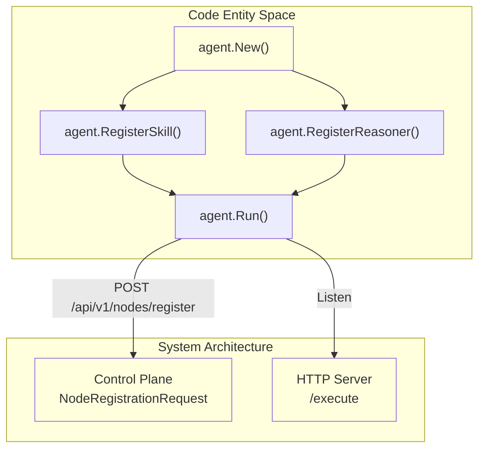
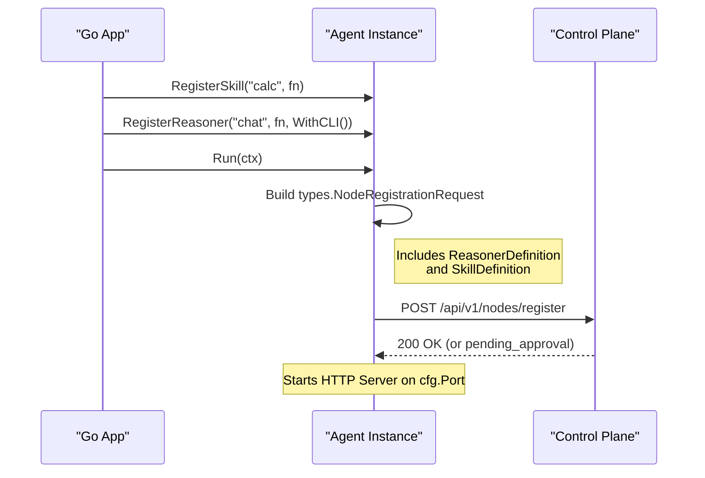

<!-- source: DeepWiki mcp.deepwiki.com · repo Agent-Field/agentfield · page 5.2 Registering Skills · fetched 2026-10-26 -->

# Registering Skills

<details>
<summary>Relevant source files</summary>

The following files were used as context for generating this wiki page:

- [docs/TESTING.md](docs/TESTING.md)
- [scripts/run-functional-tests.sh](scripts/run-functional-tests.sh)
- [sdk/go/agent/agent.go](sdk/go/agent/agent.go)
- [sdk/go/agent/agent_lifecycle.go](sdk/go/agent/agent_lifecycle.go)
- [sdk/go/agent/pause.go](sdk/go/agent/pause.go)
- [sdk/go/agent/pause_test.go](sdk/go/agent/pause_test.go)
- [sdk/go/agent/router.go](sdk/go/agent/router.go)
- [sdk/go/agent/router_test.go](sdk/go/agent/router_test.go)
- [sdk/go/agent/skill_registration_additional_test.go](sdk/go/agent/skill_registration_additional_test.go)
- [sdk/go/functional_test.go](sdk/go/functional_test.go)
- [sdk/go/harness/claudecode.go](sdk/go/harness/claudecode.go)
- [sdk/go/harness/coverage_branches_test.go](sdk/go/harness/coverage_branches_test.go)
- [sdk/go/harness/coverage_helpers_test.go](sdk/go/harness/coverage_helpers_test.go)
- [sdk/go/harness/parity_test.go](sdk/go/harness/parity_test.go)
- [sdk/go/harness/provider.go](sdk/go/harness/provider.go)
- [sdk/go/harness/result.go](sdk/go/harness/result.go)
- [sdk/go/harness/runner.go](sdk/go/harness/runner.go)
- [sdk/go/harness/runner_test.go](sdk/go/harness/runner_test.go)
- [sdk/go/harness/schema.go](sdk/go/harness/schema.go)
- [sdk/go/internal/testutil/testenv.go](sdk/go/internal/testutil/testenv.go)

</details>


## Purpose and Scope

This page documents how to register skills and reasoners in the Go SDK. In AgentField, **Skills** are deterministic, non-AI operations that an agent performs (e.g., API calls, calculations), while **Reasoners** are high-level handlers often involving AI logic. In the Go SDK, both are registered using the `Agent` instance before starting the server.

**Sources:** [sdk/go/agent/agent.go:121-153](), [sdk/go/agent/agent_lifecycle.go:126-184]()

---

## Code Entity Space to System Architecture

The following diagram bridges Go code entities to the system-level registration flow.

**Diagram: Go SDK Registration Flow**


**Sources:** [sdk/go/agent/agent_lifecycle.go:79-124](), [sdk/go/agent/agent_lifecycle.go:126-217]()

---

## Registering Skills

Skills represent deterministic capabilities. They are defined by a name and a handler function.

### Skill Handler Signature
The skill handler follows the `HandlerFunc` type:
`type HandlerFunc func(ctx context.Context, input map[string]any) (any, error)` [sdk/go/agent/agent.go:58-58]()

### Implementation Example
```go
agent.RegisterSkill("get_weather", func(ctx context.Context, input map[string]any) (any, error) {
    city, _ := input["city"].(string)
    // Deterministic logic here
    return map[string]string{"temp": "22C", "city": city}, nil
})
```

**Sources:** [sdk/go/agent/agent.go:57-59](), [sdk/go/agent/agent_lifecycle.go:145-153]()

---

## Registering Reasoners

Reasoners are registered using `RegisterReasoner`. Unlike skills, reasoners in Go support extensive metadata via `ReasonerOption` decorators.

### Reasoner Options (Decorators)
Metadata can be attached to reasoners during registration to control behavior in the Control Plane:

| Function | Purpose |
|----------|---------|
| `WithInputSchema` | Defines the JSON schema for input validation [sdk/go/agent/agent.go:64-70]() |
| `WithOutputSchema` | Defines the JSON schema for output validation [sdk/go/agent/agent.go:73-79]() |
| `WithCLI` | Marks the reasoner as accessible via the `af` CLI [sdk/go/agent/agent.go:82-86]() |
| `WithTriggers` | Binds external event sources (Webhooks/Schedules) [sdk/go/agent/agent.go:188-202]() |
| `WithDescription` | Adds a human-readable description for the UI [sdk/go/agent/agent.go:104-108]() |

### Trigger Bindings
Go agents can declare that a reasoner should be triggered by external events:
- **EventTrigger**: Binds to sources like GitHub, Stripe, or generic webhooks [sdk/go/agent/agent.go:158-163]().
- **ScheduleTrigger**: Binds to a cron expression [sdk/go/agent/agent.go:168-171]().

**Sources:** [sdk/go/agent/agent.go:60-120](), [sdk/go/agent/agent.go:188-225]()

---

## Data Flow: Registration to Execution

When `agent.Run()` is called, the SDK aggregates all registered skills and reasoners into a `NodeRegistrationRequest` [sdk/go/agent/agent_lifecycle.go:155-184]().

**Diagram: Capability Registration Data Flow**


**Sources:** [sdk/go/agent/agent_lifecycle.go:126-184](), [sdk/go/agent/agent_lifecycle.go:94-105]()

---

## Execution Context

Handlers receive a `context.Context` which contains execution metadata. This can be extracted into an `ExecutionContext` struct:

```go
// ExecutionContext captures headers like RunID and SessionID
type ExecutionContext struct {
    RunID             string
    ExecutionID       string
    SessionID         string
    ActorID           string
    // ...
}
```

This context allows the handler to be "aware" of its place in a larger workflow, enabling stateful memory access or multi-agent coordination.

**Sources:** [sdk/go/agent/agent.go:33-51]()

---

## Advanced: The Harness System

While skills are deterministic, Go agents can delegate complex autonomous tasks to the **Harness** system. The `harness.Runner` allows a Go agent to invoke "Coding Agents" (like Claude Code or OpenCode) to produce structured output based on a JSON schema.

### Harness Execution Pattern
1. **Initialize Runner**: `harness.NewRunner(options)` [sdk/go/harness/runner.go:28-33]().
2. **Run Task**: `runner.Run(ctx, prompt, schema, &dest, overrides)` [sdk/go/harness/runner.go:53-158]().
3. **Schema Enforcement**: The runner automatically handles prompt injection, output file tracking, and retries if the coding agent fails to produce valid JSON [sdk/go/harness/runner.go:140-144]().

**Sources:** [sdk/go/harness/runner.go:19-53](), [sdk/go/harness/result.go:49-71]()

---

