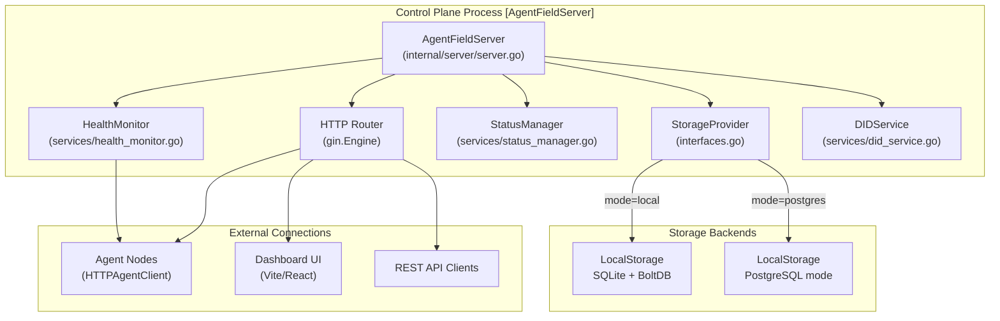
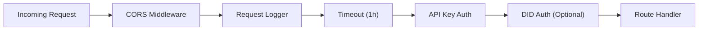

<!-- source: DeepWiki mcp.deepwiki.com · repo Agent-Field/agentfield · page 6 Control Plane · fetched 2026-10-26 -->

# Control Plane

Relevant source files

The following files were used as context for generating this wiki page:

- [.dockerignore](.dockerignore)
- [control-plane/cmd/af/main.go](control-plane/cmd/af/main.go)
- [control-plane/cmd/agentfield-server/main.go](control-plane/cmd/agentfield-server/main.go)
- [control-plane/config/agentfield.yaml](control-plane/config/agentfield.yaml)
- [control-plane/go.mod](control-plane/go.mod)
- [control-plane/go.sum](control-plane/go.sum)
- [control-plane/internal/config/config.go](control-plane/internal/config/config.go)
- [control-plane/internal/config/config_additional_test.go](control-plane/internal/config/config_additional_test.go)
- [control-plane/internal/server/middleware/auth.go](control-plane/internal/server/middleware/auth.go)
- [control-plane/internal/server/middleware/auth_admin_additional_test.go](control-plane/internal/server/middleware/auth_admin_additional_test.go)
- [control-plane/internal/server/middleware/auth_test.go](control-plane/internal/server/middleware/auth_test.go)
- [control-plane/internal/server/routes_admin.go](control-plane/internal/server/routes_admin.go)
- [control-plane/internal/server/routes_middleware.go](control-plane/internal/server/routes_middleware.go)
- [control-plane/internal/server/server.go](control-plane/internal/server/server.go)
- [control-plane/internal/server/server_additional_test.go](control-plane/internal/server/server_additional_test.go)
- [control-plane/internal/server/server_coverage_additional_test.go](control-plane/internal/server/server_coverage_additional_test.go)
- [deployments/docker/Dockerfile.control-plane](deployments/docker/Dockerfile.control-plane)
- [deployments/docker/Dockerfile.demo-go-agent](deployments/docker/Dockerfile.demo-go-agent)
- [deployments/docker/Dockerfile.go-agent](deployments/docker/Dockerfile.go-agent)
- [deployments/helm/agentfield/templates/control-plane-deployment.yaml](deployments/helm/agentfield/templates/control-plane-deployment.yaml)
- [docs/ENVIRONMENT_VARIABLES.md](docs/ENVIRONMENT_VARIABLES.md)
- [tests/functional/docker/agentfield-test.yaml](tests/functional/docker/agentfield-test.yaml)

The Control Plane is the central orchestration service in AgentField. It is a stateless Go-based HTTP server that manages agent discovery, routes execution requests between agents, tracks workflow state, and provides observability into the entire multi-agent system. The Control Plane does not execute agent logic itself—it coordinates and observes.

**Scope:** This page covers the Control Plane's architecture, core components, storage layer, API endpoints, and configuration. For details, see:
- [Server Configuration](#6.1) — Control plane startup options: `--port`, `--backend-only`, `--ui-dev`, `--no-vc-execution`, config files.
- [Storage Layer](#6.2) — `StorageProvider` interface, `LocalStorage` implementation, SQLite vs PostgreSQL modes.
- [Database Configuration](#6.3) — Configuring SQLite (WAL mode, pragmas) and PostgreSQL (connection pooling, FTS setup).
- [Agent Registration](#6.4) — How agents register with the control plane: capabilities, callback URLs, and discovery.
- [API Endpoints](#6.5) — Control plane REST API reference: `/api/v1/execute`, `/api/v1/nodes`, `/api/v1/memory`, etc.

---

## Architecture Overview

The Control Plane follows a hub-and-spoke architecture where it acts as the central coordination point for all agent nodes. It is designed to be stateless—all persistent state lives in the storage layer.

**Sources:**
- [control-plane/internal/server/server.go:47-104]()
- [control-plane/internal/server/server.go:123-134]()
- [control-plane/internal/config/config.go:17-25]()

---

## Core Components

### AgentFieldServer

The `AgentFieldServer` struct is the main entry point for the Control Plane. It orchestrates all subsystems and exposes HTTP/WebSocket endpoints via the `gin` framework [control-plane/internal/server/server.go:51]().

**Key Responsibilities:**
- **Lifecycle Management:** Creating infrastructure components like `ProcessManager` and `PortManager` [control-plane/internal/server/server.go:151-152]().
- **Agent Communication:** Initializing the `HTTPAgentClient` for dispatching requests to agent nodes [control-plane/internal/server/server.go:145]().
- **Status Coordination:** Using `StatusManager` to reconcile agent health and heartbeats [control-plane/internal/server/server.go:158-171]().
- **Identity:** Managing Decentralized Identifiers (DIDs) and Verifiable Credentials (VCs) via `didService` and `vcService` [control-plane/internal/server/server.go:64-65]().

**Sources:**
- [control-plane/internal/server/server.go:47-104]()
- [control-plane/internal/server/server.go:145-171]()

### Storage Provider Interface

The `StorageProvider` interface defines all persistence operations. The Control Plane uses a `StorageFactory` to instantiate the correct backend based on the `StorageConfig` [control-plane/internal/server/server.go:123-127]().

| Category | Purpose | Code Reference |
|----------|---------|----------------|
| **Local Mode** | SQLite for relations, BoltDB for KV | [control-plane/internal/config/config.go:193-197]() |
| **Postgres Mode** | Full PostgreSQL with connection pooling | [control-plane/internal/config/config.go:199-210]() |
| **Vector** | Embedding search (pgvector fallback) | [control-plane/internal/config/config.go:212-215]() |

For details, see [Storage Layer](#6.2).

---

## Server Configuration

The server is configured primarily through `control-plane/config/agentfield.yaml` and environment variables. Key startup options include:

- **Port:** Default `8080` [control-plane/config/agentfield.yaml:2]().
- **Authentication:** Enforced via `APIKeyAuth` middleware using `X-API-Key` or `Authorization: Bearer` [control-plane/internal/server/middleware/auth.go:19-146]().
- **CORS:** Configurable allowed origins, methods, and headers for browser clients [control-plane/internal/server/routes_middleware.go:19-38]().
- **Redaction:** `redact_payloads` (default `true`) prevents sensitive input/output data from appearing in logs [control-plane/internal/config/config.go:38-41]().

**Startup Logic:**
The entry point in `control-plane/cmd/af/main.go` parses flags like `--backend-only` and `--ui-dev` to toggle the embedded UI [control-plane/cmd/af/main.go:136-144]().

**Sources:**
- [control-plane/internal/config/config.go:17-151]()
- [control-plane/internal/server/middleware/auth.go:20-146]()
- [control-plane/cmd/af/main.go:53-219]()

---

## Security & Middleware

The Control Plane implements a robust middleware stack to protect the orchestration layer:

1. **API Key Auth:** Validates requests using constant-time comparison [control-plane/internal/server/middleware/auth.go:121]().
2. **DID Auth:** Optional cryptographic identity verification [control-plane/internal/server/routes_middleware.go:90-102]().
3. **Admin Auth:** Separate `X-Admin-Token` requirement for sensitive management routes [control-plane/internal/server/middleware/auth.go:166-185]().
4. **Timeout:** Global 1-hour timeout for long-running AI agent executions [control-plane/internal/server/routes_middleware.go:54-62]().

**Sources:**
- [control-plane/internal/server/routes_middleware.go:18-110]()
- [control-plane/internal/server/middleware/auth.go:1-186]()

---

## Agent Registration & Discovery

Agents register by providing their `node_id`, `callback_url`, and capabilities (reasoners and skills). The Control Plane tracks these in the registry and uses a `StatusManager` to monitor liveness via heartbeats [control-plane/internal/server/server.go:158-171]().

For details on the registration handshake and capability discovery, see [Agent Registration](#6.4).

**Sources:**
- [control-plane/internal/server/server.go:155-171]()
- [control-plane/internal/config/config.go:122-130]()

---

