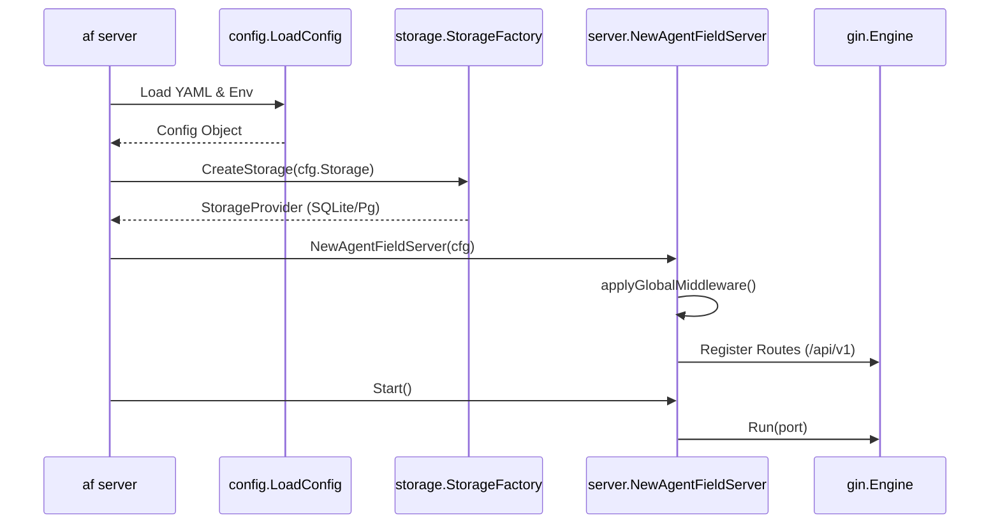
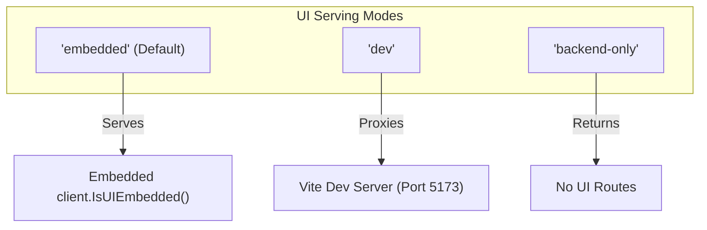

<!-- source: DeepWiki mcp.deepwiki.com · repo Agent-Field/agentfield · page 6.1 Server Configuration · fetched 2026-10-26 -->

# Server Configuration

<details>
<summary>Relevant source files</summary>

The following files were used as context for generating this wiki page:

- [control-plane/cmd/af/main.go](control-plane/cmd/af/main.go)
- [control-plane/cmd/agentfield-server/main.go](control-plane/cmd/agentfield-server/main.go)
- [control-plane/config/agentfield.yaml](control-plane/config/agentfield.yaml)
- [control-plane/internal/config/config.go](control-plane/internal/config/config.go)
- [control-plane/internal/config/config_additional_test.go](control-plane/internal/config/config_additional_test.go)
- [control-plane/internal/server/middleware/auth.go](control-plane/internal/server/middleware/auth.go)
- [control-plane/internal/server/middleware/auth_admin_additional_test.go](control-plane/internal/server/middleware/auth_admin_additional_test.go)
- [control-plane/internal/server/middleware/auth_test.go](control-plane/internal/server/middleware/auth_test.go)
- [control-plane/internal/server/routes_admin.go](control-plane/internal/server/routes_admin.go)
- [control-plane/internal/server/routes_middleware.go](control-plane/internal/server/routes_middleware.go)
- [control-plane/internal/server/server.go](control-plane/internal/server/server.go)
- [control-plane/internal/server/server_additional_test.go](control-plane/internal/server/server_additional_test.go)
- [control-plane/internal/server/server_coverage_additional_test.go](control-plane/internal/server/server_coverage_additional_test.go)
- [deployments/helm/agentfield/templates/control-plane-deployment.yaml](deployments/helm/agentfield/templates/control-plane-deployment.yaml)
- [docs/ENVIRONMENT_VARIABLES.md](docs/ENVIRONMENT_VARIABLES.md)
- [tests/functional/docker/agentfield-test.yaml](tests/functional/docker/agentfield-test.yaml)

</details>


This page documents how to configure and start the AgentField control plane server. It covers command-line flags, configuration files, environment variables, and runtime options for the core orchestration service.

---

## Overview

The AgentField control plane is the central orchestration hub. It is started using the `af server` command (or the legacy `agentfield-server` binary). It is a Go service built on the Gin web framework that manages agent registrations, execution routing, and cryptographic identity.

**Key Components:**
- **StorageProvider:** Interface for persistence (SQLite or PostgreSQL). [control-plane/internal/server/server.go:49-49]()
- **AgentService:** Manages agent lifecycle and process management. [control-plane/internal/server/server.go:155-155]()
- **StatusManager:** Unified status and health tracking for agent nodes. [control-plane/internal/server/server.go:168-168]()
- **DID/VC Services:** Handles identity and verifiable credential generation. [control-plane/internal/server/server.go:63-70]()

**Sources:** [control-plane/internal/server/server.go:46-104](), [control-plane/cmd/af/main.go:53-219]()

---

## Starting the Server

The server can be started via the unified CLI:

```bash
af server
```

Upon startup, the server initializes data directories (defaulting to `~/.agentfield`), sets up the storage provider, and begins listening for HTTP and gRPC traffic.

### Startup Sequence



**Sources:** [control-plane/cmd/af/main.go:171-190](), [control-plane/internal/server/server.go:107-168](), [control-plane/internal/server/routes_middleware.go:18-110]()

---

## Command-Line Flags

The `af server` command (implemented via Cobra) supports several flags that override configuration file settings.

| Flag | Type | Default | Description |
|------|------|---------|-------------|
| `--port` | int | 8080 | HTTP server port. [control-plane/cmd/af/main.go:64-67]() |
| `--config` | string | "" | Path to custom `agentfield.yaml`. [control-plane/cmd/af/main.go:57-57]() |
| `--backend-only` | bool | false | Disables the Web UI entirely. [control-plane/cmd/af/main.go:137-139]() |
| `--ui-dev` | bool | false | Proxies UI requests to Vite dev server (port 5173). [control-plane/cmd/af/main.go:140-144]() |
| `--no-vc-execution` | bool | false | Disables Verifiable Credential generation for executions. [control-plane/cmd/af/main.go:147-151]() |
| `--storage-mode` | string | "local" | Force storage mode (`local` or `postgres`). [control-plane/cmd/af/main.go:77-82]() |
| `--open` | bool | true | Automatically open the browser to the dashboard. [control-plane/cmd/af/main.go:195-213]() |

**Sources:** [control-plane/cmd/af/main.go:63-151](), [control-plane/cmd/agentfield-server/main.go:84-190]()

---

## Configuration File

The server primary configuration is defined in `agentfield.yaml`. The loader searches for this file in the current directory, `~/.agentfield/`, or `/etc/agentfield/`.

### Core Configuration Sections

| Section | Code Entity | Description |
|---------|-------------|-------------|
| `agentfield` | `AgentFieldConfig` | Port, timeouts, and execution queue settings. [control-plane/internal/config/config.go:70-82]() |
| `storage` | `StorageConfig` | Database mode and connection details. [control-plane/internal/config/config.go:20-20]() |
| `features.did` | `DIDConfig` | DID method, key rotation, and VC requirements. [control-plane/config/agentfield.yaml:85-105]() |
| `api.cors` | `CORSConfig` | Allowed origins and headers for the Gin router. [control-plane/config/agentfield.yaml:29-55]() |
| `logging` | `LoggingConfig` | Log level and payload redaction. [control-plane/internal/config/config.go:28-36]() |

**Sources:** [control-plane/internal/config/config.go:17-25](), [control-plane/config/agentfield.yaml:1-173]()

---

## Environment Variables

AgentField uses Viper to map environment variables to configuration keys using the `AGENTFIELD_` prefix and underscores for nesting.

| Environment Variable | Config Path | Description |
|----------------------|-------------|-------------|
| `AGENTFIELD_PORT` | `agentfield.port` | Server listen port. [control-plane/cmd/af/main.go:70-74]() |
| `AGENTFIELD_STORAGE_MODE` | `storage.mode` | `local` (SQLite) or `postgres`. [control-plane/cmd/af/main.go:85-88]() |
| `AGENTFIELD_POSTGRES_URL` | `storage.postgres.url` | Full PostgreSQL connection string. [control-plane/cmd/af/main.go:90-108]() |
| `AGENTFIELD_API_KEY` | `api.auth.api_key` | Global API key for endpoint protection. [control-plane/internal/server/middleware/auth.go:32-40]() |
| `AGENTFIELD_HOME` | N/A | Base directory for data/keys (default `~/.agentfield`). [control-plane/internal/server/server.go:109-116]() |

**Sources:** [docs/ENVIRONMENT_VARIABLES.md:1-130](), [control-plane/cmd/af/main.go:70-129]()

---

## Authentication and Security

The server enforces security through multiple layers of middleware applied in `applyGlobalMiddleware()`.

### API Key Authentication
Enforced via `middleware.APIKeyAuth`. It checks the `X-API-Key` header or `Authorization: Bearer` token.
- **Exemptions:** Health checks, metrics, public DID documents, and UI static files. [control-plane/internal/server/middleware/auth.go:54-71]()
- **Streaming:** Browser-based EventSource/WebSockets can use the `api_key` query parameter for specific allowlisted paths. [control-plane/internal/server/middleware/auth.go:117-119]()

### DID Authentication
When `features.did.authorization.did_auth_enabled` is true, the server validates `X-DID-Signature` and `X-Caller-DID` headers. [control-plane/internal/server/routes_middleware.go:90-102]()

### Admin Authentication
Routes under `/api/admin/v1` require an `X-Admin-Token` as configured in the `AuthorizationConfig`. [control-plane/internal/server/middleware/auth.go:166-185]()

**Sources:** [control-plane/internal/server/middleware/auth.go:19-146](), [control-plane/internal/server/routes_middleware.go:64-102]()

---

## UI Configuration

The control plane includes a React-based dashboard. Its behavior is controlled by the `ui` config block.



- **Embedded:** Static assets are bundled into the Go binary using `go:embed`. [control-plane/cmd/af/main.go:154-163]()
- **Dev Mode:** Useful for frontend development. The server proxies UI requests while maintaining API logic. [control-plane/cmd/af/main.go:140-144]()

**Sources:** [control-plane/cmd/af/main.go:136-163](), [control-plane/internal/config/config.go:61-67]()

---

## Storage Layer Setup

The server uses a `StorageFactory` to initialize the persistence layer.

### Local Mode (SQLite + BoltDB)
- **SQLite:** Stores structured data (agents, executions, workflows). [control-plane/config/agentfield.yaml:71-71]()
- **BoltDB:** Acts as the high-performance Key-Value store for agent memory. [control-plane/config/agentfield.yaml:72-72]()

### PostgreSQL Mode
- Recommended for production.
- Requires `pgvector` for vector memory operations. [control-plane/config/agentfield.yaml:80-82]()
- Configured via `AGENTFIELD_POSTGRES_URL` or individual host/port variables. [control-plane/cmd/af/main.go:90-129]()

**Sources:** [control-plane/internal/server/server.go:123-127](), [control-plane/config/agentfield.yaml:68-82]()

---

