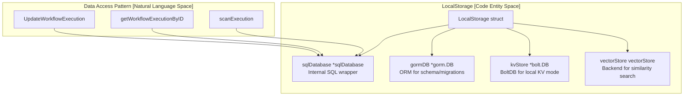
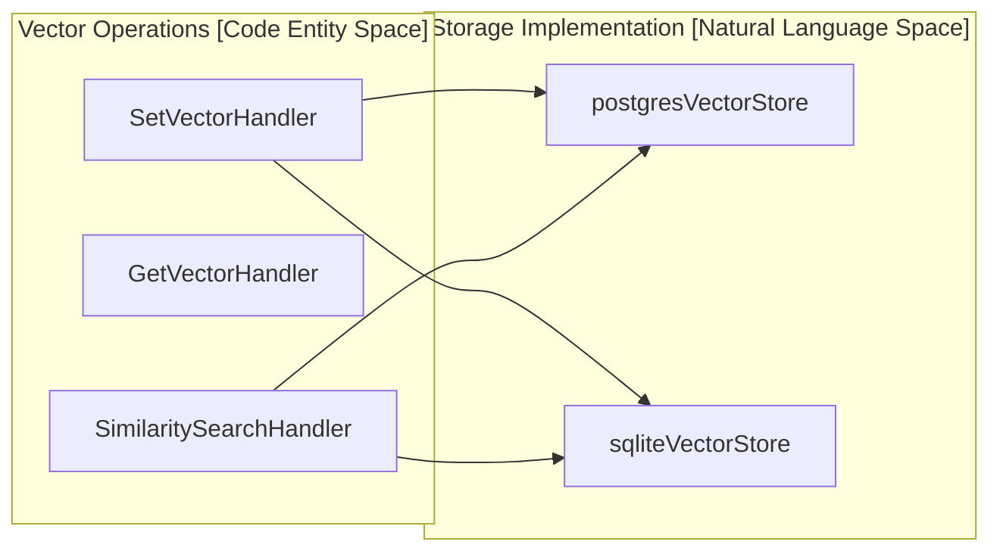

<!-- source: DeepWiki mcp.deepwiki.com · repo Agent-Field/agentfield · page 6.2 Storage Layer · fetched 2026-10-26 -->

# Storage Layer

Relevant source files

The following files were used as context for generating this wiki page:

- [control-plane/internal/handlers/memory.go](control-plane/internal/handlers/memory.go)
- [control-plane/internal/handlers/memory_handler_test.go](control-plane/internal/handlers/memory_handler_test.go)
- [control-plane/internal/handlers/ui/dashboard.go](control-plane/internal/handlers/ui/dashboard.go)
- [control-plane/internal/handlers/ui/dashboard_aggregate.go](control-plane/internal/handlers/ui/dashboard_aggregate.go)
- [control-plane/internal/handlers/ui/dashboard_cache.go](control-plane/internal/handlers/ui/dashboard_cache.go)
- [control-plane/internal/handlers/ui/dashboard_format.go](control-plane/internal/handlers/ui/dashboard_format.go)
- [control-plane/internal/handlers/vector_memory.go](control-plane/internal/handlers/vector_memory.go)
- [control-plane/internal/handlers/vector_memory_test.go](control-plane/internal/handlers/vector_memory_test.go)
- [control-plane/internal/server/server_routes_test.go](control-plane/internal/server/server_routes_test.go)
- [control-plane/internal/storage/execution_records.go](control-plane/internal/storage/execution_records.go)
- [control-plane/internal/storage/local.go](control-plane/internal/storage/local.go)
- [control-plane/internal/storage/storage.go](control-plane/internal/storage/storage.go)
- [control-plane/internal/storage/time_parsing_test.go](control-plane/internal/storage/time_parsing_test.go)
- [control-plane/internal/storage/vector_store.go](control-plane/internal/storage/vector_store.go)
- [control-plane/internal/storage/vector_store_postgres.go](control-plane/internal/storage/vector_store_postgres.go)
- [control-plane/internal/storage/vector_store_sqlite.go](control-plane/internal/storage/vector_store_sqlite.go)
- [control-plane/pkg/types/execution.go](control-plane/pkg/types/execution.go)

The Storage Layer provides the persistence backend for the AgentField control plane. It abstracts database operations behind the `StorageProvider` interface and supports two operational modes: **local** mode using SQLite + BoltDB, and **postgres** mode using PostgreSQL. This layer handles agent registry, workflow executions, memory storage, DID/VC records, and all other persistent state.

For API endpoints that interact with storage, see [API Endpoints](#6.5). For database configuration details, see [Database Configuration](#6.3). For memory-specific operations, see [Memory System](#7).

**Sources:** [control-plane/internal/storage/storage.go:1-11]() [control-plane/internal/storage/local.go:1-30]()

## StorageProvider Interface

The `StorageProvider` interface defines the contract for all storage backends. It encompasses lifecycle management, execution tracking, workflow state, memory operations, agent registry, DID/VC management, and distributed locking.

```mermaid
graph TB
    subgraph "StorageProvider Interface"
        Lifecycle["Lifecycle Methods<br/>Initialize()<br/>Close()<br/>HealthCheck()"]
        Execution["Execution Operations<br/>StoreExecution()<br/>GetExecution()<br/>QueryExecutions()"]
        Workflow["Workflow Operations<br/>StoreWorkflowExecution()<br/>GetWorkflowExecution()<br/>QueryWorkflowExecutions()<br/>UpdateWorkflowExecution()"]
        Memory["Memory Operations<br/>SetMemory()<br/>GetMemory()<br/>DeleteMemory()<br/>ListMemory()"]
        Vector["Vector Operations<br/>SetVector()<br/>DeleteVector()<br/>SimilaritySearch()"]
        Agent["Agent Registry<br/>RegisterAgent()<br/>GetAgent()<br/>ListAgents()<br/>UpdateAgentHealth()"]
        DID["DID Registry<br/>StoreDID()<br/>GetDID()<br/>StoreAgentDID()<br/>StoreComponentDID()"]
        VC["VC Operations<br/>StoreExecutionVC()<br/>GetExecutionVC()<br/>StoreWorkflowVC()"]
        Lock["Distributed Locks<br/>AcquireLock()<br/>ReleaseLock()<br/>RenewLock()"]
        Event["Event Operations<br/>StoreEvent()<br/>GetEventHistory()<br/>PublishMemoryChange()"]
    end
    
    Lifecycle --> Implementation["LocalStorage<br/>NewLocalStorage()<br/>NewPostgresStorage()"]
    Execution --> Implementation
    Workflow --> Implementation
    Memory --> Implementation
    Vector --> Implementation
    Agent --> Implementation
    DID --> Implementation
    VC --> Implementation
    Lock --> Implementation
    Event --> Implementation
```

**Key interface method groups:**

| Category | Methods | Purpose |
|----------|---------|---------|
| Lifecycle | `Initialize()`, `Close()`, `HealthCheck()` | Database connection management [control-plane/internal/storage/storage.go:45-57]() |
| Executions | `StoreExecution()`, `GetExecution()`, `QueryExecutions()` | Agent execution records [control-plane/internal/storage/storage.go:59-71]() |
| Workflows | `StoreWorkflowExecution()`, `GetWorkflowExecution()`, `UpdateWorkflowExecution()` | Workflow state tracking [control-plane/internal/storage/storage.go:73-89]() |
| Memory | `SetMemory()`, `GetMemory()`, `DeleteMemory()`, `ListMemory()` | Key-value memory operations [control-plane/internal/handlers/memory.go:16-20]() |
| Vectors | `SetVector()`, `DeleteVector()`, `SimilaritySearch()` | Vector embeddings for RAG [control-plane/internal/handlers/memory.go:23-27]() |

**Sources:** [control-plane/internal/storage/storage.go:44-127]() [control-plane/internal/handlers/memory.go:16-28]()

## LocalStorage Implementation

The `LocalStorage` struct implements `StorageProvider` and operates in two distinct modes: **local** (SQLite + BoltDB) and **postgres** (PostgreSQL). It utilizes the `DBTX` interface to allow execution of queries against both standard database connections and active transactions.

**Key functions for Execution Tracking:**
- `CreateExecutionRecord`: Inserts a new execution row into the `executions` table [control-plane/internal/storage/execution_records.go:19-85]().
- `GetExecutionRecord`: Fetches a single execution by `execution_id` [control-plane/internal/storage/execution_records.go:88-110]().
- `UpdateExecutionRecord`: Applies an update callback atomically within a transaction [control-plane/internal/storage/execution_records.go:114-222]().
- `QueryExecutionRecords`: Runs a filtered query based on `ExecutionFilter` [control-plane/internal/storage/execution_records.go:225-260]().

**Sources:** [control-plane/internal/storage/execution_records.go:1-260]() [control-plane/internal/storage/local.go:69-160]()

## SQLite Mode vs PostgreSQL Mode

The system dynamically adapts its behavior based on the configured backend.

### SQLite Mode (Local)
In local mode, AgentField uses SQLite for relational data and BoltDB for key-value memory buckets.
- **Concurrency**: Configured with `WAL` (Write-Ahead Logging) to allow concurrent reads [control-plane/internal/storage/local.go:807-823]().
- **Vector Storage**: Implemented via `sqliteVectorStore`, which stores embeddings as blobs and performs in-memory similarity computation [control-plane/internal/storage/vector_store_sqlite.go:13-23]().
- **Key-Value**: Uses BoltDB buckets (e.g., `workflow`, `session`, `actor`) for memory operations [control-plane/internal/handlers/memory_handler_test.go:32-34]().

### PostgreSQL Mode
In PostgreSQL mode, all data resides in the relational database.
- **Concurrency**: Leverages PostgreSQL's native MVCC and connection pooling [control-plane/internal/storage/vector_store_postgres.go:15-25]().
- **Vector Storage**: Implemented via `postgresVectorStore`, utilizing the `pgvector` extension (using `::vector` and `::jsonb` casts) for efficient database-level similarity search [control-plane/internal/storage/vector_store_postgres.go:41-48]().
- **Memory**: Stores key-value data in a dedicated table rather than BoltDB buckets.

**Sources:** [control-plane/internal/storage/vector_store_sqlite.go:1-23]() [control-plane/internal/storage/vector_store_postgres.go:1-66]() [control-plane/internal/storage/local.go:807-823]()

## Vector Memory Layer

The Vector Storage system provides RAG capabilities across different scopes.

### Distance Metrics
The system supports multiple distance metrics for vector similarity search:
- **Cosine Distance**: Default metric for similarity.
- **L2 (Euclidean)**: Supported via `VectorDistanceL2`.
- **Dot Product**: Supported via `VectorDistanceDot`.

In PostgreSQL, these map to specific operators like `<->` (L2), `<#>` (Dot), and `<=>` (Cosine) [control-plane/internal/storage/vector_store_postgres.go:238-250]().

### Similarity Search
The `Search` operation filters by `scope` and `scope_id` (e.g., a specific `workflow_id` or `session_id`) and can optionally apply metadata filters using JSONB operators in PostgreSQL [control-plane/internal/storage/vector_store_postgres.go:153-180]().

**Sources:** [control-plane/internal/handlers/vector_memory.go:39-86]() [control-plane/internal/storage/vector_store_postgres.go:238-250]() [control-plane/internal/storage/vector_store_sqlite.go:144-209]()

## Dashboard Aggregation

The Storage Layer provides specialized aggregation methods for the UI Dashboard. The `QueryRunSummaries` method aggregates individual execution records into `RunSummaryAggregation` objects [control-plane/internal/storage/storage.go:13-30]().

This aggregation calculates:
- Total executions per run.
- Status counts (Success vs Failure).
- Earliest and latest start times.
- Root execution details (Reasoner ID, Agent Node ID).

**Sources:** [control-plane/internal/storage/storage.go:13-30]() [control-plane/internal/handlers/ui/dashboard.go:108-120]() [control-plane/internal/storage/storage.go:106-109]()

---

