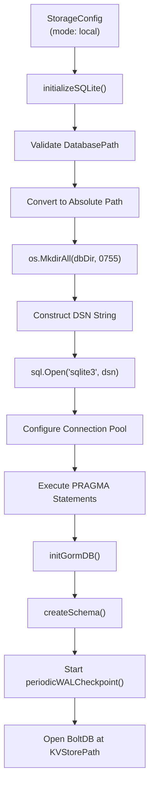
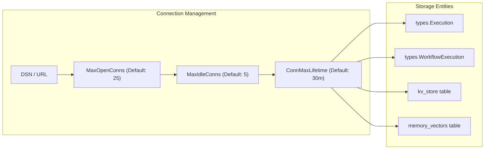
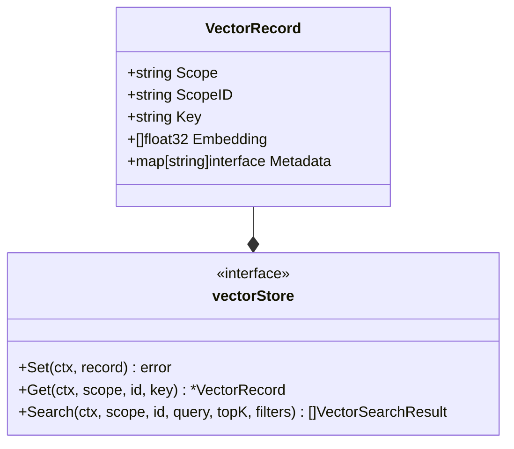

<!-- source: DeepWiki mcp.deepwiki.com · repo Agent-Field/agentfield · page 6.3 Database Configuration · fetched 2026-10-26 -->

# Database Configuration

<details>
<summary>Relevant source files</summary>

The following files were used as context for generating this wiki page:

- [control-plane/internal/core/services/dev_service_test.go](control-plane/internal/core/services/dev_service_test.go)
- [control-plane/internal/events/events_test.go](control-plane/internal/events/events_test.go)
- [control-plane/internal/handlers/memory.go](control-plane/internal/handlers/memory.go)
- [control-plane/internal/handlers/memory_handler_test.go](control-plane/internal/handlers/memory_handler_test.go)
- [control-plane/internal/handlers/vector_memory.go](control-plane/internal/handlers/vector_memory.go)
- [control-plane/internal/handlers/vector_memory_test.go](control-plane/internal/handlers/vector_memory_test.go)
- [control-plane/internal/server/server_routes_test.go](control-plane/internal/server/server_routes_test.go)
- [control-plane/internal/storage/local.go](control-plane/internal/storage/local.go)
- [control-plane/internal/storage/local_cleanup_test.go](control-plane/internal/storage/local_cleanup_test.go)
- [control-plane/internal/storage/postgres_test.go](control-plane/internal/storage/postgres_test.go)
- [control-plane/internal/storage/storage.go](control-plane/internal/storage/storage.go)
- [control-plane/internal/storage/storage_parity_test.go](control-plane/internal/storage/storage_parity_test.go)
- [control-plane/internal/storage/vector_store.go](control-plane/internal/storage/vector_store.go)
- [control-plane/internal/storage/vector_store_postgres.go](control-plane/internal/storage/vector_store_postgres.go)
- [control-plane/internal/storage/vector_store_sqlite.go](control-plane/internal/storage/vector_store_sqlite.go)

</details>


## Purpose and Scope

This document describes how to configure the database backends used by the AgentField control plane. AgentField supports two storage modes: **SQLite** for local development and **PostgreSQL** for production deployments. This page covers connection parameters, performance tuning, schema initialization, and vector storage setup.

For information about the storage layer architecture and interfaces, see [Storage Layer](6.2). For general control plane configuration options, see [Server Configuration](6.1).

---

## Configuration Modes

AgentField's storage layer operates in one of two modes, determined by the `mode` field in the `StorageConfig`:

| Mode | Primary Database | Key-Value Store | Use Case |
|------|-----------------|-----------------|----------|
| `local` | SQLite | BoltDB | Development, single-node deployments |
| `postgres` | PostgreSQL | PostgreSQL tables | Production, distributed deployments |

The mode is typically set via the `AGENTFIELD_STORAGE_MODE` environment variable.

**Sources:** [control-plane/internal/storage/storage.go:207-213](), [control-plane/internal/storage/storage.go:260-272]()

---

## SQLite Configuration

### Database Path and Initialization

In `local` mode, the `LocalStorage` implementation handles SQLite initialization. It automatically converts relative paths to absolute paths and ensures the database directory exists.



**Sources:** [control-plane/internal/storage/local.go:504-586]()

### WAL Mode and Performance Pragmas

The SQLite DSN is constructed with specific parameters optimized for the AgentField workflow engine, specifically utilizing Write-Ahead Logging (WAL) for concurrent read/write performance.

| Parameter | Value | Purpose |
|-----------|-------|---------|
| `_journal_mode` | `WAL` | Enables concurrent reads and writes |
| `_synchronous` | `NORMAL` | Optimized for WAL mode durability |
| `_busy_timeout` | Configurable | Prevents "database is locked" errors during contention |
| `_foreign_keys` | `ON` | Enforces relational integrity |
| `_wal_autocheckpoint`| `1000` | Triggers automatic WAL checkpoints |

**Sources:** [control-plane/internal/storage/local.go:534-540](), [control-plane/internal/storage/local.go:557-567]()

### SQLite Vector Storage

When using SQLite, vector embeddings are stored in the `memory_vectors` table. Since SQLite lacks a native vector type, embeddings are encoded as binary blobs.

- **Encoding**: `encodeEmbedding` converts `[]float32` to little-endian bytes. [control-plane/internal/storage/vector_store.go:43-49]()
- **Search**: Performed via `sqliteVectorStore.Search`, which performs an exhaustive scan (flat search) and computes similarity in-memory using `computeSimilarity`. [control-plane/internal/storage/vector_store_sqlite.go:144-209]()

---

## PostgreSQL Configuration

### Connection Pooling and Management

PostgreSQL mode is implemented via `NewPostgresStorage`. It manages a connection pool using the standard library `sql.DB` with `pgx` as the driver.



**Sources:** [control-plane/internal/storage/local.go:706-728](), [control-plane/internal/storage/postgres_test.go:25-33]()

### Automatic Database Creation

If the target database does not exist, the storage provider attempts to connect to the `AdminDatabase` (defaulting to `postgres`) to execute `CREATE DATABASE`.

**Sources:** [control-plane/internal/storage/local.go:730-800]()

### Full-Text Search (FTS) and Vectors

PostgreSQL mode leverages advanced features for agent performance:

1.  **FTS Setup**: Creates a `workflow_executions_fts` table and a GIN index on a `TSVECTOR` column to allow fast searching of workflow logs and metadata. [control-plane/internal/storage/local.go:973-1029]()
2.  **Vector Store**: Uses the `pgvector` extension. The `postgresVectorStore` handles `ON CONFLICT` upserts and similarity searches using native PostgreSQL operators like `<->` (L2) and `<=>` (Cosine). [control-plane/internal/storage/vector_store_postgres.go:27-65](), [control-plane/internal/storage/vector_store_postgres.go:238-250]()

---

## Memory and Vector Schema

The storage layer provides a unified interface for both standard memory and vector memory across both backends.

### Key-Value Store (Memory)
In PostgreSQL, memory is stored in the `kv_store` table, supporting multiple scopes (workflow, session, actor, global).

```sql
CREATE TABLE kv_store (
    scope TEXT NOT NULL,
    scope_id TEXT NOT NULL,
    key TEXT NOT NULL,
    value JSONB NOT NULL,
    updated_at TIMESTAMPTZ NOT NULL DEFAULT NOW(),
    PRIMARY KEY (scope, scope_id, key)
);
```
**Sources:** [control-plane/internal/storage/local.go:912-925]()

### Vector Storage (RAG Support)
Vector records include the embedding, metadata, and scope information.



**Sources:** [control-plane/internal/storage/vector_store.go:16-22](), [control-plane/pkg/types/types.go]() (implied)

---

## Initialization Flow

The `StorageFactory` determines the backend at runtime.

1.  **Factory Selection**: Based on `StorageConfig.Mode`. [control-plane/internal/storage/storage.go:260-307]()
2.  **Lifecycle**: `Initialize` is called, which triggers backend-specific setup (`initializeSQLite` or `initializePostgres`). [control-plane/internal/storage/local.go:504-586](), [control-plane/internal/storage/local.go:601-728]()
3.  **Schema Enforcement**: `createSchema` runs migrations, ensures tables, and creates indexes. [control-plane/internal/storage/local.go:826-858]()

**Sources:** [control-plane/internal/storage/local.go:504-858](), [control-plane/internal/storage/storage.go:260-307]()

---

