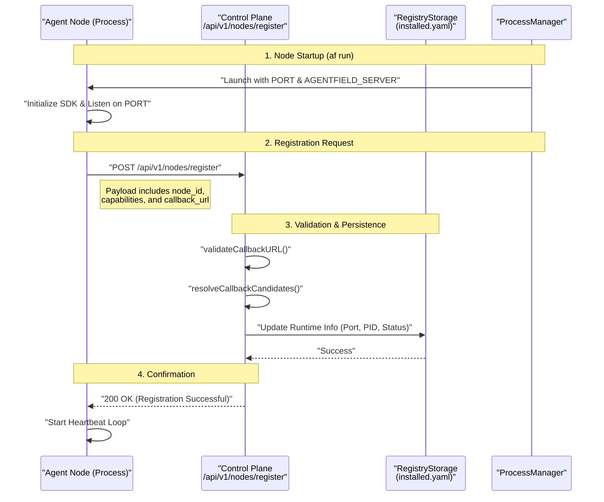
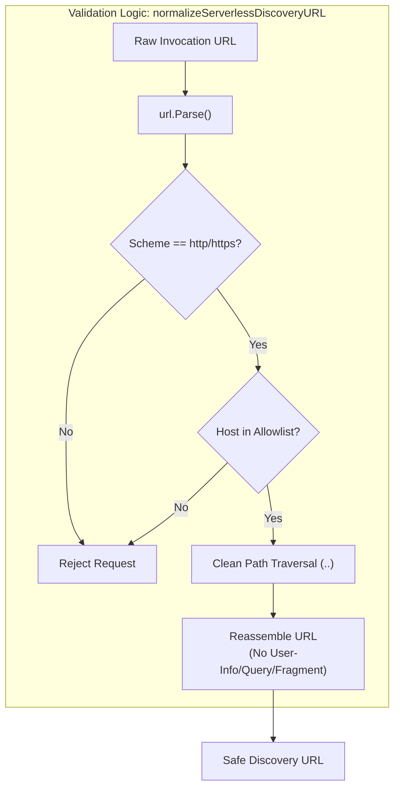
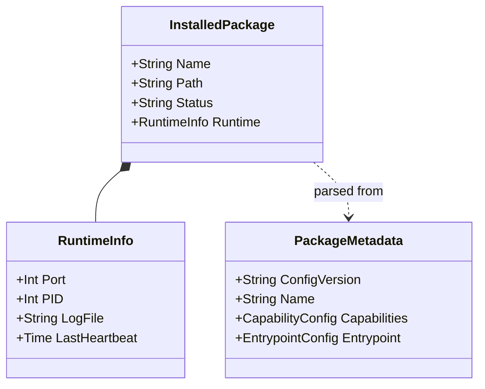

<!-- source: DeepWiki mcp.deepwiki.com · repo Agent-Field/agentfield · page 6.4 Agent Registration · fetched 2026-10-26 -->

# Agent Registration

Relevant source files

The following files were used as context for generating this wiki page:

- [control-plane/internal/core/services/agent_service.go](control-plane/internal/core/services/agent_service.go)
- [control-plane/internal/core/services/package_service.go](control-plane/internal/core/services/package_service.go)
- [control-plane/internal/handlers/nodes_register.go](control-plane/internal/handlers/nodes_register.go)
- [control-plane/internal/handlers/nodes_serverless_ssrf_test.go](control-plane/internal/handlers/nodes_serverless_ssrf_test.go)
- [control-plane/internal/observability/telemetry.go](control-plane/internal/observability/telemetry.go)
- [control-plane/internal/observability/telemetry_test.go](control-plane/internal/observability/telemetry_test.go)
- [control-plane/internal/packages/config_version_fixtures_test.go](control-plane/internal/packages/config_version_fixtures_test.go)
- [control-plane/internal/packages/go_runtime_test.go](control-plane/internal/packages/go_runtime_test.go)
- [control-plane/internal/packages/gointerp.go](control-plane/internal/packages/gointerp.go)
- [control-plane/internal/packages/installer.go](control-plane/internal/packages/installer.go)
- [control-plane/internal/packages/runner.go](control-plane/internal/packages/runner.go)
- [deployments/docker/README.md](deployments/docker/README.md)
- [deployments/docker/docker-compose.yml](deployments/docker/docker-compose.yml)
- [docs/installing-agent-nodes.md](docs/installing-agent-nodes.md)

## Purpose and Scope

This page documents how agent nodes register themselves with the AgentField control plane. Registration establishes the agent's identity, advertises its capabilities (reasoners and skills), and provides callback URLs for the control plane to invoke agent functions.

In the AgentField ecosystem, registration is the bridge between a standalone agent process (Node) and the central orchestration layer (Control Plane).

---

## Overview

Agent registration is the process by which an agent node announces itself to the control plane and declares:

- **Node Identity**: Unique `node_id` used for routing and discovery. [control-plane/internal/packages/installer.go:148-150]()
- **Capabilities**: A list of reasoners (AI-powered functions) and skills (deterministic functions) that the agent can perform. [control-plane/internal/packages/installer.go:163-172]()
- **Callback URLs**: The HTTP endpoint(s) where the control plane can reach the agent to trigger executions. [control-plane/internal/handlers/nodes_register.go:38-65]()
- **Metadata**: Version, author, description, and required environment variables. [control-plane/internal/packages/installer.go:101-126]()

Registration occurs automatically when an agent starts via the CLI (`af run`) or the SDK, but it can also be handled for serverless environments.

**Sources:** [control-plane/internal/packages/installer.go:101-172](), [control-plane/internal/handlers/nodes_register.go:38-65]()

---

## Registration Flow

The registration process involves the Control Plane validating the agent's reachability and persisting its manifest into the registry.

### High-Level Sequence

**Sources:** [control-plane/internal/core/services/agent_service.go:53-160](), [control-plane/internal/handlers/nodes_register.go:91-131](), [control-plane/internal/packages/runner.go:28-109]()

---

## Callback URL Discovery

The control plane must be able to reach the agent. Because agents often run in complex networking environments (Docker, NAT, Serverless), AgentField uses a discovery mechanism to find the best "Callback URL".

### Callback Candidate Resolution

When an agent registers, it provides a list of candidates. The control plane attempts to normalize and select the most viable one.

| Method | Description | Code Entity |
| :--- | :--- | :--- |
| **Preferred** | The URL explicitly provided by the agent SDK. | `discovery.Preferred` |
| **Candidates** | A list of alternative URLs (e.g., local IPs, container hostnames). | `discovery.Candidates` |
| **Client IP** | The IP address from which the registration request originated. | `clientIP` |
| **Normalization** | Rebuilding the URL to ensure correct scheme, host, and port. | `normalizeCandidate` |

**Sources:** [control-plane/internal/handlers/nodes_register.go:91-131](), [control-plane/internal/handlers/nodes_register.go:133-185]()

### Serverless SSRF Protection

For serverless agents, the control plane implements strict Serverless Service Request Forgery (SSRF) protection. The `invocation_url` is reconstructed from validated components to prevent attackers from using the control plane as a proxy to scan internal networks.

**Sources:** [control-plane/internal/handlers/nodes_register.go:215-229](), [control-plane/internal/handlers/nodes_register.go:235-267]()

---

## The Manifest: `agentfield-package.yaml`

The registration data is derived from the `PackageMetadata` struct, which represents the `agentfield-package.yaml` file.

### Key Registration Fields

| Field | YAML Key | Description |
| :--- | :--- | :--- |
| **Node ID** | `agent_node.node_id` | The unique ID used in the system. [control-plane/internal/packages/installer.go:148]() |
| **Capabilities** | `capabilities` | Defines `reasoners` and `skills`. [control-plane/internal/packages/installer.go:163-166]() |
| **Entrypoint** | `entrypoint.start` | The command used to launch the process. [control-plane/internal/packages/installer.go:130-136]() |
| **Healthcheck** | `entrypoint.healthcheck` | The path the control plane polls to verify readiness. [control-plane/internal/packages/installer.go:142]() |

**Sources:** [control-plane/internal/packages/installer.go:101-150](), [docs/installing-agent-nodes.md:35-86]()

---

## Implementation Details

### Runtime State Management

The control plane tracks the status of registered agents in a registry (usually `installed.yaml` in local mode).

**Sources:** [control-plane/internal/core/services/agent_service.go:139-142](), [control-plane/internal/packages/installer.go:101-126](), [control-plane/internal/packages/runner.go:39-47]()

### Process Lifecycle and Registration

When `DefaultAgentService.RunAgent` is called:
1. It loads the registry to verify the agent is installed. [control-plane/internal/core/services/agent_service.go:64-73]()
2. It reconciles the process state (checking if the PID is still alive). [control-plane/internal/core/services/agent_service.go:79-86]()
3. It allocates a free port (defaulting to 8001 range). [control-plane/internal/core/services/agent_service.go:98-107]()
4. It launches the process and waits for the health check. [control-plane/internal/core/services/agent_service.go:121-135]()
5. Once healthy, the agent's runtime info is updated, marking it as "registered" and "running". [control-plane/internal/core/services/agent_service.go:139-142]()

**Sources:** [control-plane/internal/core/services/agent_service.go:53-160](), [control-plane/internal/packages/runner.go:112-137]()

---

## Registration Best Practices

1. **Unique Node IDs**: Ensure `node_id` is unique within your control plane to avoid routing collisions.
2. **Health Checks**: Implement the `/health` endpoint (or your custom `healthcheck` path) to return a 200 OK only when the agent is fully initialized.
3. **Environment Variables**: Use the `user_environment` section in the manifest to declare required secrets (like API keys). The control plane will ensure these are present before registration. [control-plane/internal/packages/installer.go:94-98]()
4. **Language Detection**: While the system can detect "go" or "python" automatically, explicitly setting `language` in the manifest is recommended for clarity. [control-plane/internal/packages/installer.go:112-118]()

**Sources:** [docs/installing-agent-nodes.md:41-86](), [control-plane/internal/packages/installer.go:53-98]()

---

