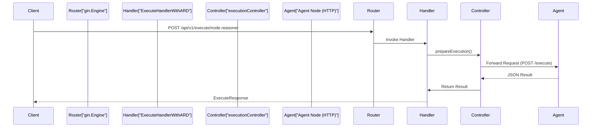
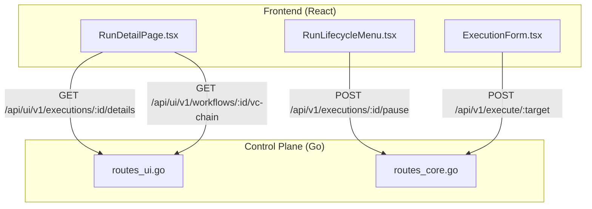

<!-- source: DeepWiki mcp.deepwiki.com · repo Agent-Field/agentfield · page 6.5 API Endpoints · fetched 2026-10-26 -->

# API Endpoints

<details>
<summary>Relevant source files</summary>

The following files were used as context for generating this wiki page:

- [control-plane/internal/handlers/coverage_handlers_90_test.go](control-plane/internal/handlers/coverage_handlers_90_test.go)
- [control-plane/internal/handlers/did_handlers.go](control-plane/internal/handlers/did_handlers.go)
- [control-plane/internal/handlers/execute.go](control-plane/internal/handlers/execute.go)
- [control-plane/internal/handlers/execute_async_test.go](control-plane/internal/handlers/execute_async_test.go)
- [control-plane/internal/handlers/execute_status_update_test.go](control-plane/internal/handlers/execute_status_update_test.go)
- [control-plane/internal/handlers/execution_notes.go](control-plane/internal/handlers/execution_notes.go)
- [control-plane/internal/handlers/execution_notes_test.go](control-plane/internal/handlers/execution_notes_test.go)
- [control-plane/internal/handlers/execution_status_handler_test.go](control-plane/internal/handlers/execution_status_handler_test.go)
- [control-plane/internal/handlers/workflow_execution_events.go](control-plane/internal/handlers/workflow_execution_events.go)
- [control-plane/internal/handlers/workflow_execution_events_test.go](control-plane/internal/handlers/workflow_execution_events_test.go)
- [control-plane/internal/server/routes_core.go](control-plane/internal/server/routes_core.go)
- [control-plane/internal/server/routes_ui.go](control-plane/internal/server/routes_ui.go)
- [control-plane/internal/storage/retry_test.go](control-plane/internal/storage/retry_test.go)
- [control-plane/web/client/src/components/reasoners/ExecutionForm.tsx](control-plane/web/client/src/components/reasoners/ExecutionForm.tsx)
- [control-plane/web/client/src/components/runs/RunLifecycleMenu.tsx](control-plane/web/client/src/components/runs/RunLifecycleMenu.tsx)
- [control-plane/web/client/src/components/ui/auto-expanding-textarea.tsx](control-plane/web/client/src/components/ui/auto-expanding-textarea.tsx)
- [control-plane/web/client/src/pages/RunDetailPage.tsx](control-plane/web/client/src/pages/RunDetailPage.tsx)
- [control-plane/web/client/src/test/pages/RunDetailPage.test.tsx](control-plane/web/client/src/test/pages/RunDetailPage.test.tsx)
- [sdk/python/agentfield/agent_workflow.py](sdk/python/agentfield/agent_workflow.py)

</details>


## Purpose and Scope

This page documents the REST API endpoints exposed by the AgentField Control Plane. The Control Plane provides a unified HTTP/WebSocket API for agent registration, execution, memory management, identity, and observability. It acts as the orchestrator for the "Kubernetes for AI Agents" model, managing the lifecycle and communication between distributed agent nodes.

---

## API Overview

### Base URL and Versioning

The Control Plane serves all core agent-facing REST surface under the `/api/v1/` prefix [control-plane/internal/server/routes_core.go:25-27](). Browser-facing UI APIs are served under `/api/ui/v1` and `/api/ui/v2` [control-plane/internal/server/routes_ui.go:42-44]().

### Authentication and Authorization

When DID-based authorization is enabled, the Control Plane applies `PermissionCheckMiddleware` to both legacy and unified execution endpoints [control-plane/internal/server/routes_core.go:67-85](). Internal communication between the control plane and agents often utilizes an `InternalToken` sent as an `Authorization` header [control-plane/internal/handlers/execute.go:141-142]().

### Context Propagation Headers

The Control Plane propagates execution context to maintain workflow integrity and memory scoping [control-plane/internal/handlers/execute.go:110-116](). Key headers include:
* `X-Workflow-ID`: Unique identifier for the workflow.
* `X-Execution-ID`: Unique identifier for this specific execution.
* `X-Agent-Node-ID`: The ID of the node performing the work.

---

## Execution API

### Unified Execution

```
POST /api/v1/execute/:target
POST /api/v1/execute/async/:target
```

The unified execution endpoint routes requests to the appropriate agent and reasoner. The `:target` parameter typically follows the format `agent_id.reasoner_id`.

#### Request Structure (`ExecuteRequest`)
[control-plane/internal/handlers/execute.go:50-54]()
```json
{
  "input": { "key": "value" },
  "context": { "session_id": "..." },
  "webhook": {
    "url": "https://example.com/callback",
    "secret": "optional-secret"
  }
}
```

#### Synchronous Response (`ExecuteResponse`)
[control-plane/internal/handlers/execute.go:64-74]()
Returns HTTP 200 upon completion.

#### Asynchronous Response (`AsyncExecuteResponse`)
[control-plane/internal/handlers/execute.go:77-88]()
Returns HTTP 202 Accepted. If the internal async queue is full, it returns 503 Service Unavailable [control-plane/internal/handlers/execute_async_test.go:90-93]().

### Execution Status and Control

| Endpoint | Method | Description |
|----------|--------|-------------|
| `/api/v1/executions/:execution_id` | GET | Get current status, result, or error [control-plane/internal/server/routes_core.go:120]() |
| `/api/v1/executions/batch-status` | POST | Fetch multiple statuses at once [control-plane/internal/handlers/execute.go:111-113]() |
| `/api/v1/executions/:execution_id/status` | POST | Used by agents to update the control plane on progress [control-plane/internal/server/routes_core.go:123]() |
| `/api/v1/executions/:execution_id/cancel` | POST | Aborts an in-flight execution [control-plane/internal/server/routes_core.go:127]() |

### Execution Data Flow

This diagram maps the HTTP request flow to the internal Go structures and handlers.


**Sources:** [control-plane/internal/server/routes_core.go:110-114](), [control-plane/internal/handlers/execute.go:134-144]()

---

## Agent & Node Management

### Registration and Lifecycle

Agents register themselves to become discoverable and reachable by the control plane.

* **Register Node**: `POST /api/v1/nodes/register` [control-plane/internal/server/routes_core.go:39]().
* **Heartbeat**: `POST /api/v1/nodes/:node_id/heartbeat` [control-plane/internal/server/routes_core.go:44](). Agents must send periodic heartbeats to maintain a "healthy" status.
* **Status Lease**: `PATCH /api/v1/nodes/:node_id/status` [control-plane/internal/server/routes_core.go:57]().

### Discovery

* **Capabilities**: `GET /api/v1/discovery/capabilities` [control-plane/internal/server/routes_core.go:34]().
* **List Reasoners**: `GET /api/v1/reasoners` [control-plane/internal/server/routes_core.go:36]().

---

## UI and Observability API

The Control Plane provides a specialized API surface for the `web/client` dashboard under `/api/ui/v1`.

### Agent and Node Management (UI)

| Endpoint | Method | Description |
|----------|--------|-------------|
| `/api/ui/v1/agents/packages` | GET | List available agent packages [control-plane/internal/server/routes_ui.go:57]() |
| `/api/ui/v1/nodes/summary` | GET | High-level overview of node health [control-plane/internal/server/routes_ui.go:97]() |
| `/api/ui/v1/nodes/:nodeId/logs` | GET | Proxy to fetch logs directly from an agent node [control-plane/internal/server/routes_ui.go:118]() |

### Execution and Workflow Observability

| Endpoint | Method | Description |
|----------|--------|-------------|
| `/api/ui/v1/executions/summary` | GET | Aggregated execution stats [control-plane/internal/server/routes_ui.go:149]() |
| `/api/ui/v1/executions/timeline` | GET | Hourly aggregated execution data [control-plane/internal/server/routes_ui.go:156]() |
| `/api/ui/v1/workflows/:id/vc-chain` | GET | Export the VC audit trail [control-plane/web/client/src/pages/RunDetailPage.tsx:106]() |

### UI Entity Mapping

This diagram associates UI components with the API endpoints they consume.


**Sources:** [control-plane/web/client/src/pages/RunDetailPage.tsx:101-107](), [control-plane/internal/server/routes_ui.go:163-167](), [control-plane/web/client/src/components/runs/RunLifecycleMenu.tsx:87-99]()

---

## Identity & DID API

AgentField implements W3C Decentralized Identifiers (DIDs) for secure agent identity.

* **Resolve DID**: `GET /api/v1/did/resolve/:did` [control-plane/internal/handlers/did_handlers.go:118](). This handles both `did:key` and `did:web` resolution [control-plane/internal/handlers/did_handlers.go:126-143]().
* **Rotate Key**: `POST /api/v1/did/key-agreement/rotate` [control-plane/internal/handlers/did_handlers.go:173](). Rotates an agent's X25519 encryption keys.

---

## Internal Event Handling

Agents can emit fire-and-forget events to the Control Plane to track local execution steps within a larger workflow.

* **Workflow Events**: `POST /api/v1/workflows/events` [control-plane/internal/handlers/workflow_execution_events.go:35]().
* This endpoint uses `WorkflowExecutionEventRequest` [control-plane/internal/handlers/workflow_execution_events.go:16-30]() to update or create execution records, ensuring the UI can render a complete DAG even for steps executed locally by an agent [control-plane/internal/handlers/workflow_execution_events.go:32-34]().

### Event Logic Flow
1. Agent emits `WorkflowExecutionEventRequest`.
2. Handler checks for existing `ExecutionID` [control-plane/internal/handlers/workflow_execution_events.go:46]().
3. If new, it calls `CreateExecutionRecord` [control-plane/internal/handlers/workflow_execution_events.go:53]().
4. If existing, it applies `applyEventToExecution` to update status, but guards against terminal state regression [control-plane/internal/handlers/workflow_execution_events.go:130-144]().

**Sources:** [control-plane/internal/handlers/workflow_execution_events.go:1-190]()

---

