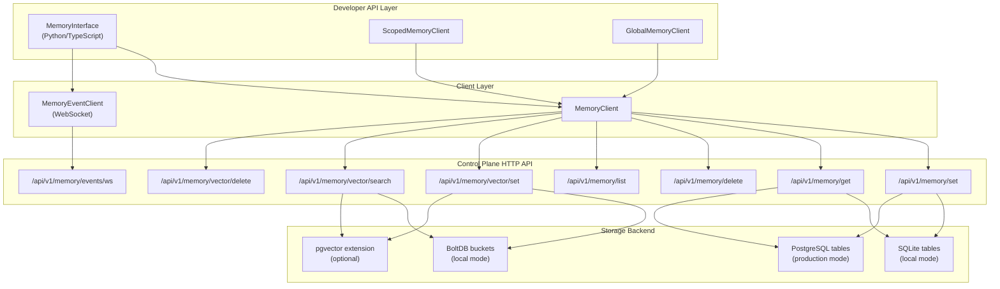
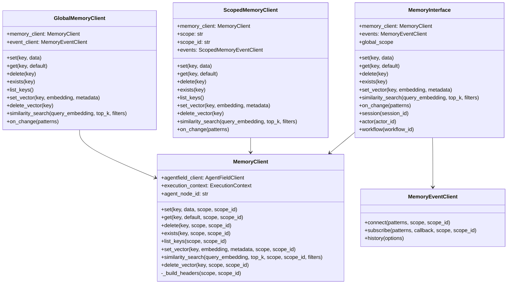
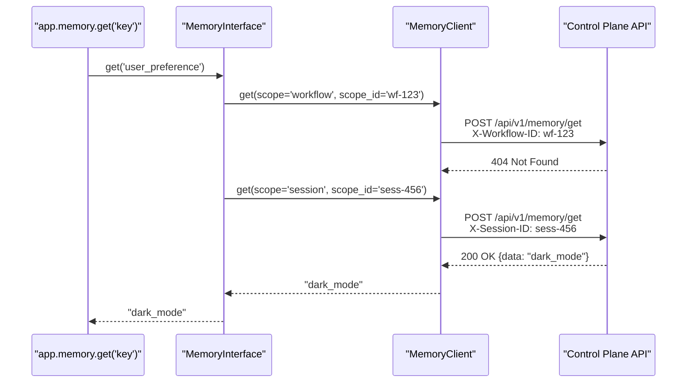
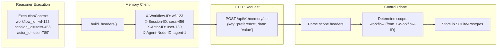
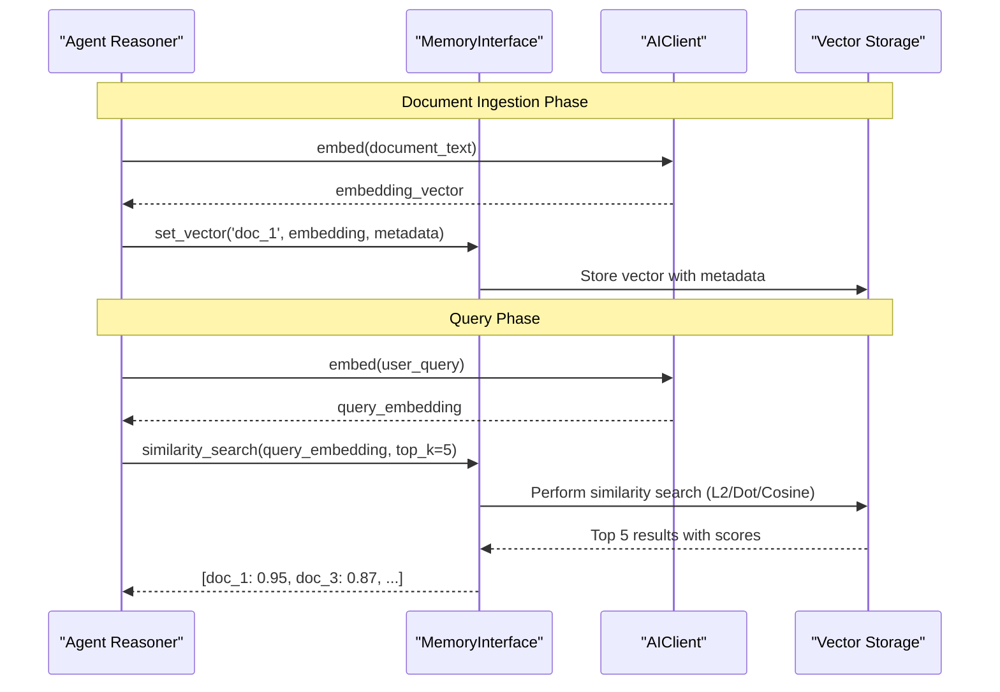

<!-- source: DeepWiki mcp.deepwiki.com · repo Agent-Field/agentfield · page 7 Memory System · fetched 2026-10-26 -->

# Memory System

<details>
<summary>Relevant source files</summary>

The following files were used as context for generating this wiki page:

- [control-plane/internal/handlers/memory.go](control-plane/internal/handlers/memory.go)
- [control-plane/internal/handlers/memory_handler_test.go](control-plane/internal/handlers/memory_handler_test.go)
- [control-plane/internal/handlers/vector_memory.go](control-plane/internal/handlers/vector_memory.go)
- [control-plane/internal/handlers/vector_memory_test.go](control-plane/internal/handlers/vector_memory_test.go)
- [control-plane/internal/server/server_routes_test.go](control-plane/internal/server/server_routes_test.go)
- [control-plane/internal/storage/local.go](control-plane/internal/storage/local.go)
- [control-plane/internal/storage/storage.go](control-plane/internal/storage/storage.go)
- [control-plane/internal/storage/vector_store.go](control-plane/internal/storage/vector_store.go)
- [control-plane/internal/storage/vector_store_postgres.go](control-plane/internal/storage/vector_store_postgres.go)
- [control-plane/internal/storage/vector_store_sqlite.go](control-plane/internal/storage/vector_store_sqlite.go)
- [sdk/python/agentfield/memory.py](sdk/python/agentfield/memory.py)
- [sdk/python/agentfield/memory_events.py](sdk/python/agentfield/memory_events.py)
- [sdk/python/tests/test_memory_scope_kwargs.py](sdk/python/tests/test_memory_scope_kwargs.py)
- [sdk/typescript/src/context/SkillContext.ts](sdk/typescript/src/context/SkillContext.ts)
- [sdk/typescript/src/memory/MemoryClient.ts](sdk/typescript/src/memory/MemoryClient.ts)
- [sdk/typescript/src/memory/MemoryEventClient.ts](sdk/typescript/src/memory/MemoryEventClient.ts)
- [sdk/typescript/src/memory/MemoryInterface.ts](sdk/typescript/src/memory/MemoryInterface.ts)
- [sdk/typescript/tests/memory_and_discovery.test.ts](sdk/typescript/tests/memory_and_discovery.test.ts)
- [sdk/typescript/tests/memory_event_client.test.ts](sdk/typescript/tests/memory_event_client.test.ts)
- [tests/functional/agents/memory_events_decorator_agent.py](tests/functional/agents/memory_events_decorator_agent.py)
- [tests/functional/tests/test_memory_events.py](tests/functional/tests/test_memory_events.py)

</details>


The Memory System provides distributed, scoped key-value storage and vector search capabilities for AgentField agents. It enables agents to persist state, share data across execution contexts, and perform similarity searches for RAG (Retrieval-Augmented Generation) applications. The system supports four hierarchical scopes (workflow, session, actor, global), automatic context propagation via HTTP headers, and real-time change notifications via WebSocket.

For memory scope semantics and fallback behavior, see [Memory Scopes](#7.1). For basic storage operations, see [Key-Value Operations](#7.2). For vector embeddings and similarity search, see [Vector Storage](#7.3). For event subscriptions and pattern matching, see [Memory Events](#7.4). For execution context header propagation, see [Context Propagation](#7.5).

## Architecture Overview

The Memory System is organized into three primary layers: the developer-facing API, the HTTP client layer, and the storage backend.

### Memory System Layers



**Sources:** [sdk/python/agentfield/memory.py:132-150](), [sdk/typescript/src/memory/MemoryClient.ts:117-206](), [sdk/typescript/src/memory/MemoryInterface.ts:1-226](), [sdk/typescript/src/memory/MemoryEventClient.ts:13-29](), [control-plane/internal/handlers/memory.go:54-171]()

### Memory Client Class Hierarchy



**Sources:** [sdk/python/agentfield/memory.py:132-724](), [sdk/python/agentfield/memory_events.py:83-200]()

## Memory Scopes and Hierarchical Fallback

The Memory System organizes data into four hierarchical scopes that determine visibility and lifetime:

| Scope | Identifier Header | Lifetime | Use Case |
|-------|------------------|----------|----------|
| `workflow` | `X-Workflow-ID` | Duration of workflow execution | Temporary state for multi-agent workflows |
| `session` | `X-Session-ID` | Duration of user session | User-specific preferences and conversation history |
| `actor` | `X-Actor-ID` | Duration of actor interaction | Individual agent or entity state |
| `global` | None (implicit `"global"`) | Permanent | System-wide configuration and shared data |

### Hierarchical Lookup Order

When retrieving data without specifying an explicit scope, the system performs a hierarchical fallback search in the order: `workflow` → `session` → `actor` → `global`, returning the first match found.



**Sources:** [sdk/python/agentfield/memory.py:47-57](), [sdk/python/agentfield/memory.py:225-250](), [sdk/typescript/src/memory/MemoryClient.ts:77-104]()

## Developer-Facing API

The Memory System is accessed through the `memory` property on agent contexts. This property exposes a `MemoryInterface` instance that provides both automatic-scoped and explicitly-scoped operations.

### Python SDK API Surface

```python
# Automatic scoping based on execution context
await ctx.memory.set("user_name", "Alice")
name = await ctx.memory.get("user_name")
await ctx.memory.delete("user_name")

# Vector operations
await ctx.memory.set_vector("doc_chunk_1", [0.1, 0.2, 0.3])
results = await ctx.memory.similarity_search([0.1, 0.2, 0.4], top_k=5)

# Explicit scope access
session_memory = ctx.memory.session("session-123")
await session_memory.set("preference", "dark_mode")

# Global scope access
global_memory = ctx.memory.global_scope
await global_memory.set("feature_flag", True)
```

**Sources:** [sdk/python/agentfield/memory.py:571-724]()

### TypeScript SDK API Surface

```typescript
// Automatic scoping
await ctx.memory.set("user_name", "Alice");
const name = await ctx.memory.get<string>("user_name");

// Vector operations
await ctx.memory.setVector("doc_chunk_1", [0.1, 0.2, 0.3], { source: "manual.pdf" });
const results = await ctx.memory.searchVector([0.1, 0.2, 0.4], { topK: 5 });

// Explicit scope access
const sessionMemory = ctx.memory.session("session-123");
await sessionMemory.set("preference", "dark_mode");
```

**Sources:** [sdk/typescript/src/memory/MemoryInterface.ts:17-226](), [sdk/typescript/src/memory/MemoryClient.ts:117-206]()

## Context Propagation via HTTP Headers

The Memory System automatically propagates execution context through HTTP headers, ensuring that memory operations are scoped correctly without requiring explicit scope parameters in every call.

### Header-Based Scope Resolution



The following headers are recognized for scope resolution:

- `X-Workflow-ID`: Identifies the workflow scope
- `X-Session-ID`: Identifies the session scope  
- `X-Actor-ID`: Identifies the actor scope
- `X-Agent-Node-ID`: Identifies the agent performing the operation
- `X-Run-ID`: Alternative identifier for workflow scope
- `X-Execution-ID`: Tracks individual reasoner/skill executions

**Sources:** [sdk/python/agentfield/memory.py:150-171](), [sdk/typescript/src/memory/MemoryClient.ts:52-75](), [control-plane/internal/handlers/memory.go:187-192]()

## Storage Backend Mapping

The Memory System uses different storage backends depending on the deployment mode and data type.

### Key-Value Storage

| Deployment Mode | Backend | Tables/Schema |
|----------------|---------|---------------|
| Local (SQLite) | SQLite database | `memory_kvstore` table with columns: `scope`, `scope_id`, `key`, `data`, `created_at`, `updated_at` |
| Production (PostgreSQL) | PostgreSQL database | Same schema as SQLite with full-text search support |

### Vector Storage

| Deployment Mode | Backend | Implementation |
|----------------|---------|----------------|
| Local | SQLite/BoltDB | SQLite for metadata, BoltDB for binary embedding storage |
| Production | PostgreSQL with pgvector | `memory_vectors` table with `vector` column type and similarity search functions |

**Sources:** [control-plane/internal/storage/local.go:70-195](), [control-plane/internal/storage/vector_store_postgres.go:41-65](), [control-plane/internal/storage/storage.go:44-130]()

## Integration with Agent Contexts

The Memory System is accessible through both `ReasonerContext` and `SkillContext` objects, which are automatically provided when defining reasoners and skills.

### Python Integration

```python
@app.reasoner()
async def process_document(url: str, ctx):
    # Memory is available via ctx.memory
    await ctx.memory.set("last_processed_url", url)
    return {"status": "processed"}
```

**Sources:** [sdk/python/agentfield/memory.py:571-724]()

### TypeScript Integration

```typescript
agent.reasoner('process_document', async (ctx) => {
  // Memory is available via ctx.memory
  await ctx.memory.set('last_processed_url', ctx.input.url);
  return { status: 'processed' };
});
```

**Sources:** [sdk/typescript/src/context/SkillContext.ts:9-74](), [sdk/typescript/src/memory/MemoryInterface.ts:17-226]()

## Vector Operations for RAG Applications

The Memory System provides first-class support for vector embeddings, enabling RAG (Retrieval-Augmented Generation) patterns.

### Complete RAG Workflow



**Sources:** [control-plane/internal/storage/vector_store_postgres.go:153-228](), [sdk/python/agentfield/memory.py:326-354](), [sdk/typescript/src/memory/MemoryClient.ts:193-205]()

## Memory Events and Pattern Matching

The Memory System provides real-time change notifications via WebSocket connections. Agents can subscribe to memory changes using pattern matching decorators.

### Pattern Matching Syntax

| Pattern Type | Syntax | Example | Matches |
|-------------|--------|---------|---------|
| Exact | `"key.name"` | `"user.preferences.theme"` | Only `user.preferences.theme` |
| Single wildcard | `"prefix.*"` | `"user.preferences.*"` | `user.preferences.theme`, `user.preferences.color` |
| Multi wildcard | `"a.*.c"` | `"decorator.*.exact"` | `decorator.preferences.exact` |

**Sources:** [sdk/python/agentfield/memory_events.py:18-42](), [tests/functional/tests/test_memory_events.py:139-200]()

### Python Event Subscriptions

```python
@app.memory.on_change("user.preferences.*")
async def on_preference_change(event):
    print(f"Preference changed: {event.key} = {event.data}")
```

**Sources:** [sdk/python/agentfield/memory_events.py:83-200](), [tests/functional/tests/test_memory_events.py:154-161]()

### Event Object Structure

Memory events contain the following fields:

- `type`: Always `"memory_change"`
- `key`: Memory key that changed
- `scope`: Scope where change occurred (`workflow`, `session`, `actor`, `global`)
- `action`: Type of change (`set`, `delete`)
- `data`: New value (for `set` operations)
- `previous_data`: Previous value (for `delete` operations)
- `metadata`: Additional context (agent_id, actor_id, workflow_id)

**Sources:** [control-plane/internal/handlers/memory.go:179-192](), [sdk/python/agentfield/memory_events.py:182-200]()

---

