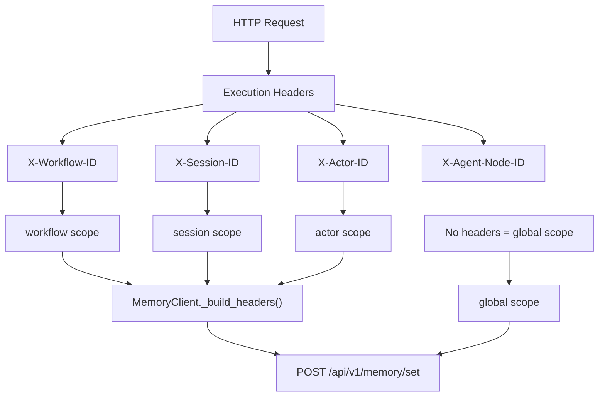
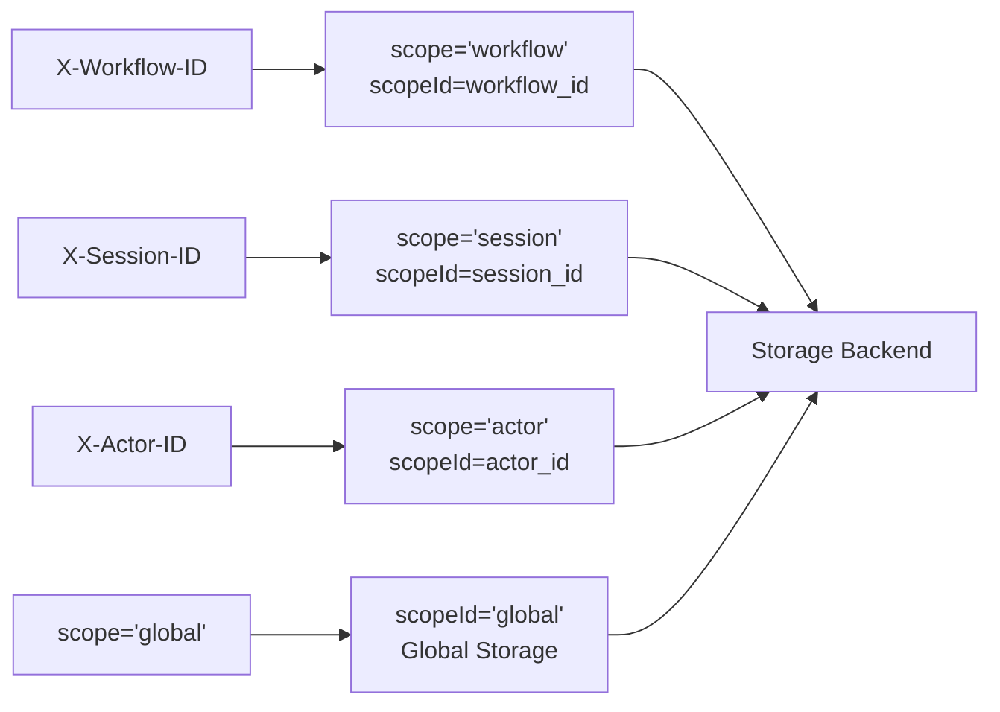
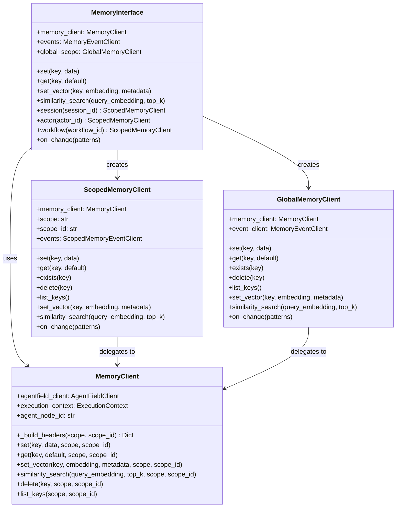
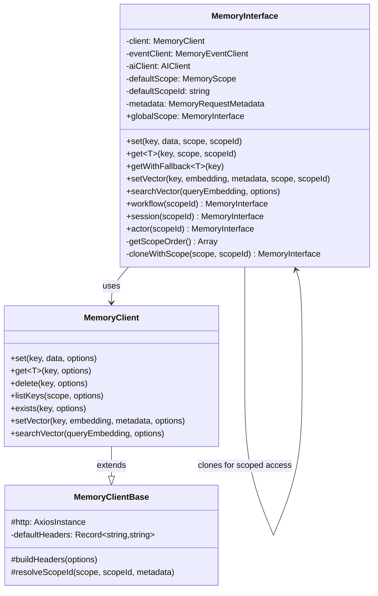
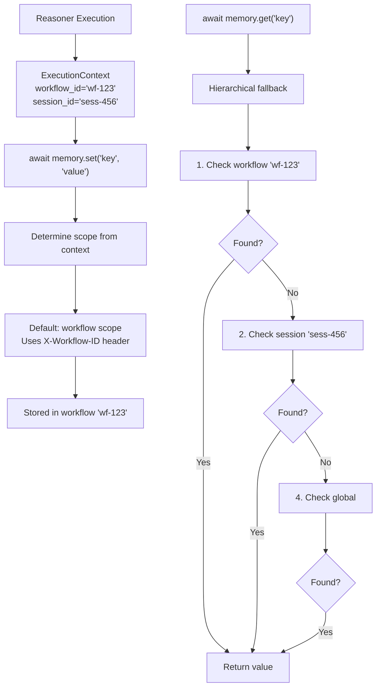

<!-- source: DeepWiki mcp.deepwiki.com · repo Agent-Field/agentfield · page 7.1 Memory Scopes · fetched 2026-10-26 -->

# Memory Scopes

<details>
<summary>Relevant source files</summary>

The following files were used as context for generating this wiki page:

- [sdk/python/agentfield/memory.py](sdk/python/agentfield/memory.py)
- [sdk/python/agentfield/memory_events.py](sdk/python/agentfield/memory_events.py)
- [sdk/python/tests/test_memory_scope_kwargs.py](sdk/python/tests/test_memory_scope_kwargs.py)
- [sdk/typescript/src/context/SkillContext.ts](sdk/typescript/src/context/SkillContext.ts)
- [sdk/typescript/src/memory/MemoryClient.ts](sdk/typescript/src/memory/MemoryClient.ts)
- [sdk/typescript/src/memory/MemoryEventClient.ts](sdk/typescript/src/memory/MemoryEventClient.ts)
- [sdk/typescript/src/memory/MemoryInterface.ts](sdk/typescript/src/memory/MemoryInterface.ts)
- [sdk/typescript/tests/memory_and_discovery.test.ts](sdk/typescript/tests/memory_and_discovery.test.ts)
- [sdk/typescript/tests/memory_event_client.test.ts](sdk/typescript/tests/memory_event_client.test.ts)
- [tests/functional/agents/memory_events_decorator_agent.py](tests/functional/agents/memory_events_decorator_agent.py)
- [tests/functional/tests/test_memory_events.py](tests/functional/tests/test_memory_events.py)

</details>


This page documents AgentField's hierarchical memory scoping system, which enables automatic context isolation and data sharing across different levels of execution. Memory scopes determine the lifetime and visibility of stored data, allowing workflow-specific, session-specific, actor-specific, or globally shared memory.

For information about memory operations (set/get/delete), see [Key-Value Operations](#7.2). For vector storage and similarity search, see [Vector Storage](#7.3). For real-time change notifications, see [Memory Events](#7.4).

## Purpose and Scope Hierarchy

AgentField provides four memory scopes organized in a hierarchy:

| Scope | Lifetime | Visibility | Use Case |
|-------|----------|------------|----------|
| `workflow` | Single workflow execution | All agents in the workflow | Temporary execution state, intermediate results |
| `session` | User session across workflows | All workflows for that session | User preferences, conversation history |
| `actor` | Actor/entity lifetime | All sessions for that actor | Actor-specific context, learned behaviors |
| `global` | Permanent | All agents, all contexts | Shared configuration, system-wide data |

Memory operations automatically resolve to the appropriate scope based on execution context. When retrieving data, the system performs **hierarchical fallback**, searching workflow → session → actor → global until a value is found.

**Sources:** [sdk/python/agentfield/memory.py:4-64](), [sdk/typescript/src/memory/MemoryInterface.ts:36-38]()

---

## Scope Resolution and Context Propagation

### Automatic Scope Detection

Memory scopes are determined by HTTP headers propagated through the execution context:



**Sources:** [sdk/python/agentfield/memory.py:150-170](), [sdk/typescript/src/memory/MemoryClient.ts:52-75]()

### Header-to-Scope Mapping

The `MemoryClient` class (Python) and `MemoryClientBase` (TypeScript) map internal scope identifiers to HTTP headers:



In TypeScript, `scopeToHeader()` [sdk/typescript/src/memory/MemoryClient.ts:77-88]() performs this mapping, while `resolveScopeId()` [sdk/typescript/src/memory/MemoryClient.ts:90-104]() determines the scope identifier from metadata. In Python, this is handled in `_build_headers` [sdk/python/agentfield/memory.py:150-170]().

**Sources:** [sdk/python/agentfield/memory.py:150-170](), [sdk/typescript/src/memory/MemoryClient.ts:77-104]()

---

## Hierarchical Fallback Mechanism

When reading data without explicit scope specification, the memory system searches multiple scopes in order.

### Fallback Order

```mermaid
sequenceDiagram
    participant Client as "memory.get('key')"
    participant Workflow as "workflow scope"
    participant Session as "session scope"
    participant Actor as "actor scope"
    participant Global as "global scope"
    
    Client->>Workflow: Search workflow scope first
    alt Found in workflow
        Workflow-->>Client: Return value
    else Not found
        Client->>Session: Search session scope
        alt Found in session
            Session-->>Client: Return value
        else Not found
            Client->>Actor: Search actor scope
            alt Found in actor
                Actor-->>Client: Return value
            else Not found
                Client->>Global: Search global scope
                alt Found in global
                    Global-->>Client: Return value
                else Not found
                    Global-->>Client: Return undefined/default
                end
            end
        end
    end
```

### Implementation Details

The TypeScript SDK explicitly implements the fallback logic in `getWithFallback<T>` [sdk/typescript/src/memory/MemoryInterface.ts:62-72](). It uses `getScopeOrder()` [sdk/typescript/src/memory/MemoryInterface.ts:191-210]() to construct the search sequence: `workflow` → `session` → `actor` → `global`.

In Python, the `MemoryClient.get` method [sdk/python/agentfield/memory.py:232-264]() performs the HTTP request. If no scope is provided, the AgentField server backend performs the hierarchical lookup and returns the most specific match.

**Sources:** [sdk/python/agentfield/memory.py:47-56](), [sdk/typescript/src/memory/MemoryInterface.ts:62-72, 191-210]()

---

## Memory Client Class Hierarchy

### Python SDK Structure



**Sources:** [sdk/python/agentfield/memory.py:132-150, 465-475, 570-580, 675-724]()

### TypeScript SDK Structure



**Sources:** [sdk/typescript/src/memory/MemoryClient.ts:38-206](), [sdk/typescript/src/memory/MemoryInterface.ts:17-227]()

---

## Using Scoped Memory

### Explicit Scope Access

Both SDKs provide methods to obtain scoped memory interfaces. These "clone" the interface with a new default scope.

**Python:**
```python
# Accessing scoped clients
session_memory = app.memory.session("session-123")
actor_memory = app.memory.actor("user-456")
workflow_memory = app.memory.workflow("workflow-789")
global_memory = app.memory.global_scope

# Scoped operations (defaults to the specified scope)
await session_memory.set("user_preference", "dark_mode")
value = await session_memory.get("user_preference")
```

**TypeScript:**
```typescript
// Accessing scoped interfaces
const sessionMemory = memory.session("session-123");
const actorMemory = memory.actor("user-456");
const workflowMemory = memory.workflow("workflow-789");
const globalMemory = memory.globalScope;

// Scoped operations
await sessionMemory.set("user_preference", "dark_mode");
const value = await sessionMemory.get("user_preference");
```

**Sources:** [sdk/python/agentfield/memory.py:675-723](), [sdk/typescript/src/memory/MemoryInterface.ts:160-189]()

### Automatic Scoping from Context

When using the base `MemoryInterface` within a reasoner or skill, operations use the current execution context by default. In TypeScript, the `MemoryInterface` is initialized with metadata from the `ExecutionContext` [sdk/typescript/src/context/SkillContext.ts:87]().



**Sources:** [sdk/python/agentfield/memory.py:583-642](), [sdk/typescript/src/memory/MemoryInterface.ts:41-72](), [sdk/typescript/src/context/SkillContext.ts:70-91]()

---

## Scope-Specific Operations

### Global Scope
Shared across all agents and sessions. Ideal for configuration or shared knowledge bases.
- **Python:** `agent.memory.global_scope` [sdk/python/agentfield/memory.py:721]()
- **TypeScript:** `memory.globalScope` [sdk/typescript/src/memory/MemoryInterface.ts:172]()

### Session Scope
Scoped to a single conversation. Cleared when the session ends.
- **Python:** `agent.memory.session(session_id)` [sdk/python/agentfield/memory.py:675]()
- **TypeScript:** `memory.session(scopeId)` [sdk/typescript/src/memory/MemoryInterface.ts:164]()

### Actor Scope
Scoped to a specific actor (user/agent) across sessions. Persists indefinitely.
- **Python:** `agent.memory.actor(actor_id)` [sdk/python/agentfield/memory.py:689]()
- **TypeScript:** `memory.actor(scopeId)` [sdk/typescript/src/memory/MemoryInterface.ts:168]()

### Workflow Scope
Scoped to a single execution run. Automatically removed when the run completes.
- **Python:** `agent.memory.workflow(workflow_id)` [sdk/python/agentfield/memory.py:701]()
- **TypeScript:** `memory.workflow(scopeId)` [sdk/typescript/src/memory/MemoryInterface.ts:160]()

---

## API Reference

### Key-Value Operations

| Method | Python | TypeScript |
|--------|--------|------------|
| Set | `await memory.set(key, data, scope=None, scope_id=None)` | `await memory.set(key, data, scope?, scopeId?)` |
| Get | `await memory.get(key, default=None, scope=None, scope_id=None)` | `await memory.get<T>(key, scope?, scopeId?)` |
| Delete | `await memory.delete(key, scope=None, scope_id=None)` | `await memory.delete(key, scope?, scopeId?)` |
| List Keys | `await memory.list_keys(scope=None, scope_id=None)` | `await memory.listKeys(scope?, scopeId?)` |

**Sources:** [sdk/python/agentfield/memory.py:187-355](), [sdk/typescript/src/memory/MemoryClient.ts:123-169]()

### Vector Operations

| Method | Python | TypeScript |
|--------|--------|------------|
| Set Vector | `await memory.set_vector(key, embedding, metadata=None, ...)` | `await memory.setVector(key, embedding, metadata?, ...)` |
| Search | `await memory.similarity_search(query_embedding, top_k=10, ...)` | `await memory.searchVector(queryEmbedding, options)` |

**Sources:** [sdk/python/agentfield/memory.py:357-450](), [sdk/typescript/src/memory/MemoryClient.ts:171-205]()

---

## Memory Events and Scopes

Memory events can be filtered by scope during subscription. This allows agents to listen for changes only within a specific session or globally.

```python
# Subscribing to events in a specific session (Python)
session_memory = agent.memory.session("my-session")

@session_memory.on_change("user.preferences.*")
async def handle_preference_change(event):
    print(f"Preference {event.key} changed to {event.data}")
```

**Sources:** [sdk/python/agentfield/memory_events.py:44-82](), [tests/functional/agents/memory_events_decorator_agent.py:160-166]()

---

