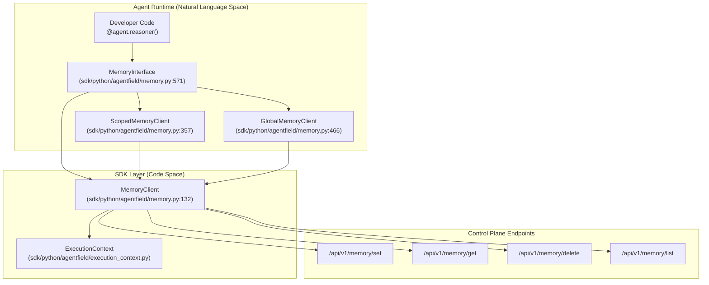
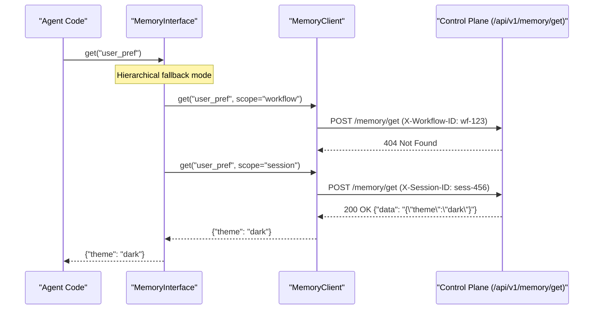
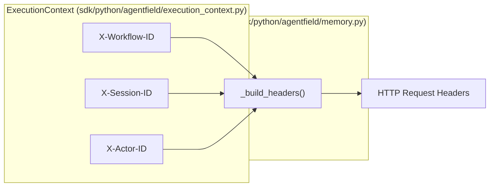

<!-- source: DeepWiki mcp.deepwiki.com · repo Agent-Field/agentfield · page 7.2 Key-Value Operations · fetched 2026-10-26 -->

# Key-Value Operations

<details>
<summary>Relevant source files</summary>

The following files were used as context for generating this wiki page:

- [examples/python_agent_nodes/agentic_rag/README.md](examples/python_agent_nodes/agentic_rag/README.md)
- [examples/python_agent_nodes/agentic_rag/embedding_manager.py](examples/python_agent_nodes/agentic_rag/embedding_manager.py)
- [examples/python_agent_nodes/agentic_rag/sample_document.txt](examples/python_agent_nodes/agentic_rag/sample_document.txt)
- [examples/python_agent_nodes/agentic_rag/schemas.py](examples/python_agent_nodes/agentic_rag/schemas.py)
- [sdk/python/agentfield/logger.py](sdk/python/agentfield/logger.py)
- [sdk/python/agentfield/memory.py](sdk/python/agentfield/memory.py)
- [sdk/python/agentfield/memory_events.py](sdk/python/agentfield/memory_events.py)
- [sdk/python/tests/conftest.py](sdk/python/tests/conftest.py)
- [sdk/python/tests/test_cancel.py](sdk/python/tests/test_cancel.py)
- [sdk/python/tests/test_logger.py](sdk/python/tests/test_logger.py)
- [sdk/python/tests/test_memory_client_core.py](sdk/python/tests/test_memory_client_core.py)
- [sdk/python/tests/test_memory_flow_core.py](sdk/python/tests/test_memory_flow_core.py)
- [sdk/python/tests/test_memory_scope_kwargs.py](sdk/python/tests/test_memory_scope_kwargs.py)
- [sdk/typescript/src/context/SkillContext.ts](sdk/typescript/src/context/SkillContext.ts)
- [sdk/typescript/src/memory/MemoryClient.ts](sdk/typescript/src/memory/MemoryClient.ts)
- [sdk/typescript/src/memory/MemoryEventClient.ts](sdk/typescript/src/memory/MemoryEventClient.ts)
- [sdk/typescript/src/memory/MemoryInterface.ts](sdk/typescript/src/memory/MemoryInterface.ts)
- [sdk/typescript/tests/memory_and_discovery.test.ts](sdk/typescript/tests/memory_and_discovery.test.ts)
- [sdk/typescript/tests/memory_event_client.test.ts](sdk/typescript/tests/memory_event_client.test.ts)
- [tests/functional/agents/memory_events_decorator_agent.py](tests/functional/agents/memory_events_decorator_agent.py)
- [tests/functional/tests/test_memory_events.py](tests/functional/tests/test_memory_events.py)

</details>


This page documents the core CRUD operations for storing and retrieving scalar data in AgentField's memory system. Key-value operations provide a simple interface for persisting state across agent executions with automatic scoping based on execution context.

For information about vector embeddings and similarity search, see [Vector Storage](7.3). For real-time change notifications, see [Memory Events](7.4). For details on how execution context determines scope, see [Context Propagation](7.5).

## Overview

AgentField's memory system provides persistent key-value storage with four-tier hierarchical scoping: **Workflow** (Run), **Session**, **Actor**, and **Global** [sdk/python/agentfield/memory.py:7-45](). All memory operations are performed through the `MemoryInterface` class, which delegates to a `MemoryClient` that communicates with the control plane's HTTP API [sdk/python/agentfield/memory.py:132-149]().

**Key characteristics:**
- **Automatic scoping**: Memory operations use execution context headers to determine scope [sdk/python/agentfield/memory.py:150-171]().
- **Hierarchical fallback**: `get()` searches through scopes in order (workflow -> session -> actor -> global) until a value is found [sdk/python/agentfield/memory.py:47-56]().
- **JSON serialization**: All data is JSON-serialized for storage [sdk/python/agentfield/memory.py:193-205]().
- **Scope isolation**: Explicit scope access bypasses hierarchical lookup [sdk/python/agentfield/memory.py:84-91]().

## Architecture

The following diagram bridges the Natural Language concepts to the Code Entities responsible for memory operations.

**Code Entity Mapping**

**Sources:** [sdk/python/agentfield/memory.py:1-149](), [sdk/typescript/src/memory/MemoryClient.ts:38-117](), [sdk/python/agentfield/memory.py:571-581]()

## Core Operations

### Setting Values

The `set()` operation stores a key-value pair with automatic scoping based on execution context.

#### Python Implementation
The `MemoryClient.set()` method constructs headers from execution context and sends a POST request to `/api/v1/memory/set` [sdk/python/agentfield/memory.py:187-230]().

```python
# Basic usage with automatic scoping
await app.memory.set("user_preference", {"theme": "dark"})

# Explicit scope
await app.memory.workflow("wf-123").set("status", "processing")
```

#### TypeScript Implementation
The `MemoryClient.set()` method mirrors the Python implementation using `axios` [sdk/typescript/src/memory/MemoryClient.ts:123-130]().

```typescript
// Basic usage with automatic scoping
await ctx.memory.set("user_preference", {theme: "dark"});
```

**Sources:** [sdk/python/agentfield/memory.py:187-230](), [sdk/typescript/src/memory/MemoryClient.ts:123-130]()

### Getting Values

The `get()` operation retrieves values with hierarchical fallback when using automatic scoping [sdk/python/agentfield/memory.py:47-56]().

#### Hierarchical Fallback Logic
When `get()` is called without explicit scope parameters, the SDK searches through scopes in order:
1. **Workflow** (Run)
2. **Session**
3. **Actor**
4. **Global**

The first non-null value found is returned [sdk/python/agentfield/memory.py:54-56]().

#### HTTP Request Flow

**Sources:** [sdk/python/agentfield/memory.py:232-294](), [sdk/typescript/src/memory/MemoryClient.ts:132-147]()

### Deleting and Checking Existence

- **`delete()`**: Removes a key from the specified scope via `/api/v1/memory/delete` [sdk/python/agentfield/memory.py:326-355]().
- **`exists()`**: Checks if a key exists by performing a `get()` and checking for a non-None result [sdk/python/agentfield/memory.py:296-313]().
- **`listKeys()`**: Retrieves all keys within a specific scope via `/api/v1/memory/list` [sdk/python/agentfield/memory.py:440-463]().

**Sources:** [sdk/python/agentfield/memory.py:296-463](), [sdk/typescript/src/memory/MemoryClient.ts:149-170]()

## Scope-Specific Access

Both SDKs provide helper methods to create scoped memory clients that operate exclusively within a single scope.

| Method | Scope Type | Lifetime |
| :--- | :--- | :--- |
| `workflow(id)` | Workflow/Run | Cleared when workflow run completes [sdk/python/agentfield/memory.py:29-31]() |
| `session(id)` | Session | Cleared when conversation/session ends [sdk/python/agentfield/memory.py:17-19]() |
| `actor(id)` | Actor | Scoped to single actor across sessions [sdk/python/agentfield/memory.py:21-25]() |
| `global_scope` | Global | Shared across all agents and sessions [sdk/python/agentfield/memory.py:9-13]() |

**Sources:** [sdk/python/agentfield/memory.py:7-32](), [sdk/python/agentfield/memory.py:675-723]()

## Data Serialization

All data is JSON-serialized before storage. The `MemoryClient` validates serialization before sending the payload [sdk/python/agentfield/memory.py:216-220]().

**Python Example:**
```python
# Complex nested structures
await app.memory.set("complex", {
    "nested": {"array": [1, 2, 3]},
    "boolean": True
})
```

**TypeScript Example:**
```typescript
// Complex nested structures
await ctx.memory.set("complex", {
    nested: { array: [1, 2, 3] },
    boolean: true
});
```
**Sources:** [sdk/python/agentfield/memory.py:216-220](), [sdk/typescript/src/memory/MemoryClient.ts:123-130]()

## Context Header Propagation

Memory operations automatically include execution context headers that determine scope resolution. The `MemoryClient._build_headers()` method is central to this process [sdk/python/agentfield/memory.py:150-171]().


**Sources:** [sdk/python/agentfield/memory.py:150-171](), [sdk/typescript/src/memory/MemoryClient.ts:52-75]()

## Error Handling

### 404 Not Found
When a key doesn't exist, the control plane returns HTTP 404. The Python SDK handles this by returning a `default` value (defaulting to `None`) [sdk/python/agentfield/memory.py:284-289](). The TypeScript SDK returns `undefined` [sdk/typescript/src/memory/MemoryClient.ts:142-144]().

### Serialization Errors
The Python SDK raises a `TypeError` if data is not JSON serializable before attempting the request [sdk/python/agentfield/memory.py:203-205]().

**Sources:** [sdk/python/agentfield/memory.py:203-289](), [sdk/typescript/src/memory/MemoryClient.ts:141-146]()

---

