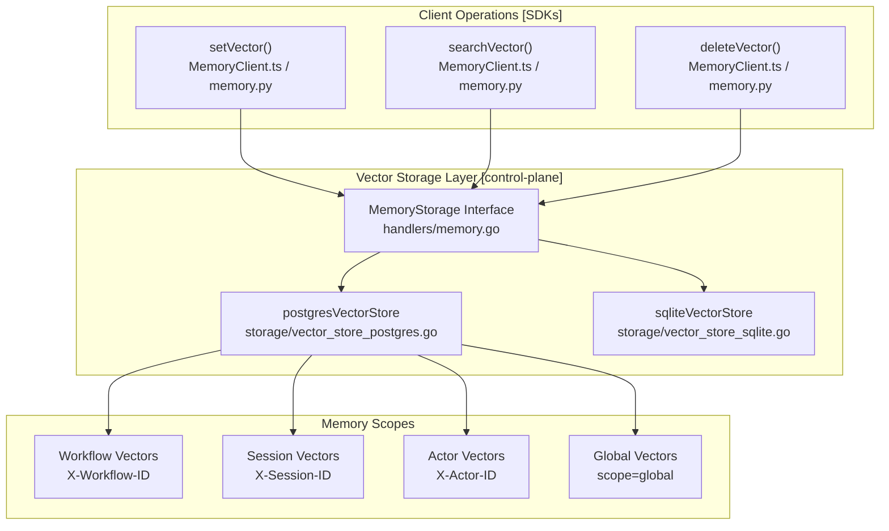
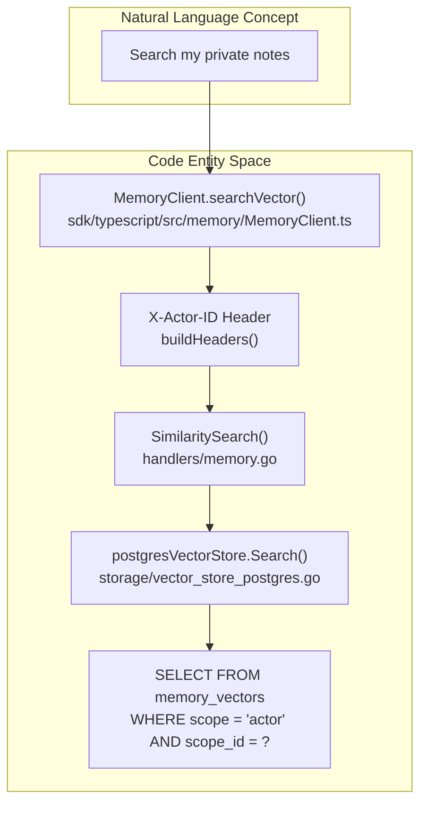

<!-- source: DeepWiki mcp.deepwiki.com · repo Agent-Field/agentfield · page 7.3 Vector Storage · fetched 2026-10-26 -->

# Vector Storage

<details>
<summary>Relevant source files</summary>

The following files were used as context for generating this wiki page:

- [control-plane/internal/handlers/memory.go](control-plane/internal/handlers/memory.go)
- [control-plane/internal/handlers/memory_handler_test.go](control-plane/internal/handlers/memory_handler_test.go)
- [control-plane/internal/handlers/vector_memory.go](control-plane/internal/handlers/vector_memory.go)
- [control-plane/internal/handlers/vector_memory_test.go](control-plane/internal/handlers/vector_memory_test.go)
- [control-plane/internal/server/server_routes_test.go](control-plane/internal/server/server_routes_test.go)
- [control-plane/internal/storage/local.go](control-plane/internal/storage/local.go)
- [control-plane/internal/storage/storage.go](control-plane/internal/storage/storage.go)
- [control-plane/internal/storage/vector_store.go](control-plane/internal/storage/vector_store.go)
- [control-plane/internal/storage/vector_store_postgres.go](control-plane/internal/storage/vector_store_postgres.go)
- [control-plane/internal/storage/vector_store_sqlite.go](control-plane/internal/storage/vector_store_sqlite.go)
- [sdk/python/agentfield/memory.py](sdk/python/agentfield/memory.py)
- [sdk/python/agentfield/memory_events.py](sdk/python/agentfield/memory_events.py)
- [sdk/python/tests/test_memory_scope_kwargs.py](sdk/python/tests/test_memory_scope_kwargs.py)
- [sdk/typescript/src/context/SkillContext.ts](sdk/typescript/src/context/SkillContext.ts)
- [sdk/typescript/src/memory/MemoryClient.ts](sdk/typescript/src/memory/MemoryClient.ts)
- [sdk/typescript/src/memory/MemoryEventClient.ts](sdk/typescript/src/memory/MemoryEventClient.ts)
- [sdk/typescript/src/memory/MemoryInterface.ts](sdk/typescript/src/memory/MemoryInterface.ts)
- [sdk/typescript/tests/memory_and_discovery.test.ts](sdk/typescript/tests/memory_and_discovery.test.ts)
- [sdk/typescript/tests/memory_event_client.test.ts](sdk/typescript/tests/memory_event_client.test.ts)
- [tests/functional/agents/memory_events_decorator_agent.py](tests/functional/agents/memory_events_decorator_agent.py)
- [tests/functional/tests/test_memory_events.py](tests/functional/tests/test_memory_events.py)

</details>


This page covers AgentField's vector storage system for semantic search and retrieval-augmented generation (RAG). Vector storage enables agents to store and search high-dimensional embeddings for similarity-based retrieval. For basic key-value operations, see [Key-Value Operations](#7.2). For organizing vector data across contexts, see [Memory Scopes](#7.1).

---

## Core Concepts

**Vector embeddings** are high-dimensional numerical representations of text, images, or other data that capture semantic meaning. AgentField stores these embeddings alongside metadata, enabling similarity-based search across agent memory.

### Use Cases

| Use Case | Description |
|----------|-------------|
| **Semantic Search** | Find documents or data similar to a query embedding |
| **RAG Systems** | Retrieve relevant context for LLM prompts |
| **Document Clustering** | Group similar content by embedding proximity |
| **Contextual Memory** | Store agent experiences as searchable vectors |

### Storage Architecture

The vector storage system is integrated into the `MemoryClient` and backed by the control plane's storage providers. It supports multiple backends including SQLite (via `vector_store_sqlite.go`) and PostgreSQL (via `vector_store_postgres.go` using the `pgvector` extension).



**Sources:** [sdk/typescript/src/memory/MemoryClient.ts:171-205](), [control-plane/internal/handlers/memory.go:23-27](), [control-plane/internal/storage/vector_store_postgres.go:15-25](), [sdk/python/agentfield/memory.py:410-445]()

---

## Vector Operations

### Setting Vectors

Store embeddings with associated keys and metadata. The system automatically normalizes various input types (like numpy arrays or tuples) into float lists before transmission.

#### TypeScript
```typescript
// Set a vector with metadata [sdk/typescript/src/memory/MemoryClient.ts:171-182]
await memory.setVector(
  'doc:chunk-1',
  [0.1, 0.2, 0.3, ...],  // 384-dim embedding
  { 
    source: 'docs/api.md',
    section: 'Authentication'
  },
  { scope: 'global' }
);
```

#### Python
```python
# Set a vector with metadata [sdk/python/agentfield/memory.py:410-435]
await app.memory.set_vector(
    'doc:chunk-1',
    [0.1, 0.2, 0.3, ...],
    metadata={'source': 'docs/api.md'},
    scope='global'
)
```

**Implementation Details:**
The `MemoryClient` sends payloads to `/api/v1/memory/vector/set`. On the control plane, `SetVector` handles persistence. In PostgreSQL, this uses an `ON CONFLICT` clause to perform upserts.

**Sources:** [sdk/typescript/src/memory/MemoryClient.ts:171-182](), [sdk/python/agentfield/memory.py:410-435](), [control-plane/internal/storage/vector_store_postgres.go:41-49]()

---

### Searching Vectors

Perform similarity search using query embeddings. The control plane supports different distance metrics including Cosine (default), L2, and Dot Product.

#### TypeScript
```typescript
// Search for similar vectors [sdk/typescript/src/memory/MemoryClient.ts:193-205]
const results = await memory.searchVector(
  queryEmbedding,
  {
    topK: 5,
    filters: { source: 'docs/api.md' },
    scope: 'global'
  }
);
```

#### Python
```python
# Search for similar vectors [sdk/python/agentfield/memory.py:461-487]
results = await app.memory.search_vector(
    query_embedding,
    top_k=5,
    filters={'source': 'docs/api.md'},
    scope='global'
)
```

**Distance Metrics (PostgreSQL):**
AgentField translates metrics into native `pgvector` operators:
- **Cosine**: `1 - (mv.embedding <=> query_vec)`
- **L2**: `-(mv.embedding <-> query_vec)`
- **Dot Product**: `-(mv.embedding <#> query_vec)`

**Sources:** [control-plane/internal/storage/vector_store_postgres.go:238-250](), [sdk/typescript/src/memory/MemoryClient.ts:193-205](), [sdk/python/agentfield/memory.py:461-487]()

---

### Deleting Vectors

Vectors can be deleted individually by key or in bulk by prefix.

#### TypeScript
```typescript
// Delete single vector [sdk/typescript/src/memory/MemoryClient.ts:184-191]
await memory.deleteVector('doc:chunk-1', { scope: 'global' });
```

#### Python
```python
# Delete single vector [sdk/python/agentfield/memory.py:437-459]
await app.memory.delete_vector('doc:chunk-1', scope='global')

# Delete by prefix (useful for cleaning up document chunks)
await app.memory.delete_vectors_by_prefix('doc:', scope='global')
```

**Sources:** [sdk/typescript/src/memory/MemoryClient.ts:184-191](), [sdk/python/agentfield/memory.py:437-459](), [control-plane/internal/storage/vector_store_postgres.go:132-151]()

---

## Embedding Generation

### Via AI Providers
The SDKs integrate with the `AIClient` to generate embeddings from text before storing them.

| Provider | Embedding Support |
|----------|-------------------|
| **OpenAI** | Supported |
| **Google** | Supported |
| **Mistral** | Supported |
| **Cohere** | Supported |
| **Ollama** | Supported |

**Sources:** [sdk/typescript/src/ai/AIClient.ts:258-310]()

---

## Memory Scopes and Vectors

Vector storage respects AgentField's memory scope hierarchy. Scopes are enforced via HTTP headers and resolved on the control plane.



**Scope Resolution:**
The control plane uses `resolveScope` to determine the active context. If a scope is not explicitly provided in the request body, it is inferred from the `X-Workflow-ID`, `X-Session-ID`, or `X-Actor-ID` headers.

**Sources:** [control-plane/internal/handlers/memory.go:79-84](), [sdk/typescript/src/memory/MemoryClient.ts:52-75](), [sdk/python/agentfield/memory.py:150-170]()

---

## API Reference

### MemoryClient Methods (TypeScript)

| Method | Signature | Description |
|--------|-----------|-------------|
| `setVector` | `(key, embedding, metadata?, options?)` | Store vector with metadata |
| `deleteVector` | `(key, options?)` | Delete vector by key |
| `searchVector` | `(queryEmbedding, options?)` | Similarity search |

**Sources:** [sdk/typescript/src/memory/MemoryClient.ts:117-206]()

### Memory Interface Methods (Python)

| Method | Signature | Description |
|--------|-----------|-------------|
| `set_vector` | `(key, embedding, metadata=None, scope=None)` | Store vector |
| `get_vector` | `(key, scope=None)` | Retrieve vector and metadata |
| `delete_vector` | `(key, scope=None)` | Remove vector |
| `search_vector` | `(query_embedding, top_k=10, filters=None, scope=None)` | Search vectors |

**Sources:** [sdk/python/agentfield/memory.py:410-510]()

### Storage Types (Go)

```go
type VectorRecord struct {
    Scope     string          `json:"scope"`
    ScopeID   string          `json:"scope_id"`
    Key       string          `json:"key"`
    Embedding []float32       `json:"embedding"`
    Metadata  map[string]any  `json:"metadata"`
    CreatedAt time.Time       `json:"created_at"`
    UpdatedAt time.Time       `json:"updated_at"`
}
```

**Sources:** [control-plane/pkg/types/memory.go]() (referenced via [control-plane/internal/handlers/memory.go:23]())

---

