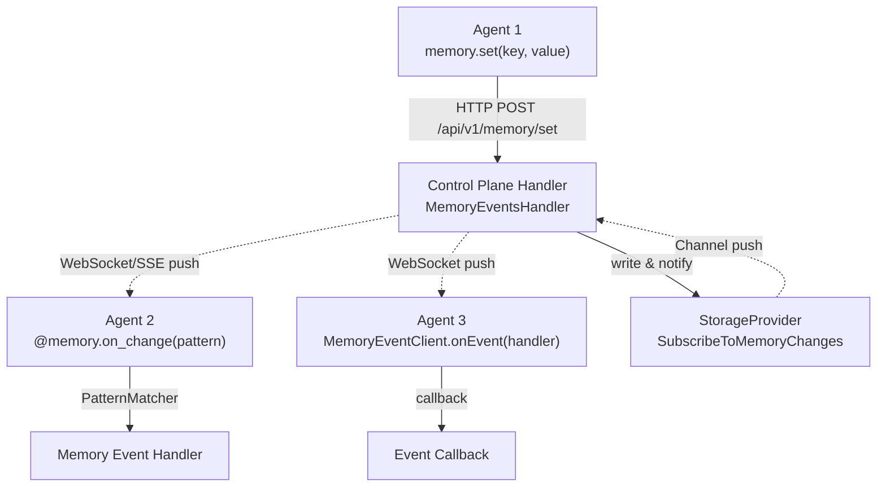
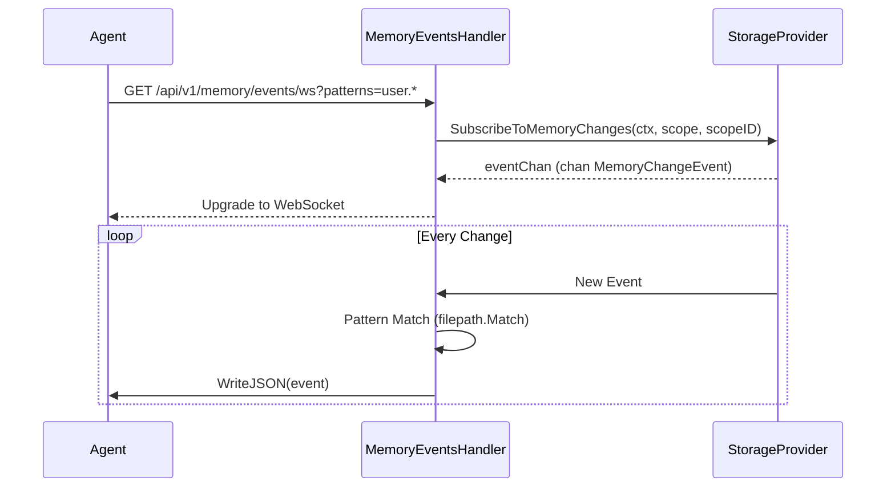

<!-- source: DeepWiki mcp.deepwiki.com · repo Agent-Field/agentfield · page 7.4 Memory Events · fetched 2026-10-26 -->

# Memory Events

<details>
<summary>Relevant source files</summary>

The following files were used as context for generating this wiki page:

- [control-plane/internal/handlers/memory_events.go](control-plane/internal/handlers/memory_events.go)
- [control-plane/internal/handlers/memory_events_test.go](control-plane/internal/handlers/memory_events_test.go)
- [control-plane/internal/handlers/reasoners_test.go](control-plane/internal/handlers/reasoners_test.go)
- [control-plane/internal/handlers/ui/dashboard_helpers_test.go](control-plane/internal/handlers/ui/dashboard_helpers_test.go)
- [control-plane/internal/handlers/ui/execution_helpers_test.go](control-plane/internal/handlers/ui/execution_helpers_test.go)
- [control-plane/internal/handlers/ui/execution_logs_handler_test.go](control-plane/internal/handlers/ui/execution_logs_handler_test.go)
- [control-plane/internal/handlers/ui/router_helpers_test.go](control-plane/internal/handlers/ui/router_helpers_test.go)
- [sdk/python/agentfield/memory.py](sdk/python/agentfield/memory.py)
- [sdk/python/agentfield/memory_events.py](sdk/python/agentfield/memory_events.py)
- [sdk/python/tests/test_memory_scope_kwargs.py](sdk/python/tests/test_memory_scope_kwargs.py)
- [sdk/typescript/src/context/SkillContext.ts](sdk/typescript/src/context/SkillContext.ts)
- [sdk/typescript/src/memory/MemoryClient.ts](sdk/typescript/src/memory/MemoryClient.ts)
- [sdk/typescript/src/memory/MemoryEventClient.ts](sdk/typescript/src/memory/MemoryEventClient.ts)
- [sdk/typescript/src/memory/MemoryInterface.ts](sdk/typescript/src/memory/MemoryInterface.ts)
- [sdk/typescript/tests/memory_and_discovery.test.ts](sdk/typescript/tests/memory_and_discovery.test.ts)
- [sdk/typescript/tests/memory_event_client.test.ts](sdk/typescript/tests/memory_event_client.test.ts)
- [tests/functional/agents/memory_events_decorator_agent.py](tests/functional/agents/memory_events_decorator_agent.py)
- [tests/functional/tests/test_memory_events.py](tests/functional/tests/test_memory_events.py)

</details>


Memory events provide real-time change notifications when memory values are updated or deleted across the AgentField system. This enables reactive workflows, state synchronization across agents, and event-driven architectures without polling.

For basic memory operations, see [Key-Value Operations](#7.2). For understanding memory scoping, see [Memory Scopes](#7.1).

---

## Overview

The memory event system uses WebSocket or Server-Sent Events (SSE) connections to push change notifications to subscribed agents in real-time. Agents can subscribe to specific memory keys using pattern matching, filter by scope, and react to both `set` and `delete` operations.

**Key capabilities:**
- **Pattern matching** - Subscribe using exact keys, wildcards, or nested patterns. [sdk/python/agentfield/memory_events.py:18-42]()
- **Scope filtering** - Listen to specific workflow, session, actor, or global scopes. [control-plane/internal/handlers/memory_events.go:66-68]()
- **Event History** - Retrieve past events using the history API. [control-plane/internal/handlers/memory_events.go:182-216]()
- **Decorator syntax** - Python SDK provides `@memory.on_change()` decorators. [sdk/python/agentfield/memory.py:445-462]()
- **Automatic reconnection** - WebSocket clients handle disconnects gracefully with exponential backoff. [sdk/typescript/src/memory/MemoryEventClient.ts:89-100]()

**Sources:** [sdk/python/agentfield/memory_events.py:1-110](), [sdk/typescript/src/memory/MemoryEventClient.ts:1-164]()

---

## Architecture

### Event Flow



**Event Publication:**
1. Agent performs `memory.set()` via `MemoryClient`. [sdk/python/agentfield/memory.py:187-210]()
2. Control plane persists change via `StorageProvider`. [control-plane/internal/handlers/memory_events.go:20-23]()
3. The storage layer notifies the `MemoryEventsHandler` via a Go channel. [control-plane/internal/handlers/memory_events.go:71-72]()
4. Subscribed agents receive events via `WebSocketHandler` or `SSEHandler`. [control-plane/internal/handlers/memory_events.go:56-179]()
5. Pattern matching filters events to relevant handlers on the client side. [sdk/python/agentfield/memory_events.py:60-76]()

**Sources:** [control-plane/internal/handlers/memory_events.go:19-111](), [sdk/python/agentfield/memory.py:132-171](), [sdk/typescript/src/memory/MemoryEventClient.ts:13-38]()

---

## Event Structure

Each memory event is represented by the `MemoryChangeEvent` type:

| Field | Type | Description |
|-------|------|-------------|
| `id` | `string` | Unique event identifier. |
| `key` | `string` | Memory key that changed. |
| `scope` | `string` | Scope type: `workflow`, `session`, `actor`, or `global`. |
| `scope_id` | `string` | ID of the specific scope instance. |
| `action` | `string` | Operation type: `set` or `delete`. |
| `data` | `any` | New value (for `set` operations). |
| `previous_data` | `any` | Previous value (for `delete` operations). |
| `metadata` | `object` | Agent ID, workflow ID, timestamps, etc. |
| `timestamp` | `string` | ISO 8601 timestamp of the event. |

**Sources:** [sdk/python/agentfield/types.py:14-45](), [control-plane/internal/handlers/memory_events_test.go:113-124]()

---

## Pattern Matching

The system supports wildcard matching using the `PatternMatcher` utility. [sdk/python/agentfield/memory_events.py:18-42]()

### Pattern Types

| Pattern | Example Keys Matched | Description |
|---------|---------------------|-------------|
| `"user.theme"` | `user.theme` | Exact key match only. |
| `"user.*"` | `user.theme`, `user.lang` | Any key with prefix `user.` (matches single segment). |
| `"settings.*.mode"` | `settings.display.mode` | Nested wildcard between segments. |
| `"features.*.*.rollout"`| `features.beta.flag.rollout` | Multiple wildcard segments. |

**Matching Logic:**
- Patterns are converted to regular expressions internally. [sdk/python/agentfield/memory_events.py:33-35]()
- Wildcards (`*`) are treated as `.*` in regex context. [sdk/python/agentfield/memory_events.py:34]()
- The server-side also supports pattern filtering using Go's `filepath.Match`. [control-plane/internal/handlers/memory_events.go:97-101]()

**Sources:** [sdk/python/agentfield/memory_events.py:21-42](), [control-plane/internal/handlers/memory_events.go:39-53]()

---

## Python SDK: Decorator Subscriptions

The Python SDK uses `MemoryInterface` to manage subscriptions via decorators. [sdk/python/agentfield/memory.py:445-462]()

### Usage Examples

```python
# Basic subscription
@agent.memory.on_change("user.preferences.theme")
async def handle_theme_change(event):
    print(f"New theme: {event.data}")

# Wildcard pattern
@agent.memory.on_change("user.preferences.*")
async def handle_any_preference(event):
    print(f"Key {event.key} changed to {event.data}")

# Explicit scope subscription
@agent.memory.global_scope.on_change("config.*")
async def handle_global_config(event):
    print("Global config updated")
```

**Implementation Details:**
- The `@on_change` decorator wraps the callback and adds it to the `MemoryEventClient`. [sdk/python/agentfield/memory.py:445-462]()
- The `MemoryEventClient` manages the underlying WebSocket connection to the Control Plane. [sdk/python/agentfield/memory_events.py:83-105]()

**Sources:** [sdk/python/agentfield/memory.py:445-462](), [sdk/python/agentfield/memory_events.py:44-81]()

---

## TypeScript SDK: Handler Subscriptions

The TypeScript `MemoryEventClient` provides a functional approach to event handling. [sdk/typescript/src/memory/MemoryEventClient.ts:13-38]()

### Client Configuration

```typescript
import { MemoryEventClient } from '@agentfield/sdk';

const events = new MemoryEventClient('http://localhost:8080', {
  'X-Agent-Node-ID': 'my-node'
});

events.onEvent(async (event) => {
  console.log(`Received change for ${event.key}`);
});

events.start();
```

### Event History

The TypeScript SDK can also query historical events:

```typescript
const history = await events.history({
  patterns: ["user.*"],
  limit: 50,
  scope: "session",
  scopeId: "session-123"
});
```

**Sources:** [sdk/typescript/src/memory/MemoryEventClient.ts:31-38](), [sdk/typescript/src/memory/MemoryEventClient.ts:116-164]()

---

## Control Plane Implementation

The Control Plane manages subscriptions through the `MemoryEventsHandler`. [control-plane/internal/handlers/memory_events.go:20-23]()

### WebSocket and SSE Support

The server supports two protocols for real-time delivery:
1. **WebSockets**: Efficient bi-directional communication. [control-plane/internal/handlers/memory_events.go:56-111]()
2. **Server-Sent Events (SSE)**: Unidirectional streaming over HTTP. [control-plane/internal/handlers/memory_events.go:114-179]()

### Connection Lifecycle



**Sources:** [control-plane/internal/handlers/memory_events.go:56-111](), [control-plane/internal/handlers/memory_events_test.go:46-74]()

---

## Event History API

Historical events can be retrieved via `GET /api/v1/memory/events/history`. [control-plane/internal/handlers/memory_events.go:182-216]()

**Filter Parameters:**
- `scope`: Filter by scope type.
- `scope_id`: Filter by specific scope ID.
- `patterns`: Comma-separated list of wildcard patterns.
- `since`: ISO 8601 timestamp to fetch events after.
- `limit`: Maximum number of events to return.

**Sources:** [control-plane/internal/handlers/memory_events.go:187-206](), [sdk/typescript/src/memory/MemoryEventClient.ts:132-152]()

---

## Connection Management and Reconnection

The `MemoryEventClient` (both Python and TS) implements robust connection logic:
- **Sanitization**: Only specific headers (e.g., `Authorization`, `X-*`) are forwarded to the WebSocket handshake. [sdk/typescript/src/memory/MemoryEventClient.ts:102-113]()
- **Exponential Backoff**: If the connection drops, the client waits for an increasing delay (doubling each time, up to 30s) before retrying. [sdk/typescript/src/memory/MemoryEventClient.ts:89-100]()
- **Heartbeats**: The Control Plane monitors connection health via reader loops. [control-plane/internal/handlers/memory_events.go:80-89]()

**Sources:** [sdk/typescript/src/memory/MemoryEventClient.ts:89-100](), [sdk/python/agentfield/memory_events.py:101-105]()

---

