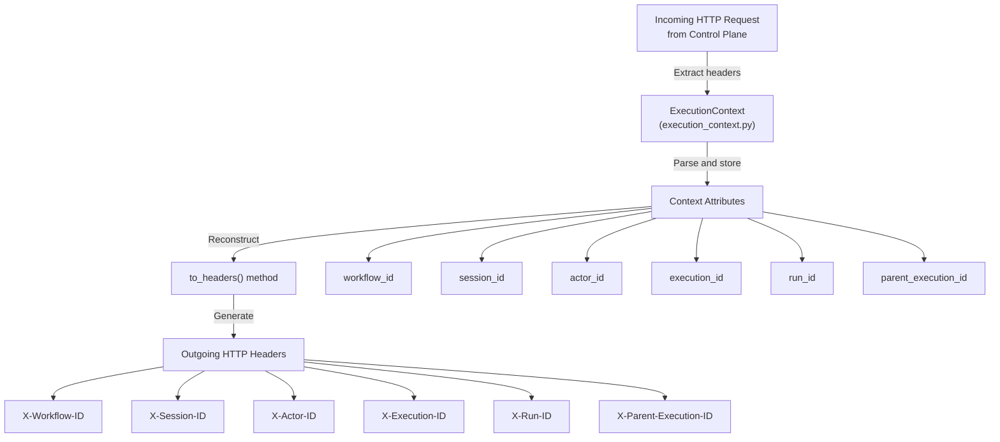
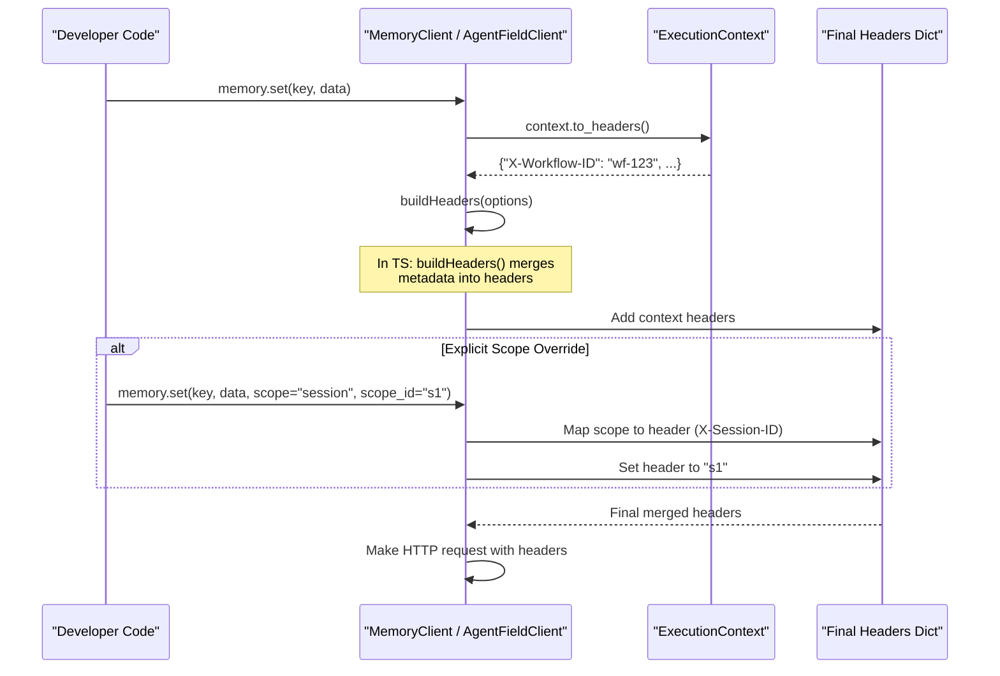
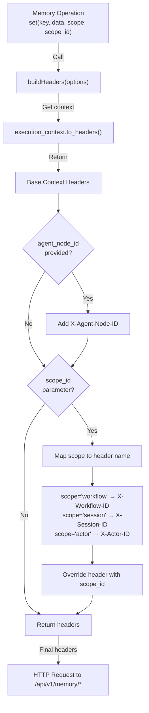
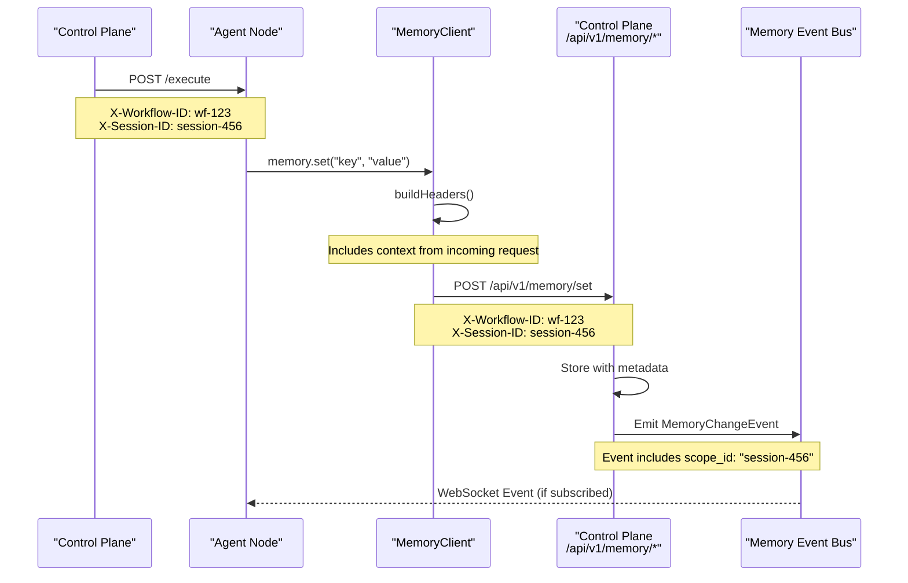
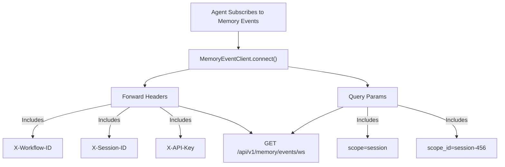

<!-- source: DeepWiki mcp.deepwiki.com · repo Agent-Field/agentfield · page 7.5 Context Propagation · fetched 2026-10-26 -->

# Context Propagation

Relevant source files

The following files were used as context for generating this wiki page:

- [sdk/python/agentfield/execution_context.py](sdk/python/agentfield/execution_context.py)
- [sdk/python/agentfield/memory.py](sdk/python/agentfield/memory.py)
- [sdk/python/agentfield/memory_events.py](sdk/python/agentfield/memory_events.py)
- [sdk/python/tests/integration/conftest.py](sdk/python/tests/integration/conftest.py)
- [sdk/python/tests/integration/test_agentfield_end_to_end.py](sdk/python/tests/integration/test_agentfield_end_to_end.py)
- [sdk/python/tests/test_execution_context_core.py](sdk/python/tests/test_execution_context_core.py)
- [sdk/python/tests/test_memory_scope_kwargs.py](sdk/python/tests/test_memory_scope_kwargs.py)
- [sdk/typescript/src/context/SkillContext.ts](sdk/typescript/src/context/SkillContext.ts)
- [sdk/typescript/src/memory/MemoryClient.ts](sdk/typescript/src/memory/MemoryClient.ts)
- [sdk/typescript/src/memory/MemoryEventClient.ts](sdk/typescript/src/memory/MemoryEventClient.ts)
- [sdk/typescript/src/memory/MemoryInterface.ts](sdk/typescript/src/memory/MemoryInterface.ts)
- [sdk/typescript/tests/memory_and_discovery.test.ts](sdk/typescript/tests/memory_and_discovery.test.ts)
- [sdk/typescript/tests/memory_event_client.test.ts](sdk/typescript/tests/memory_event_client.test.ts)
- [tests/functional/agents/memory_events_decorator_agent.py](tests/functional/agents/memory_events_decorator_agent.py)
- [tests/functional/tests/test_memory_events.py](tests/functional/tests/test_memory_events.py)

## Overview

Context propagation is the mechanism by which execution metadata flows transparently through distributed agent operations, enabling automatic memory scoping, workflow tracking, and event routing. When an agent execution is initiated, context headers capture workflow, session, actor, and execution identifiers. These headers are then automatically included in all downstream operations—memory reads/writes, cross-agent calls, and event subscriptions—without requiring explicit parameter passing by developers.

This document describes the HTTP header-based context propagation system and its integration with memory operations. For information about how context enables workflow tracking and DAG generation, see [Workflow Tracking](#9.3). For details on memory scoping behavior enabled by context, see [Memory Scopes](#7.1).

## Context Headers

AgentField uses a standardized set of HTTP headers to propagate execution context across distributed operations. All headers use the `X-` prefix convention for custom headers.

| Header Name | Purpose | Scope |
|------------|---------|-------|
| `X-Workflow-ID` | Identifies the top-level workflow instance | All operations within a workflow |
| `X-Session-ID` | Identifies a user or conversation session | All operations within a session |
| `X-Actor-ID` | Identifies the executing actor (user/bot/system) | All operations by that actor |
| `X-Agent-Node-ID` | Identifies the current agent node | Memory operations scoped to agent |
| `X-Execution-ID` | Unique identifier for a single execution | Single reasoner/skill invocation |
| `X-Run-ID` | Identifies a logical run grouping | Related executions in a batch |
| `X-Parent-Execution-ID` | Links to parent execution in call chain | Child executions in nested calls |
| `X-Caller-DID` | Decentralized Identifier of the caller | Security and identity verification |
| `X-Target-DID` | Decentralized Identifier of the target agent | Routing and identity verification |
| `X-AgentField-Replay-Mode`| Metadata for execution replay | Replay and debugging |

**Sources:** [sdk/python/agentfield/memory.py:150-171](), [sdk/python/agentfield/execution_context.py:130-185](), [sdk/typescript/src/memory/MemoryClient.ts:52-75]()

## Execution Context Capture

The `ExecutionContext` class captures incoming request headers and provides methods to reconstruct them for downstream operations. This context is automatically initialized when an agent receives an execution request from the control plane. In Python, this is managed via thread-local or context-variable storage to ensure availability within reasoner and skill functions.

**Sources:** [sdk/python/agentfield/execution_context.py:130-185](), [sdk/python/tests/test_execution_context_core.py:12-38](), [sdk/typescript/src/context/SkillContext.ts:70-91]()

## Client Context Propagation

The SDK clients maintain a reference to the active execution context and automatically merge context headers into all outgoing requests. The merge logic ensures that explicit overrides are respected while providing sensible defaults from the current execution environment.

### Header Merge Sequence

**Key Implementation Details:**

1. **Python `MemoryClient`**: Merges context headers via `self.execution_context.to_headers()` [sdk/python/agentfield/memory.py:155]().
2. **TypeScript `MemoryClientBase`**: Implements `buildHeaders` to map `MemoryRequestMetadata` to `X-` headers [sdk/typescript/src/memory/MemoryClient.ts:52-75]().
3. **Scope Mapping**: Scopes like `workflow`, `session`, and `actor` are mapped to their respective `X-Workflow-ID`, `X-Session-ID`, and `X-Actor-ID` headers [sdk/typescript/src/memory/MemoryClient.ts:77-88]().

**Sources:** [sdk/python/agentfield/memory.py:150-171](), [sdk/typescript/src/memory/MemoryClient.ts:52-88](), [sdk/typescript/src/memory/MemoryInterface.ts:41-47]()

## Memory Context Integration

The `MemoryClient` integrates execution context into memory operations, enabling automatic scoping without explicit scope parameters. The `_build_headers()` (Python) or `buildHeaders()` (TS) method merges execution context with optional scope overrides.

### Memory Header Construction

**Scope Override Logic:**

When a memory operation specifies an explicit `scope_id`, the corresponding context header is overridden:

- `scope="workflow"`, `scope_id="custom-wf-123"` → Sets `X-Workflow-ID: custom-wf-123` [sdk/python/agentfield/memory.py:162-168]()
- `scope="session"`, `scope_id="user-session-456"` → Sets `X-Session-ID: user-session-456` [sdk/typescript/src/memory/MemoryClient.ts:81-82]()

**Sources:** [sdk/python/agentfield/memory.py:150-171](), [sdk/typescript/src/memory/MemoryClient.ts:52-88](), [sdk/python/tests/test_memory_scope_kwargs.py:83-88]()

## End-to-End Context Flow

Context headers flow from initial execution through memory operations and event notifications. This allows the Control Plane to track the provenance of every memory write.

**Sources:** [sdk/python/agentfield/memory.py:187-210](), [sdk/typescript/src/memory/MemoryEventClient.ts:71-81](), [tests/functional/tests/test_memory_events.py:28-70]()

## Context in Event Subscriptions

Memory event clients (`MemoryEventClient`) also use context propagation to filter real-time updates. When connecting via WebSocket, the client forwards context headers to the server to enable server-side filtering of events.

### WebSocket Context Propagation

**Key Implementation Details:**

1. **Python `MemoryEventClient`**: Connects using headers from `self.execution_context.to_headers()` [sdk/python/agentfield/memory_events.py:149-169]().
2. **TypeScript `MemoryEventClient`**: Sanitizes headers to only forward `X-` headers, `Authorization`, and `Cookie` to the WebSocket endpoint [sdk/typescript/src/memory/MemoryEventClient.ts:102-113]().
3. **Event History**: The `history()` method also propagates context headers to the REST endpoint to retrieve historical events for the current workflow or session [sdk/typescript/src/memory/MemoryEventClient.ts:127-130]().

**Sources:** [sdk/python/agentfield/memory_events.py:127-173](), [sdk/typescript/src/memory/MemoryEventClient.ts:102-113](), [sdk/typescript/src/memory/MemoryEventClient.ts:116-158]()

## Hierarchical Fallback and Context

The `MemoryInterface` uses context to perform hierarchical lookups. When `get()` is called without an explicit scope, the client attempts to resolve the key by traversing from the most specific scope (Workflow) to the broadest (Global), using the IDs found in the execution context.

### Lookup Order Resolution

The lookup order is determined by the `getScopeOrder()` (TS) or internal logic in Python:
1. **Workflow Scope**: Uses `X-Workflow-ID` or `X-Run-ID`.
2. **Session Scope**: Uses `X-Session-ID`.
3. **Actor Scope**: Uses `X-Actor-ID`.
4. **Global Scope**: Uses the constant `'global'`.

**Sources:** [sdk/typescript/src/memory/MemoryInterface.ts:191-209](), [sdk/python/agentfield/memory.py:47-56]()

## Header Sanitization and Normalization

To ensure reliable propagation across different HTTP clients (Axios, httpx, requests), the SDKs perform sanitization.

- **TypeScript**: `sanitizeHeaders` converts all values to strings and removes `undefined`/`null` [sdk/typescript/src/memory/MemoryClient.ts:106-113]().
- **Python**: `_build_headers` merges context and ensures required headers like `X-Agent-Node-ID` are present if available [sdk/python/agentfield/memory.py:150-171]().

**Sources:** [sdk/typescript/src/memory/MemoryClient.ts:106-113](), [sdk/python/agentfield/memory.py:150-171]()

---

