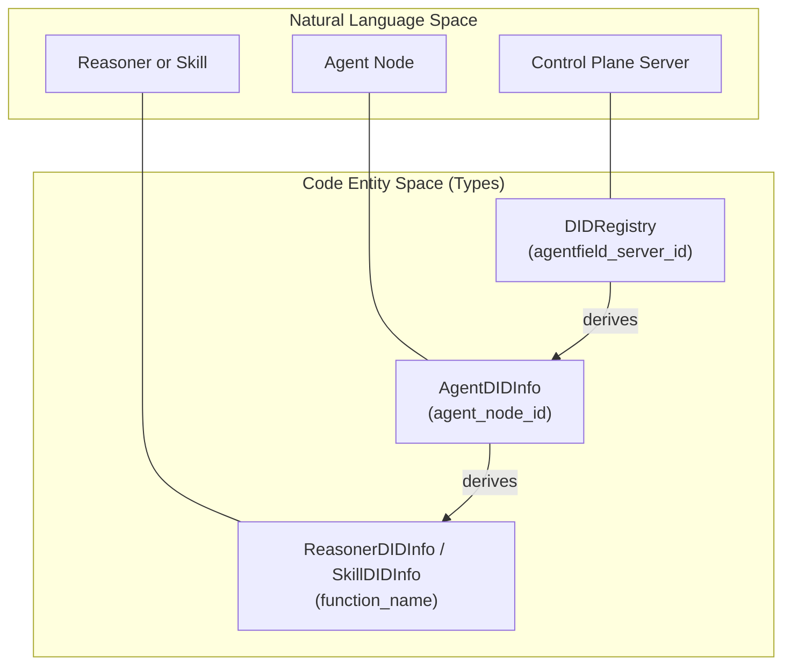
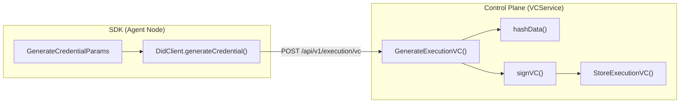

<!-- source: DeepWiki mcp.deepwiki.com · repo Agent-Field/agentfield · page 8 Identity & Trust · fetched 2026-10-26 -->

# Identity & Trust

Relevant source files

The following files were used as context for generating this wiki page:

- [control-plane/internal/services/vc_chain.go](control-plane/internal/services/vc_chain.go)
- [control-plane/internal/services/vc_issuance.go](control-plane/internal/services/vc_issuance.go)
- [control-plane/internal/services/vc_resolution.go](control-plane/internal/services/vc_resolution.go)
- [control-plane/internal/services/vc_service.go](control-plane/internal/services/vc_service.go)
- [control-plane/internal/services/vc_service_test.go](control-plane/internal/services/vc_service_test.go)
- [control-plane/internal/services/vc_storage.go](control-plane/internal/services/vc_storage.go)
- [control-plane/internal/services/vc_validation.go](control-plane/internal/services/vc_validation.go)
- [control-plane/pkg/types/did_types.go](control-plane/pkg/types/did_types.go)
- [control-plane/web/client/src/hooks/useVCVerification.ts](control-plane/web/client/src/hooks/useVCVerification.ts)
- [control-plane/web/client/src/types/did.ts](control-plane/web/client/src/types/did.ts)
- [examples/ts-node-examples/init-example/package.json](examples/ts-node-examples/init-example/package.json)
- [sdk/typescript/src/did/DidClient.ts](sdk/typescript/src/did/DidClient.ts)
- [sdk/typescript/src/utils/httpAgents.ts](sdk/typescript/src/utils/httpAgents.ts)
- [sdk/typescript/tests/did_client_methods.test.ts](sdk/typescript/tests/did_client_methods.test.ts)
- [sdk/typescript/tests/integration.e2e.test.ts](sdk/typescript/tests/integration.e2e.test.ts)
- [sdk/typescript/tests/memory_performance.test.ts](sdk/typescript/tests/memory_performance.test.ts)
- [tests/functional/ts_agents/echo-agent.mjs](tests/functional/ts_agents/echo-agent.mjs)

This page documents AgentField's cryptographic identity and trust system, which provides verifiable provenance for agent executions through W3C-compliant Decentralized Identifiers (DIDs) and Verifiable Credentials (VCs). This system enables cryptographic proof of execution chains, infrastructure-level access control, and compliance-ready audit trails.

**Scope**: This page covers DID hierarchies, VC generation, storage schemas, and audit trail export. For agent-to-agent communication patterns that use these identities, see [Multi-Agent Coordination](#9). For memory and state management, see [Memory System](#7).

---

## Overview

AgentField implements a hierarchical identity system where cryptographic identities are deterministically derived from a root seed. Each execution produces a tamper-evident Verifiable Credential that can be aggregated into workflow-level VCs for compliance and audit purposes.

**Core Components**:
- **DID Registry**: W3C-compliant decentralized identifiers for server, agents, and components. [control-plane/pkg/types/did_types.go:8-17]()
- **VC Engine**: Generates cryptographically signed credentials for executions. [control-plane/internal/services/vc_issuance.go:15-136]()
- **Hierarchical Derivation**: Server → Agent → Component identity chains. [control-plane/pkg/types/did_types.go:19-60]()
- **Policy Enforcement**: Infrastructure-level access control using DIDs and VCs. [control-plane/internal/services/vc_service.go:49-59]()
- **Audit Trail**: Exportable VC chains with mathematical proof. [control-plane/internal/services/vc_chain.go:13-60]()

Sources: [control-plane/internal/services/vc_service.go:19-33](), [control-plane/pkg/types/did_types.go:1-132](), [sdk/typescript/src/did/DidClient.ts:9-112]()

---

## DID Hierarchical Architecture

AgentField uses a hierarchical DID architecture where each level is cryptographically derived from its parent. This allows for fine-grained identity management (down to individual reasoners and skills) while maintaining a single root of trust.

### Identity Model Mapping

**Identity Components**:
- **DIDRegistry**: Represents the master DID registry for an `af` server, containing the `MasterSeed` and `RootDID`. [control-plane/pkg/types/did_types.go:8-17]()
- **AgentDIDInfo**: Contains DID information for an agent node, including its `PublicKeyJWK` and `X25519PublicKeyJWK` for encryption. [control-plane/pkg/types/did_types.go:19-38]()
- **Component Info**: `ReasonerDIDInfo` and `SkillDIDInfo` represent the individual functions with their own DIDs and `DerivationPath`. [control-plane/pkg/types/did_types.go:40-60]()

Sources: [control-plane/pkg/types/did_types.go:8-60](), [control-plane/web/client/src/types/did.ts:3-34]()

---

## Decentralized Identifiers (DIDs)

AgentField implements W3C-compliant DIDs (primarily using the `did:key` method) to identify every actor in the system.

- **Derivation**: Keys are derived using hierarchical deterministic paths (e.g., `m/0` for agents, `m/1` for reasoners). [sdk/typescript/src/did/DidClient.ts:158-188]()
- **Registration**: Agents register their capabilities with the control plane via `DidClient.registerAgent` to receive an `IdentityPackage`. [sdk/typescript/src/did/DidClient.ts:132-156]()
- **Key Management**: The system supports key rotation for encryption keys (`X25519Epoch`) while maintaining the primary signing identity. [control-plane/pkg/types/did_types.go:25-32]()

For details, see [Decentralized Identifiers (DIDs)](#8.1).

Sources: [sdk/typescript/src/did/DidClient.ts:9-36](), [control-plane/pkg/types/did_types.go:19-38]()

---

## Verifiable Credentials (VCs)

Every execution in AgentField can generate a Verifiable Credential (VC) that serves as a tamper-evident record of what happened.

### Execution VC Workflow

- **Hashing**: Input and output data are hashed (SHA-256) to ensure integrity without necessarily storing sensitive data in the VC document. [control-plane/internal/services/vc_service.go:137-145]()
- **Signing**: Credentials are signed using Ed25519 signatures (`Ed25519Signature2020`). [control-plane/internal/services/vc_issuance.go:73-85]()
- **Aggregation**: Individual `ExecutionVC` records are aggregated into a `WorkflowVC` to provide a summary of an entire session. [control-plane/internal/services/vc_issuance.go:138-177]()

For details, see [Verifiable Credentials](#8.2).

Sources: [control-plane/internal/services/vc_issuance.go:15-136](), [sdk/typescript/src/did/DidClient.ts:190-219](), [control-plane/pkg/types/did_types.go:71-107]()

---

## Policy Enforcement

The Identity & Trust system enables infrastructure-level access control. The control plane can be configured to require VCs for execution, effectively preventing unsigned or anonymous actors from invoking sensitive reasoners or skills.

- **Requirement Flags**: `RequireVCForExecution` and `PersistExecutionVC` control the enforcement levels. [control-plane/internal/services/vc_service.go:49-70]()
- **Verification**: The `VCService.VerifyVC` method checks signatures, expiry (`expirationDate`), and revocation status. [control-plane/internal/services/vc_validation.go:17-82]()
- **Revocation**: VCs can be checked against a revocation list in storage to invalidate credentials after issuance. [control-plane/internal/services/vc_validation.go:172-218]()

For details, see [Policy Enforcement](#8.3).

Sources: [control-plane/internal/services/vc_service.go:49-70](), [control-plane/internal/services/vc_validation.go:17-82]()

---

## Audit Trail Export

AgentField provides tools to export the complete provenance of a workflow. This is essential for compliance and debugging in complex multi-agent systems.

- **VC Chain**: The `GetWorkflowVCChain` method retrieves all execution VCs associated with a `workflow_id` and generates a `DIDResolutionBundle` for offline verification. [control-plane/internal/services/vc_chain.go:13-60]()
- **Status Summaries**: The system can generate lightweight summaries (`WorkflowVCStatusSummary`) for UI dashboards to show verification health across many workflows. [control-plane/internal/services/vc_service.go:72-135]()
- **Data Integrity**: Verification results include detailed scores and integrity checks (e.g., `hash_validation`, `signature_strength`). [control-plane/web/client/src/types/did.ts:235-244]()

For details, see [Audit Trail Export](#8.4).

Sources: [control-plane/internal/services/vc_chain.go:13-123](), [control-plane/internal/services/vc_service.go:72-135](), [control-plane/web/client/src/types/did.ts:246-270]()

---

