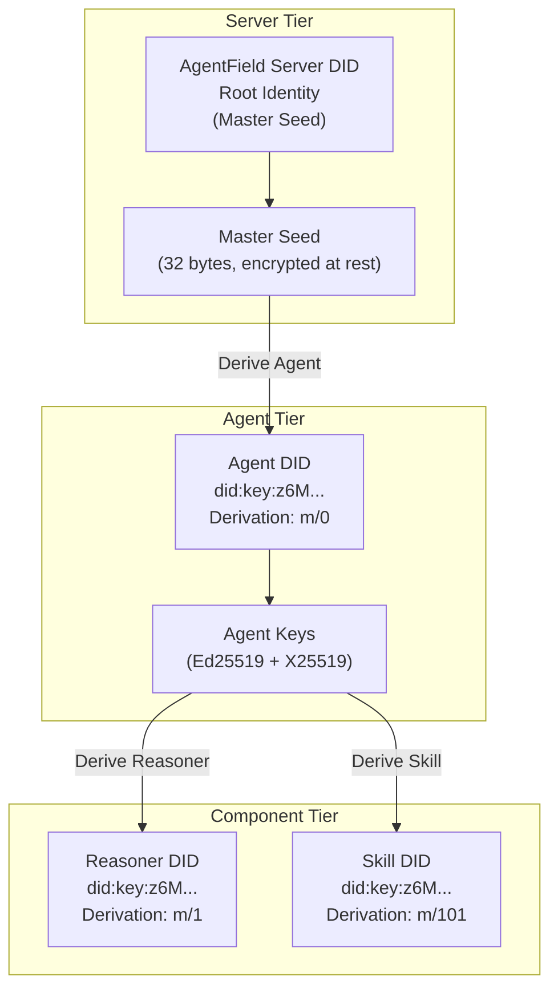
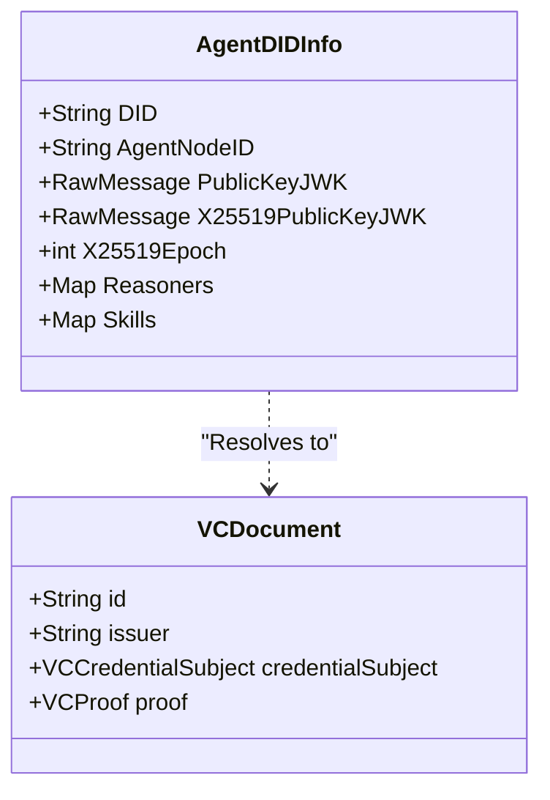
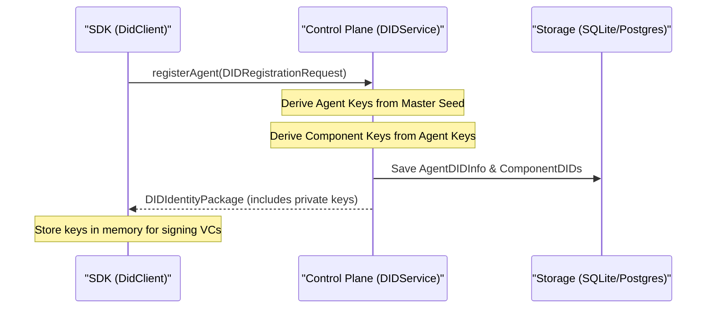
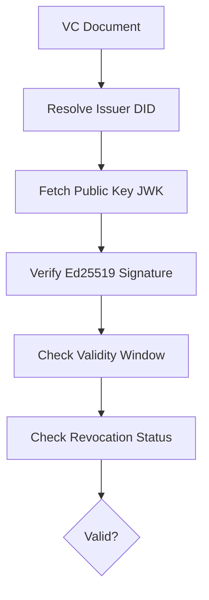

<!-- source: DeepWiki mcp.deepwiki.com · repo Agent-Field/agentfield · page 8.1 Decentralized Identifiers (DIDs) · fetched 2026-10-26 -->

# Decentralized Identifiers (DIDs)

<details>
<summary>Relevant source files</summary>

The following files were used as context for generating this wiki page:

- [control-plane/internal/services/vc_chain.go](control-plane/internal/services/vc_chain.go)
- [control-plane/internal/services/vc_issuance.go](control-plane/internal/services/vc_issuance.go)
- [control-plane/internal/services/vc_resolution.go](control-plane/internal/services/vc_resolution.go)
- [control-plane/internal/services/vc_service.go](control-plane/internal/services/vc_service.go)
- [control-plane/internal/services/vc_service_test.go](control-plane/internal/services/vc_service_test.go)
- [control-plane/internal/services/vc_storage.go](control-plane/internal/services/vc_storage.go)
- [control-plane/internal/services/vc_validation.go](control-plane/internal/services/vc_validation.go)
- [control-plane/pkg/types/did_types.go](control-plane/pkg/types/did_types.go)
- [control-plane/web/client/src/hooks/useVCVerification.ts](control-plane/web/client/src/hooks/useVCVerification.ts)
- [control-plane/web/client/src/types/did.ts](control-plane/web/client/src/types/did.ts)
- [examples/ts-node-examples/init-example/package.json](examples/ts-node-examples/init-example/package.json)
- [sdk/typescript/src/did/DidClient.ts](sdk/typescript/src/did/DidClient.ts)
- [sdk/typescript/src/utils/httpAgents.ts](sdk/typescript/src/utils/httpAgents.ts)
- [sdk/typescript/tests/did_client_methods.test.ts](sdk/typescript/tests/did_client_methods.test.ts)
- [sdk/typescript/tests/integration.e2e.test.ts](sdk/typescript/tests/integration.e2e.test.ts)
- [sdk/typescript/tests/memory_performance.test.ts](sdk/typescript/tests/memory_performance.test.ts)
- [tests/functional/ts_agents/echo-agent.mjs](tests/functional/ts_agents/echo-agent.mjs)

</details>


## Purpose and Scope

AgentField implements W3C Decentralized Identifiers (DIDs) to provide cryptographic identity for the entire agent execution stack. DIDs enable mathematical proof of agent provenance, execution integrity, and access control without relying on centralized identity providers.

This page covers the DID implementation, hierarchical derivation, registration process, and integration with agent execution. For credential generation and verification built on top of DIDs, see [Verifiable Credentials](#8.2).

**Scope:**
- Hierarchical DID derivation from server master seed to component identities.
- W3C DID specification compliance (Ed25519 signatures, JWK format).
- Registration and resolution protocols via `DIDService` and `DidClient`.
- Key management and storage in the Control Plane.

**Sources:** [control-plane/pkg/types/did_types.go:9-17](), [sdk/typescript/src/did/DidClient.ts:9-36]()

---

## DID Hierarchy

AgentField uses a three-tier hierarchical DID structure where each level derives cryptographic keys from its parent. This creates a verifiable chain of trust from the server root to individual reasoners and skills.

### Hierarchy Visualization



**Sources:** [control-plane/pkg/types/did_types.go:9-60](), [sdk/typescript/tests/integration.e2e.test.ts:125-186]()

### Derivation Properties

| Level | Parent | Derivation Input | Purpose |
|-------|--------|------------------|---------|
| **Server** | None | Random master seed | Root identity for the AgentField instance. |
| **Agent** | Server | Agent Node ID | Primary identity for an agent node; supports Ed25519 (signing) and X25519 (encryption). |
| **Component** | Agent | Function Name | Specific identity for a Reasoner or Skill to sign its own outputs. |

**Sources:** [control-plane/pkg/types/did_types.go:20-38](), [control-plane/pkg/types/did_types.go:41-60]()

---

## W3C DID Specification Compliance

AgentField DIDs resolve to a DID document containing public key material and metadata. The system primarily uses the `did:key` method for simplicity and portability, but supports internal resolution of agent-specific metadata.

### DID Document Mapping
The system maps internal `AgentDIDInfo` and `ReasonerDIDInfo` to W3C-compliant `VCDocument` structures during verification.



**Sources:** [control-plane/pkg/types/did_types.go:20-38](), [control-plane/web/client/src/types/did.ts:102-112]()

---

## DID Registration Process

Agents register with the Control Plane during initialization to obtain their `DIDIdentityPackage`. This package contains the private keys (JWK) the agent needs to sign Verifiable Credentials locally.

### Registration Data Flow



**Sources:** [sdk/typescript/src/did/DidClient.ts:132-156](), [control-plane/internal/services/vc_service_test.go:54-61]()

### SDK Registration (TypeScript)
The `DidClient` handles the communication with the Control Plane's `/api/v1/did/register` endpoint.

```typescript
// sdk/typescript/src/did/DidClient.ts:132-156
async registerAgent(request: DIDRegistrationRequest): Promise<DIDRegistrationResponse> {
  const payload = {
    agent_node_id: request.agentNodeId,
    reasoners: request.reasoners,
    skills: request.skills
  };
  const res = await this.http.post('/api/v1/did/register', payload);
  return {
    success: true,
    identityPackage: this.parseIdentityPackage(res.data.identity_package)
  };
}
```

---

## Key Management

AgentField uses Ed25519 elliptic curve cryptography for signing and X25519 for encryption. Keys are represented in JSON Web Key (JWK) format.

### Key Storage and Visibility

| Key Type | Storage Location | Visibility |
|----------|------------------|------------|
| **Master Seed** | Control Plane Database | Encrypted; never leaves server. |
| **Agent Private Key** | Agent Node Memory | Sent once during registration; never persisted in CP. |
| **Agent Public Key** | Control Plane Database | Public; used for VC verification. |
| **X25519 Key** | Agent Node Memory | Used for encrypted memory/communication; supports rotation via `X25519Epoch`. |

**Sources:** [control-plane/pkg/types/did_types.go:11](), [control-plane/pkg/types/did_types.go:24-32](), [sdk/typescript/src/did/DidClient.ts:9-16]()

---

## DID Resolution and Verification

The `VCService` in the control plane provides the logic for resolving DIDs and verifying signatures on documents.

### Verification Logic (`VCService.VerifyVC`)
1. **Resolve Issuer:** Fetch the `DIDIdentity` (public key) for the `issuer` field in the VC.
2. **Signature Check:** Use `ed25519.Verify` to check the `proofValue` against the canonicalized document.
3. **Validity Window:** Check `issuanceDate`, `notBefore`, and `expirationDate`.
4. **Revocation Check:** Query the storage provider to see if the DID or specific VC has been marked as `revoked`.

**Sources:** [control-plane/internal/services/vc_validation.go:18-82](), [control-plane/internal/services/vc_validation.go:172-218]()



---

## Implementation Details

### Go Types: `AgentDIDInfo`
The core data structure for an agent's identity in the backend.
```go
// control-plane/pkg/types/did_types.go:20-38
type AgentDIDInfo struct {
	DID                string          `json:"did" db:"did"`
	AgentNodeID        string          `json:"agent_node_id" db:"agent_node_id"`
	PublicKeyJWK       json.RawMessage `json:"public_key_jwk" db:"public_key_jwk"`
	X25519PublicKeyJWK json.RawMessage `json:"x25519_public_key_jwk,omitempty" db:"x25519_public_key_jwk"`
	X25519Epoch        int             `json:"x25519_epoch,omitempty" db:"x25519_epoch"`
	Reasoners          map[string]ReasonerDIDInfo `json:"reasoners" db:"reasoners"`
	Skills             map[string]SkillDIDInfo    `json:"skills" db:"skills"`
}
```

### TypeScript Client: `DidClient`
The SDK component used by agents to interact with identity services.
```typescript
// sdk/typescript/src/did/DidClient.ts:114-126
export class DidClient {
  private readonly http: AxiosInstance;
  
  constructor(baseUrl: string, defaultHeaders?: Record<string, any>) {
    this.http = axios.create({
      baseURL: baseUrl.replace(/\/$/, ''),
      timeout: 30000,
    });
  }
  // ... methods for registration, VC generation, and verification
}
```

**Sources:** [control-plane/pkg/types/did_types.go:20-38](), [sdk/typescript/src/did/DidClient.ts:114-126]()

---

