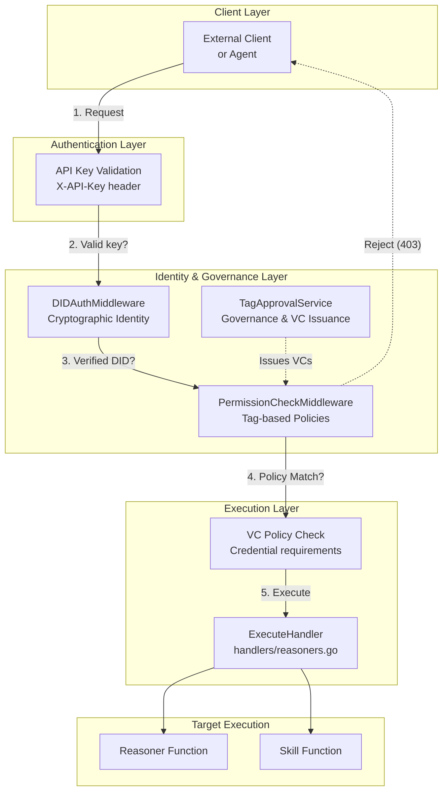
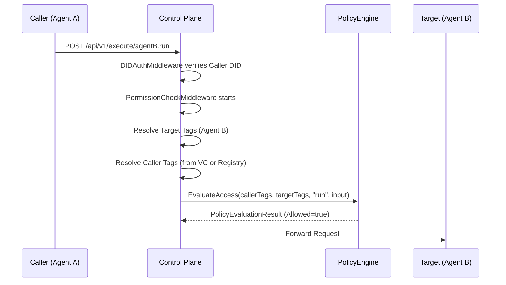
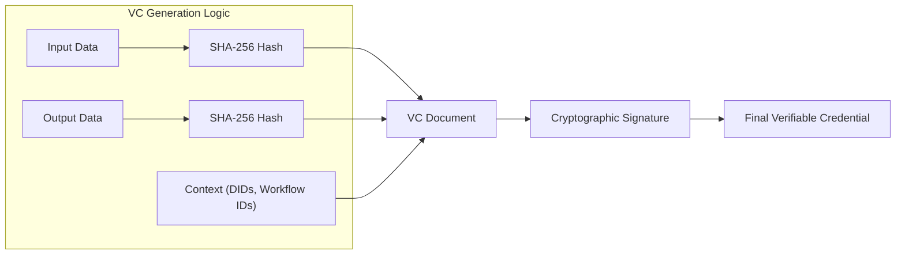

<!-- source: DeepWiki mcp.deepwiki.com · repo Agent-Field/agentfield · page 8.3 Policy Enforcement · fetched 2026-10-26 -->

# Policy Enforcement

Relevant source files

The following files were used as context for generating this wiki page:

- [control-plane/.env.example](control-plane/.env.example)
- [control-plane/internal/handlers/admin/tag_approval.go](control-plane/internal/handlers/admin/tag_approval.go)
- [control-plane/internal/handlers/empty_input_test.go](control-plane/internal/handlers/empty_input_test.go)
- [control-plane/internal/handlers/reasoners.go](control-plane/internal/handlers/reasoners.go)
- [control-plane/internal/server/middleware/permission.go](control-plane/internal/server/middleware/permission.go)
- [control-plane/internal/server/middleware/permission_test.go](control-plane/internal/server/middleware/permission_test.go)
- [control-plane/internal/services/tag_approval_service.go](control-plane/internal/services/tag_approval_service.go)
- [control-plane/web/client/src/components/authorization/AgentTagsTab.tsx](control-plane/web/client/src/components/authorization/AgentTagsTab.tsx)
- [control-plane/web/client/src/utils/dateFormat.ts](control-plane/web/client/src/utils/dateFormat.ts)

## Purpose and Scope

Policy Enforcement in AgentField provides **infrastructure-level access control** mechanisms that prevent unauthorized agent actions through cryptographic identity verification and credential validation. Unlike prompt-based restrictions that rely on AI compliance, AgentField's policies are enforced at the execution layer before any agent code runs.

This document covers:
- API key authentication for basic access control.
- DID-based identity verification and tag-based access policies.
- VC-based execution policies and audit requirements.
- The tag approval workflow for agent onboarding.

**Sources:** [control-plane/internal/server/middleware/permission.go:81-87](), [control-plane/internal/services/tag_approval_service.go:45-50]()

---

## Policy Architecture Overview

AgentField enforces policies at three levels, creating a defense-in-depth security model:

**Sources:** [control-plane/internal/server/middleware/permission.go:66-87](), [control-plane/internal/handlers/reasoners.go:45-50](), [control-plane/internal/services/tag_approval_service.go:194-206]()

---

## Tag-Based Access Control

AgentField uses a tag-based system for granular authorization. Agents are assigned "Tags" (e.g., `finance`, `pii-access`) which are verified via cryptographically signed Verifiable Credentials.

### Permission Middleware Flow

The `PermissionCheckMiddleware` is the primary enforcement point in the Control Plane. It evaluates whether a caller has permission to invoke a specific target function.

| Feature | Behavior |
|---------|----------|
| **Caller Identity** | Resolved strictly from verified DIDs. Identity headers (like `X-Caller-Agent-ID`) are ignored if not backed by DID verification. |
| **Tag Precedence** | VC-verified tags take precedence over registration-time tags. If a VC exists but verification fails, the system fails closed (empty tags). |
| **Default Deny** | If `AGENTFIELD_AUTHORIZATION_DEFAULT_DENY` is true, requests with no matching policy are rejected with 403 Forbidden. |
| **Lifecycle Blocking** | Agents in `pending_approval` status are blocked from receiving any calls. |

**Sources:** [control-plane/internal/server/middleware/permission.go:115-120](), [control-plane/internal/server/middleware/permission.go:132-139](), [control-plane/internal/server/middleware/permission.go:154-169](), [control-plane/internal/server/middleware/permission.go:178-189]()

### Policy Evaluation Logic

The `AccessPolicyServiceInterface` evaluates access based on the following tuple: `(caller_tags, target_tags, function_name, input_params)`.

**Sources:** [control-plane/internal/server/middleware/permission.go:172-200](), [control-plane/internal/server/middleware/permission_test.go:65-75]()

---

## Tag Approval Workflow

Before an agent can participate in the ecosystem with privileged tags, it must pass through the Tag Approval workflow managed by `TagApprovalService`.

### Lifecycle Statuses

1.  **`pending_approval`**: The agent has registered with proposed tags that require manual review. It cannot receive execution requests.
2.  **`starting` / `active`**: Tags have been approved. The system issues a `AgentTagVC` signed by the Control Plane.
3.  **`offline`**: The agent is reachable but has been manually or automatically taken offline.

**Sources:** [control-plane/internal/handlers/reasoners.go:122-140](), [control-plane/internal/services/tag_approval_service.go:194-206]()

### Administrative Actions

Administrators use the `TagApprovalHandlers` to manage agent permissions:

- **Approve**: Transitions agent to `starting` and issues a signed VC containing the approved tags.
- **Reject**: Rejects proposed tags; agent remains in restricted state.
- **Revoke**: Moves an active agent back to `pending_approval` and revokes the existing Tag VC.

**Sources:** [control-plane/internal/handlers/admin/tag_approval.go:96-156](), [control-plane/internal/handlers/admin/tag_approval.go:199-216](), [control-plane/internal/services/tag_approval_service.go:35-36]()

---

## VC-Based Policy Enforcement

Verifiable Credentials (VCs) are used to provide cryptographic proof of execution and identity.

### Execution VC Generation

The `VCGenerator` (SDK-side) or Control Plane logic ensures that every execution produces a tamper-proof record.

**Sources:** [control-plane/internal/services/tag_approval_service.go:39-43](), [control-plane/internal/services/tag_approval_service.go:230-245]()

### Configuration Options

Policy enforcement behavior is controlled via environment variables and CLI flags:

| Variable / Flag | Description | Default |
|-----------------|-------------|---------|
| `AGENTFIELD_AUTHORIZATION_DEFAULT_DENY` | If true, denies any request not explicitly allowed by a policy. | `false` |
| `AGENTFIELD_AUTHORIZATION_ADMIN_TOKEN` | Token required for admin endpoints (tag approval). | - |
| `AGENTFIELD_AUTHORIZATION_INTERNAL_TOKEN` | Secret sent to agents to verify the Control Plane as the origin. | - |
| `--no-vc-execution` | CLI flag to bypass VC generation for performance/testing. | `false` |

**Sources:** [control-plane/.env.example:51-59](), [control-plane/internal/cli/root_test.go:50]()

---

## Implementation Details

### Handling Empty Inputs

The execution handlers (`ExecuteHandler` and `ExecuteReasonerHandler`) include specific logic to handle empty or nil input objects (`{}` or missing `input` field). This ensures that parameterless skills/reasoners do not fail validation while still maintaining strict JSON binding for policy evaluation.

**Sources:** [control-plane/internal/handlers/reasoners.go:100-108](), [control-plane/internal/handlers/empty_input_test.go:45-88]()

### UI Integration

The `AgentTagsTab` component in the Control Plane dashboard provides the interface for governance. It surfaces:
- **Proposed vs. Approved Tags**: Visualizing the delta between what the agent requested and what was granted.
- **Component-Level Tags**: Granular visibility into tags for specific Reasoners or Skills.
- **Relative Timestamps**: Using `formatRelativeTime` to track registration and approval history.

**Sources:** [control-plane/web/client/src/components/authorization/AgentTagsTab.tsx:182-211](), [control-plane/web/client/src/utils/dateFormat.ts:12-45]()

---

