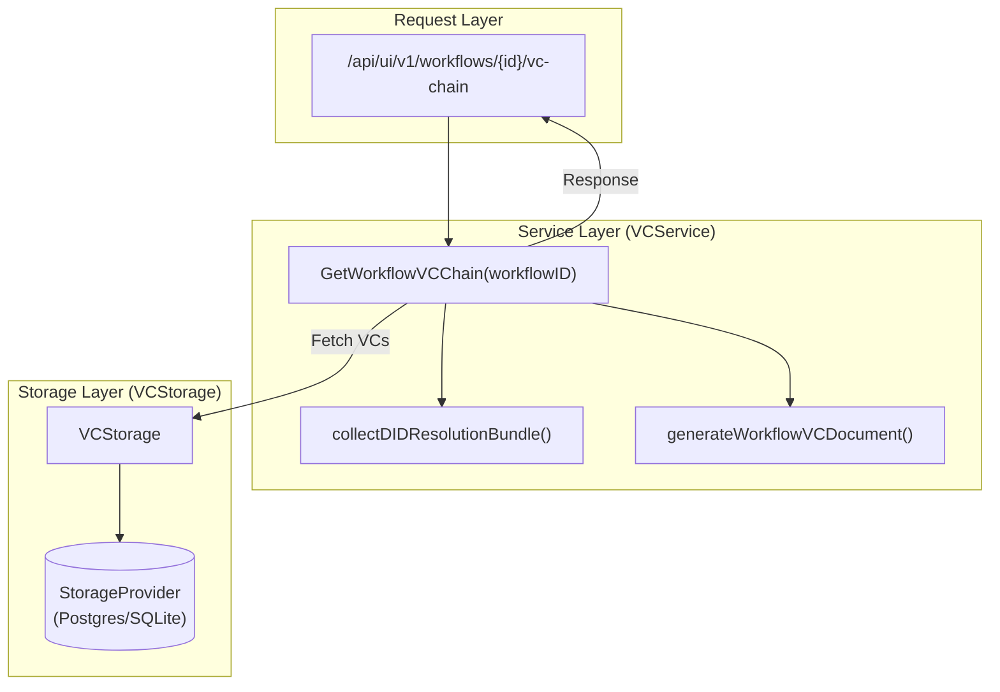
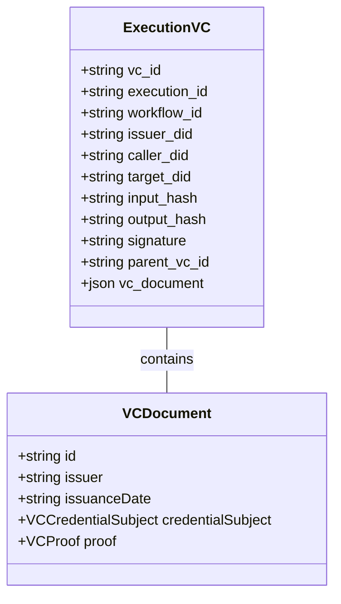
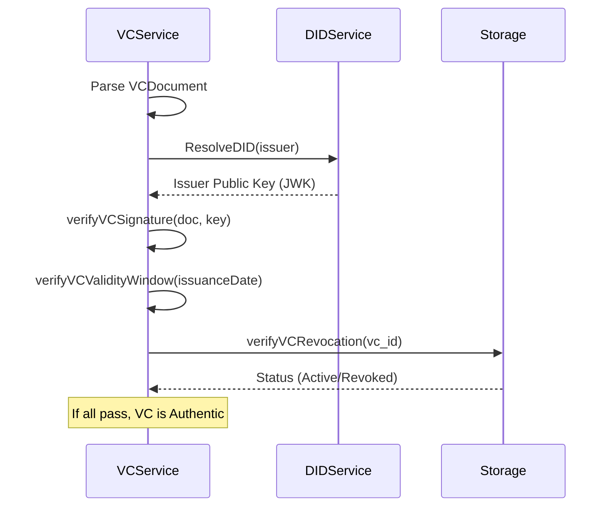

<!-- source: DeepWiki mcp.deepwiki.com · repo Agent-Field/agentfield · page 8.4 Audit Trail Export · fetched 2026-10-26 -->

# Audit Trail Export

Relevant source files

The following files were used as context for generating this wiki page:

- [control-plane/internal/services/vc_chain.go](control-plane/internal/services/vc_chain.go)
- [control-plane/internal/services/vc_issuance.go](control-plane/internal/services/vc_issuance.go)
- [control-plane/internal/services/vc_resolution.go](control-plane/internal/services/vc_resolution.go)
- [control-plane/internal/services/vc_service.go](control-plane/internal/services/vc_service.go)
- [control-plane/internal/services/vc_service_test.go](control-plane/internal/services/vc_service_test.go)
- [control-plane/internal/services/vc_storage.go](control-plane/internal/services/vc_storage.go)
- [control-plane/internal/services/vc_validation.go](control-plane/internal/services/vc_validation.go)
- [control-plane/pkg/types/did_types.go](control-plane/pkg/types/did_types.go)
- [control-plane/web/client/src/hooks/useVCVerification.ts](control-plane/web/client/src/hooks/useVCVerification.ts)
- [control-plane/web/client/src/types/did.ts](control-plane/web/client/src/types/did.ts)

**Purpose**: This document describes how to export cryptographically verifiable audit trails from AgentField workflows using the Verifiable Credential (VC) chain API. Audit trail export allows compliance teams and auditors to obtain tamper-proof records of agent executions with complete provenance information.

**Scope**: This page covers the implementation of the VC chain export service, the data structures for exported audit data, and the cryptographic verification logic. For information about how VCs are generated during execution, see [Verifiable Credentials (8.2)](). For DID hierarchy and identity management, see [Decentralized Identifiers (DIDs) (8.1)]().

---

## Overview

AgentField generates Verifiable Credentials (VCs) for every execution. These credentials form an immutable audit trail that can be exported via the Control Plane. The system aggregates individual `ExecutionVC` records into a `WorkflowVC` to provide a complete provenance graph of an AI agent's decision-making process.

**Sources**: [control-plane/internal/services/vc_service.go:19-24](), [control-plane/pkg/types/did_types.go:79-107]()

---

## VC Chain Export API

The primary interface for audit trail export is handled by the `VCService` in the control plane, which aggregates data for the UI and external auditors.

### Data Flow: From Storage to Export

**Sources**: [control-plane/internal/services/vc_chain.go:14-60](), [control-plane/internal/services/vc_storage.go:96-99]()

### Export Response Structure

The `WorkflowVCChainResponse` provides a comprehensive bundle for offline verification.

| Field | Type | Description |
|-------|------|-------------|
| `workflow_id` | string | The unique identifier of the workflow. |
| `component_vcs` | `[]ExecutionVC` | List of all individual execution credentials in the chain. |
| `workflow_vc` | `WorkflowVC` | The aggregate credential signing the entire chain. |
| `did_resolution_bundle` | `map[string]DIDResolutionEntry` | Public keys (JWKs) for all DIDs involved, allowing offline verification. |

**Sources**: [control-plane/internal/services/vc_chain.go:52-60](), [control-plane/web/client/src/types/did.ts:250-257]()

---

## Verifiable Credential Structure

### Execution VC (Atomic Audit Unit)

The `ExecutionVC` represents a single step in a workflow (e.g., a Reasoner execution or a Skill call).

**Sources**: [control-plane/pkg/types/did_types.go:79-107](), [control-plane/web/client/src/types/did.ts:38-56]()

### Input/Output Hashing

To protect privacy while ensuring integrity, the `VCService` can hash sensitive data.
- **Function**: `hashData(data []byte) string` [control-plane/internal/services/vc_service.go:138-145]()
- **Implementation**: Uses SHA-256 and encodes the result in Base64 Raw URL Encoding.
- **Configuration**: Controlled by `config.VCRequirements.HashSensitiveData` [control-plane/internal/services/vc_service.go:139-141]().

---

## Verification Logic

Exported audit trails can be verified using the `VerifyVC` logic. This ensures that the data has not been tampered with since the agent execution.

### Verification Sequence

**Sources**: [control-plane/internal/services/vc_validation.go:18-82](), [control-plane/internal/services/vc_validation.go:172-218]()

### Key Verification Steps:
1. **Signature Check**: Validates the Ed25519 signature against the issuer's public key [control-plane/internal/services/vc_validation.go:47-54]().
2. **Proof Purpose**: Ensures the VC was intended for `assertionMethod` [control-plane/internal/services/vc_validation.go:84-102]().
3. **Validity Window**: Checks `issuanceDate`, `notBefore`, and `expirationDate` [control-plane/internal/services/vc_validation.go:104-170]().
4. **Revocation Check**: Queries the database to ensure the VC status is not "revoked" [control-plane/internal/services/vc_validation.go:172-218]().

---

## Audit Trail Persistence

Audit trails are managed by the `VCStorage` class, which abstracts the underlying `StorageProvider` (SQLite or PostgreSQL).

### Storage Methods
- `StoreExecutionVC`: Persists individual execution VCs. It automatically calculates document size if not provided [control-plane/internal/services/vc_storage.go:38-78]().
- `StoreWorkflowVC`: Persists the aggregate workflow metadata [control-plane/internal/services/vc_storage.go:141-165]().
- `ListWorkflowVCStatusSummaries`: Provides high-level statistics (count, verified vs failed) for the dashboard [control-plane/internal/services/vc_service.go:73-135]().

**Sources**: [control-plane/internal/services/vc_storage.go:14-21](), [control-plane/internal/services/vc_service.go:100-134]()

---

## Frontend Integration

The AgentField UI uses React hooks to interact with the audit trail export system.

### Hooks Reference
- `useWorkflowVCChain(workflowId)`: Fetches the complete chain for visualization [control-plane/web/client/src/hooks/useVCVerification.ts:100-131]().
- `useVCVerification()`: Provides functions to verify a VC document locally in the browser [control-plane/web/client/src/hooks/useVCVerification.ts:21-54]().
- `useAuditTrail(workflowId)`: Specifically for displaying a human-readable log derived from VCs [control-plane/web/client/src/hooks/useVCVerification.ts:136-167]().

**Sources**: [control-plane/web/client/src/hooks/useVCVerification.ts:1-15]()

---

## Configuration

VC Export and generation are governed by the `DIDConfig` structure:

| Option | Default | Description |
|--------|---------|-------------|
| `Enabled` | `true` | Master switch for the DID/VC system. |
| `RequireVCForExecution` | `true` | If true, reasoners will fail if a VC cannot be generated. |
| `PersistExecutionVC` | `true` | Whether to save VCs to the database for future export. |
| `HashSensitiveData` | `true` | If true, actual input/output data is replaced by hashes in the VC. |

**Sources**: [control-plane/internal/services/vc_service.go:51-70](), [control-plane/internal/services/vc_service_test.go:29-37]()

---

