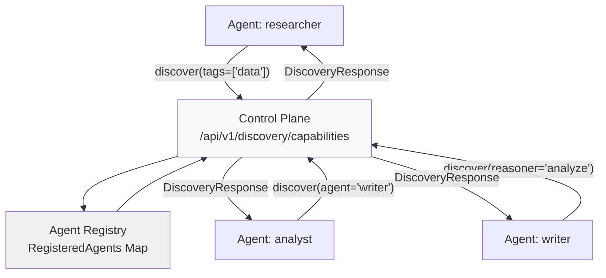
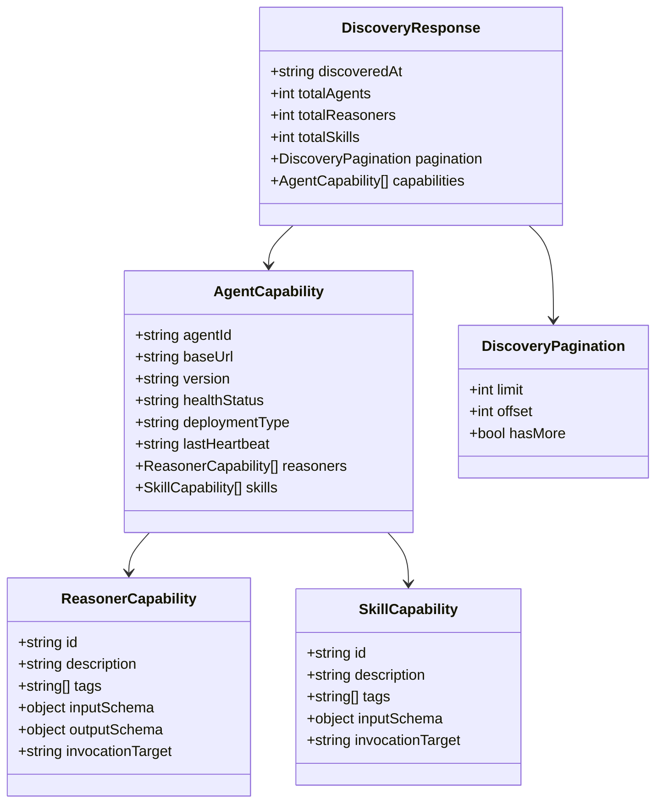
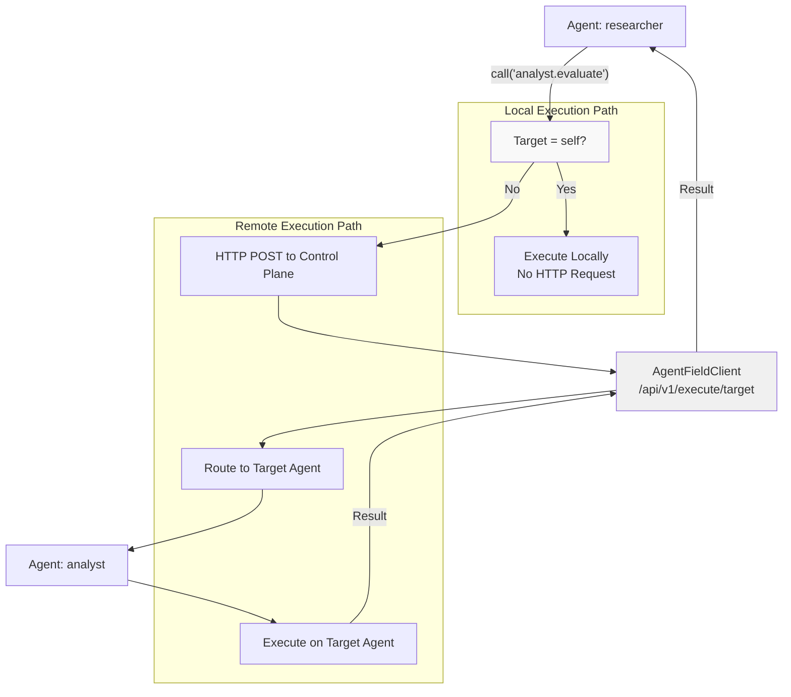
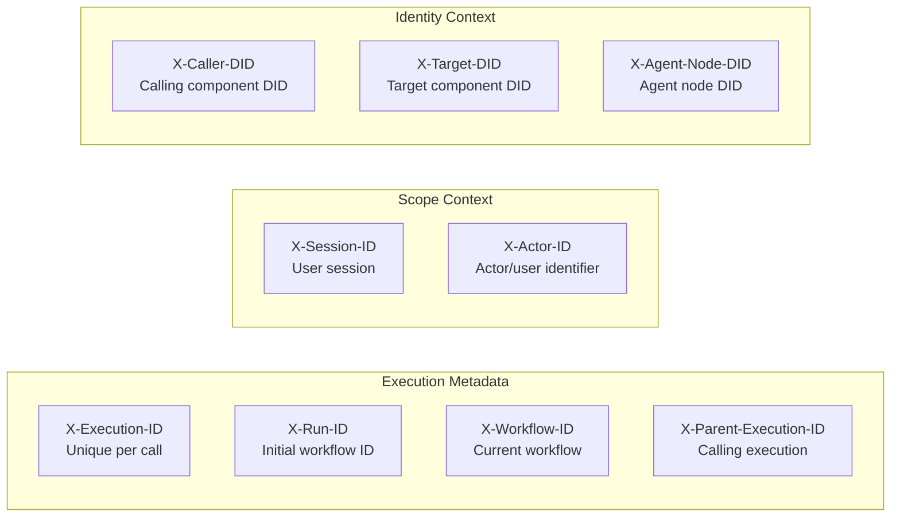
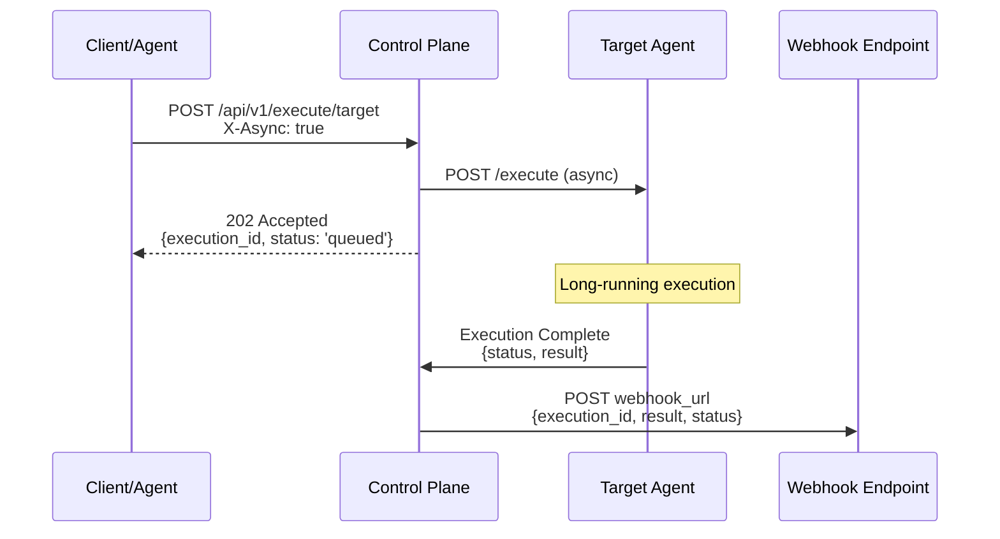

<!-- source: DeepWiki mcp.deepwiki.com · repo Agent-Field/agentfield · page 9 Multi-Agent Coordination · fetched 2026-10-26 -->

# Multi-Agent Coordination

<details>
<summary>Relevant source files</summary>

The following files were used as context for generating this wiki page:

- [control-plane/internal/handlers/execute_awaiter_status.go](control-plane/internal/handlers/execute_awaiter_status.go)
- [control-plane/internal/handlers/execute_awaiter_status_test.go](control-plane/internal/handlers/execute_awaiter_status_test.go)
- [sdk/python/agentfield/agent.py](sdk/python/agentfield/agent.py)
- [sdk/python/agentfield/async_execution_manager.py](sdk/python/agentfield/async_execution_manager.py)
- [sdk/python/agentfield/client.py](sdk/python/agentfield/client.py)
- [sdk/python/agentfield/exceptions.py](sdk/python/agentfield/exceptions.py)
- [sdk/python/agentfield/execution_state.py](sdk/python/agentfield/execution_state.py)
- [sdk/python/tests/test_agent_call.py](sdk/python/tests/test_agent_call.py)
- [sdk/python/tests/test_agent_coverage_additions.py](sdk/python/tests/test_agent_coverage_additions.py)
- [sdk/python/tests/test_async_config.py](sdk/python/tests/test_async_config.py)
- [sdk/python/tests/test_async_execution.py](sdk/python/tests/test_async_execution.py)
- [sdk/python/tests/test_client_laser_push.py](sdk/python/tests/test_client_laser_push.py)
- [sdk/python/tests/test_execution_state.py](sdk/python/tests/test_execution_state.py)
- [sdk/typescript/src/agent/Agent.ts](sdk/typescript/src/agent/Agent.ts)
- [sdk/typescript/src/ai/AIClient.ts](sdk/typescript/src/ai/AIClient.ts)
- [sdk/typescript/src/client/AgentFieldClient.ts](sdk/typescript/src/client/AgentFieldClient.ts)
- [sdk/typescript/src/context/ReasonerContext.ts](sdk/typescript/src/context/ReasonerContext.ts)
- [sdk/typescript/src/index.ts](sdk/typescript/src/index.ts)
- [sdk/typescript/src/router/AgentRouter.ts](sdk/typescript/src/router/AgentRouter.ts)
- [sdk/typescript/src/triggers/factories.ts](sdk/typescript/src/triggers/factories.ts)
- [sdk/typescript/src/triggers/index.ts](sdk/typescript/src/triggers/index.ts)
- [sdk/typescript/src/triggers/types.ts](sdk/typescript/src/triggers/types.ts)
- [sdk/typescript/src/types/agent.ts](sdk/typescript/src/types/agent.ts)
- [sdk/typescript/src/types/reasoner.ts](sdk/typescript/src/types/reasoner.ts)
- [sdk/typescript/tests/agent.test.ts](sdk/typescript/tests/agent.test.ts)
- [sdk/typescript/tests/ai_client.test.ts](sdk/typescript/tests/ai_client.test.ts)
- [sdk/typescript/tests/triggers.test.ts](sdk/typescript/tests/triggers.test.ts)

</details>


Multi-agent coordination in AgentField enables agents to discover, communicate with, and orchestrate workflows across distributed agent nodes. This page covers the mechanisms for agent discovery, cross-agent communication, workflow tracking, and asynchronous execution patterns.

For information about agent registration and lifecycle management, see [Agent Registration](#6.4). For memory sharing across agents, see [Memory Scopes](#7.1). For identity and authorization between agents, see [Decentralized Identifiers (DIDs)](#8.1).

---

## Discovery Architecture

AgentField provides a centralized discovery service through the control plane that allows agents to query for available agents, reasoners, and skills across the ecosystem. Discovery operates through the `/api/v1/discovery/capabilities` endpoint and supports multiple query formats and filtering options.

### Discovery Flow Diagram



**Sources:** [sdk/python/agentfield/client.py:400-500](), [sdk/typescript/src/client/AgentFieldClient.ts:149-217](), [sdk/typescript/src/types/agent.ts:122-148]()

---

## Agent Discovery

### Discovery Methods

#### Python SDK

The Python Agent class exposes discovery through the `discover()` method, which delegates to the underlying `AgentFieldClient`:

```python
# Discover all available agents
result = app.discover()

# Discover agents by tags
result = app.discover(tags=["nlp", "summarization"])

# Discover specific reasoner
result = app.discover(reasoner="analyze_sentiment")

# Discover with schema information
result = app.discover(
    include_input_schema=True,
    include_output_schema=True,
    include_descriptions=True
)
```

**Sources:** [sdk/python/agentfield/agent.py:1200-1230]()

#### TypeScript SDK

The TypeScript Agent provides similar discovery capabilities:

```typescript
// Discover all capabilities
const result = await agent.discover();

// Filter by agent ID
const result = await agent.discover({ agent: 'analyst' });

// Filter by tags
const result = await agent.discover({ tags: ['finance', 'risk'] });

// Request compact format
const result = await agent.discover({ format: 'compact' });
```

**Sources:** [sdk/typescript/src/agent/Agent.ts:160-162](), [sdk/typescript/src/client/AgentFieldClient.ts:149-217]()

### Discovery Response Structure



**Sources:** [sdk/typescript/src/types/agent.ts:93-148]()

### Discovery Filters and Options

| Filter | Type | Description |
|--------|------|-------------|
| `agent` / `nodeId` | string | Filter by single agent ID |
| `agentIds` / `nodeIds` | string[] | Filter by multiple agent IDs |
| `reasoner` | string | Filter for specific reasoner |
| `skill` | string | Filter for specific skill |
| `tags` | string[] | Filter by capability tags |
| `healthStatus` | string | Filter by agent health status |
| `includeInputSchema` | boolean | Include input schemas in response |
| `includeOutputSchema` | boolean | Include output schemas in response |
| `includeDescriptions` | boolean | Include capability descriptions |
| `includeExamples` | boolean | Include usage examples |
| `format` | string | Response format: `json`, `compact`, `xml` |
| `limit` | integer | Maximum results per page |
| `offset` | integer | Pagination offset |

**Sources:** [sdk/typescript/src/types/agent.ts:160-177]()

---

## Cross-Agent Communication

Agents communicate with each other through the control plane's execution gateway. The `call()` method provides a unified interface for both local and remote agent invocation, with automatic context propagation and workflow tracking.

### Call Method Architecture



**Sources:** [sdk/python/agentfield/agent.py:1231-1350](), [sdk/typescript/src/agent/Agent.ts:260-351]()

### Local vs Remote Execution

The `call()` method automatically determines whether to execute locally or route through the control plane. In the Python SDK, it utilizes `_should_execute_locally` to avoid unnecessary network hops.

| Condition | Execution Path | HTTP Request |
|-----------|----------------|--------------|
| Target agent ID matches current agent | Local | No |
| Target agent ID is omitted and reasoner exists locally | Local | No |
| Target agent ID differs from current agent | Remote via Control Plane | Yes |

**Sources:** [sdk/python/agentfield/agent.py:1231-1260](), [sdk/typescript/src/agent/Agent.ts:260-267]()

---

## Execution Context Propagation

All cross-agent calls automatically propagate execution metadata through HTTP headers. This enables automatic workflow tracking, memory scoping, and identity verification.

### Propagated Context Headers



**Sources:** [sdk/python/agentfield/execution_context.py:50-150](), [sdk/typescript/src/client/AgentFieldClient.ts:29-44]()

### Context Access in Reasoners

In TypeScript, the `ReasonerContext` provides direct access to metadata and services:

```typescript
agent.reasoner('analyze', async (ctx) => {
  console.log(`Execution ID: ${ctx.executionId}`);
  // Use context for memory operations
  const history = await ctx.memory.get('analysis_history');
  // Context automatically propagates to nested calls
  const validation = await ctx.agent.call('validator.check', ctx.input);
  return { result: validation };
});
```

**Sources:** [sdk/typescript/src/context/ReasonerContext.ts:13-86]()

---

## Asynchronous Execution

AgentField supports long-running, asynchronous operations that can execute for minutes, hours, or days. Asynchronous execution uses webhooks for result delivery and supports timeout configuration.

### Async Execution Flow



**Sources:** [sdk/python/agentfield/async_config.py:1-100](), [sdk/python/agentfield/async_execution_manager.py:185-220]()

### Polling and Timeouts

The `AsyncExecutionManager` in the Python SDK manages concurrent async executions with intelligent polling and adaptive intervals [sdk/python/agentfield/async_execution_manager.py:185-200](). In TypeScript, the `executionBudgetMs` configuration bounds the active-time wall-clock budget for detached reasoners [sdk/typescript/src/types/agent.ts:46-53]().

---

## Best Practices

1. **Prefer Local Execution**: Use `call()` with local targets to avoid network overhead when calling capabilities on the same node [sdk/python/agentfield/agent.py:1231-1260]().
2. **Handle Timeouts**: Use `ExecutionTimeoutError` to manage long-running cross-agent calls [sdk/python/agentfield/exceptions.py:74-77]().
3. **Use Webhooks**: For operations exceeding the synchronous dispatch ceiling, configure `AsyncConfig` with a `webhook_url` [sdk/python/agentfield/async_config.py:40-60]().
4. **Resilient Retries**: The SDK skips sync fallback for `ExecutionFailedError` to prevent doubling costs on deterministic failures [sdk/python/tests/test_agent_call.py:136-176]().

---

**Sources:**
- [sdk/python/agentfield/agent.py:1200-1400]()
- [sdk/typescript/src/agent/Agent.ts:110-155]()
- [sdk/python/agentfield/client.py:142-220]()
- [sdk/typescript/src/client/AgentFieldClient.ts:146-217]()
- [sdk/typescript/src/types/agent.ts:10-54]()
- [sdk/python/agentfield/async_execution_manager.py:185-220]()
- [sdk/python/agentfield/exceptions.py:17-96]()

---

