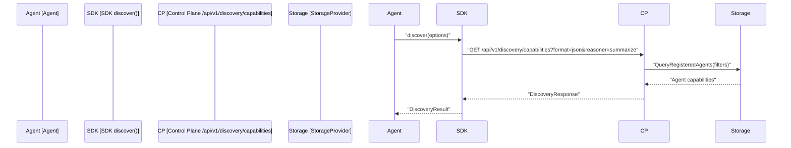
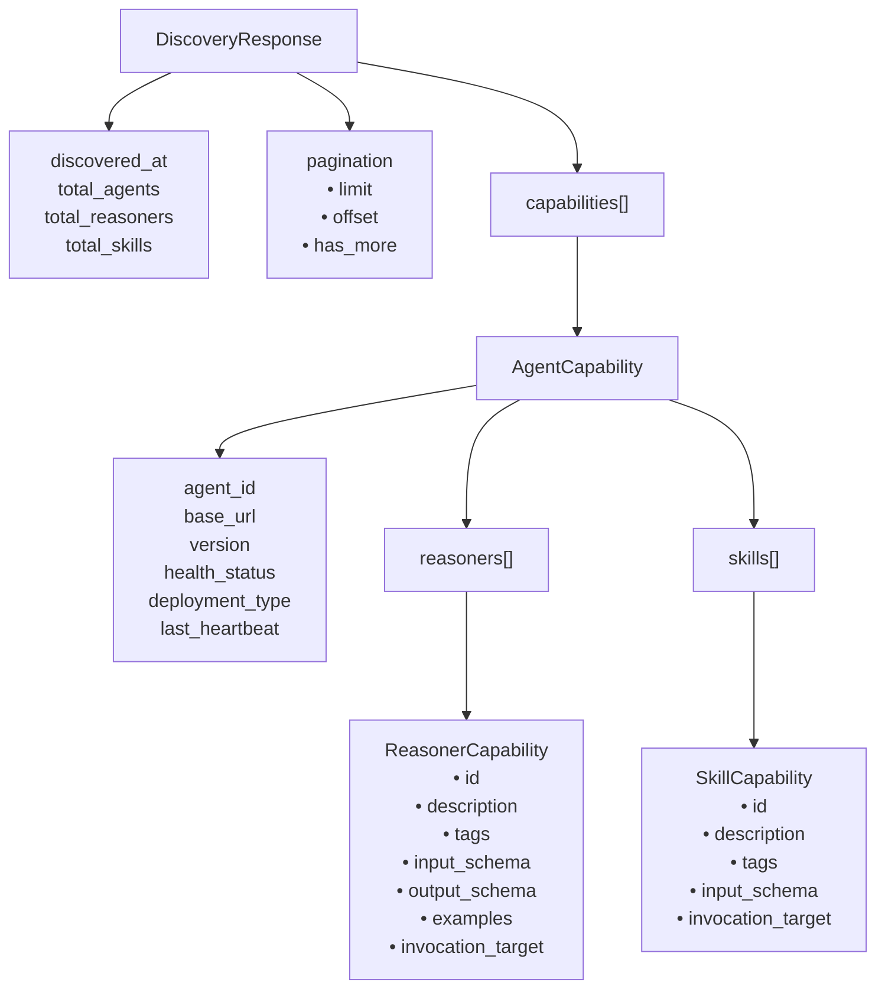
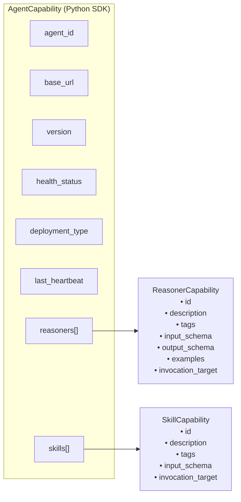
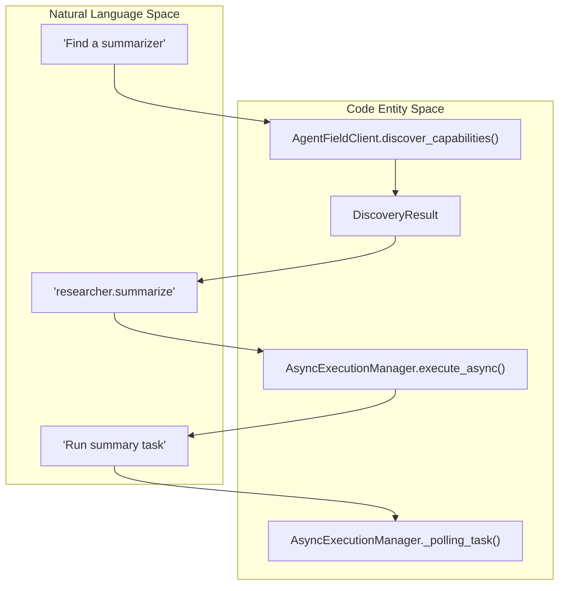

<!-- source: DeepWiki mcp.deepwiki.com · repo Agent-Field/agentfield · page 9.1 Agent Discovery · fetched 2026-10-26 -->

# Agent Discovery

<details>
<summary>Relevant source files</summary>

The following files were used as context for generating this wiki page:

- [control-plane/internal/handlers/agentic/agent_summary.go](control-plane/internal/handlers/agentic/agent_summary.go)
- [control-plane/internal/handlers/agentic/agentic_test.go](control-plane/internal/handlers/agentic/agentic_test.go)
- [control-plane/internal/handlers/agentic/batch.go](control-plane/internal/handlers/agentic/batch.go)
- [control-plane/internal/handlers/agentic/coverage_additional_test.go](control-plane/internal/handlers/agentic/coverage_additional_test.go)
- [control-plane/internal/handlers/agentic/discover.go](control-plane/internal/handlers/agentic/discover.go)
- [control-plane/internal/handlers/agentic/helpers.go](control-plane/internal/handlers/agentic/helpers.go)
- [control-plane/internal/handlers/agentic/kb.go](control-plane/internal/handlers/agentic/kb.go)
- [control-plane/internal/handlers/agentic/query.go](control-plane/internal/handlers/agentic/query.go)
- [control-plane/internal/handlers/agentic/run_overview.go](control-plane/internal/handlers/agentic/run_overview.go)
- [control-plane/internal/handlers/agentic/status.go](control-plane/internal/handlers/agentic/status.go)
- [control-plane/internal/handlers/execute_awaiter_status.go](control-plane/internal/handlers/execute_awaiter_status.go)
- [control-plane/internal/handlers/execute_awaiter_status_test.go](control-plane/internal/handlers/execute_awaiter_status_test.go)
- [sdk/python/agentfield/agent.py](sdk/python/agentfield/agent.py)
- [sdk/python/agentfield/async_execution_manager.py](sdk/python/agentfield/async_execution_manager.py)
- [sdk/python/agentfield/client.py](sdk/python/agentfield/client.py)
- [sdk/python/agentfield/exceptions.py](sdk/python/agentfield/exceptions.py)
- [sdk/python/agentfield/execution_state.py](sdk/python/agentfield/execution_state.py)
- [sdk/python/tests/test_agent_call.py](sdk/python/tests/test_agent_call.py)
- [sdk/python/tests/test_agent_coverage_additions.py](sdk/python/tests/test_agent_coverage_additions.py)
- [sdk/python/tests/test_async_config.py](sdk/python/tests/test_async_config.py)
- [sdk/python/tests/test_async_execution.py](sdk/python/tests/test_async_execution.py)
- [sdk/python/tests/test_client_laser_push.py](sdk/python/tests/test_client_laser_push.py)
- [sdk/python/tests/test_execution_state.py](sdk/python/tests/test_execution_state.py)

</details>


## Purpose and Scope

Agent Discovery provides a query interface for agents to find and inspect other agents, reasoners, and skills registered with the AgentField control plane. This page documents the discovery API, filtering options, response formats, and SDK usage patterns.

For information about calling discovered capabilities, see [Cross-Agent Calls](#9.2). For details on agent registration, see [Agent Registration](#6.4).

---

## Discovery Overview

The discovery system allows agents to dynamically query the control plane for available capabilities at runtime. This enables agents to:

- Locate other agents by ID or health status
- Find reasoners and skills by name or tag
- Inspect capability schemas before invocation
- Build dynamic agent workflows based on available resources

**Discovery Flow**



**Sources:**
- [sdk/python/agentfield/client.py:142-300]()
- [sdk/python/agentfield/agent.py:1-100]()

---

## Discovery API Endpoint

The control plane exposes discovery at:

```
GET /api/v1/discovery/capabilities
```

**Query Parameters:**

| Parameter | Type | Description |
|-----------|------|-------------|
| `format` | string | Response format: `json` (default), `compact`, `xml` |
| `agent` | string | Single agent/node ID filter |
| `agent_ids` | string | Comma-separated agent IDs |
| `reasoner` | string | Filter by reasoner name |
| `skill` | string | Filter by skill name |
| `tags` | string | Comma-separated tag list |
| `health_status` | string | Filter by health: `healthy`, `ready`, `degraded`, `offline` |
| `include_input_schema` | boolean | Include reasoner/skill input schemas |
| `include_output_schema` | boolean | Include reasoner output schemas |
| `include_descriptions` | boolean | Include capability descriptions |
| `include_examples` | boolean | Include usage examples |
| `limit` | integer | Pagination limit |
| `offset` | integer | Pagination offset |

**Sources:**
- [sdk/python/agentfield/client.py:201-272]()
- [control-plane/internal/handlers/agentic/helpers.go:85-98]()

---

## Discovery Response Formats

### JSON Format (Default)

Full structured response with complete capability metadata. In the Python SDK, this is handled via `DiscoveryResponse` and `AgentCapability` mappings.

**Response Structure:**



**Sources:**
- [sdk/python/agentfield/client.py:299-300]()
- [sdk/python/agentfield/types.py:56-62]()

### Compact Format

Minimal response optimized for low-latency discovery queries, using the `CompactDiscoveryResponse` class in Python.

**Response Structure:**

```python
# CompactDiscoveryResponse (Python SDK)
{
  "discovered_at": str,
  "reasoners": List[CompactCapability],
  "skills": List[CompactCapability]
}

# CompactCapability:
{
  "id": str,           # Reasoner/skill name
  "agent_id": str,     # Owner agent
  "target": str,       # Invocation target (agent.capability)
  "tags": List[str]    # Associated tags
}
```

**Sources:**
- [sdk/python/agentfield/client.py:14-16]()
- [sdk/python/agentfield/client.py:293-295]()

---

## Python SDK Usage

### Basic Discovery

The `Agent` class provides a high-level `discover()` method that delegates to the `AgentFieldClient`.

```python
from agentfield.agent import Agent

agent = Agent(node_id="orchestrator")

# Discover all capabilities
result = agent.discover()

# Access JSON response
if result.json:
    print(f"Found {result.json.total_agents} agents")
    for capability in result.json.capabilities:
        print(f"Agent: {capability.agent_id}")
        for reasoner in capability.reasoners:
            print(f"  Reasoner: {reasoner.invocation_target}")
```

### Discovery Client

The underlying `AgentFieldClient` in `sdk/python/agentfield/client.py` provides the actual implementation of `discover_capabilities`.

```python
from agentfield.client import AgentFieldClient

client = AgentFieldClient(base_url="http://localhost:8080")

result = client.discover_capabilities(
    agent_ids=["agent1", "agent2"],
    reasoner="analyze",
    limit=50,
    offset=0
)
```

**Sources:**
- [sdk/python/agentfield/client.py:142-300]()
- [sdk/python/agentfield/agent.py:2400-2450]() (inferred discovery method)

---

## Discovery Response Mapping

### Agent Capability Structure



**Sources:**
- [sdk/python/agentfield/client.py:299-300]()
- [sdk/python/agentfield/types.py:59-62]()

---

## Implementation Details

### Header Propagation and Security

Discovery requests propagate execution context headers to ensure that discovery results respect the current workflow's permissions and visibility.

```python
# sdk/python/agentfield/client.py
# Headers are sanitized and merged from the execution context
sanitized_headers = self._sanitize_header_values(headers)
```

The control plane uses `getAuthLevel` in `control-plane/internal/handlers/agentic/helpers.go` to determine the requester's permissions based on `X-API-Key` or `Authorization` headers.

**Sources:**
- [sdk/python/agentfield/client.py:201-216]()
- [control-plane/internal/handlers/agentic/helpers.go:69-82]()

### Async Context Integration

The discovery system is designed to work within the `AsyncExecutionManager` framework. While discovery itself is usually a synchronous GET request from the SDK's perspective, the results (invocation targets) are used to trigger async executions via `execute_async`.



**Sources:**
- [sdk/python/agentfield/client.py:142-300]()
- [sdk/python/agentfield/async_execution_manager.py:185-220]()
- [sdk/python/agentfield/execution_state.py:121-177]()

---

## Best Practices

1. **Filter Early**: Use `tags` and `reasoner` parameters to minimize the payload size returned by the control plane.
2. **Health Checks**: Always check `health_status` in the `DiscoveryResult` to avoid calling offline agents.
3. **Pagination**: For large environments, check `has_more` in the pagination metadata and use `offset` to iterate through results.
4. **Error Handling**: Catch `AgentFieldClientError` for network issues and `ExecuteError` for control-plane specific failures.

**Sources:**
- [sdk/python/agentfield/client.py:269-272]()
- [sdk/python/agentfield/exceptions.py:11-34]()
- [sdk/python/agentfield/execution_state.py:15-28]()

---

