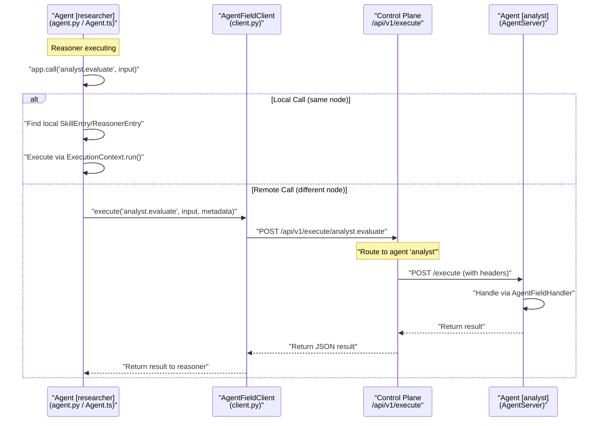
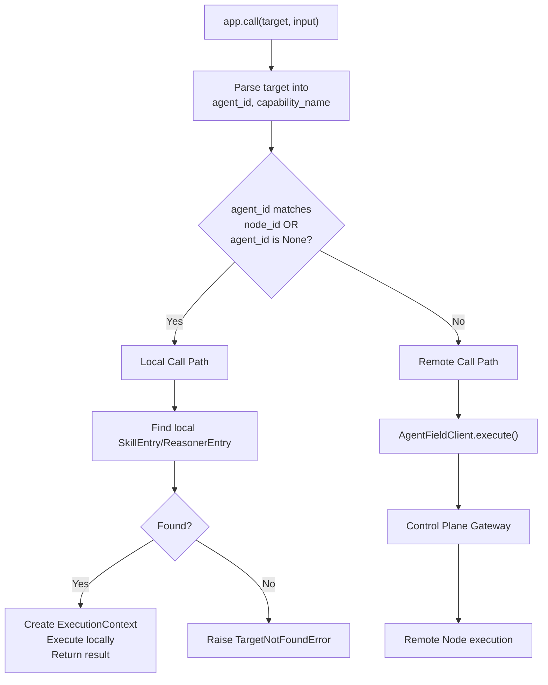

<!-- source: DeepWiki mcp.deepwiki.com · repo Agent-Field/agentfield · page 9.2 Cross-Agent Calls · fetched 2026-10-26 -->

# Cross-Agent Calls

Relevant source files

The following files were used as context for generating this wiki page:

- [control-plane/internal/handlers/execute_awaiter_status.go](control-plane/internal/handlers/execute_awaiter_status.go)
- [control-plane/internal/handlers/execute_awaiter_status_test.go](control-plane/internal/handlers/execute_awaiter_status_test.go)
- [sdk/python/agentfield/agent.py](sdk/python/agentfield/agent.py)
- [sdk/python/agentfield/async_execution_manager.py](sdk/python/agentfield/async_execution_manager.py)
- [sdk/python/agentfield/client.py](sdk/python/agentfield/client.py)
- [sdk/python/agentfield/exceptions.py](sdk/python/agentfield/exceptions.py)
- [sdk/python/agentfield/execution_state.py](sdk/python/agentfield/execution_state.py)
- [sdk/python/tests/test_agent_call.py](sdk/python/tests/test_agent_call.py)
- [sdk/python/tests/test_agent_coverage_additions.py](sdk/python/tests/test_agent_coverage_additions.py)
- [sdk/python/tests/test_async_config.py](sdk/python/tests/test_async_config.py)
- [sdk/python/tests/test_async_execution.py](sdk/python/tests/test_async_execution.py)
- [sdk/python/tests/test_client_laser_push.py](sdk/python/tests/test_client_laser_push.py)
- [sdk/python/tests/test_execution_state.py](sdk/python/tests/test_execution_state.py)
- [sdk/typescript/src/agent/Agent.ts](sdk/typescript/src/agent/Agent.ts)
- [sdk/typescript/src/ai/AIClient.ts](sdk/typescript/src/ai/AIClient.ts)
- [sdk/typescript/src/client/AgentFieldClient.ts](sdk/typescript/src/client/AgentFieldClient.ts)
- [sdk/typescript/src/context/ReasonerContext.ts](sdk/typescript/src/context/ReasonerContext.ts)
- [sdk/typescript/src/index.ts](sdk/typescript/src/index.ts)
- [sdk/typescript/src/router/AgentRouter.ts](sdk/typescript/src/router/AgentRouter.ts)
- [sdk/typescript/src/triggers/factories.ts](sdk/typescript/src/triggers/factories.ts)
- [sdk/typescript/src/triggers/index.ts](sdk/typescript/src/triggers/index.ts)
- [sdk/typescript/src/triggers/types.ts](sdk/typescript/src/triggers/types.ts)
- [sdk/typescript/src/types/agent.ts](sdk/typescript/src/types/agent.ts)
- [sdk/typescript/src/types/reasoner.ts](sdk/typescript/src/types/reasoner.ts)
- [sdk/typescript/tests/agent.test.ts](sdk/typescript/tests/agent.test.ts)
- [sdk/typescript/tests/ai_client.test.ts](sdk/typescript/tests/ai_client.test.ts)
- [sdk/typescript/tests/triggers.test.ts](sdk/typescript/tests/triggers.test.ts)

This page documents how agents invoke capabilities (reasoners and skills) on other agents using the `call()` method. Cross-agent calls enable distributed multi-agent workflows where agents coordinate by directly invoking each other's registered capabilities through the AgentField control plane.

For discovering available capabilities before calling them, see **9.1 Agent Discovery**. For understanding how workflows are tracked across calls, see **9.3 Workflow Tracking**. For asynchronous execution patterns, see **9.4 Asynchronous Execution**.

---

## Overview

Cross-agent calls allow one agent to invoke a reasoner or skill registered on another agent node. The AgentField SDK provides a unified `call()` method that:

1.  **Routes local calls directly** when the target is on the same agent node [sdk/python/agentfield/agent.py:1024-1150]().
2.  **Routes remote calls through the control plane** using the `AgentFieldClient` [sdk/typescript/src/agent/Agent.ts:337-351]().
3.  **Propagates execution context** automatically (Workflow ID, Session ID, etc.) across all calls [sdk/python/agentfield/agent.py:1150-1200]().
4.  **Maintains workflow lineage** by tracking parent-child relationships between executions [sdk/typescript/src/agent/Agent.ts:288-303]().

**Key Components:**
*   `Agent.call()` / `app.call()`: Unified SDK method for invoking capabilities [sdk/python/agentfield/agent.py:1024-1030]().
*   `AgentFieldClient.execute()`: Client used for remote execution dispatch [sdk/python/agentfield/client.py:198-217]().
*   `ExecutionContext`: Container for propagated metadata [sdk/typescript/src/context/ExecutionContext.ts:5-15]().

**Sources:** [sdk/python/agentfield/agent.py:1024-1200](), [sdk/typescript/src/agent/Agent.ts:260-351](), [sdk/python/agentfield/client.py:198-217]()

---

## Cross-Agent Call Flow

The following diagram illustrates how the SDK bridges "Natural Language Space" (the intent to call an analyst) with "Code Entity Space" (the `AgentFieldClient` and control plane routes).

### Cross-Agent Call Routing

**Sources:** [sdk/python/agentfield/agent.py:1024-1150](), [sdk/typescript/src/agent/Agent.ts:260-351](), [sdk/python/agentfield/client.py:198-228]()

---

## Target Resolution

The `call()` method accepts a target string in the format `agent_id.capability_name`.

### Target Format
*   **Full target**: `"analyst.evaluate"` → agent `analyst`, capability `evaluate`.
*   **Short target**: `"evaluate"` → current agent, capability `evaluate`.

### Implementation
The Python SDK uses `_parse_target()` to extract agent and capability names [sdk/python/agentfield/agent.py:2115-2152](). The TypeScript SDK implements similar logic in `parseTarget()` [sdk/typescript/src/agent/Agent.ts:893-906]().

**Sources:** [sdk/python/agentfield/agent.py:2115-2152](), [sdk/typescript/src/agent/Agent.ts:893-906]()

---

## Local vs Remote Call Decision

The SDK determines whether to execute locally or route through the control plane based on the target agent ID.

**Sources:** [sdk/python/agentfield/agent.py:1024-1150](), [sdk/typescript/src/agent/Agent.ts:260-337]()

---

## Execution Context Propagation

All cross-agent calls automatically propagate execution metadata via HTTP headers to maintain workflow lineage.

### Propagated Metadata

| Metadata Field | Header Name | Description |
| :--- | :--- | :--- |
| `workflow_id` | `X-Workflow-ID` | Top-level workflow identifier [sdk/typescript/src/client/AgentFieldClient.ts:31]() |
| `run_id` | `X-Run-ID` | Specific run identifier [sdk/typescript/src/client/AgentFieldClient.ts:30]() |
| `execution_id` | `X-Execution-ID` | Unique ID for this specific execution [sdk/typescript/src/client/AgentFieldClient.ts:29]() |
| `parent_execution_id` | `X-Parent-Execution-ID` | ID of the calling execution [sdk/typescript/src/client/AgentFieldClient.ts:33]() |
| `caller_did` | `X-Caller-DID` | Caller's Decentralized Identifier [sdk/typescript/src/client/AgentFieldClient.ts:37]() |

### Context Capture and Forwarding
In TypeScript, the `AgentFieldClient.buildExecuteHeaders` method prepares these headers [sdk/typescript/src/client/AgentFieldClient.ts:218-228](). In Python, `Agent.call` extracts these from the `get_current_context()` utility [sdk/python/agentfield/agent.py:1150-1200]().

**Sources:** [sdk/typescript/src/client/AgentFieldClient.ts:29-44](), [sdk/python/agentfield/agent.py:1150-1200]()

---

## Advanced Execution Patterns

### Async Fallback Logic
The Python SDK supports a two-tier execution pattern:
1.  **Async First**: Attempt to dispatch the call asynchronously via `execute_async` [sdk/python/agentfield/agent.py:1180-1195]().
2.  **Sync Fallback**: If async execution is disabled or fails due to specific transport issues, it falls back to a synchronous call [sdk/python/agentfield/agent.py:1197-1205]().

> **Note**: The SDK intentionally skips sync fallback if the error is `ExecutionFailedError` or `ExecutionTimeoutError` to prevent doubling costs for deterministic failures [sdk/python/tests/test_agent_call.py:136-184]().

### Pause and Resume
Cross-agent calls can be interrupted by human-in-the-loop approvals using `ctx.pause()`. This transitions the execution to a `waiting` state on the control plane [sdk/typescript/src/context/ReasonerContext.ts:151-158]().

**Sources:** [sdk/python/agentfield/agent.py:1180-1205](), [sdk/python/tests/test_agent_call.py:136-184](), [sdk/typescript/src/context/ReasonerContext.ts:151-158]()

---

## SDK Implementation Reference

### Python SDK (`Agent.call`)
The Python implementation manages the lifecycle of the call, including argument mapping and context switching.

[sdk/python/agentfield/agent.py:1024-1200]()

### TypeScript SDK (`Agent.call`)
The TypeScript implementation uses `ExecutionContext.run` to wrap local calls and `AgentFieldClient` for remote dispatch.

[sdk/typescript/src/agent/Agent.ts:260-351]()

### Control Plane Client (`AgentFieldClient`)
The client handles the low-level HTTP communication, DID signing, and header sanitization.

[sdk/python/agentfield/client.py:142-230]()
[sdk/typescript/src/client/AgentFieldClient.ts:146-230]()

**Sources:** [sdk/python/agentfield/agent.py:1024-1200](), [sdk/typescript/src/agent/Agent.ts:260-351](), [sdk/python/agentfield/client.py:142-230](), [sdk/typescript/src/client/AgentFieldClient.ts:146-230]()

---

