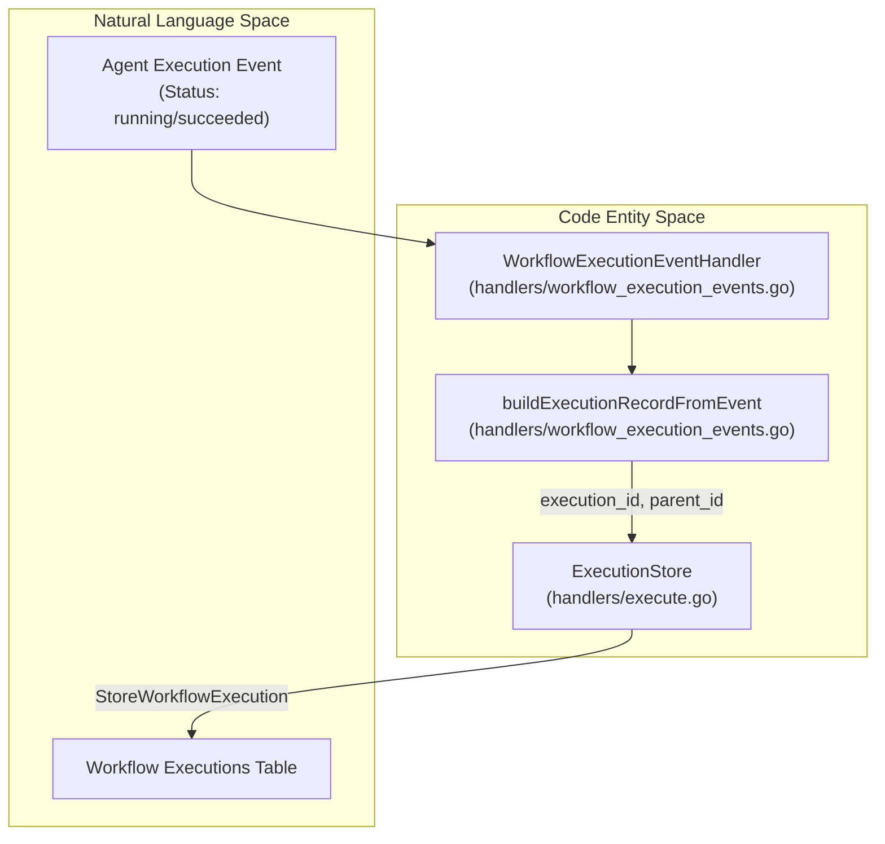
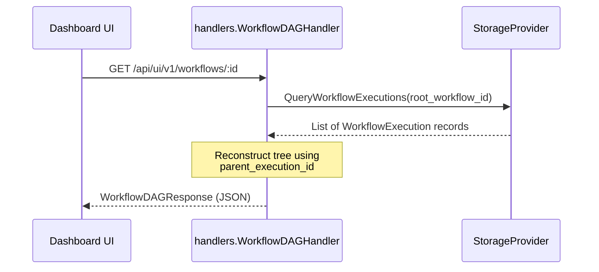
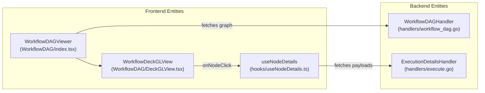

<!-- source: DeepWiki mcp.deepwiki.com · repo Agent-Field/agentfield · page 9.3 Workflow Tracking · fetched 2026-10-26 -->

# Workflow Tracking

Relevant source files

The following files were used as context for generating this wiki page:

- [control-plane/internal/handlers/did_handlers.go](control-plane/internal/handlers/did_handlers.go)
- [control-plane/internal/handlers/execute.go](control-plane/internal/handlers/execute.go)
- [control-plane/internal/handlers/execute_async_test.go](control-plane/internal/handlers/execute_async_test.go)
- [control-plane/internal/handlers/execute_status_update_test.go](control-plane/internal/handlers/execute_status_update_test.go)
- [control-plane/internal/handlers/execution_status_handler_test.go](control-plane/internal/handlers/execution_status_handler_test.go)
- [control-plane/internal/handlers/workflow_dag.go](control-plane/internal/handlers/workflow_dag.go)
- [control-plane/internal/handlers/workflow_execution_events.go](control-plane/internal/handlers/workflow_execution_events.go)
- [control-plane/internal/handlers/workflow_execution_events_test.go](control-plane/internal/handlers/workflow_execution_events_test.go)
- [control-plane/internal/storage/retry_test.go](control-plane/internal/storage/retry_test.go)
- [control-plane/web/client/src/components/WorkflowDAG/DeckGLView.tsx](control-plane/web/client/src/components/WorkflowDAG/DeckGLView.tsx)
- [control-plane/web/client/src/components/WorkflowDAG/hooks/useNodeDetails.ts](control-plane/web/client/src/components/WorkflowDAG/hooks/useNodeDetails.ts)
- [control-plane/web/client/src/components/WorkflowDAG/index.tsx](control-plane/web/client/src/components/WorkflowDAG/index.tsx)
- [control-plane/web/client/src/components/WorkflowDAG/layouts/LayoutManager.ts](control-plane/web/client/src/components/WorkflowDAG/layouts/LayoutManager.ts)
- [control-plane/web/client/src/components/WorkflowDAG/layouts/layoutWorker.ts](control-plane/web/client/src/components/WorkflowDAG/layouts/layoutWorker.ts)
- [control-plane/web/client/src/components/execution/EnhancedModal.tsx](control-plane/web/client/src/components/execution/EnhancedModal.tsx)
- [control-plane/web/client/src/components/execution/ExecutionHeader.tsx](control-plane/web/client/src/components/execution/ExecutionHeader.tsx)
- [control-plane/web/client/src/components/execution/ExecutionIdentityPanel.tsx](control-plane/web/client/src/components/execution/ExecutionIdentityPanel.tsx)
- [control-plane/web/client/src/components/layout/ResponsiveGrid.tsx](control-plane/web/client/src/components/layout/ResponsiveGrid.tsx)
- [control-plane/web/client/src/components/reasoners/ExecutionForm.tsx](control-plane/web/client/src/components/reasoners/ExecutionForm.tsx)
- [control-plane/web/client/src/components/ui/auto-expanding-textarea.tsx](control-plane/web/client/src/components/ui/auto-expanding-textarea.tsx)
- [sdk/python/agentfield/agent_workflow.py](sdk/python/agentfield/agent_workflow.py)

AgentField automatically tracks all agent executions as a directed acyclic graph (DAG), capturing parent-child relationships, execution hierarchies, and the complete call chain without requiring developers to manually instrument their code. Every agent invocation is assigned unique identifiers and tracked in the control plane's storage layer.

For information about how agents discover and call each other, see [9.1 Agent Discovery]() and [9.2 Cross-Agent Calls](). For long-running asynchronous tasks, see [9.4 Asynchronous Execution]().

---

## Core Tracking Identifiers

AgentField uses several identifiers to track workflow execution:

| Identifier | Purpose | Scope | Generation |
|------------|---------|-------|------------|
| `workflow_id` | Unique identifier for a workflow instance | Global | Generated by control plane on first execution |
| `execution_id` | Unique identifier for a single execution | Per-execution | Generated for each agent/reasoner invocation |
| `parent_execution_id` | Reference to parent execution | Per-execution | Inherited from caller context |
| `root_workflow_id` | Reference to the root workflow | Per-execution | Propagated through entire call chain |
| `workflow_depth` | Depth in the execution tree | Per-execution | Incremented with each nested call |
| `run_id` | Optional identifier for a logical run | Per-run | User-provided or generated |

**Sources:**
- [control-plane/pkg/types/executions.go:42-105]()
- [control-plane/internal/handlers/workflow_dag.go:27-44]()

---

## Automatic DAG Generation

AgentField builds execution DAGs automatically. Each time an agent node reports an execution event (start, success, or failure), the control plane updates the execution graph.

### Execution Event Ingestion
The `WorkflowExecutionEventHandler` in [control-plane/internal/handlers/workflow_execution_events.go:35-84]() processes events from agents. If a step starts and no record exists, it calls `buildExecutionRecordFromEvent` [control-plane/internal/handlers/workflow_execution_events.go:86-128]() to initialize the tracking metadata, including `parent_execution_id` and `run_id`.

**Diagram: Workflow Event Processing Pipeline**

**Sources:**
- [control-plane/internal/handlers/workflow_execution_events.go:35-84]()
- [control-plane/internal/handlers/execute.go:41-43]()

---

## Execution Status Management

Executions transition through various states. The control plane enforces terminal state immutability to prevent late-arriving "running" events from overwriting "succeeded" or "failed" results—a common race condition in distributed agent systems.

### Terminal Regression Guard
In `applyEventToExecution` [control-plane/internal/handlers/workflow_execution_events.go:130-190](), the system checks `types.IsTerminalExecutionStatus(current.Status)`. If the execution is already in a terminal state, the update is ignored except for the `updated_at` timestamp [control-plane/internal/handlers/workflow_execution_events.go:141-144]().

| Status | Terminal | Description |
|--------|----------|-------------|
| `pending` | No | Execution is enqueued |
| `running` | No | Agent is currently processing |
| `succeeded`| Yes | Execution completed successfully |
| `failed` | Yes | Execution encountered an error |

**Sources:**
- [control-plane/internal/handlers/workflow_execution_events.go:130-190]()
- [control-plane/internal/handlers/execute_status_update_test.go:20-76]()

---

## DAG Query and Reconstruction

The control plane provides endpoints to reconstruct the execution graph for visualization.

### Execution Graph Service
The `executionGraphService` [control-plane/internal/handlers/workflow_dag.go:18-24]() handles the retrieval of DAG nodes. It builds a `WorkflowDAGResponse` [control-plane/internal/handlers/workflow_dag.go:52-68]() which contains:
- `dag`: A hierarchical tree of `WorkflowDAGNode` objects.
- `timeline`: A flat list of nodes ordered by start time.
- `max_depth`: The deepest level of nested calls found.

**Diagram: DAG Retrieval Flow**

**Sources:**
- [control-plane/internal/handlers/workflow_dag.go:52-68]()
- [control-plane/internal/handlers/execute.go:44]()

---

## Dashboard Visualization

The frontend uses `@xyflow/react` and `deck.gl` to render the tracked workflows.

### Visualization Components
- **WorkflowDAGViewer**: The primary container for graph rendering [control-plane/web/client/src/components/WorkflowDAG/index.tsx:176-217]().
- **WorkflowDeckGLView**: A high-performance renderer used for large graphs (exceeding performance thresholds) [control-plane/web/client/src/components/WorkflowDAG/DeckGLView.tsx:73-79]().
- **useNodeDetails**: A custom hook that fetches detailed execution metadata (input/output payloads) when a node is selected [control-plane/web/client/src/components/WorkflowDAG/hooks/useNodeDetails.ts:31-115]().

**Diagram: Frontend-Backend Tracking Integration**

**Sources:**
- [control-plane/web/client/src/components/WorkflowDAG/index.tsx:176-217]()
- [control-plane/web/client/src/components/WorkflowDAG/DeckGLView.tsx:73-79]()
- [control-plane/web/client/src/components/WorkflowDAG/hooks/useNodeDetails.ts:31-115]()

---

## Real-Time Tracking Updates

The control plane maintains an `ExecutionEventBus` [control-plane/internal/handlers/execute.go:46]() to broadcast updates as they happen.

### Event Propagation
When `UpdateExecutionStatusHandler` is called [control-plane/internal/handlers/execute_status_update_test.go:46](), it updates the database and can trigger webhooks if `WebhookRegistered` is true [control-plane/internal/handlers/execute_status_update_test.go:131-187](). This ensures that the UI and external systems stay synchronized with the agent's progress.

**Sources:**
- [control-plane/internal/handlers/execute.go:46]()
- [control-plane/internal/handlers/execute_status_update_test.go:131-187]()
- [control-plane/internal/handlers/workflow_execution_events.go:82]()

---

