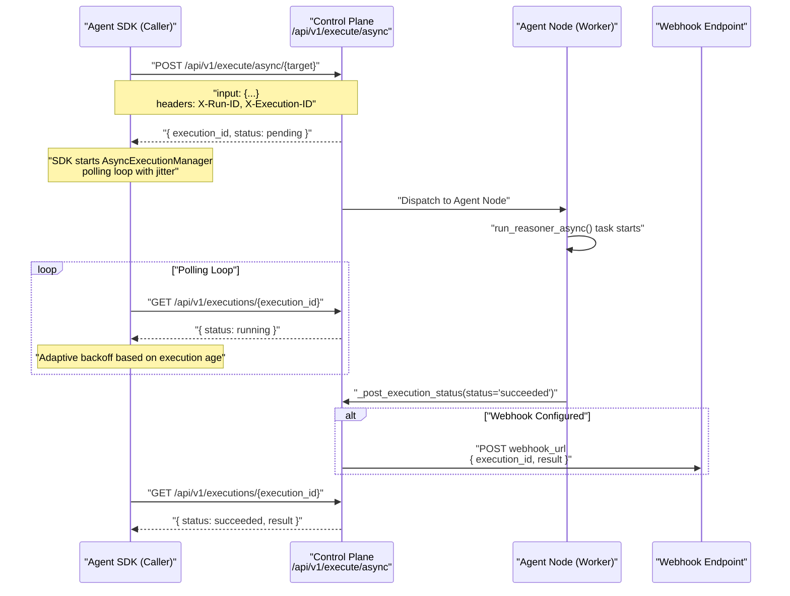
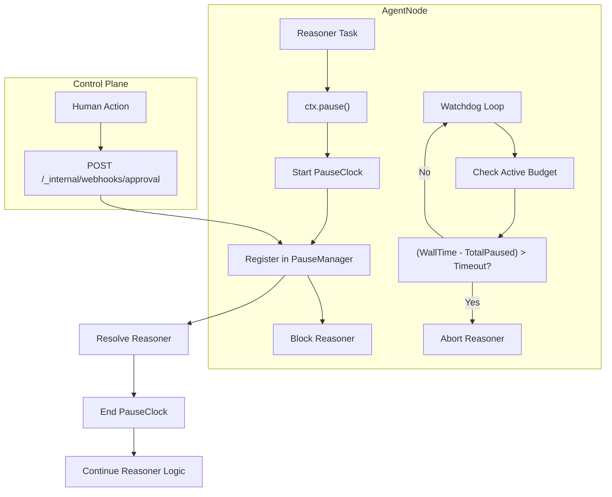

<!-- source: DeepWiki mcp.deepwiki.com · repo Agent-Field/agentfield · page 9.4 Asynchronous Execution · fetched 2026-10-26 -->

# Asynchronous Execution

Relevant source files

The following files were used as context for generating this wiki page:

- [control-plane/internal/handlers/execute_awaiter_status.go](control-plane/internal/handlers/execute_awaiter_status.go)
- [control-plane/internal/handlers/execute_awaiter_status_test.go](control-plane/internal/handlers/execute_awaiter_status_test.go)
- [examples/ts-node-examples/waiting-state/main.ts](examples/ts-node-examples/waiting-state/main.ts)
- [sdk/python/agentfield/agent.py](sdk/python/agentfield/agent.py)
- [sdk/python/agentfield/async_execution_manager.py](sdk/python/agentfield/async_execution_manager.py)
- [sdk/python/agentfield/client.py](sdk/python/agentfield/client.py)
- [sdk/python/agentfield/exceptions.py](sdk/python/agentfield/exceptions.py)
- [sdk/python/agentfield/execution_state.py](sdk/python/agentfield/execution_state.py)
- [sdk/python/tests/test_agent_call.py](sdk/python/tests/test_agent_call.py)
- [sdk/python/tests/test_agent_coverage_additions.py](sdk/python/tests/test_agent_coverage_additions.py)
- [sdk/python/tests/test_async_config.py](sdk/python/tests/test_async_config.py)
- [sdk/python/tests/test_async_execution.py](sdk/python/tests/test_async_execution.py)
- [sdk/python/tests/test_client_laser_push.py](sdk/python/tests/test_client_laser_push.py)
- [sdk/python/tests/test_execution_state.py](sdk/python/tests/test_execution_state.py)
- [sdk/typescript/src/agent/cancel.ts](sdk/typescript/src/agent/cancel.ts)
- [sdk/typescript/src/agent/pause.ts](sdk/typescript/src/agent/pause.ts)
- [sdk/typescript/tests/agent_async_execution.test.ts](sdk/typescript/tests/agent_async_execution.test.ts)
- [sdk/typescript/tests/agent_pause.test.ts](sdk/typescript/tests/agent_pause.test.ts)
- [sdk/typescript/tests/agent_runtime_paths.test.ts](sdk/typescript/tests/agent_runtime_paths.test.ts)

## Purpose and Scope

This page describes AgentField's asynchronous execution system, which enables fire-and-forget operations, long-running tasks, and human-in-the-loop approvals. The system supports tasks that may run for minutes, hours, or days with durable state management, automatic retry logic, and cooperative cancellation.

For calling other agents synchronously, see [Cross-Agent Calls](9.2). For tracking execution workflows, see [Workflow Tracking](9.3). For the underlying REST API, see [API Endpoints](6.5).

---

## Execution Architecture

AgentField uses a **submit-and-poll** architecture where execution requests are submitted to the control plane's durable execution gateway, assigned an `execution_id`, and tracked through completion. The SDK polls for status updates with adaptive backoff, while optionally supporting webhook notifications or blocking until a human approval is received via `ctx.pause()`.

**Diagram: Asynchronous Execution Flow**

**Sources:**
- [sdk/python/agentfield/client.py:574-600]()
- [sdk/python/agentfield/client.py:713-798]()
- [sdk/python/agentfield/async_execution_manager.py:185-197]()
- [sdk/python/agentfield/agent.py:1131-1150]()

---

## AsyncConfig Configuration

Asynchronous behavior is controlled via `AsyncConfig`, which configures polling intervals, connection pooling, and timeout thresholds.

**AsyncConfig Parameters**

| Parameter | Type | Default | Description |
|-----------|------|---------|-------------|
| `initial_poll_interval` | `float` | `0.25` | Starting interval between status checks (seconds) |
| `max_poll_interval` | `float` | `10.0` | Maximum interval between polls after exponential backoff |
| `max_execution_timeout` | `float` | `3600.0` | Total wall-clock time to wait for completion |
| `default_execution_timeout`| `float` | `300.0` | Default timeout for the agent-side reasoner watchdog |
| `enable_result_caching` | `bool` | `True` | Whether to cache terminal results locally |
| `webhook_url` | `str` | `None` | URL for completion notifications |

**Sources:**
- [sdk/python/agentfield/async_config.py:12-45]()
- [sdk/python/agentfield/client.py:163-167]()

---

## Human-in-the-Loop: Pausing and Resuming

A unique feature of AgentField's async execution is the ability to **pause** a reasoner mid-flight to wait for human approval without burning the execution's active timeout budget.

### The Pause Mechanism
When a reasoner calls `ctx.pause()` (TS) or `app.pause()` (Python), the following occurs:
1. The execution status is updated to `waiting` on the control plane.
2. A `PauseClock` is started on the agent node to track time spent waiting [sdk/typescript/src/agent/pause.ts:68-98]().
3. The reasoner logic blocks on a local promise/future in the `PauseManager` [sdk/typescript/src/agent/pause.ts:113-137]().
4. When a human approves via the Control Plane UI, the CP sends a webhook to the agent's `/_internal/webhooks/approval` route, resolving the pause [sdk/typescript/src/agent/pause.ts:106-112]().

**Diagram: Pause and Watchdog Logic**

**Sources:**
- [sdk/python/agentfield/agent.py:2260-2300]()
- [sdk/typescript/src/agent/pause.ts:68-98]()
- [sdk/python/tests/test_async_execution.py:96-104]()

---

## Adaptive Polling and Metrics

The `AsyncExecutionManager` (Python) and `AgentFieldClient` manage high-concurrency polling for hundreds of active tasks.

### Polling Strategy
The system uses an age-based adaptive polling interval:
- **New Tasks**: Polled frequently (`fast_poll_interval`) to ensure low latency for quick tasks [sdk/python/agentfield/async_config.py:32-34]().
- **Aging Tasks**: Interval increases as the task stays active, reducing load on the control plane.
- **Jitter**: Every poll interval is multiplied by a random factor (0.8x - 1.2x) to prevent "thundering herd" synchronization [sdk/python/agentfield/client.py:880-882]().

### Metrics Tracking
The `AsyncExecutionManager` tracks performance through `PollingMetrics` and `ExecutionManagerMetrics`, including success rates and average poll durations [sdk/python/agentfield/async_execution_manager.py:99-184]().

**Sources:**
- [sdk/python/agentfield/async_execution_manager.py:185-220]()
- [sdk/python/agentfield/async_config.py:24-35]()

---

## Cooperative Cancellation

Executions can be cancelled from the control plane (e.g., via the dashboard). The Agent Node implements cooperative cancellation using `AbortController` (TS) or `asyncio.Task.cancel` (Python).

1. **Registration**: When an async reasoner starts, its `execution_id` is registered in the `CancelRegistry` [sdk/typescript/src/agent/cancel.ts:33-65]().
2. **Signal Propagation**: The `ctx.signal` (TS) or context is passed to downstream skills or AI calls.
3. **Internal Route**: The control plane notifies the agent via `POST /_internal/executions/:execution_id/cancel` [sdk/typescript/src/agent/cancel.ts:99-134]().
4. **Abort**: The registry triggers `.abort()`, causing any bound `fetch` or SDK calls to reject immediately.

**Sources:**
- [sdk/typescript/src/agent/cancel.ts:9-32]()
- [sdk/typescript/src/agent/cancel.ts:99-134]()

---

## Implementation Details: Python vs TypeScript

### Python SDK
Uses a dedicated `AsyncExecutionManager` class that handles background polling tasks and integrates with a `ResultCache` [sdk/python/agentfield/async_execution_manager.py:185-210](). It provides `execute_async` and `wait_for_execution_result` methods on the `AgentFieldClient` [sdk/python/agentfield/client.py:574-610]().

### TypeScript SDK
Uses a similar pattern but exposes a lower-level `ApprovalClient` for manual polling control in addition to the high-level `ctx.pause()` primitive [examples/ts-node-examples/waiting-state/main.ts:38-42](). It uses Express-based internal routes for webhooks [sdk/typescript/src/agent/pause.ts:1-5]().

**Sources:**
- [sdk/python/agentfield/client.py:574-610]()
- [examples/ts-node-examples/waiting-state/main.ts:149-185]()
- [sdk/typescript/src/agent/cancel.ts:99-134]()

---

## Error Handling and Retries

The system distinguishes between different failure types to prevent infinite retry loops that burn budget:
- **ExecutionFailedError**: The reasoner ran and returned an error. The SDK **skips** sync fallback because re-running will yield the same failure [sdk/python/agentfield/exceptions.py:17-33]().
- **ExecutionTimeoutError**: The wait deadline was hit. Sync fallback is skipped to prevent double-billing for a task that might still be running [sdk/python/agentfield/exceptions.py:74-77]().
- **Transient Errors**: Network failures during polling are retried with exponential backoff [sdk/python/agentfield/async_execution_manager.py:117-131]().

**Sources:**
- [sdk/python/tests/test_agent_call.py:136-178]()
- [sdk/python/agentfield/exceptions.py:80-96]()

---

