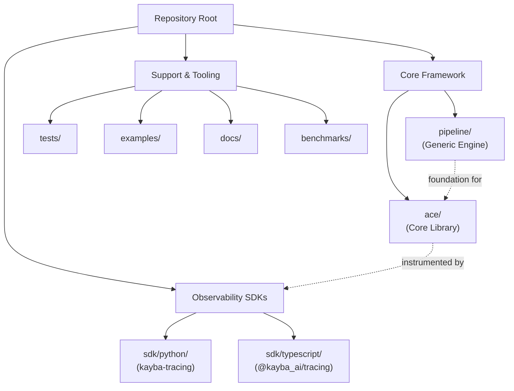
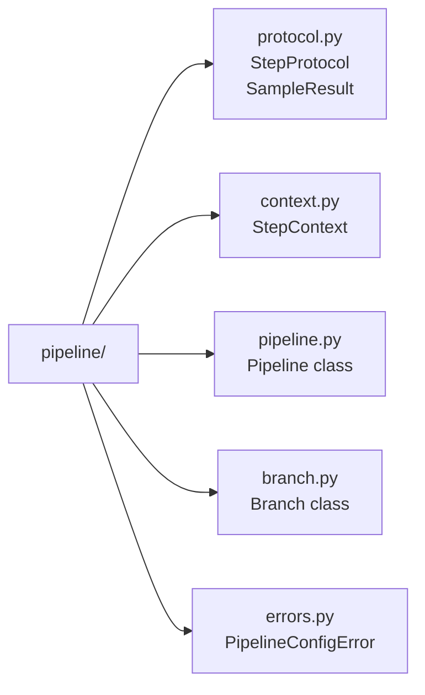
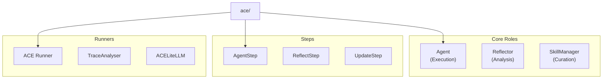

<!-- source: DeepWiki mcp.deepwiki.com · repo kayba-ai/agentic-context-engine · page 1.1 Repository Structure · fetched 2026-10-26 -->

# Repository Structure

Relevant source files

The following files were used as context for generating this wiki page:

- [.gitignore](.gitignore)
- [CLAUDE.md](CLAUDE.md)
- [README.md](README.md)
- [ace/runners/litellm.py](ace/runners/litellm.py)
- [assets/kayba-banner.png](assets/kayba-banner.png)
- [benchmarks/tasks/tau_bench/Tau2Benchmark Result Haiku4.5.png](benchmarks/tasks/tau_bench/Tau2Benchmark Result Haiku4.5.png)
- [examples/ace/ace_demo.py](examples/ace/ace_demo.py)
- [examples/pipeline_ex/pipeline_demo.ipynb](examples/pipeline_ex/pipeline_demo.ipynb)
- [mlflow.db](mlflow.db)
- [pipeline/branch.py](pipeline/branch.py)
- [pipeline/context.py](pipeline/context.py)
- [pipeline/pipeline.py](pipeline/pipeline.py)
- [sdk/python/pyproject.toml](sdk/python/pyproject.toml)
- [sdk/python/src/kayba_tracing/__init__.py](sdk/python/src/kayba_tracing/__init__.py)
- [sdk/python/src/kayba_tracing/_wrapper.py](sdk/python/src/kayba_tracing/_wrapper.py)
- [sdk/typescript/.gitignore](sdk/typescript/.gitignore)
- [sdk/typescript/package-lock.json](sdk/typescript/package-lock.json)
- [sdk/typescript/package.json](sdk/typescript/package.json)
- [sdk/typescript/src/index.ts](sdk/typescript/src/index.ts)
- [tests/pipeline_engine/__init__.py](tests/pipeline_engine/__init__.py)

## Purpose and Scope

This document describes the physical organization of the Agentic Context Engine (ACE) repository. It covers the three main directories: `ace/` (the core library), `pipeline/` (the generic execution engine), and `sdk/` (the tracing SDKs). It also details the supporting directories for tests, examples, and documentation.

---

## High-Level Directory Layout

The repository is organized into three main codebases that implement a layered architecture, plus supporting directories for cross-language SDKs and tooling.

**Directory Purpose Summary:**

| Directory | Purpose | Primary Language |
|-----------|---------|------------------|
| `ace/` | Core library: roles, skillbook, steps, and runners | Python |
| `pipeline/` | Generic pipeline engine: StepProtocol, Pipeline, and Branch | Python |
| `sdk/` | Multi-language tracing SDKs for Kayba observability | Python / TS |
| `tests/` | Unit and integration tests (pytest) | Python |
| `examples/` | Runnable demonstrations and integration samples | Python |
| `docs/` | User guides, API reference, and design documents | Markdown |
| `benchmarks/` | Research and evaluation tooling (e.g., Tau-bench) | Python |

Sources: [CLAUDE.md:46-57](), [README.md:80-101]()

---

## Core Directories

### pipeline/ — Generic Pipeline Engine

The foundational layer providing composable execution primitives. This directory contains no ACE-specific logic (e.g., no mention of "Skillbooks" or "Agents") and serves as a standalone engine for building complex LLM workflows.

**Key Architectural Components:**

*   **`StepProtocol`**: A structural protocol that all pipeline steps must implement, defining `requires` and `provides` fields for contract validation [pipeline/protocol.py:1-53]().
*   **`Pipeline`**: An ordered sequence of steps. It manages sequential execution and supports `async_boundary` for non-blocking background tasks [pipeline/pipeline.py:53-73]().
*   **`Branch`**: A parallel fork/join primitive that runs multiple pipelines concurrently and merges their `StepContext` using a `MergeStrategy` [pipeline/branch.py:114-127]().
*   **`StepContext`**: A frozen, immutable data carrier passed between steps. Users subclass this to add domain-specific fields [pipeline/context.py:11-25]().

Sources: [CLAUDE.md:7-23](), [pipeline/pipeline.py:1-73]()

---

### ace/ — Core Library

The primary implementation of the Agentic Context Engine. It builds upon the `pipeline/` engine to implement the self-improving learning loop.

**Implementation Details:**

*   **Roles**: Implemented as PydanticAI-backed agents. The `Agent` [ace/roles.py] executes tasks, the `Reflector` [ace/roles.py] analyzes traces, and the `SkillManager` [ace/roles.py] updates the `Skillbook` [ace/skillbook.py].
*   **Recursive Reflector (RR)**: Located in `ace/rr/`, this system uses a `RecursiveAgent` to perform iterative code-based analysis of traces within a `TraceSandbox` [README.md:88]().
*   **Runners**: High-level entry points. `ACE` provides the full Execute-Evaluate-Reflect loop [examples/ace/ace_demo.py:61-73](), while `TraceAnalyser` enables learning from pre-recorded logs [examples/ace/ace_demo.py:62]().

Sources: [CLAUDE.md:80-87](), [README.md:80-101](), [examples/ace/ace_demo.py:59-74]()

---

### sdk/ — Tracing SDKs

The SDKs provide instrumentation for AI agents to send traces to the Kayba platform or local MLflow instances.

#### Python SDK (`sdk/python/`)
*   **Package Name**: `kayba-tracing` [sdk/python/pyproject.toml:6]().
*   **Core**: Provides a `@trace` decorator and `start_span` context managers to instrument functions [sdk/python/src/kayba_tracing/__init__.py]().

#### TypeScript SDK (`sdk/typescript/`)
*   **Package Name**: `@kayba_ai/tracing` [sdk/typescript/package.json:2]().
*   **Implementation**: A thin wrapper around `mlflow-tracing` that configures authentication and injects Kayba-specific folder tags [sdk/typescript/src/index.ts:1-23]().
*   **Key Functions**: `configure()`, `trace()`, `startSpan()`, and `setFolder()` [sdk/typescript/src/index.ts:124-236]().

Sources: [sdk/python/pyproject.toml:1-10](), [sdk/typescript/package.json:1-10](), [sdk/typescript/src/index.ts:1-155]()

---

## Tooling and Supporting Directories

### tests/ — Test Suite
The repository uses `pytest` for testing, categorized by markers:
*   **Unit**: Fast tests for core logic (`pytest -m unit`) [CLAUDE.md:61]().
*   **Integration**: Tests requiring LLM API access or framework integrations (`pytest -m integration`) [CLAUDE.md:61]().
*   **Slow**: Long-running benchmarks or multi-epoch training tests (`pytest -m slow`) [CLAUDE.md:61]().

### examples/ — Runnable Demos
Demonstrations of ACE integrations:
*   `examples/ace/`: Basic ACE usage and `TraceAnalyser` [examples/ace/ace_demo.py]().
*   `examples/browser-use/`: Self-improving browser automation [CLAUDE.md:94]().
*   `examples/langchain/`: Wrapping LangChain agents with learning capabilities [CLAUDE.md:93]().

### Configuration Files
*   **`pyproject.toml`**: Defines project dependencies, including optional extras like `mcp`, `browser-use`, and `deduplication` [CLAUDE.md:59]().
*   **`CLAUDE.md`**: Provides mandatory "Pipeline-First" development guidelines for contributors [CLAUDE.md:7-23]().
*   **`.gitignore`**: Excludes environment files (`.env`), virtual environments (`.venv`), and generated Skillbook JSON files [ .gitignore:54-91]().

Sources: [CLAUDE.md:42-57](), [ .gitignore:1-123]()

---

