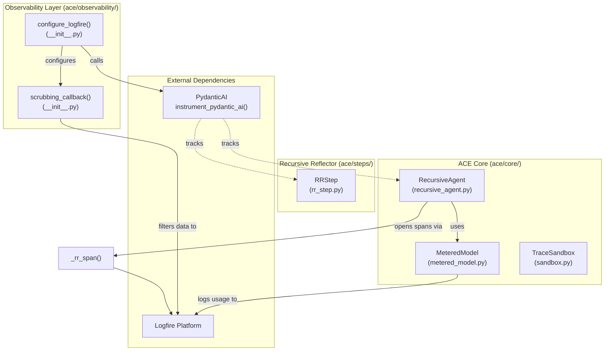
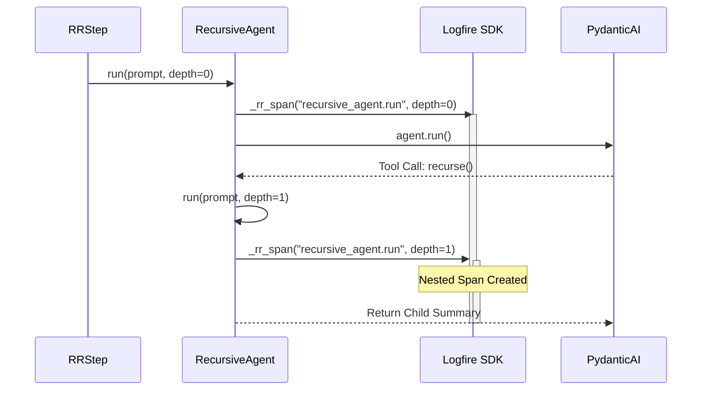

<!-- source: DeepWiki mcp.deepwiki.com · repo kayba-ai/agentic-context-engine · page 10.1 Logfire Integration · fetched 2026-10-26 -->

# Logfire Integration

<details>
<summary>Relevant source files</summary>

The following files were used as context for generating this wiki page:

- [AGENTS.md](AGENTS.md)
- [ace/core/recursive_agent.py](ace/core/recursive_agent.py)
- [ace/implementations/rr/__init__.py](ace/implementations/rr/__init__.py)
- [ace/implementations/rr/config.py](ace/implementations/rr/config.py)
- [ace/implementations/rr/prompts.py](ace/implementations/rr/prompts.py)
- [ace/implementations/rr/tools.py](ace/implementations/rr/tools.py)
- [ace/observability/__init__.py](ace/observability/__init__.py)
- [ace/steps/rr_step.py](ace/steps/rr_step.py)
- [agent-guides/logfire.md](agent-guides/logfire.md)

</details>


The Logfire Integration provides enterprise-grade observability and tracing for the ACE Framework. It is designed to auto-instrument PydanticAI agents, track complex recursive operations, and provide secure data scrubbing for sensitive information. This integration is the primary observability layer for the next-gen `ace_next/` architecture and the Recursive Reflector (RR) system.

## Overview

ACE uses [Logfire](https://logfire.pydantic.dev/) for structured logging and distributed tracing. The integration is opt-in but highly recommended for production environments to monitor agent performance, token usage, and the execution flow of recursive sub-agents.

Key capabilities include:
1.  **Auto-instrumentation**: Automatic tracking of all PydanticAI-backed roles (`Agent`, `Reflector`, `SkillManager`, `RRStep`) [ace/observability/__init__.py:1-4]().
2.  **Recursive Trace Visualization**: Capturing the parent-child relationships in the Recursive Reflector system [ace/core/recursive_agent.py:47-52]().
3.  **Enterprise Scrubbing**: A custom callback system to prevent sensitive data (like payment IDs) from being sent to Logfire while preserving critical agent reasoning [ace/observability/__init__.py:47-63]().
4.  **Metered Usage**: Tracking token consumption and request counts via `MeteredModel` [ace/core/recursive_agent.py:68-70]().

Sources: [ace/observability/__init__.py:1-16](), [ace/core/recursive_agent.py:39-52]()

## Architecture

### System Components and Instrumentation

The following diagram shows how Logfire integrates with the ACE core and the Recursive Reflector system.



Sources: [ace/observability/__init__.py:27-70](), [ace/core/recursive_agent.py:47-52](), [ace/steps/rr_step.py:51-70]()

### Data Flow for Recursive Spans

In the Recursive Reflector system, spans are nested to represent the depth of analysis. The `_rr_span` utility ensures that even if Logfire is not installed, the code executes normally using a `nullcontext`.



Sources: [ace/core/recursive_agent.py:47-52](), [ace/core/recursive_agent.py:150-174](), [ace/steps/rr_step.py:167-180]()

## Configuration

### Logfire Setup

The `configure_logfire` function initializes the connection and instruments PydanticAI. It reads the `LOGFIRE_TOKEN` from the environment.

```python
from ace.observability import configure_logfire

# Returns True if successful, False if logfire package is missing
if configure_logfire():
    print("Logfire instrumentation active")
```

Sources: [ace/observability/__init__.py:27-71]()

### Data Scrubbing

To comply with enterprise security requirements, ACE implements a `scrubbing_callback`. This allows the framework to hide sensitive fields while explicitly **preserving** agent reasoning and message content which are vital for debugging traces.

The following fields are explicitly allowed (not scrubbed):
- `attributes.trace.reasoning`
- `attributes.trace.answer`
- `messages.content`
- `tool_arguments`
- `tool_response`

Sources: [ace/observability/__init__.py:47-63]()

## Recursive Reflector (RR) Observability

The RR system uses specific Logfire spans to track the "thought process" of the recursive analysis.

### Specialized Tools and Spans
- **`execute_code`**: Instrumented to show the Python code being run against the trace [ace/core/recursive_agent.py:82-106]().
- **`think`**: A dedicated narration channel that surfaces in Logfire to show the agent's internal state without cluttering the sandbox [ace/implementations/rr/tools.py:97-107]().
- **`recurse`**: Tracks the spawning of child agents, creating a hierarchical trace tree in the Logfire UI [ace/core/recursive_agent.py:143-174]().

### RR Configuration for Observability
The `RRConfig` (inherited from `AgenticConfig`) controls limits that affect what is logged:
- `max_output_chars`: Limits the size of sandbox output logged to Logfire (default 50,000) [ace/implementations/rr/config.py:17]().
- `cache_prompts`: Enables prompt caching which is reflected in Logfire metadata for cost analysis [ace/implementations/rr/config.py:18]().

Sources: [ace/implementations/rr/config.py:9-20](), [ace/steps/rr_step.py:102-108]()

## Querying Traces

For developers and agents needing to retrieve data back from Logfire for analysis (e.g., during the "Reflect" phase of the ACE loop), the framework follows a standard query pattern using the Logfire SQL API.

### Recommended Access Pattern
- **Endpoint**: `https://logfire-api.pydantic.dev/v1/query` [agent-guides/logfire.md:71-73]().
- **Authentication**: Requires `LOGFIRE_READ_TOKEN` [agent-guides/logfire.md:173-175]().
- **Data Shape**: Logfire returns column-oriented JSON. The framework recommends converting this to row-oriented dicts for easier processing [agent-guides/logfire.md:130-154]().

### Canonical Query Example
To fetch the latest root traces for analysis:
```sql
SELECT
  start_timestamp,
  trace_id,
  message,
  duration
FROM records
WHERE parent_span_id IS NULL
ORDER BY start_timestamp DESC
LIMIT 20
```

Sources: [agent-guides/logfire.md:149-154](), [agent-guides/logfire.md:200-218]()

## Summary of Logfire Utilities

| Function / Class | Location | Purpose |
| :--- | :--- | :--- |
| `configure_logfire()` | `ace/observability/__init__.py` | Main entry point to enable Logfire and PydanticAI instrumentation. |
| `_rr_span()` | `ace/core/recursive_agent.py` | Internal helper to create spans for recursive operations. |
| `scrubbing_callback()` | `ace/observability/__init__.py` | Security filter to prevent leaking PII while keeping agent logs readable. |
| `is_configured()` | `ace/observability/__init__.py` | Check if Logfire has already been initialized. |

Sources: [ace/observability/__init__.py:27-75](), [ace/core/recursive_agent.py:47-52]()

---

