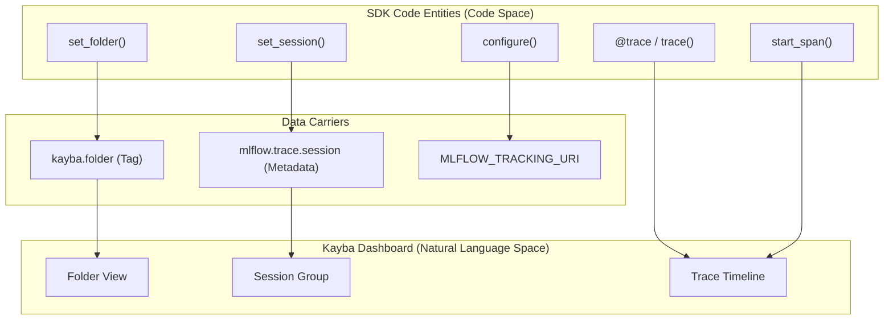
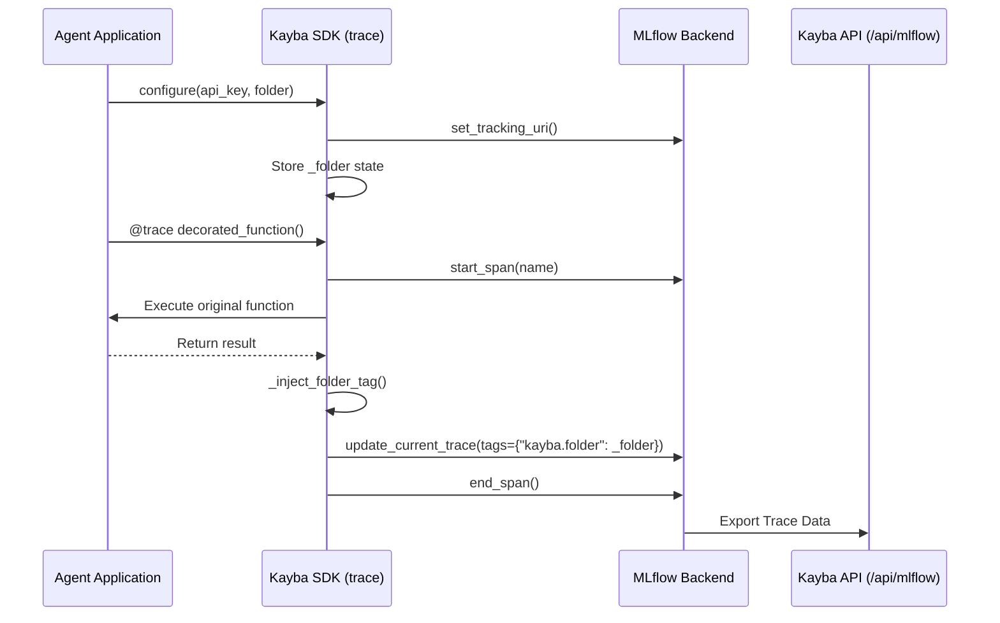

<!-- source: DeepWiki mcp.deepwiki.com · repo kayba-ai/agentic-context-engine · page 10.2 Kayba Tracing SDK · fetched 2026-10-26 -->

# Kayba Tracing SDK

<details>
<summary>Relevant source files</summary>

The following files were used as context for generating this wiki page:

- [ace/tracing/__init__.py](ace/tracing/__init__.py)
- [ace/tracing/_wrapper.py](ace/tracing/_wrapper.py)
- [agent-guides/tracing-sdk.md](agent-guides/tracing-sdk.md)
- [docs/integrations/tracing.md](docs/integrations/tracing.md)
- [examples/tracing_glm_example.py](examples/tracing_glm_example.py)
- [mlflow.db](mlflow.db)
- [sdk/python/pyproject.toml](sdk/python/pyproject.toml)
- [sdk/python/src/kayba_tracing/__init__.py](sdk/python/src/kayba_tracing/__init__.py)
- [sdk/python/src/kayba_tracing/_wrapper.py](sdk/python/src/kayba_tracing/_wrapper.py)
- [sdk/typescript/.gitignore](sdk/typescript/.gitignore)
- [sdk/typescript/package-lock.json](sdk/typescript/package-lock.json)
- [sdk/typescript/package.json](sdk/typescript/package.json)
- [sdk/typescript/src/index.ts](sdk/typescript/src/index.ts)
- [tests/test_tracing.py](tests/test_tracing.py)

</details>


The Kayba Tracing SDK provides a lightweight, agent-centric instrumentation layer for Python and TypeScript. It is built as a thin wrapper around MLflow tracing, specifically optimized for the Kayba backend. The SDK enables automatic folder organization in the Kayba dashboard, session tracking, and hierarchical span management.

## Overview

The SDK allows developers to instrument agent logic using decorators or context managers. All captured traces are exported to the Kayba platform via the MLflow protocol.

Key features include:
- **Automatic Folder Tagging**: Organize traces into dashboard folders using `kayba.folder` tags.
- **Session Management**: Group multiple traces (e.g., individual tool calls) into a single agent session.
- **MLflow Compatibility**: Uses standard MLflow backend, allowing integration with existing MLflow tools.
- **Cross-Language Support**: Feature parity between Python (`kayba-tracing`) and TypeScript (`@kayba_ai/tracing`).

Sources: [sdk/python/src/kayba_tracing/_wrapper.py:1-6](), [sdk/typescript/src/index.ts:1-6](), [ace/tracing/__init__.py:1-15]()

## Architecture and Data Flow

The SDK acts as an interceptor that injects Kayba-specific metadata into the MLflow trace context before data is transmitted to the tracking URI.

### System Entity Mapping

The following diagram bridges the high-level dashboard concepts to the internal code entities.

**Tracing Entity Map**

Sources: [sdk/python/src/kayba_tracing/_wrapper.py:52-118](), [sdk/typescript/src/index.ts:100-120]()

### Instrumentation Flow

When a function is wrapped with `@trace`, the SDK manages the lifecycle of the MLflow span and ensures metadata injection.

**Span Lifecycle and Tag Injection**

Sources: [sdk/python/src/kayba_tracing/_wrapper.py:134-179](), [sdk/typescript/src/index.ts:236-280]()

## Implementation Details

### Configuration and Backend Setup

The `configure()` function is the entry point for the SDK. It translates Kayba credentials into MLflow environment variables and initializes the tracking client.

| Parameter | Description | Internal Action |
|-----------|-------------|-----------------|
| `api_key` | Kayba API Key | Sets `MLFLOW_TRACKING_TOKEN` |
| `base_url`| API Base URL | Appends `/api/mlflow` to set `MLFLOW_TRACKING_URI` |
| `folder`  | Dashboard Folder | Sanitizes and stores in global `_folder` variable |

**Python Implementation:** [sdk/python/src/kayba_tracing/_wrapper.py:52-92]()
**TypeScript Implementation:** [sdk/typescript/src/index.ts:130-155]()

### Folder Sanitization

To prevent injection attacks and ensure dashboard compatibility, folder names are sanitized using a strict regex `[^a-zA-Z0-9 _\-/.]`. Names are truncated to 256 characters and HTML tags are stripped.

Sources: [sdk/python/src/kayba_tracing/_wrapper.py:35-45](), [sdk/typescript/src/index.ts:84-88]()

### The @trace Decorator

The `trace()` function (or `@trace` decorator in Python) wraps execution logic. It supports both bare usage and parameterized usage (e.g., specifying `span_type` like `LLM` or `TOOL`).

- **Python**: Uses `functools.wraps` to preserve function metadata. It wraps the function with a helper that calls `_inject_folder_tag()` immediately before the span finishes. [sdk/python/src/kayba_tracing/_wrapper.py:134-179]()
- **TypeScript**: Returns a wrapped function that manages the `mlflowTrace` lifecycle. [sdk/typescript/src/index.ts:236-280]()

### Manual Span Management

For fine-grained control, `start_span()` is provided as a context manager (Python) or a function returning a span object (TypeScript).

```python
from kayba_tracing import start_span

with start_span(name="retrieval", span_type="TOOL") as span:
    # ... logic ...
    span.set_inputs({"query": "example"})
```
Sources: [sdk/python/src/kayba_tracing/_wrapper.py:182-199](), [sdk/typescript/src/index.ts:282-300]()

## Dashboard Folders and Organization

The SDK uses the `kayba.folder` tag to drive the organization of traces in the Kayba UI.

1. **Global Folder**: Set via `configure(folder="...")` or `set_folder("...")`. This applies to all subsequent traces in the process. [sdk/python/src/kayba_tracing/_wrapper.py:94-106]()
2. **Session Tracking**: In TypeScript, `setSession(id)` injects `mlflow.trace.session` into metadata, allowing the dashboard to group disparate traces into a single logical agent run. [sdk/typescript/src/index.ts:183-190]()
3. **User Attribution**: `setUser(id)` injects `mlflow.trace.user` for multi-user application tracking. [sdk/typescript/src/index.ts:198-205]()

## Usage within ACE Framework

While `kayba-tracing` is a standalone package, the ACE Framework provides a convenience re-export via `ace.tracing`.

- **Installation**: `pip install ace-framework[tracing]` [ace/tracing/__init__.py:12-14]()
- **Integration**: The `ace.tracing` module simply maps to the underlying `kayba_tracing` implementation, ensuring that ACE agents can be instrumented with the same API. [ace/tracing/__init__.py:17-27]()

Sources: [ace/tracing/__init__.py:1-40](), [sdk/python/pyproject.toml:28-30]()

---

