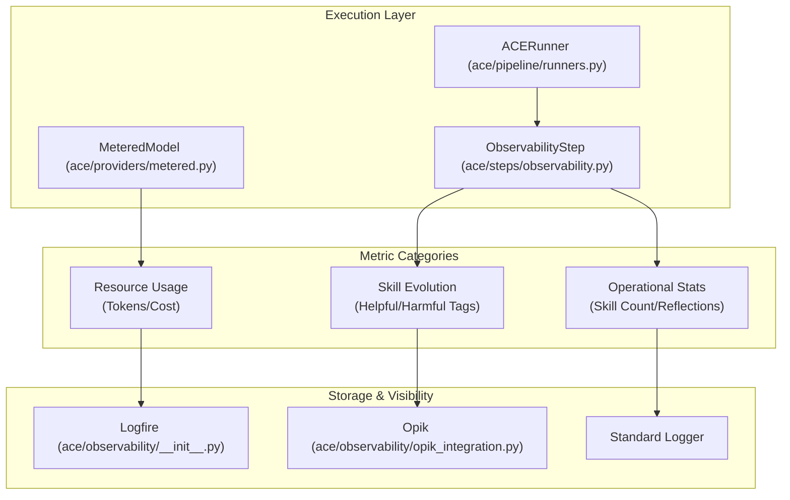
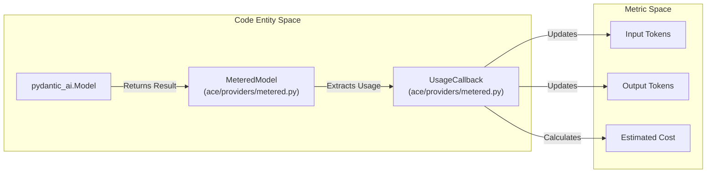

<!-- source: DeepWiki mcp.deepwiki.com · repo kayba-ai/agentic-context-engine · page 10.3 Performance Metrics · fetched 2026-10-26 -->

# Performance Metrics

Relevant source files

The following files were used as context for generating this wiki page:

- [AGENTS.md](AGENTS.md)
- [ace/core/outputs.py](ace/core/outputs.py)
- [ace/observability/__init__.py](ace/observability/__init__.py)
- [ace/steps/observability.py](ace/steps/observability.py)
- [agent-guides/logfire.md](agent-guides/logfire.md)

## Purpose and Scope

Performance metrics in the ACE framework serve to monitor system behavior, skill evolution, and resource utilization. These metrics are collected through multiple observability layers: the legacy `OpikIntegration` for structured feedback scores, the `ObservabilityStep` within the pipeline engine for operational logging, and the `MeteredModel` for granular token and cost accounting.

## Metric Collection Architecture

ACE employs a multi-tiered approach to performance monitoring, bridging high-level role outcomes with low-level execution data.

**Data Flow**: Execution metrics are captured at the point of action (e.g., `MeteredModel` for LLM calls) and aggregated during pipeline execution via dedicated steps like `ObservabilityStep` [ace/steps/observability.py:12-36]().

Sources: [ace/steps/observability.py:12-36](), [ace/observability/__init__.py:1-16]()

## Pipeline Operational Metrics

The `ObservabilityStep` is a standard pipeline component that logs the current state of the learning loop. It is designed to work across both `ACE` and `TraceAnalyser` pipelines by optionally reading context fields.

### Logged Operational Data

| Field | Source | Description |
|-------|--------|-------------|
| `skill_count` | `ctx.skillbook` | Total number of skills currently in the skillbook [ace/steps/observability.py:24](). |
| `key_insight` | `ctx.reflections[-1]` | The most recent high-level lesson learned by the Reflector [ace/steps/observability.py:27](). |
| `reflections_count`| `ctx.reflections` | Total number of reflection cycles performed in the trace [ace/steps/observability.py:28](). |
| `operations_count` | `ctx.skill_manager_output` | Number of discrete skillbook updates (ADD, UPDATE, etc.) [ace/steps/observability.py:30](). |
| `trace_type` | `ctx.trace` | The class name of the trace object being processed [ace/steps/observability.py:32](). |

Sources: [ace/steps/observability.py:23-35]()

## Resource Usage and MeteredModel

ACE tracks LLM performance through the `MeteredModel` wrapper. This allows for precise monitoring of usage callbacks and cost analysis across different providers.

### Usage Callback Data Flow

**Metered Usage**: By wrapping models in a metered layer, ACE ensures that every `Agent`, `Reflector`, and `SkillManager` call contributes to a global or session-specific resource metric [ace/observability/__init__.py:1-16]().

Sources: [ace/observability/__init__.py:1-16](), [ace/core/outputs.py:12-29]()

## Skill Evolution Metrics

The framework monitors how individual strategies evolve over time. This is primarily tracked through the `AgentOutput` and `ReflectorOutput` structures.

### Skill Performance Tracking
- **Citations**: The `Agent` logs `skill_ids` used during task execution [ace/core/outputs.py:19-21]().
- **Analysis**: The `Reflector` provides `root_cause_analysis` and `correct_approach` metrics to evaluate why certain skills failed or succeeded [ace/core/outputs.py:65-70]().
- **Updates**: The `SkillManager` logs the batch of operations applied, allowing the system to track "churn" in the knowledge base [ace/core/outputs.py:89-91]().

Sources: [ace/core/outputs.py:12-94]()

## Observability Backends

### Logfire Integration
ACE uses Logfire for deep trace inspection. It auto-instruments all PydanticAI agents (`Agent`, `Reflector`, `SkillManager`, `RR`) [ace/observability/__init__.py:1-16]().

- **Scrubbing**: ACE implements custom scrubbing callbacks to protect sensitive data while preserving critical metrics like `reasoning`, `tool_arguments`, and `tool_response` [ace/observability/__init__.py:47-60]().
- **Configuration**: Logfire is enabled via `configure_logfire()` which reads `LOGFIRE_TOKEN` from the environment [ace/observability/__init__.py:27-42]().

### Logfire Querying for Metrics
For offline analysis, developers can query the Logfire API using SQL to extract aggregate performance data:
- **Success Rates**: Querying `records` where `is_exception = false` [agent-guides/logfire.md:248-264]().
- **Latency**: Analyzing the `duration` field across root traces [agent-guides/logfire.md:205-218]().

Sources: [ace/observability/__init__.py:27-70](), [agent-guides/logfire.md:200-265]()

## Background Learning Stats

When running in asynchronous modes (e.g., `async_boundary` in the pipeline), ACE tracks metrics for background tasks to ensure they do not exceed resource limits.

- **Thread Pool Usage**: Managed via `max_workers` on pipeline steps [AGENTS.md:19]().
- **Reflector Iterations**: For the Recursive Reflector, metrics include `max_iterations` and `CallBudget` usage to monitor analysis depth [AGENTS.md:38-43]().

Sources: [AGENTS.md:16-23](), [AGENTS.md:38-43]()

---

