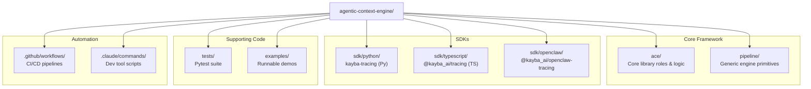
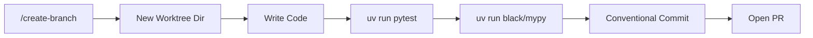

<!-- source: DeepWiki mcp.deepwiki.com · repo kayba-ai/agentic-context-engine · page 11 Development · fetched 2026-10-26 -->

# Development

<details>
<summary>Relevant source files</summary>

The following files were used as context for generating this wiki page:

- [.claude/commands/checkout-branch.md](.claude/commands/checkout-branch.md)
- [.claude/commands/create-branch.md](.claude/commands/create-branch.md)
- [.claude/commands/list-branches.md](.claude/commands/list-branches.md)
- [.claude/commands/remove-branch.md](.claude/commands/remove-branch.md)
- [.github/workflows/publish.yml](.github/workflows/publish.yml)
- [.github/workflows/test.yml](.github/workflows/test.yml)
- [CONTRIBUTING.md](CONTRIBUTING.md)
- [LICENSE](LICENSE)
- [examples/agentic-system-prompting/README.md](examples/agentic-system-prompting/README.md)
- [sdk/openclaw/.gitignore](sdk/openclaw/.gitignore)
- [sdk/openclaw/README.md](sdk/openclaw/README.md)
- [sdk/openclaw/build.mjs](sdk/openclaw/build.mjs)
- [sdk/openclaw/openclaw.plugin.json](sdk/openclaw/openclaw.plugin.json)
- [sdk/openclaw/package-lock.json](sdk/openclaw/package-lock.json)
- [sdk/openclaw/package.json](sdk/openclaw/package.json)
- [sdk/openclaw/src/index.ts](sdk/openclaw/src/index.ts)
- [sdk/openclaw/tsconfig.json](sdk/openclaw/tsconfig.json)
- [tests/conftest.py](tests/conftest.py)

</details>


This page provides an overview of development practices, tooling, and workflows for contributors working on the ACE Framework codebase itself. It covers the technical infrastructure, package organization, and development processes that enable maintaining and extending the framework.

For user-facing guides on using ACE in your projects, see [Getting Started](#5) and [User Guide](#6). For integration-specific development, see [Integration Guide](#7).

---

## Overview

The ACE Framework uses modern Python development practices with a focus on:
- **UV package manager** for fast, reproducible dependency management [.github/workflows/test.yml:26-30]()
- **Pytest** for comprehensive testing with coverage requirements [pyproject.toml:170-190]()
- **Black + mypy** for code quality and type safety [CONTRIBUTING.md:127-128]()
- **Conventional Commits** for clear version history [CONTRIBUTING.md:136-156]()
- **Multi-language SDKs** supporting Python, TypeScript, and OpenClaw [.github/workflows/publish.yml:45-133]()

The repository follows a strict documentation-first approach where design docs must stay synchronized with code changes.

Sources: [CONTRIBUTING.md:1-183](), [pyproject.toml:1-191](), [.github/workflows/test.yml:1-47]()

---

## Development Environment

### Prerequisites

- **Python 3.12** or higher [pyproject.toml:17-17]()
- **UV package manager** (recommended) [CONTRIBUTING.md:120-121]()
- **Node.js 20+** (for TypeScript SDK development) [.github/workflows/publish.yml:80-83]()

### Quick Setup

```bash
# Clone the repository
git clone https://github.com/kayba-ai/agentic-context-engine.git
cd agentic-context-engine

# Install all dependencies using UV
uv sync --extra mcp --extra tracing

# Run tests to verify setup
uv run pytest
```

Sources: [CONTRIBUTING.md:113-124](), [.github/workflows/test.yml:29-30]()

---

## Package Architecture

### Directory Structure



**Module Responsibilities:**

| Directory | Purpose | Shipped to |
|-----------|---------|-----------------|
| `ace/` | Core library (roles, skillbook, adapters) | PyPI (`ace-framework`) |
| `pipeline/` | Generic pipeline engine (StepProtocol, Pipeline) | PyPI (`ace-framework`) |
| `sdk/python/` | Python tracing client | PyPI (`kayba-tracing`) |
| `sdk/typescript/` | TypeScript tracing client | npm (`@kayba_ai/tracing`) |
| `sdk/openclaw/` | OpenClaw agent turn capture plugin | npm (`@kayba_ai/openclaw-tracing`) |

Sources: [.github/workflows/publish.yml:18-133](), [sdk/openclaw/package.json:1-50]()

---

## Development Workflow

### Standard Development Cycle

The project uses a **Git Worktree** workflow to allow parallel development on multiple branches without switching contexts.



### Key Commands

| Command | Purpose |
|---------|---------|
| `uv sync` | Sync dependencies and lockfile [.github/workflows/test.yml:30-30]() |
| `uv run pytest -m unit` | Run unit tests [CONTRIBUTING.md:132-132]() |
| `uv run pytest -m integration` | Run integration tests [CONTRIBUTING.md:133-133]() |
| `uv run mypy ace/` | Run type checking [.github/workflows/test.yml:47-47]() |
| `/create-branch feature name` | Create branch + worktree [.claude/commands/create-branch.md:1-34]() |

Sources: [CONTRIBUTING.md:68-111](), [.claude/commands/create-branch.md:1-40]()

---

## Code Quality Standards

### Formatting and Style

The codebase follows **PEP 8** with **Black** formatting and strict typing via **mypy**.

- **Line Length**: Under 100 characters [CONTRIBUTING.md:163-163]().
- **Type Hints**: Required where possible [CONTRIBUTING.md:161-161]().
- **Docstrings**: Required for all public functions/classes [CONTRIBUTING.md:162-162]().

### Testing Requirements

All tests use **pytest** with custom markers registered in `conftest.py` [tests/conftest.py:16-31]().

| Marker | Purpose |
|--------|---------|
| `unit` | Fast logic tests [tests/conftest.py:26-26]() |
| `integration` | External system interaction [tests/conftest.py:24-25]() |
| `slow` | Long-running tasks [tests/conftest.py:21-22]() |
| `requires_api` | Tests needing real LLM keys [tests/conftest.py:28-30]() |

Sources: [CONTRIBUTING.md:158-172](), [tests/conftest.py:1-32]()

---

## Dependency Management

The project uses **UV** for Python and **npm** for TypeScript/OpenClaw.

### Python Extras
Optional features are managed via extras in `pyproject.toml`:
- `mcp`: MCP server support.
- `tracing`: Tracing capabilities.

### TypeScript / OpenClaw
The OpenClaw SDK depends on the core TypeScript tracing SDK:
- `@kayba_ai/openclaw-tracing` depends on `@kayba_ai/tracing` [sdk/openclaw/package.json:35-35]().

Sources: [.github/workflows/test.yml:30-30](), [sdk/openclaw/package.json:34-36]()

---

## Documentation Guidelines

- **README.md**: Must be updated when adding new features [CONTRIBUTING.md:175-175]().
- **CHANGELOG.md**: Must follow "Keep a Changelog" format [CONTRIBUTING.md:177-177]().
- **Examples**: New functionality should include a runnable example [CONTRIBUTING.md:178-178]().

For details, see [Documentation Guidelines](#11.4).

---

## Contributing

We use **Conventional Commits** to automate changelogs and releases.

- `feat`: New feature.
- `fix`: Bug fix.
- `docs`: Documentation only.
- `chore`: Maintenance.

For details, see [Contributing](#11.5).

Sources: [CONTRIBUTING.md:136-156]()

---

## Related Pages

- [Package Structure](#11.1) — Detailed breakdown of `ace/`, `pipeline/`, `sdk/` directories.
- [Dependency Management with UV](#11.2) — Using `uv` for sync and lock files.
- [Testing](#11.3) — Test structure and markers.
- [Documentation Guidelines](#11.4) — Keeping docs synchronized with code.
- [Contributing](#11.5) — Workflow, commits, and PR requirements.

---

