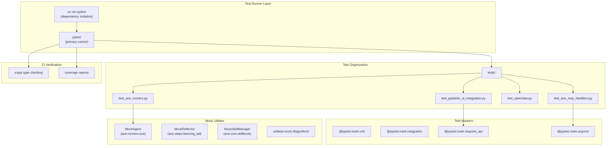
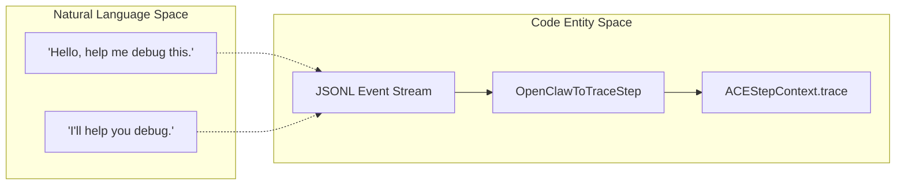
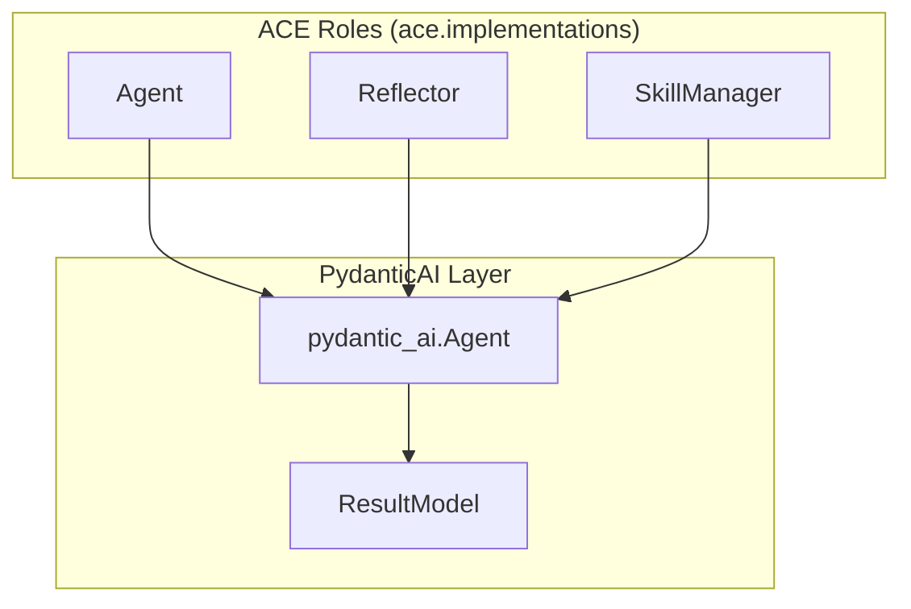

<!-- source: DeepWiki mcp.deepwiki.com · repo kayba-ai/agentic-context-engine · page 11.3 Testing · fetched 2026-10-26 -->

# Testing

<details>
<summary>Relevant source files</summary>

The following files were used as context for generating this wiki page:

- [.claude/commands/checkout-branch.md](.claude/commands/checkout-branch.md)
- [.claude/commands/create-branch.md](.claude/commands/create-branch.md)
- [.claude/commands/list-branches.md](.claude/commands/list-branches.md)
- [.claude/commands/remove-branch.md](.claude/commands/remove-branch.md)
- [.github/workflows/test.yml](.github/workflows/test.yml)
- [CONTRIBUTING.md](CONTRIBUTING.md)
- [LICENSE](LICENSE)
- [ace/deduplication/prompts.py](ace/deduplication/prompts.py)
- [ace/integrations/mcp/handlers.py](ace/integrations/mcp/handlers.py)
- [examples/agentic-system-prompting/README.md](examples/agentic-system-prompting/README.md)
- [tests/conftest.py](tests/conftest.py)
- [tests/test_ace_mcp_handlers.py](tests/test_ace_mcp_handlers.py)
- [tests/test_ace_runners.py](tests/test_ace_runners.py)
- [tests/test_openclaw.py](tests/test_openclaw.py)
- [tests/test_pydantic_ai_integration.py](tests/test_pydantic_ai_integration.py)

</details>


This page documents the testing infrastructure, test execution, mock utilities, and testing patterns used in the ACE Framework. For information about contributing code changes, see [Contributing](#11.5). For package structure and organization, see [Package Structure](#11.1).

## Overview

The ACE Framework uses **pytest** as the primary test runner with **unittest** compatibility. The test suite includes unit tests, integration tests, and marker-based test filtering. The framework provides mock LLM clients and specialized roles (e.g., `MockAgent`, `MockReflector`, `MockSkillManager`) for testing without making actual API calls, enabling fast, deterministic tests.

**CI/CD Pipeline**: Tests are automatically executed across Ubuntu, Windows, and macOS via GitHub Actions on every push and pull request.

Sources: [.github/workflows/test.yml:1-15](), [CONTRIBUTING.md:123-134]()

---

## Test Framework Architecture



**Test Framework Design**: ACE leverages `pytest` for its powerful fixture system and marker support. The architecture separates fast unit tests from slower integration tests that require API keys. Mock roles are used to verify pipeline logic without incurring LLM costs.

Sources: [tests/test_ace_runners.py:26-91](), [tests/test_pydantic_ai_integration.py:17-21](), [.github/workflows/test.yml:32-48]()

---

## Running Tests

### Basic Test Execution

The repository uses `uv` for dependency management, ensuring tests run in a consistent environment.

```bash
# Run all tests
uv run pytest

# Run specific test files
uv run pytest tests/test_skillbook.py

# Run with verbose output and show print statements
uv run pytest -v -s
```

### Marker-Based Filtering

Markers are used to categorize tests by speed and requirement.

| Marker | Description | Command |
|--------|-------------|---------|
| `unit` | Fast tests with no external dependencies | `uv run pytest -m unit` |
| `integration` | Tests covering multiple components | `uv run pytest -m integration` |
| `requires_api` | Tests requiring LLM API keys (OpenAI/Bedrock) | `uv run pytest -m requires_api` |
| `not requires_api` | Skip all tests that call real LLMs | `uv run pytest -m "not requires_api"` |

Sources: [CONTRIBUTING.md:130-134](), [.github/workflows/test.yml:34-35]()

---

## Testing Integrations and MCP

ACE includes comprehensive tests for its integration layers, specifically for the Model Context Protocol (MCP) server and OpenClaw session processing.

### MCP Handler Testing
Tests for `MCPHandlers` use `unittest.mock.patch` to intercept calls to `ACELiteLLM` and the `SessionRegistry`. These tests verify:
- Prompt limit enforcement via `_enforce_prompt_limit` [ace/integrations/mcp/handlers.py:49-59]().
- Safe mode restrictions for learning tools [ace/integrations/mcp/handlers.py:150-151]().
- Path validation for skillbook loading/saving [ace/integrations/mcp/handlers.py:60-84]().

### OpenClaw Pipeline Testing
The `OpenClawToTraceStep` is tested by providing raw JSONL session events and verifying they are correctly converted into `ACEStepContext` trace dictionaries [tests/test_openclaw.py:170-202]().


Sources: [tests/test_ace_mcp_handlers.py:46-60](), [tests/test_openclaw.py:164-215]()

---

## Mock Roles and LLM Abstraction

To test runners like `ACE` or `TraceAnalyser` without live API calls, the framework uses mock roles that satisfy the internal protocols.

### Mock Role Implementation
- **MockAgent**: Implements `generate` to return a static `AgentOutput` [tests/test_ace_runners.py:26-38]().
- **MockReflector**: Implements `reflect` to return a static `ReflectorOutput` [tests/test_ace_runners.py:41-59]().
- **MockSkillManager**: Simulates skillbook mutations by calling `skillbook.add_skill` during `update_skills` [tests/test_ace_runners.py:61-91]().

### LLM Integration Tests
Tests in `tests/test_pydantic_ai_integration.py` serve as the ground truth for real LLM interactions. They verify:
- **Structured Outputs**: Ensuring `Agent`, `Reflector`, and `SkillManager` produce the correct Pydantic models (`AgentOutput`, `ReflectorOutput`, `SkillManagerOutput`) [tests/test_pydantic_ai_integration.py:23-31]().
- **Usage Tracking**: Verifying that `raw["usage"]` contains token counts [tests/test_pydantic_ai_integration.py:54-59]().


Sources: [tests/test_ace_runners.py:21-91](), [tests/test_pydantic_ai_integration.py:36-164]()

---

## Continuous Integration and Coverage

### CI Workflow
The `.github/workflows/test.yml` defines the CI pipeline:
1. **Setup**: Installs Python 3.12 and `uv` [ .github/workflows/test.yml:21-27]().
2. **Installation**: Syncs dependencies including `mcp` and `tracing` extras [ .github/workflows/test.yml:29-30]().
3. **Execution**: Runs `pytest` excluding API-dependent tests [ .github/workflows/test.yml:34]().
4. **Validation**: Runs `mypy` for static type checking on the `ace/` directory [ .github/workflows/test.yml:44-48]().

### Coverage Requirements
- **Enforcement**: Coverage is tracked via `pytest-cov`.
- **Artifacts**: HTML coverage reports are generated and uploaded for Linux builds [ .github/workflows/test.yml:36-42]().
- **Requirement**: Developers are expected to write tests for all new features and maintain high coverage for core logic in `ace/` and `pipeline/` [CONTRIBUTING.md:168-172]().

Sources: [.github/workflows/test.yml:1-48](), [CONTRIBUTING.md:166-172]()

---

