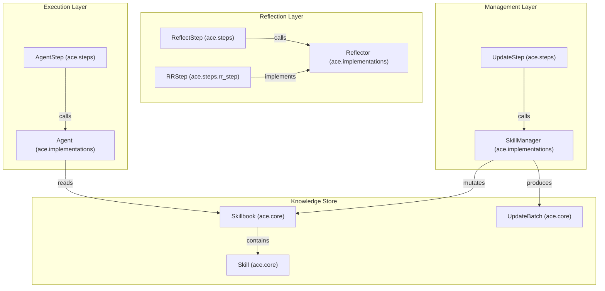

<!-- source: DeepWiki mcp.deepwiki.com · repo kayba-ai/agentic-context-engine · page 12 API Reference · fetched 2026-10-26 -->

# API Reference

<details>
<summary>Relevant source files</summary>

The following files were used as context for generating this wiki page:

- [ace/__init__.py](ace/__init__.py)
- [docs/api/index.md](docs/api/index.md)
- [docs/concepts/skillbook.md](docs/concepts/skillbook.md)
- [docs/concepts/updates.md](docs/concepts/updates.md)
- [docs/design/SKILLBOOK_V2_PLAN.md](docs/design/SKILLBOOK_V2_PLAN.md)
- [docs/guides/composing-pipelines.md](docs/guides/composing-pipelines.md)
- [docs/guides/prompts.md](docs/guides/prompts.md)
- [tests/test_pipeline_exports.py](tests/test_pipeline_exports.py)

</details>


This page provides comprehensive API documentation for the ACE Framework, covering all public interfaces, classes, and methods. It serves as the entry point to detailed API documentation organized by functional area.

For practical usage examples and integration patterns, see [Integration Guide](#7). For conceptual understanding of the architecture, see [Architecture](#3).

---

## Overview

The ACE Framework exposes APIs organized into categories across the core library (`ace/`) and the pipeline engine (`pipeline/`).

| Category | Purpose | Sub-Page |
|----------|---------|----------|
| **Core Role APIs** | Implementation of Agent, Reflector, and SkillManager | [Core Role APIs](#12.1) |
| **Adaptation APIs** | High-level runners for online/offline learning | [Adaptation APIs](#12.2) |
| **Skillbook APIs** | Knowledge storage, schema v2, and BM25 retrieval | [Skillbook APIs](#12.3) |
| **LLM Client APIs** | PydanticAI model resolution and usage tracking | [LLM Client APIs](#12.4) |
| **Prompt APIs** | Template management and version selection | [Prompt APIs](#12.5) |
| **Integration APIs** | Wrappers for LiteLLM, LangChain, Browser-Use, etc. | [Integration APIs](#12.6) |
| **Pipeline APIs** | Primitive building blocks (Steps, Branch, Pipeline) | [Pipeline APIs](#12.7) |
| **Runner APIs** | Specialized runner classes for different frameworks | [Runner APIs](#12.8) |
| **RR APIs** | Recursive Reflector and TraceSandbox interfaces | [RR APIs](#12.9) |
| **MCP Server APIs** | Model Context Protocol tools and schemas | [MCP Server APIs](#12.10) |
| **CLI & Tracing APIs** | Kayba CLI and Tracing SDK interfaces | [Kayba CLI and Tracing APIs](#12.11) |

All public symbols are lazily imported via `ace/__init__.py` to keep initialization fast. [ace/__init__.py:1-6]()

Sources: [ace/__init__.py:62-121](), [docs/api/index.md:1-5]()

---

## Architecture Mapping

The following diagram bridges "Natural Language Space" to "Code Entity Space" by mapping system roles to their corresponding class implementations and data structures.

### Role and Data Entity Map

Sources: [ace/__init__.py:16-58](), [docs/api/index.md:122-198]()

---

## Data Flow Pipeline

This diagram shows how data flows through the pipeline engine, transforming from raw inputs to learned insights.

### Pipeline Type Transformation

```mermaid
graph LR
    Sample["Sample (ace.core)<br/>question, context"]
    
    ACEStepContext["ACEStepContext (ace.core)<br/>Carries immutable state"]
    
    AgentOut["AgentOutput (ace.core.outputs)<br/>reasoning, skill_ids"]
    
    EnvResult["EnvironmentResult (ace.core)<br/>feedback, ground_truth"]
    
    RefOut["ReflectorOutput (ace.core.outputs)<br/>key_insight, skill_tags"]
    
    SMOut["SkillManagerOutput (ace.core.outputs)<br/>update: UpdateBatch"]

    Sample --> ACEStepContext
    ACEStepContext -- "AgentStep" --> AgentOut
    AgentOut -- "EvaluateStep" --> EnvResult
    EnvResult -- "ReflectStep / RRStep" --> RefOut
    RefOut -- "UpdateStep" --> SMOut
    SMOut -- "PersistStep" --> Skillbook["Skillbook (JSON/NPZ)"]
```

Sources: [docs/api/index.md:224-275](), [docs/guides/composing-pipelines.md:18-29]()

---

## Core Classes Quick Reference

### Runners and Integrations
Runners are high-level entry points that encapsulate a full `Pipeline`. [docs/guides/composing-pipelines.md:3-6]()

| Class | Purpose | Key Method |
|-------|---------|------------|
| `ACELiteLLM` | Simple conversational agent | `ask(question)` [docs/api/index.md:19]() |
| `ACE` | Standard learning pipeline | `run(samples)` [docs/api/index.md:52]() |
| `BrowserUse` | Browser automation with learning | `run(task)` [docs/api/index.md:67]() |
| `LangChain` | Wraps LangChain Runnables | `run(inputs)` [docs/api/index.md:80]() |
| `TraceAnalyser` | Learn from pre-recorded logs | `run(traces)` [docs/api/index.md:22]() |

Sources: [ace/__init__.py:97-103](), [docs/api/index.md:5-103]()

### Role Implementation
Roles are the functional "brains" of the system, typically called within pipeline steps.

| Role | Class | Primary Interface |
|------|-------|-------------------|
| **Agent** | `Agent` | `generate(...)` [docs/api/index.md:132]() |
| **Reflector** | `Reflector` | `reflect(...)` [docs/api/index.md:157]() |
| **Skill Manager** | `SkillManager` | `update_skills(...)` [docs/api/index.md:186]() |

Sources: [ace/__init__.py:84-86](), [docs/api/index.md:122-198]()

### Skillbook and Knowledge
The `Skillbook` uses a v2 schema focused on "Issues" and "Insights". [docs/design/SKILLBOOK_V2_PLAN.md:9-10]()

| Method | Description |
|--------|-------------|
| `add_skill(...)` | Adds a new entry to `context` or `harness` sections. [docs/api/index.md:212]() |
| `apply_update(batch)` | Applies an `UpdateBatch` (ADD, UPDATE, TAG, REMOVE). [docs/api/index.md:213]() |
| `as_prompt()` | Renders active skills as Markdown for LLMs. [docs/api/index.md:214]() |
| `save_to_file(path)` | Saves JSON and a `.npz` embeddings sidecar. [docs/api/index.md:215]() |

Sources: [ace/__init__.py:75](), [docs/api/index.md:202-222](), [docs/concepts/skillbook.md:1-178]()

---

## Pipeline Engine

ACE is built on a composable pipeline engine where every runner is a sequence of steps. [docs/guides/composing-pipelines.md:3-4]()

### Step Protocol
A step is any object satisfying `StepProtocol`, declaring its dependencies via `requires` and `provides` sets. [docs/guides/composing-pipelines.md:113-132]()

```python
class MyStep:
    requires = frozenset({"agent_output"})
    provides = frozenset()
    def __call__(self, ctx: ACEStepContext) -> ACEStepContext:
        # logic here
        return ctx
```

### Learning Tail
The `learning_tail()` helper provides a standard sequence of learning steps: `ReflectStep`, `UpdateStep`, `DeduplicateStep`, and `CheckpointStep`. [docs/guides/composing-pipelines.md:63-77]()

Sources: [ace/__init__.py:115](), [docs/guides/composing-pipelines.md:61-80]()

---

## Recursive Reflector (RR)

`RRStep` is a specialized pipeline step that implements the `ReflectorLike` interface. It performs iterative code-based trace analysis in a `TraceSandbox`. [docs/guides/composing-pipelines.md:208-212]()

| Entity | Purpose |
|--------|---------|
| `RRStep` | The pipeline step executing the RR loop. [ace/__init__.py:117]() |
| `RRConfig` | Configuration for iterations, budgets, and depth. [ace/__init__.py:118]() |
| `TraceSandbox` | Sandboxed environment for executing analysis code. [RR APIs](#12.9) |

Sources: [ace/__init__.py:117-118](), [docs/guides/composing-pipelines.md:208-240]()

---

## Sub-Page Directory

- **[Core Role APIs](#12.1)**: Methods for `Agent`, `Reflector`, and `SkillManager`.
- **[Adaptation APIs](#12.2)**: `ACE` and `TraceAnalyser` runners.
- **[Skillbook APIs](#12.3)**: Persistence, searching, and `UpdateBatch` operations.
- **[LLM Client APIs](#12.4)**: `resolve_model` and `MeteredModel` usage.
- **[Prompt APIs](#12.5)**: `PromptManager` and template variables.
- **[Integration APIs](#12.6)**: Framework-specific wrappers.
- **[Pipeline APIs](#12.7)**: `Pipeline`, `Branch`, and `StepProtocol`.
- **[Runner APIs](#12.8)**: `ACERunner` and class-specific `build_steps()`.
- **[RR APIs](#12.9)**: `RRStep` and `RecursiveConfig`.
- **[MCP Server APIs](#12.10)**: Tool definitions and session handling.
- **[Kayba CLI and Tracing APIs](#12.11)**: `kayba` command-line and SDK reference.

---

