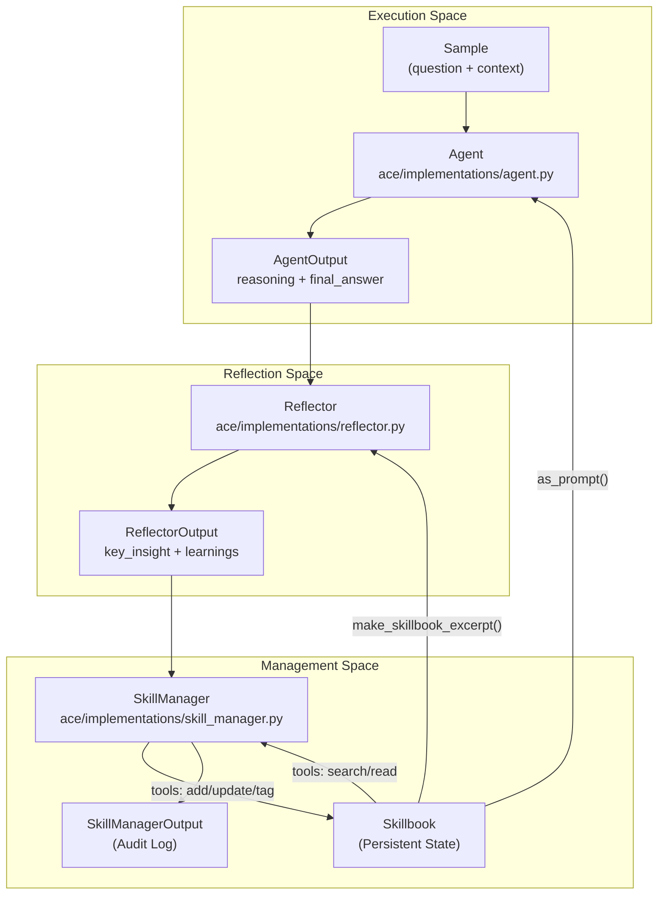
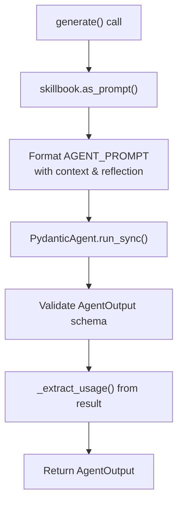
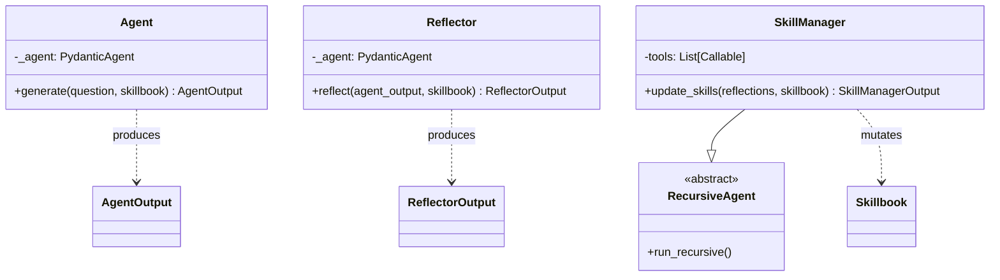

<!-- source: DeepWiki mcp.deepwiki.com · repo kayba-ai/agentic-context-engine · page 12.1 Core Role APIs · fetched 2026-10-26 -->

# Core Role APIs

<details>
<summary>Relevant source files</summary>

The following files were used as context for generating this wiki page:

- [ace/core/context.py](ace/core/context.py)
- [ace/deduplication/__init__.py](ace/deduplication/__init__.py)
- [ace/deduplication/manager.py](ace/deduplication/manager.py)
- [ace/implementations/agent.py](ace/implementations/agent.py)
- [ace/implementations/prompts.py](ace/implementations/prompts.py)
- [ace/implementations/reflector.py](ace/implementations/reflector.py)
- [ace/implementations/skill_manager.py](ace/implementations/skill_manager.py)
- [ace/providers/registry.py](ace/providers/registry.py)
- [ace/steps/reflect.py](ace/steps/reflect.py)

</details>


This page documents the API for the three core ACE roles: `Agent`, `Reflector`, and `SkillManager`. These classes implement the ACE learning loop by producing answers, analyzing outcomes, and updating the skillbook. 

The framework has transitioned to using **PydanticAI** as the primary engine for role execution, providing native structured output validation and robust model integration.

---

## Role Architecture Overview

The ACE architecture consists of three role classes that operate sequentially in the learning loop. In the current implementation, these roles leverage `pydantic_ai.Agent` for execution.

Title: Core Role Interaction and Data Flow


**Role Responsibilities**

| Role | Input | Output | Purpose |
|------|-------|--------|---------|
| `Agent` | Question + Context + Skillbook | `AgentOutput` | Execute task using learned strategies |
| `Reflector` | AgentOutput + Feedback + Skillbook | `ReflectorOutput` | Analyze what worked/failed and why |
| `SkillManager` | Reflections + Skillbook | `SkillManagerOutput` | Mutate skillbook via atomic tool calls |

Sources: [ace/implementations/agent.py:25-31](), [ace/implementations/reflector.py:26-31](), [ace/implementations/skill_manager.py:58-68]()

---

## Agent Class

### Class Signature

```python
class Agent:
    def __init__(
        self,
        model: str,
        *,
        prompt_template: str = AGENT_PROMPT,
        max_retries: int = 3,
        model_settings: ModelSettings | None = None,
    ) -> None
```

The `Agent` class produces answers by applying strategies from the skillbook. It uses `PydanticAI` to ensure the output adheres to the `AgentOutput` schema.

**Parameters:**
- `model`: Model identifier string (e.g., `"gpt-4o"`) or a `PydanticAI` model instance.
- `prompt_template`: Custom prompt (defaults to `AGENT_PROMPT` v2.1).
- `max_retries`: Maximum validation retries via PydanticAI (default: 3).
- `model_settings`: Optional settings like temperature or token limits.

Sources: [ace/implementations/agent.py:25-61]()

---

### generate() Method

```python
def generate(
    self,
    *,
    question: str,
    context: Optional[str],
    skillbook: Union[SkillbookView, Skillbook],
    reflection: Optional[str] = None,
    **kwargs: Any,
) -> AgentOutput
```

**Method Flow:**

Title: Agent Execution Logic


**Parameters:**
- `question`: The task/question to solve.
- `context`: Additional requirements or constraints.
- `skillbook`: Current skillbook containing learned strategies.
- `reflection`: Recent reflection context from previous attempts (optional).

**Returns:**
`AgentOutput` containing reasoning, the final answer, and raw usage metadata.

Sources: [ace/implementations/agent.py:71-105]()

---

## Reflector Class

### Class Signature

```python
class Reflector:
    def __init__(
        self,
        model: str,
        *,
        prompt_template: str = REFLECTOR_PROMPT,
        max_retries: int = 3,
        model_settings: ModelSettings | None = None,
    ) -> None
```

The `Reflector` analyzes agent performance. Note that in the current architecture, the `Reflector` produces pure analysis; skill-effectiveness tagging is delegated to the `SkillManager` or handled via the `Recursive Reflector` (RR) system.

Sources: [ace/implementations/reflector.py:25-75]()

---

### reflect() Method

```python
def reflect(
    self,
    *,
    question: str,
    agent_output: AgentOutput,
    skillbook: Union[SkillbookView, Skillbook],
    ground_truth: Optional[str] = None,
    feedback: Optional[str] = None,
    injected_skill_ids: tuple[str, ...] = (),
    **kwargs: Any,
) -> ReflectorOutput
```

**Parameters:**
- `agent_output`: The `AgentOutput` to analyze.
- `skillbook`: Current skillbook (used to build context).
- `injected_skill_ids`: IDs of skills the Agent was actually shown, used to create a "Strategies Applied" excerpt via `make_skillbook_excerpt`.

**Returns:**
`ReflectorOutput` with `key_insight`, `root_cause_analysis`, and `correct_approach`.

Sources: [ace/implementations/reflector.py:77-131]()

---

## SkillManager Class

### Class Signature

```python
class SkillManager(RecursiveAgent):
    def __init__(
        self,
        model: str | PydanticModel,
        *,
        config: Optional[AgenticConfig] = None,
        prompt_template: str = SKILL_MANAGER_PROMPT,
        system_prompt: str = SKILL_MANAGER_SYSTEM,
        model_settings: ModelSettings | None = None,
    ) -> None
```

The `SkillManager` is a `RecursiveAgent` that mutates the `Skillbook` directly using tools. Unlike the Agent and Reflector, it does not just return data; it executes side effects on the `Skillbook` object provided to it.

Sources: [ace/implementations/skill_manager.py:58-103]()

---

### update_skills() Method

```python
def update_skills(
    self,
    *,
    reflections: tuple,
    skillbook: Skillbook,
    question_context: str,
    progress: str,
    source: InsightSource | None = None,
    injected_skill_ids: tuple[str, ...] = (),
    **kwargs: Any,
) -> SkillManagerOutput
```

**Tool-Based Mutation:**
The `SkillManager` uses the following tools defined in `ace/implementations/sm_tools.py`:
- `add_skill`: Creates a new skill.
- `update_skill`: Modifies content of an existing skill.
- `remove_skill`: Deletes a skill.
- `tag_skill`: Updates helpful/harmful counts.
- `search_skills` / `read_skill`: Inspection tools.

**Audit Log:**
The returned `SkillManagerOutput` serves as a post-hoc audit log of the operations already performed by the tools.

Sources: [ace/implementations/skill_manager.py:1-14](), [ace/implementations/skill_manager.py:136-169]()

---

## Data Structures (Outputs)

### AgentOutput
Defined in `ace/core/outputs.py`, used by `Agent.generate`.
- `reasoning`: Detailed chain of thought.
- `final_answer`: The produced answer.
- `raw`: Metadata including token usage.

Sources: [ace/implementations/agent.py:103-105]()

### ReflectorOutput
Defined in `ace/core/outputs.py`, used by `Reflector.reflect`.
- `key_insight`: Main lesson learned.
- `error_identification`: Description of failures.
- `root_cause_analysis`: Why it failed.
- `correct_approach`: Recommended strategy for next time.

Sources: [ace/implementations/reflector.py:122-124]()

---

## Implementation Detail: Skillbook Injection

For external agents or custom roles, the framework provides a canonical utility to format skillbook strategies into a system prompt.

```python
def wrap_skillbook_for_external_agent(skillbook) -> str:
    # Returns formatted text with "Available Strategic Knowledge" 
    # and usage instructions (citing IDs, helpful/harmful scores).
```

Sources: [ace/implementations/prompts.py:31-59]()

---

## Role API Mapping

Title: Code Entity to Role Mapping


Sources: [ace/implementations/agent.py:25-53](), [ace/implementations/reflector.py:25-58](), [ace/implementations/skill_manager.py:58-93]()

---

