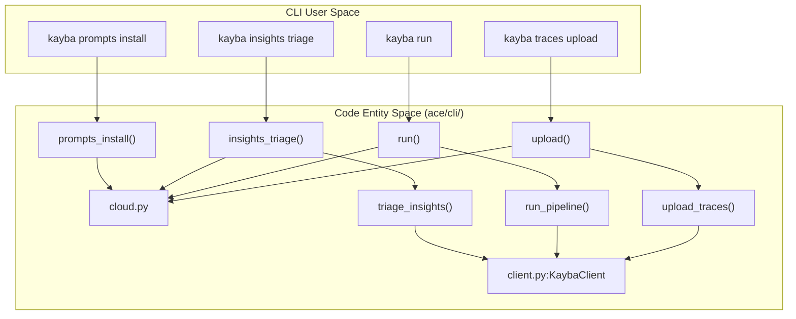
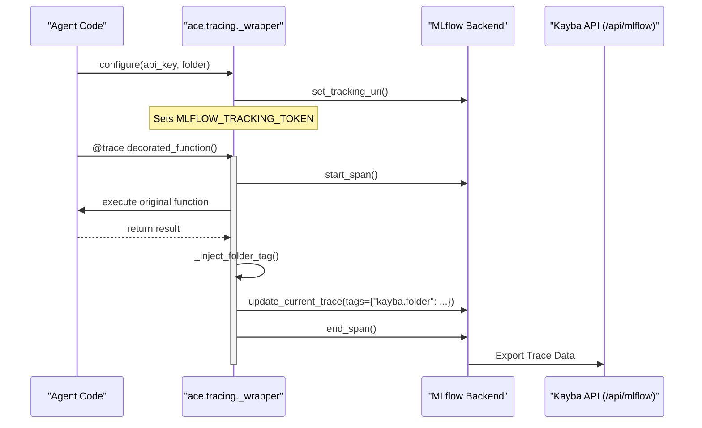

<!-- source: DeepWiki mcp.deepwiki.com · repo kayba-ai/agentic-context-engine · page 12.11 Kayba CLI and Tracing APIs · fetched 2026-10-26 -->

# Kayba CLI and Tracing APIs

<details>
<summary>Relevant source files</summary>

The following files were used as context for generating this wiki page:

- [ace/cli/__init__.py](ace/cli/__init__.py)
- [ace/cli/client.py](ace/cli/client.py)
- [ace/cli/cloud.py](ace/cli/cloud.py)
- [ace/cli/commands/__init__.py](ace/cli/commands/__init__.py)
- [ace/cli/commands/kayba-agent-instructions.md](ace/cli/commands/kayba-agent-instructions.md)
- [ace/tracing/__init__.py](ace/tracing/__init__.py)
- [ace/tracing/_wrapper.py](ace/tracing/_wrapper.py)
- [agent-guides/tracing-sdk.md](agent-guides/tracing-sdk.md)
- [docs/integrations/hosted-api.md](docs/integrations/hosted-api.md)
- [docs/integrations/tracing.md](docs/integrations/tracing.md)
- [examples/tracing_glm_example.py](examples/tracing_glm_example.py)
- [tests/test_kayba_cli.py](tests/test_kayba_cli.py)
- [tests/test_tracing.py](tests/test_tracing.py)

</details>


The Kayba CLI and Tracing SDKs provide the interface for interacting with the Kayba Hosted API and instrumenting external agentic systems. These tools enable developers to upload execution traces, trigger remote analysis pipelines, manage generated insights, and pull optimized prompts directly into their local development environments.

## Kayba CLI Overview

The `kayba` CLI is a command-line interface that wraps the Kayba Hosted API endpoints [docs/integrations/hosted-api.md:3-3](). It is designed for both interactive human use and programmatic integration into agent workflows.

### Implementation and Client
The CLI is built using `click` [ace/cli/cloud.py:14-14]() and utilizes a specialized `KaybaClient` for HTTP communication [ace/cli/client.py:57-64](). 

**Key CLI Components:**
*   **Authentication:** Uses `KAYBA_API_KEY` environment variable or the `--api-key` flag [ace/cli/cloud.py:19-23]().
*   **Automatic File Detection:** The `_detect_file_type` function infers file types (md, json, txt) from extensions [ace/cli/cloud.py:50-57]().
*   **Chunked Uploads:** To handle large batches, `_chunk_trace_uploads` splits trace data into request-sized batches under a 900KB body size cap [ace/cli/client.py:25-54]().

### Trace Management
Traces can be uploaded from files, directories, or stdin [ace/cli/cloud.py:76-80](). The CLI enforces a character limit (350,000 chars) per trace file to ensure API compatibility [ace/cli/cloud.py:30-30]().

| Command | Purpose |
|---------|---------|
| `kayba traces upload <path>` | Uploads traces from files or directories recursively [ace/cli/cloud.py:76-80](). |
| `kayba traces list` | Lists metadata for all uploaded traces [ace/cli/cloud.py:173-178](). |
| `kayba traces show <id>` | Displays the full content and metadata of a specific trace [ace/cli/cloud.py:211-218](). |
| `kayba traces delete <ids>` | Removes traces from the Kayba cloud [ace/cli/commands/kayba-agent-instructions.md:13-13](). |

Sources: [ace/cli/cloud.py:14-14](), [ace/cli/client.py:25-54](), [ace/cli/client.py:57-64](), [docs/integrations/hosted-api.md:3-3](), [ace/cli/commands/kayba-agent-instructions.md:13-13]().

---

## Remote Pipeline Execution

The CLI allows users to trigger the ACE learning pipeline on the Kayba hosted infrastructure. This avoids the need for local LLM orchestration and resource consumption.

### The `run` Command
The `kayba run` command combines trace selection and pipeline execution [docs/integrations/hosted-api.md:91-92](). It supports an interactive mode using `questionary` for visual trace selection [docs/integrations/hosted-api.md:110-112]().

**Pipeline Configuration Options:**
*   `--model`: Selects the server-side LLM (e.g., `claude-sonnet-4-6`) [docs/integrations/hosted-api.md:120-120]().
*   `--epochs`: Defines the number of analysis cycles [docs/integrations/hosted-api.md:121-121]().
*   `--reflector-mode`: Choice between `standard` or `recursive` (Recursive Reflector) [docs/integrations/hosted-api.md:122-122]().

### Insights and Prompts
Once a run completes, insights can be triaged and converted into prompts.

1.  **Insight Triage:** Users can list pending insights and selectively accept or reject them [docs/integrations/hosted-api.md:140-160]().
2.  **Prompt Generation:** `kayba prompts generate` creates a new prompt version from accepted insights [docs/integrations/hosted-api.md:165-166]().
3.  **Prompt Installation:** The `install` command injects the generated prompt into specific agent configuration files (e.g., `CLAUDE.md`, `.cursorrules`) using managed comment blocks [ace/cli/cloud.py:31-39]().

### CLI Command to Code Entity Mapping
This diagram bridges the CLI user commands to the underlying Python implementation and client methods.

**CLI Command to Implementation Bridge**

Sources: [ace/cli/cloud.py:75-75](), [ace/cli/cloud.py:42-48](), [ace/cli/client.py:57-57](), [ace/cli/client.py:164-164](), [docs/integrations/hosted-api.md:91-108]().

---

## Kayba Tracing API

The `ace.tracing` module provides a Kayba-branded wrapper around MLflow to instrument agentic code. It allows developers to capture execution data from any agent and send it to the Kayba dashboard for analysis.

### Configuration and Setup
Tracing is configured via the `configure()` function, which sets the `MLFLOW_TRACKING_TOKEN` and the tracking URI to point to the Kayba backend [ace/tracing/_wrapper.py:52-88]().

```python
from ace.tracing import configure
configure(api_key="your-key", folder="research-project")
```

### Core Tracing Primitives
The API provides two primary ways to instrument code:

1.  **`@trace` Decorator:** Automatically captures function inputs, outputs, and duration [ace/tracing/_wrapper.py:134-145](). It supports custom names and span types [ace/tracing/_wrapper.py:157-162]().
2.  **`start_span` Context Manager:** Used for manual instrumentation within a function body [ace/tracing/_wrapper.py:183-192]().

### Data Flow: Folder Tagging
A unique feature of the Kayba wrapper is the "Folder" system. When a `folder` is set via `configure()` or `set_folder()`, the wrapper automatically injects a `kayba.folder` tag into every trace using `_inject_folder_tag()` [ace/tracing/_wrapper.py:114-118]().

**Tracing Data Flow**


### API Reference Table

| Function | Role | Implementation Detail |
|----------|------|-----------------------|
| `configure()` | Initialization | Sets environment variables and MLflow URI [ace/tracing/_wrapper.py:52-92](). |
| `trace()` | Decorator | Wraps functions to create spans; injects folder tags [ace/tracing/_wrapper.py:134-179](). |
| `start_span()` | Context Manager | Creates child spans; injects folder tags [ace/tracing/_wrapper.py:183-199](). |
| `set_folder()` | Metadata | Updates the global `_folder` variable [ace/tracing/_wrapper.py:94-101](). |
| `enable()` / `disable()` | Toggle | Controls MLflow tracing state [ace/tracing/_wrapper.py:206-214](). |

Sources: [ace/tracing/_wrapper.py:52-92](), [ace/tracing/_wrapper.py:114-118](), [ace/tracing/_wrapper.py:134-179](), [ace/tracing/_wrapper.py:183-199](), [docs/integrations/tracing.md:183-195]().

---

