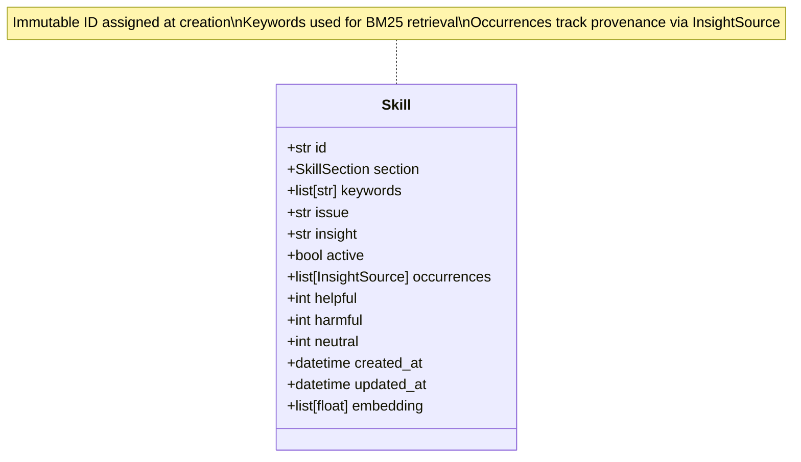
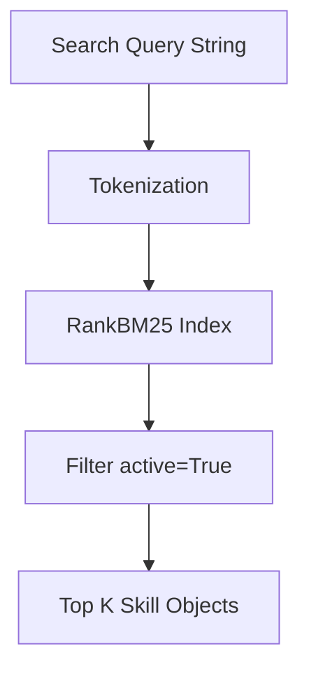
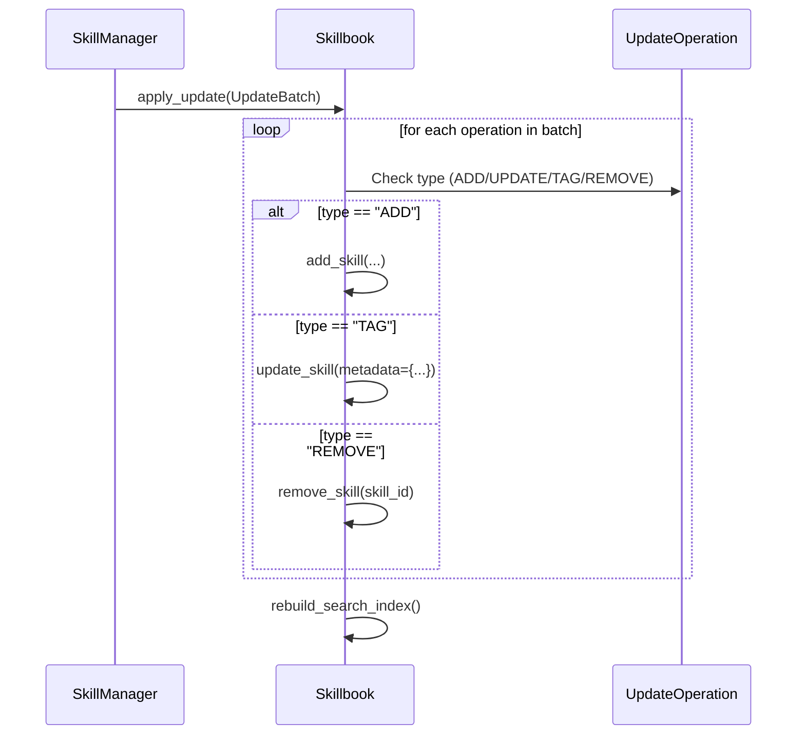
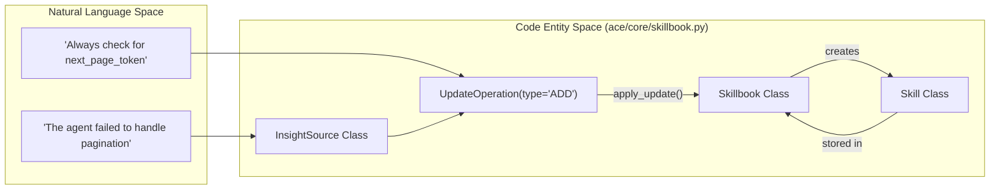

<!-- source: DeepWiki mcp.deepwiki.com · repo kayba-ai/agentic-context-engine · page 12.3 Skillbook APIs · fetched 2026-10-26 -->

# Skillbook APIs

<details>
<summary>Relevant source files</summary>

The following files were used as context for generating this wiki page:

- [ace/core/__init__.py](ace/core/__init__.py)
- [ace/core/insight_source.py](ace/core/insight_source.py)
- [ace/core/skillbook.py](ace/core/skillbook.py)
- [tests/test_ace_core.py](tests/test_ace_core.py)

</details>


## Purpose and Scope

The `Skillbook` is the central knowledge repository for the ACE framework. It stores learned strategies as "skills," organized into sections (`context` or `harness`). This page details the `Skillbook` class, its underlying data structures (`Skill`, `UpdateOperation`, `UpdateBatch`), and its core APIs for manipulation, persistence, and retrieval.

The Skillbook system in ACE v2 utilizes a structured schema designed for both human readability and LLM efficiency, featuring hybrid retrieval via BM25 and provenance tracking through `InsightSource`.

**Sources:** [ace/core/skillbook.py:1-21](), [ace/core/__init__.py:16-23]()

---

## Core Data Structures

### Skill Class

The `Skill` class is a dataclass representing an atomic unit of knowledge. It includes the strategy content, metadata for tracking effectiveness, and provenance links to the traces that informed it.



**Key Attributes:**

| Attribute | Type | Description |
|-----------|------|-------------|
| `id` | `str` | Unique identifier (e.g., "context-00001"). |
| `section` | `SkillSection` | Either `context` (agent strategies) or `harness` (eval logic). |
| `keywords` | `list[str]` | Normalized tags used for BM25 indexing and search. |
| `issue` | `str` | Description of the problem or observation. |
| `insight` | `str` | The recommended strategy or corrective action. |
| `occurrences` | `list[InsightSource]` | List of `InsightSource` objects providing trace provenance. |
| `active` | `bool` | Soft-delete flag; `False` if the skill is deprecated. |

**Sources:** [ace/core/skillbook.py:253-286](), [ace/core/skillbook.py:19-21]()

### InsightSource Class

`InsightSource` provides the "paper trail" for a skill, linking it back to specific execution traces.

| Attribute | Description |
|-----------|-------------|
| `trace_uid` | Stable composite identifier (`source_system:trace_id`). |
| `display_name` | Human-readable name for the source trace (e.g., a filename). |
| `sample_question` | The original input that triggered the learning. |
| `learning_text` | The raw text extracted during reflection. |

**Sources:** [ace/core/insight_source.py:108-121](), [ace/core/insight_source.py:13-15]()

---

## Skillbook Operations

The `Skillbook` class manages the lifecycle of skills and provides high-level APIs for the ACE adaptation loop.

### CRUD and Search APIs

| Method | Parameters | Description |
|--------|------------|-------------|
| `add_skill` | `section, issue, insight, ...` | Creates and stores a new `Skill`. Auto-generates IDs. |
| `update_skill` | `skill_id, ...` | Updates content, keywords, or metadata of an existing skill. |
| `remove_skill` | `skill_id, soft=True` | Removes a skill. Default is a soft-delete (setting `active=False`). |
| `get_skill` | `skill_id` | Retrieves a `Skill` object by its ID. |
| `search` | `query, limit=5` | Performs **BM25 search** over skill keywords and content. |
| `as_prompt` | `limit, section` | Formats active skills into a string for LLM context. |

**Sources:** [ace/core/skillbook.py:531-569](), [ace/core/skillbook.py:597-626](), [ace/core/skillbook.py:641-655](), [ace/core/skillbook.py:734-757]()

### BM25 Search Implementation

The `Skillbook` maintains an internal `RankBM25` index. When `search()` is called, it tokenizes the query and returns the most relevant active skills based on `keywords`, `issue`, and `insight` fields.



**Sources:** [ace/core/skillbook.py:734-757](), [ace/core/skillbook.py:461-477]()

---

## Update Batch Application

Mutations to the Skillbook are typically encapsulated in an `UpdateBatch`. This allows the `SkillManager` to propose multiple changes (ADD, UPDATE, TAG, REMOVE) that are applied atomically to the Skillbook state.

### apply_update

This method iterates through a batch of operations and dispatches them to the internal CRUD methods.

**Sources:** [ace/core/skillbook.py:698-726]()



**Sources:** [ace/core/skillbook.py:698-726](), [ace/core/skillbook.py:136-151]()

---

## Persistence and Serialization

The Skillbook supports JSON-based persistence with a sidecar for vector embeddings.

### save_to_file and load_from_file

- **`save_to_file(path)`**: Serializes the skillbook to JSON. If skills have embeddings, it saves them to a companion `.embeddings.npz` file.
- **`load_from_file(path)`**: Reconstructs the `Skillbook` instance. It automatically detects and loads the sidecar embedding file if present.

**Sources:** [ace/core/skillbook.py:504-526](), [ace/core/skillbook.py:483-502](), [ace/core/skillbook.py:86-91]()

### JSON Schema (v2)

The Skillbook uses a versioned schema to ensure backward compatibility.

```json
{
  "schema_version": "2",
  "skills": {
    "context-001": {
      "id": "context-001",
      "section": "context",
      "keywords": ["math", "division"],
      "issue": "Division by zero errors",
      "insight": "Check if denominator is zero before dividing",
      "active": true,
      "occurrences": [
        {
          "trace_uid": "local:trace_123",
          "source_system": "local",
          "trace_id": "trace_123"
        }
      ]
    }
  },
  "sections": {
    "context": ["context-001"]
  },
  "next_id": 2
}
```

**Sources:** [ace/core/skillbook.py:21](), [ace/core/skillbook.py:414-444]()

---

## Technical Data Flow: Natural Language to Code Entity

This diagram maps how a natural language strategy identified by an LLM becomes a concrete `Skill` entity in the `Skillbook`.



**Sources:** [ace/core/skillbook.py:136-151](), [ace/core/skillbook.py:253-286](), [ace/core/insight_source.py:108-121]()

---

## Summary of Key Methods

| Method | Implementation Detail | Source |
|--------|-----------------------|--------|
| `add_skill` | Validates section names and normalizes keywords. | [ace/core/skillbook.py:531-569]() |
| `update_skill` | Merges new metadata and appends unique `InsightSource` records. | [ace/core/skillbook.py:597-626]() |
| `as_prompt` | Filters for `active=True` and formats using `[id] insight` pattern. | [ace/core/skillbook.py:657-696]() |
| `to_dict` | Handles recursive serialization of skills and sources. | [ace/core/skillbook.py:414-444]() |
| `search` | Uses `rank_bm25` for keyword-based retrieval. | [ace/core/skillbook.py:734-757]() |

**Sources:** [ace/core/skillbook.py:1-800]()

---

