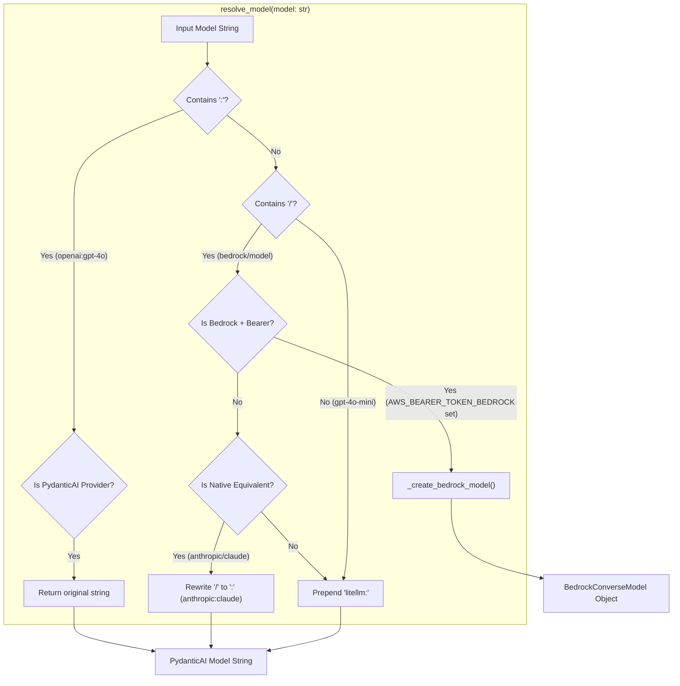
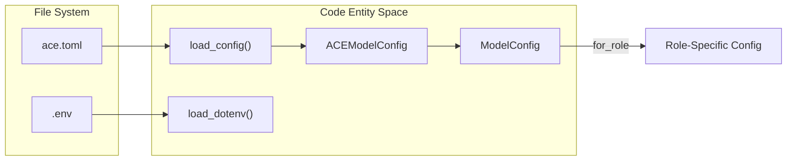

<!-- source: DeepWiki mcp.deepwiki.com · repo kayba-ai/agentic-context-engine · page 12.4 LLM Client APIs · fetched 2026-10-26 -->

# LLM Client APIs

Relevant source files

The following files were used as context for generating this wiki page:

- [ace/providers/config.py](ace/providers/config.py)
- [ace/providers/pydantic_ai.py](ace/providers/pydantic_ai.py)

This document provides a comprehensive technical reference for the LLM client and model resolution APIs in the ACE framework. The framework utilizes **PydanticAI** as its primary orchestration layer for LLM interactions, providing robust model resolution, configuration management, and usage tracking.

## Model Resolution Architecture

ACE uses a flexible model resolution strategy that maps ACE/LiteLLM-style model identifiers to PydanticAI model strings or provider objects. This allows users to use familiar LiteLLM conventions (e.g., `bedrock/model-id`) while leveraging PydanticAI's native SDK integrations for performance and security.

### Resolution Flow

The `resolve_model` function in `ace/providers/pydantic_ai.py` implements a four-path resolution strategy.

**Sources:** [ace/providers/pydantic_ai.py:1-50](), [ace/providers/pydantic_ai.py:107-179]()

### Resolution Paths Detail

| Path | Pattern | Result | Reason |
| :--- | :--- | :--- | :--- |
| **1. Native Prefix** | `openai:gpt-4o` | `openai:gpt-4o` | Already matches PydanticAI convention. |
| **2. Bedrock Bearer** | `bedrock/...` | `BedrockConverseModel` | Uses `AWS_BEARER_TOKEN_BEDROCK` to bypass Boto3 SigV4. |
| **3. LiteLLM Native** | `anthropic/claude` | `anthropic:claude` | Rewrites LiteLLM `/` to PydanticAI `:` for native SDK usage. |
| **4. Proxy Fallback** | `gpt-4o-mini` | `litellm:gpt-4o-mini` | Routes through LiteLLM proxy for unknown prefixes. |

**Sources:** [ace/providers/pydantic_ai.py:107-179]()

## Configuration Management

ACE separates model selection and parameters from secrets (API keys). Configuration is managed via `ModelConfig` and `ACEModelConfig` classes.

### Configuration Classes

#### ModelConfig
Describes parameters for a single LLM role.
- `model`: The model identifier string. [ace/providers/config.py:36]()
- `temperature`: Default `0.0`. [ace/providers/config.py:37]()
- `max_tokens`: Default `2048`. [ace/providers/config.py:38]()
- `extra_params`: Optional dictionary for provider-specific settings. [ace/providers/config.py:39]()

#### ACEModelConfig
Maps specific ACE roles to `ModelConfig` instances.
- `default`: The fallback configuration. [ace/providers/config.py:67]()
- `agent`: Configuration for the Agent role. [ace/providers/config.py:68]()
- `reflector`: Configuration for the Reflector role. [ace/providers/config.py:69]()
- `skill_manager`: Configuration for the SkillManager role. [ace/providers/config.py:70]()

### Persistence and Environment
Configuration is persisted in `ace.toml` (secrets-free), while API keys are loaded from `.env` files.

**Sources:** [ace/providers/config.py:1-11](), [ace/providers/config.py:64-78](), [ace/providers/config.py:151-164]()

## Provider-Specific Resolution

ACE normalizes provider names between LiteLLM and PydanticAI.

### Native Provider Rewriting
When a LiteLLM prefix is detected that has a native PydanticAI equivalent, the prefix is rewritten to use the native SDK. This avoids the overhead of the LiteLLM proxy for major providers.

| LiteLLM Prefix | PydanticAI Prefix |
| :--- | :--- |
| `anthropic` | `anthropic` |
| `vertex_ai` | `google-vertex` |
| `azure_ai` | `azure` |
| `bedrock` | `bedrock` |
| `groq` | `groq` |

**Sources:** [ace/providers/pydantic_ai.py:91-104](), [ace/providers/pydantic_ai.py:165-176]()

### Bedrock with Bearer Token
ACE provides specialized support for Amazon Bedrock using bearer tokens via `_create_bedrock_model`. This instantiates a `BedrockConverseModel` (from `pydantic_ai.models.bedrock`) configured with a `BearerTokenSigner`.

**Sources:** [ace/providers/pydantic_ai.py:181-195]()

## Usage Tracking and MeteredModel

While core PydanticAI handles standard completions, ACE often wraps these in a `MeteredModel` (defined in `ace/recursive_agent.py` and utilized by `RecursiveAgent`) to track token usage and costs across complex recursive operations.

### Usage Callbacks
The framework supports usage callbacks to monitor consumption in real-time. This is particularly critical for the **Recursive Reflector**, which may perform dozens of sub-calls during a single analysis phase.

## Installation Requirements

To use native PydanticAI providers, the corresponding SDK extras must be installed. ACE defaults to `pydantic-ai-slim[litellm]`.

| Provider | Install Extra | Env Var |
| :--- | :--- | :--- |
| **Anthropic** | `[anthropic]` | `ANTHROPIC_API_KEY` |
| **OpenAI** | `[openai]` | `OPENAI_API_KEY` |
| **Bedrock** | `[bedrock]` | `AWS_BEARER_TOKEN_BEDROCK` |
| **Google** | `[google]` | `GEMINI_API_KEY` |

**Sources:** [ace/providers/pydantic_ai.py:29-36]()

---

