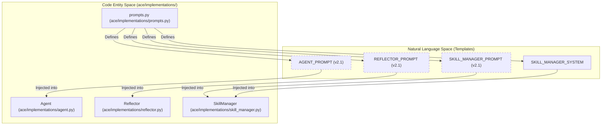
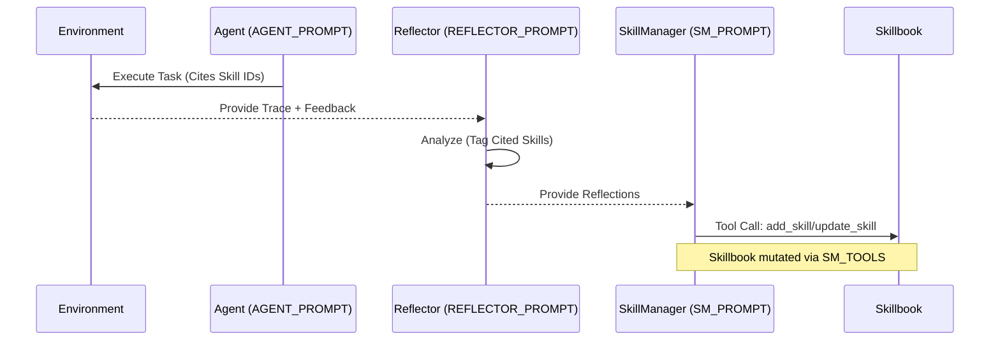

<!-- source: DeepWiki mcp.deepwiki.com · repo kayba-ai/agentic-context-engine · page 12.5 Prompt APIs · fetched 2026-10-26 -->

# Prompt APIs

<details>
<summary>Relevant source files</summary>

The following files were used as context for generating this wiki page:

- [ace/implementations/prompts.py](ace/implementations/prompts.py)
- [ace/implementations/skill_manager.py](ace/implementations/skill_manager.py)
- [docs/api/index.md](docs/api/index.md)
- [docs/concepts/skillbook.md](docs/concepts/skillbook.md)
- [docs/concepts/updates.md](docs/concepts/updates.md)
- [docs/design/SKILLBOOK_V2_PLAN.md](docs/design/SKILLBOOK_V2_PLAN.md)
- [docs/guides/composing-pipelines.md](docs/guides/composing-pipelines.md)
- [docs/guides/prompts.md](docs/guides/prompts.md)

</details>


This page provides the complete API reference for the ACE Framework's prompt management system. It covers the core prompt templates used by the three roles (Agent, Reflector, and SkillManager), the logic for injecting skillbooks into external agents, and the versioning strategy.

## Prompt Architecture

ACE manages prompts through a structured template system. The current recommended versions are **v2.1**, which emphasize strategic reasoning, explicit skill citations, and structured JSON outputs.


**Sources:** [ace/implementations/prompts.py:1-1313](), [ace/implementations/skill_manager.py:95-134]()

---

## Core Role Prompts (v2.1)

### Agent Prompt
The `AGENT_PROMPT` directs the agent to solve problems using the `Skillbook`. It enforces a strict protocol for strategy application and citation.

**Key Requirements:**
- **Identity:** ACE Agent v2.1 [ace/implementations/prompts.py:71-72]().
- **Skill Citation:** Must cite specific skill IDs (e.g., `[content_extraction-00001]`) in reasoning [ace/implementations/prompts.py:18-21]().
- **Output Schema:** Returns a JSON object with `reasoning`, `step_validations`, `final_answer`, `answer_confidence`, and `quality_check` [ace/implementations/prompts.py:164-176]().

**Template Variables:**
| Variable | Description |
| :--- | :--- |
| `{skillbook}` | The rendered markdown of active skills. |
| `{reflection}` | Learnings from previous attempts (if any). |
| `{question}` | The user's input task. |
| `{context}` | Additional environmental context. |

**Sources:** [ace/implementations/prompts.py:68-176]()

### Reflector Prompt
The `REFLECTOR_PROMPT` (or the recursive variant used in `RRStep`) guides the analysis of execution traces.

**Key Requirements:**
- **Error Identification:** Must pinpoint exactly where the agent failed [ace/implementations/prompts.py:1161-1165]().
- **Skill Tagging:** Determines if cited skills were `helpful`, `harmful`, or `neutral` [ace/implementations/prompts.py:1169-1175]().
- **Insight Extraction:** Generates a `key_insight` for the SkillManager to process [ace/implementations/prompts.py:1166-1168]().

**Sources:** [ace/implementations/prompts.py:1145-1200]()

### SkillManager Prompt
The `SkillManager` uses a combination of a system prompt and a user prompt template to manage the evolution of the skillbook.

**System Prompt (`SKILL_MANAGER_SYSTEM`):**
Defines the "Curator" identity and the two-section taxonomy: `context` (agent-facing) and `harness` (runtime-facing) [ace/implementations/prompts.py:1208-1215]().

**User Prompt (`SKILL_MANAGER_PROMPT`):**
Provides the agent with current `progress`, `stats`, and `reflections` to decide on `ADD`, `UPDATE`, or `REMOVE` operations [ace/implementations/prompts.py:1260-1313]().

**Sources:** [ace/implementations/prompts.py:1204-1313]()

---

## External Agent Integration

When integrating ACE with external frameworks (like `browser-use` or `LangChain`), the skillbook must be injected into the external agent's prompt in a way it understands.

### `wrap_skillbook_for_external_agent`
This is the canonical function for formatting skills for non-ACE agents.

```python
from ace.implementations.prompts import wrap_skillbook_for_external_agent

# Injects skills + usage instructions (how to cite IDs)
formatted_prompt = wrap_skillbook_for_external_agent(skillbook)
```

**Implementation Details:**
- Returns an empty string if the skillbook has no skills [ace/implementations/prompts.py:45-46]().
- Includes `SKILLBOOK_USAGE_INSTRUCTIONS` which explicitly tells the agent to cite IDs in its reasoning to enable attribution tracking [ace/implementations/prompts.py:15-28]().

**Sources:** [ace/implementations/prompts.py:31-60]()

---

## Data Flow: From Trace to Skill Update

The following diagram illustrates how prompts facilitate the flow of information from a raw execution trace to a structured skillbook mutation.


**Sources:** [ace/implementations/skill_manager.py:1-14](), [docs/concepts/updates.md:112-119]()

---

## Prompt Version Management

While v2.1 is the default, users can override prompts at the role constructor level.

### Overriding Templates
Each role implementation allows passing a custom `prompt_template` string.

```python
from ace import Agent
from ace.implementations.prompts import AGENT_PROMPT

# Example: Customizing the Agent prompt
custom_agent = Agent(
    model="gpt-4o",
    prompt_template=AGENT_PROMPT + "\nAdditional Rule: Be concise."
)
```
**Sources:** [ace/implementations/skill_manager.py:95-104](), [docs/guides/prompts.md:12-21]()

### Template Variable Reference

| Role | Required Variables | File Reference |
| :--- | :--- | :--- |
| **Agent** | `{skillbook}`, `{question}`, `{context}`, `{reflection}` | [ace/implementations/prompts.py:91-98]() |
| **Reflector** | `{question}`, `{agent_output}`, `{skillbook}`, `{ground_truth}`, `{feedback}` | [ace/implementations/prompts.py:1145-1155]() |
| **SkillManager** | `{progress}`, `{stats}`, `{reflections}`, `{question_context}` | [ace/implementations/prompts.py:1260-1265]() |

---

## Best Practices for Custom Prompts

1. **Maintain Citations:** If writing a custom Agent prompt, ensure you keep the instruction to cite skill IDs (e.g., `[skill-id]`). Without these citations, the Reflector cannot accurately tag skills as helpful or harmful [ace/implementations/prompts.py:18-21]().
2. **JSON Enforcement:** ACE roles expect structured JSON responses. Custom templates should include clear JSON schemas and "Return ONLY valid JSON" instructions to avoid parsing errors [ace/implementations/prompts.py:162-164]().
3. **Placeholder Safety:** The `{current_date}` placeholder is automatically filled at import time in the default templates [ace/implementations/prompts.py:3-4]().

**Sources:** [ace/implementations/prompts.py:1-1313](), [docs/guides/prompts.md:84-91]()

---

