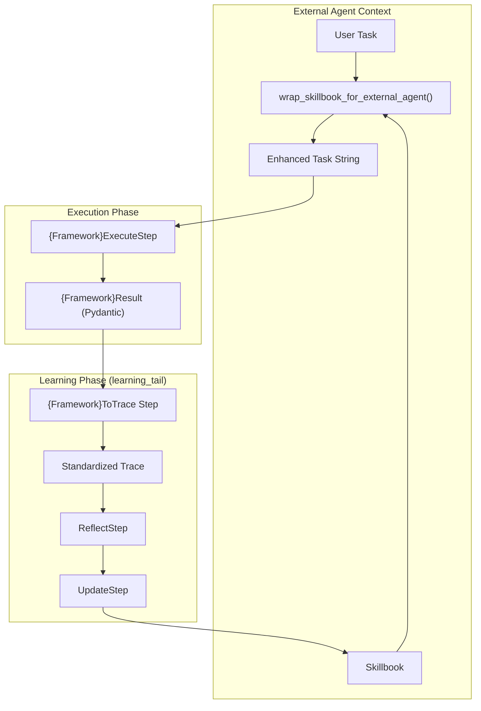

<!-- source: DeepWiki mcp.deepwiki.com · repo kayba-ai/agentic-context-engine · page 12.6 Integration APIs · fetched 2026-10-26 -->

# Integration APIs

Relevant source files

The following files were used as context for generating this wiki page:

- [ace/integrations/__init__.py](ace/integrations/__init__.py)
- [ace/integrations/browser_use.py](ace/integrations/browser_use.py)
- [ace/integrations/claude_code.py](ace/integrations/claude_code.py)
- [ace/integrations/claude_sdk.py](ace/integrations/claude_sdk.py)
- [ace/integrations/langchain.py](ace/integrations/langchain.py)
- [docs/guides/integration.md](docs/guides/integration.md)
- [docs/integrations/claude-sdk.md](docs/integrations/claude-sdk.md)

This page documents the Integration APIs for the ACE Framework. These APIs allow you to add self-improvement capabilities to existing agentic frameworks (browser-use, LangChain, Claude Code, etc.) by wrapping them in ACE learning pipelines.

The integration pattern follows a consistent three-phase lifecycle:
1.  **INJECT**: Add learned skillbook strategies to the external agent's context.
2.  **EXECUTE**: Run the external agent normally (e.g., browsing, coding, or chain execution).
3.  **LEARN**: Use the ACE Reflector and SkillManager to analyze the execution trace and update the skillbook.

**Sources:** [ace/integrations/__init__.py:1-21](), [docs/guides/integration.md:1-19]()

---

## Integration Architecture

The following diagram bridges the "Natural Language Space" (Integration Pattern) to the "Code Entity Space" (Classes and Steps).

### Integration Data Flow

**Sources:** [ace/integrations/__init__.py:1-21](), [ace/integrations/browser_use.py:53-103](), [ace/integrations/langchain.py:73-143](), [docs/guides/integration.md:12-18]()

---

## Browser-use Integration (`ACEAgent`)

The browser-use integration allows ACE to learn from web automation tasks. It uses `BrowserExecuteStep` to run the agent and `BrowserToTrace` to convert browser history into learning signals.

### Key Classes
- **`BrowserExecuteStep`**: Injects skillbook context and executes via `browser_use.Agent`. It reads from `ctx.sample` and writes a `BrowserResult` to `ctx.trace`. [ace/integrations/browser_use.py:53-77]()
- **`BrowserResult`**: A dataclass containing the task, success status, output, and chronological steps extracted from the browser history. [ace/integrations/browser_use.py:29-45]()

### Implementation Details
- **Injection**: The `_inject` method uses `wrap_skillbook_for_external_agent` to format strategies for the browser agent. [ace/integrations/browser_use.py:109-116]()
- **Trace Extraction**: `_build_result` parses the `AgentHistoryList` to extract "thoughts" (reasoning, memory, goals) and "actions" (tool calls) for the Reflector. [ace/integrations/browser_use.py:118-186]()

**Sources:** [ace/integrations/browser_use.py:1-211]()

---

## LangChain Integration (`ACELangChain`)

The LangChain integration wraps `Runnable` objects (chains, `AgentExecutor`, or `LangGraph`) to provide self-learning capabilities.

### Supported Variants
- **Simple Chains**: Basic `prompt | llm` sequences.
- **AgentExecutor**: Automatically enables `return_intermediate_steps` to capture tool-use traces. [ace/integrations/langchain.py:112-116]()
- **LangGraph**: Detects `CompiledStateGraph` and extracts learning signal from message history. [ace/integrations/langchain.py:138-139]()

### Logic Flow
- **`LangChainExecuteStep`**: The primary execution step. It handles input injection across strings, dicts, and message lists. [ace/integrations/langchain.py:73-101]()
- **`_inject_context`**: Intelligent injection logic that places skillbook strategies into the first message of a list or the `input` key of a dictionary. [ace/integrations/langchain.py:149-182]()

**Sources:** [ace/integrations/langchain.py:1-210]()

---

## Claude Code & SDK Integrations

ACE provides specific integrations for Anthropic's ecosystem, supporting both the CLI and the Python SDK.

### Claude Code (`ACEClaudeCode`)
Integrates with the `claude` CLI.
- **`ClaudeCodeExecuteStep`**: Runs the CLI via `subprocess.run` with `--output-format=stream-json`. [ace/integrations/claude_code.py:48-72]()
- **`_parse_stream_json`**: Parses the JSON stream to reconstruct an execution trace containing reasoning blocks and tool usage (Read, Write, Bash, etc.). [ace/integrations/claude_code.py:156-200]()

### Claude SDK
Direct integration with the `anthropic` Python SDK.
- **`ClaudeSDKExecuteStep`**: Calls the Messages API directly. It supports built-in observability via Logfire. [ace/integrations/claude_sdk.py:176-211]()
- **`ClaudeSDKResult`**: Pydantic model capturing `input_tokens`, `output_tokens`, `latency_seconds`, and `tool_calls`. [ace/integrations/claude_sdk.py:116-162]()

**Sources:** [ace/integrations/claude_code.py:1-200](), [ace/integrations/claude_sdk.py:1-211]()

---

## Construction Patterns

Integrations are typically used via Runners (e.g., `BrowserUse`, `LangChain`, `ClaudeCode`). These runners offer two factory methods:

| Method | Purpose | Source |
| :--- | :--- | :--- |
| `from_model()` | Quick setup using a model string for ACE roles. | [docs/guides/integration.md:80-90]() |
| `from_roles()` | Full control by providing pre-built `Reflector` and `SkillManager` instances. | [docs/guides/integration.md:92-107]() |

### Common Runner Parameters
All integration runners support:
- `skillbook`: An existing `Skillbook` instance.
- `checkpoint_dir`: Directory for saving skillbook snapshots.
- `dedup_config`: Configuration for skill deduplication.

**Sources:** [docs/guides/integration.md:109-121]()

---

## Summary of Integration Steps

| Framework | Execute Step | Result Type | Trace Converter |
| :--- | :--- | :--- | :--- |
| **Browser-use** | `BrowserExecuteStep` | `BrowserResult` | `BrowserToTrace` |
| **LangChain** | `LangChainExecuteStep` | `LangChainResult` | `LangChainToTrace` |
| **Claude Code** | `ClaudeCodeExecuteStep` | `ClaudeCodeResult` | `ClaudeCodeToTrace` |
| **Claude SDK** | `ClaudeSDKExecuteStep` | `ClaudeSDKResult` | `ClaudeSDKToTrace` |

**Sources:** [ace/integrations/__init__.py:27-36]()

---

