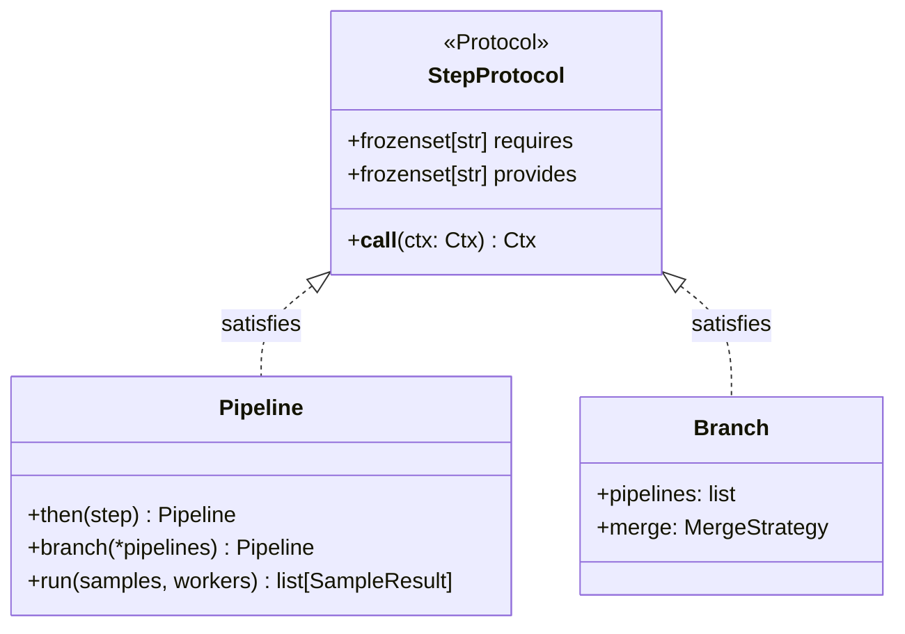
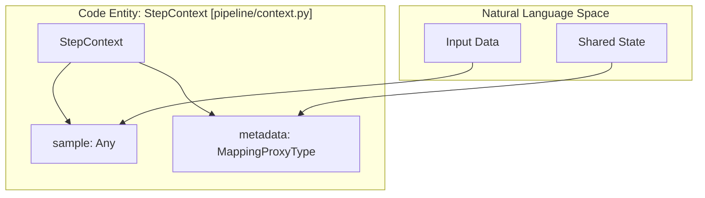
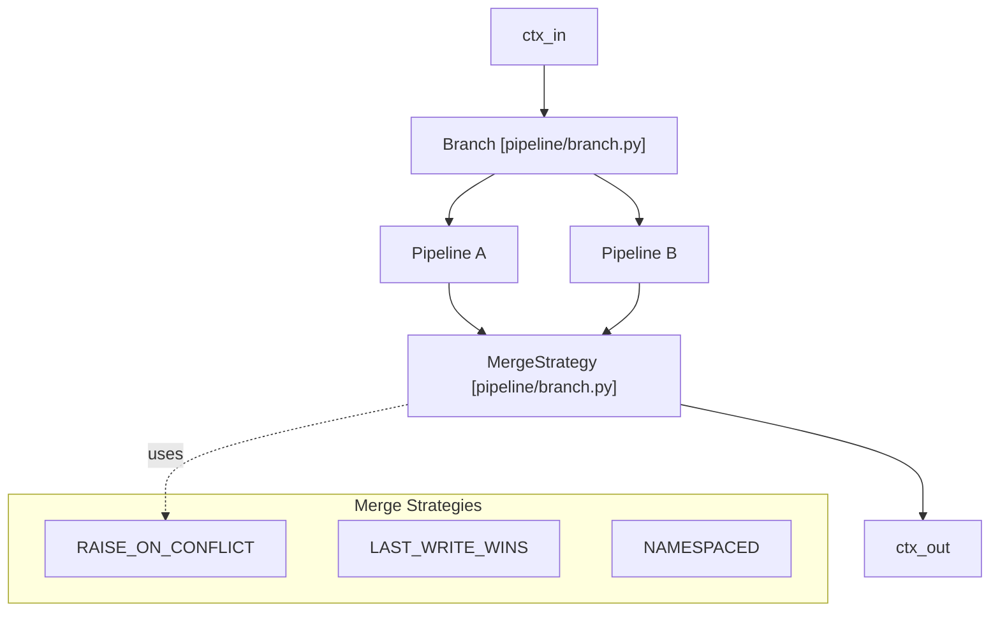

<!-- source: DeepWiki mcp.deepwiki.com · repo kayba-ai/agentic-context-engine · page 12.7 Pipeline APIs · fetched 2026-10-26 -->

# Pipeline APIs

Relevant source files

The following files were used as context for generating this wiki page:

- [examples/pipeline_ex/pipeline_demo.ipynb](examples/pipeline_ex/pipeline_demo.ipynb)
- [examples/pipeline_ex/pipeline_demo.py](examples/pipeline_ex/pipeline_demo.py)
- [pipeline/__init__.py](pipeline/__init__.py)
- [pipeline/branch.py](pipeline/branch.py)
- [pipeline/context.py](pipeline/context.py)
- [pipeline/errors.py](pipeline/errors.py)
- [pipeline/pipeline.py](pipeline/pipeline.py)
- [pipeline/protocol.py](pipeline/protocol.py)
- [tests/pipeline_engine/__init__.py](tests/pipeline_engine/__init__.py)
- [tests/pipeline_engine/conftest.py](tests/pipeline_engine/conftest.py)
- [tests/pipeline_engine/test_branch.py](tests/pipeline_engine/test_branch.py)
- [tests/pipeline_engine/test_context.py](tests/pipeline_engine/test_context.py)
- [tests/pipeline_engine/test_pipeline.py](tests/pipeline_engine/test_pipeline.py)
- [tests/pipeline_engine/test_pipeline_e2e.py](tests/pipeline_engine/test_pipeline_e2e.py)
- [tests/pipeline_engine/test_protocol.py](tests/pipeline_engine/test_protocol.py)
- [tests/test_pipeline_hooks.py](tests/test_pipeline_hooks.py)

This page documents the public API for composing pipelines using the generic pipeline engine. These APIs enable building custom workflows by assembling reusable steps into sequential or parallel structures.

---

## Overview

The pipeline engine is built on three fundamental concepts:
1.  **Immutable Context**: The `StepContext` (and its ACE-specific subclass `ACEStepContext`) is the single data carrier that flows through the pipeline.
2.  **Structural Protocol**: The `StepProtocol` defines the contract (requirements and provisions) for every step.
3.  **Composition Primitives**: `Pipeline` (sequential) and `Branch` (parallel) allow nesting and complex flow control.

---

## Core Primitives

### StepProtocol[Ctx]

A structural protocol that every step, pipeline, and branch must satisfy. It is generic over the context type.

**Attributes:**
*   `requires`: A `frozenset` of field names (from `metadata` or named attributes) that the step reads from the context [pipeline/protocol.py:44-44]().
*   `provides`: A `frozenset` of field names that the step writes to the context [pipeline/protocol.py:45-45]().

**Sources:** [pipeline/protocol.py:33-47](), [pipeline/__init__.py:9-12]()

---

### StepContext

The immutable carrier of state. Consuming applications typically subclass this to add domain-specific fields.

*   **Immutability**: The class is `frozen=True`. Mutation is handled via the `.replace()` method which returns a new instance [pipeline/context.py:11-37]().
*   **Metadata Coercion**: Plain dictionaries passed to `metadata` are automatically coerced into `MappingProxyType` to prevent accidental in-place mutation [pipeline/context.py:30-33]().

**Sources:** [pipeline/context.py:1-38](), [tests/pipeline_engine/test_context.py:58-78]()

---

## Composition and Flow

### Pipeline

An ordered sequence of steps. It automatically infers its own `requires` and `provides` based on the internal chain [pipeline/pipeline.py:53-82]().

| Feature | Description |
| :--- | :--- |
| **Fluent API** | Build using `.then(step)` and `.branch(...)` [pipeline/pipeline.py:56-65](). |
| **Validation** | Checks for `PipelineOrderError` (step B requires X, but X is provided by later step C) [pipeline/pipeline.py:166-171](). |
| **Execution** | Supports single context calls via `__call__` or batch execution via `.run()` [pipeline/pipeline.py:204-211](). |

**Sources:** [pipeline/pipeline.py:53-131](), [tests/pipeline_engine/test_pipeline.py:41-85]()

### Branch and MergeStrategy

`Branch` allows parallel execution of multiple pipelines. It uses a `MergeStrategy` to join the resulting contexts back into one.

*   **RAISE_ON_CONFLICT**: (Default) Raises a `ValueError` if two branches modify the same named field to different values [pipeline/branch.py:29-58]().
*   **LAST_WRITE_WINS**: The value from the last branch in the list takes precedence [pipeline/branch.py:61-87]().
*   **NAMESPACED**: Stores each branch's full context inside `metadata` under keys like `branch_0`, `branch_1` [pipeline/branch.py:90-99]().

**Sources:** [pipeline/branch.py:1-152](), [tests/pipeline_engine/test_branch.py:184-220]()

---

## Concurrency and Backgrounding

### Async Boundaries

A pipeline can define a split between "foreground" and "background" work using `async_boundary = True` on a step [pipeline/pipeline.py:176-182]().

*   **Behavior**: When `.run()` encounters an async boundary step, it completes the foreground work, returns the results to the caller, and continues the remaining steps in background threads [pipeline/pipeline.py:276-300]().
*   **Thread Pools**: Background execution is managed via `ThreadPoolExecutor`. By default, executors are shared per step class [pipeline/pipeline.py:27-45]().
*   **Serialization**: Setting `max_workers = 1` on a step class ensures that background work for that step is serialized across all samples [tests/pipeline_engine/conftest.py:148-153]().

**Sources:** [pipeline/pipeline.py:21-45](), [tests/pipeline_engine/test_pipeline_e2e.py:187-203]()

### Cancellation

The engine provides a thread-safe `CancellationToken` to stop execution between steps [pipeline/errors.py:46-68]().

*   **Context Propagation**: The current token is stored in a `ContextVar` named `cancel_token_var`, making it accessible to deep LLM clients without signature changes [pipeline/errors.py:76-78]().

**Sources:** [pipeline/errors.py:46-78]()

---

## Result Handling

### SampleResult

The outcome of a pipeline execution for a single sample.

| Attribute | Type | Description |
| :--- | :--- | :--- |
| `sample` | `Any` | The original input sample [pipeline/protocol.py:67-67](). |
| `output` | `StepContext \| None` | The final context if successful [pipeline/protocol.py:68-68](). |
| `error` | `Exception \| None` | Captured exception if the pipeline failed [pipeline/protocol.py:69-69](). |
| `failed_at` | `str \| None` | Name of the step class where the failure occurred [pipeline/protocol.py:70-70](). |

**Sources:** [pipeline/protocol.py:51-72](), [tests/pipeline_engine/test_protocol.py:98-136]()

---

