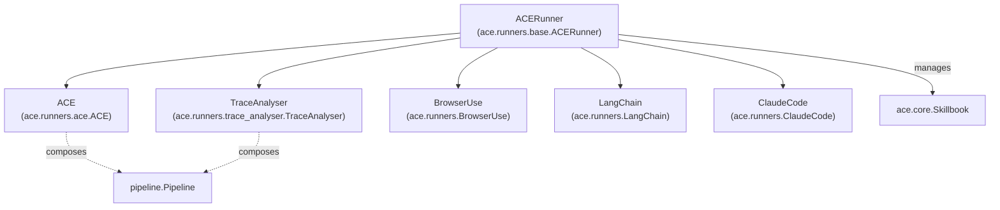
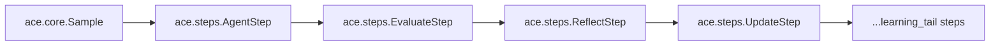

<!-- source: DeepWiki mcp.deepwiki.com · repo kayba-ai/agentic-context-engine · page 12.8 Runner APIs · fetched 2026-10-26 -->

# Runner APIs

<details>
<summary>Relevant source files</summary>

The following files were used as context for generating this wiki page:

- [ace/__init__.py](ace/__init__.py)
- [ace/runners/ace.py](ace/runners/ace.py)
- [ace/runners/base.py](ace/runners/base.py)
- [ace/runners/trace_analyser.py](ace/runners/trace_analyser.py)
- [ace/steps/agent.py](ace/steps/agent.py)
- [agent-guides/plan-sm-rewrite-v3.md](agent-guides/plan-sm-rewrite-v3.md)
- [tests/test_pipeline_exports.py](tests/test_pipeline_exports.py)

</details>


This page documents the runner APIs in the ACE framework. Runners are high-level orchestrators that compose pipeline steps, manage skillbook lifecycle, and provide convenient construction patterns for different use cases.

**Scope**: This page covers the `ACERunner` base class and concrete runners (`ACE`, `TraceAnalyser`, and various integration runners). For the underlying pipeline primitives, see [Pipeline APIs](#12.7).

---

## Runner System Overview

The runner system provides composable, high-level APIs for executing ACE learning pipelines. All runners inherit from `ACERunner` and follow a consistent pattern: they encapsulate a `Pipeline` instance and a `Skillbook`.

**Class Hierarchy and Entity Mapping**


**Sources**: [ace/runners/base.py:19-43](), [ace/runners/ace.py:27-38](), [ace/runners/trace_analyser.py:26-41](), [ace/__init__.py:97-103]()

---

## ACERunner Base Class

`ACERunner` is the base class for all runners. It manages the epoch loop and delegates per-sample iteration, error isolation, and concurrency to the underlying `Pipeline`.

### Core Responsibilities

| Responsibility | Implementation |
|---|---|
| **Pipeline execution** | `_run()` method handling epochs and `SampleResult` collection [ace/runners/base.py:86-145]() |
| **Skillbook lifecycle** | `save()` and `load()` methods for persistence [ace/runners/base.py:57-63]() |
| **Background learning** | `wait_for_background()` and `learning_stats` properties [ace/runners/base.py:65-80]() |
| **Context building** | Abstract `_build_context()` method mapping inputs to `ACEStepContext` [ace/runners/base.py:151-167]() |

### Key Methods

- `_run(items, epochs, wait, cancel_token)`: The internal engine that iterates through epochs, constructs contexts via `_build_context`, and calls `self.pipeline.run()` [ace/runners/base.py:86-145]().
- `save(path)`: Persists the runner's `Skillbook` to disk [ace/runners/base.py:57-59]().
- `wait_for_background(timeout)`: Blocks until all background learning tasks in the pipeline are finished [ace/runners/base.py:65-72]().

**Sources**: [ace/runners/base.py:19-167]()

---

## ACE Runner

`ACE` is the full adaptive pipeline runner. It executes the complete loop: `Agent → Evaluate → Reflect → Update`.

### Pipeline Structure



**Sources**: [ace/runners/ace.py:78-91](), [ace/steps/agent.py:11-42]()

### Construction Methods

#### from_roles()
Constructs the runner from pre-built role instances (Agent, Reflector, SkillManager).

```python
@classmethod
def from_roles(
    cls,
    *,
    agent: AgentLike,
    reflector: ReflectorLike,
    skill_manager: SkillManagerLike,
    environment: TaskEnvironment | None = None,
    skillbook: Skillbook | None = None,
    # ... (dedup and checkpoint config)
) -> ACE
```
This method delegates step composition to `build_steps()` and wraps them in a `Pipeline` [ace/runners/ace.py:97-142]().

#### build_steps()
Returns the list of `StepProtocol` instances. This allows users to inspect or modify the pipeline (e.g., inserting custom steps) before instantiation [ace/runners/ace.py:41-94]().

### Context Building
`ACE._build_context` maps a `Sample` to an `ACEStepContext`, providing a `SkillbookView` to ensure steps interact with a consistent snapshot of the skills [ace/runners/ace.py:169-193]().

**Sources**: [ace/runners/ace.py:27-193](), [tests/test_pipeline_exports.py:156-170]()

---

## TraceAnalyser Runner

`TraceAnalyser` is designed for batch learning from pre-recorded execution traces. It skips execution (`AgentStep`) and evaluation (`EvaluateStep`), running only the learning tail.

### Pipeline Structure


**Sources**: [ace/runners/trace_analyser.py:26-41](), [ace/runners/trace_analyser.py:78-89]()

### Construction and Usage
- **`from_roles()`**: Requires only `reflector` and `skill_manager` [ace/runners/trace_analyser.py:92-130]().
- **`run(traces, epochs)`**: Accepts a sequence of raw trace objects. These are placed directly on `ctx.trace` for the Reflector to interpret [ace/runners/trace_analyser.py:132-153]().
- **Trace Identity**: Automatically infers identity metadata for the trace to ensure proper attribution in the skillbook [ace/runners/trace_analyser.py:171-181]().

**Sources**: [ace/runners/trace_analyser.py:26-187](), [tests/test_pipeline_exports.py:171-182]()

---

## Implementation Details

### The learning_tail Factory
Most runners utilize the `learning_tail` factory to ensure a consistent learning pipeline. It composes `ReflectStep` and `UpdateStep`, and optionally appends `DeduplicateStep` and `CheckpointStep` based on the provided configuration [ace/steps/__init__.py:115](), [ace/runners/ace.py:82-90]().

### Skill Mutation Flow
In the current architecture, the `SkillManager` (invoked within `UpdateStep`) mutates the `Skillbook` directly using its toolset. This removes the need for a separate "Apply" step. The `UpdateStep` produces a `SkillManagerOutput` which serves as an audit log of the mutations performed [agent-guides/plan-sm-rewrite-v3.md:51-73]().

### Attribution and Counters
The `AgentStep` is responsible for recording which skills were injected into the prompt.
1. It reads `ctx.skillbook`.
2. It records `injected_skill_ids` onto the `ACEStepContext` [ace/steps/agent.py:39-42]().
3. It increments the `used_count` for those skills in the `Skillbook` [ace/steps/agent.py:37-37]().

**Sources**: [ace/steps/agent.py:11-43](), [agent-guides/plan-sm-rewrite-v3.md:20-21]()

---

## Summary of Runner APIs

| Method | Runner Class | Purpose |
|---|---|---|
| `build_steps(...)` | `ACE`, `TraceAnalyser` | Returns a list of pipeline steps for manual composition [ace/runners/ace.py:41](). |
| `from_roles(...)` | All Runners | Standard constructor using pre-built role instances [ace/runners/ace.py:97](). |
| `run(...)` | All Runners | Main entry point to process samples or traces [ace/runners/base.py:86](). |
| `save(path)` | `ACERunner` | Saves the internal `Skillbook` to a file [ace/runners/base.py:57](). |
| `wait_for_background()` | `ACERunner` | Blocks until async learning steps complete [ace/runners/base.py:65](). |

**Sources**: [ace/runners/base.py:19-167](), [ace/runners/ace.py:27-193](), [ace/runners/trace_analyser.py:26-187]()

---

