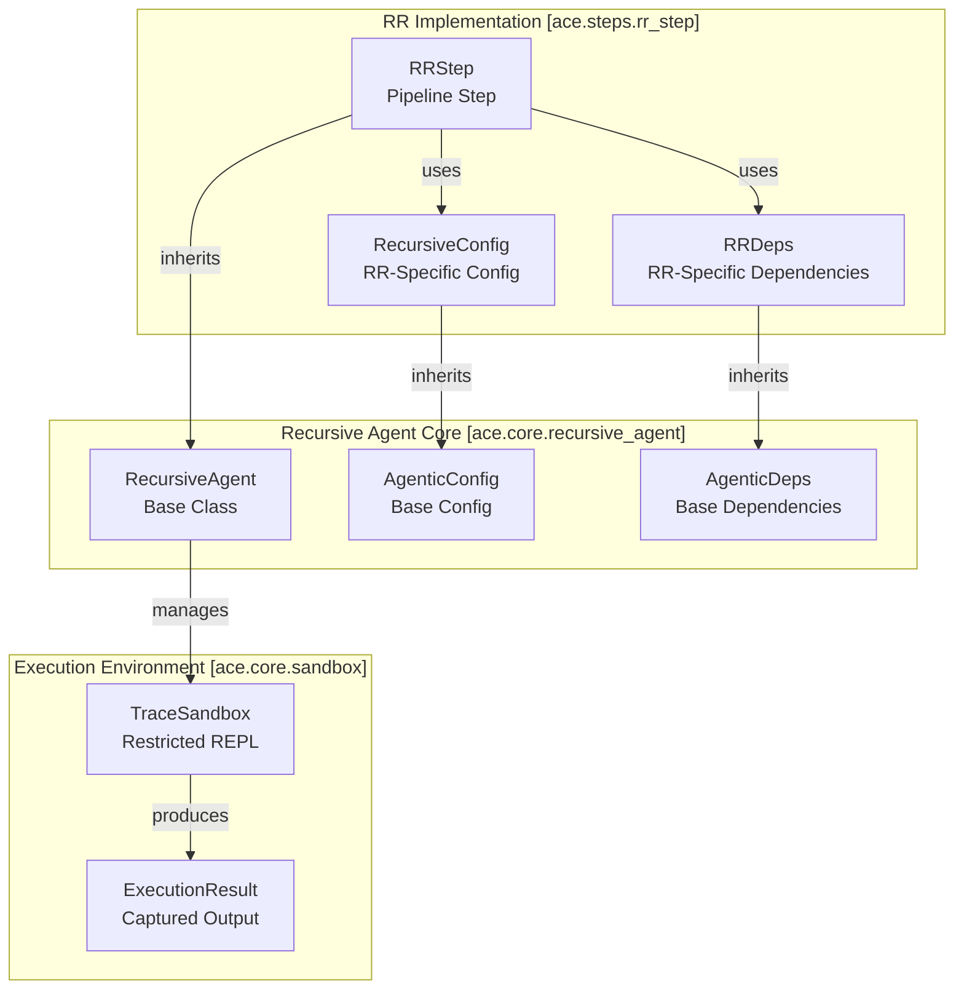
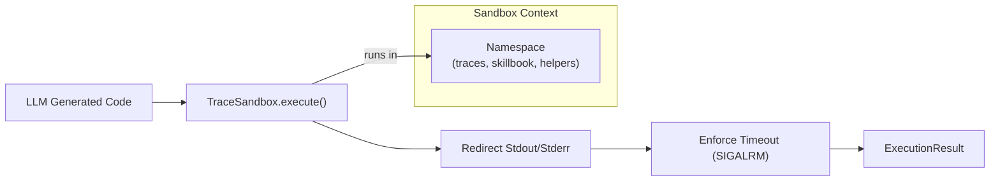

<!-- source: DeepWiki mcp.deepwiki.com · repo kayba-ai/agentic-context-engine · page 12.9 RR APIs · fetched 2026-10-26 -->

# RR APIs

<details>
<summary>Relevant source files</summary>

The following files were used as context for generating this wiki page:

- [ace/core/recursive_agent.py](ace/core/recursive_agent.py)
- [ace/core/sandbox.py](ace/core/sandbox.py)
- [ace/implementations/rr/__init__.py](ace/implementations/rr/__init__.py)
- [ace/implementations/rr/config.py](ace/implementations/rr/config.py)
- [ace/implementations/rr/prompts.py](ace/implementations/rr/prompts.py)
- [ace/implementations/rr/tools.py](ace/implementations/rr/tools.py)
- [ace/steps/rr_step.py](ace/steps/rr_step.py)

</details>


This page documents the public API surface for the Recursive Reflector (RR) system. The RR is an advanced reflector implementation that uses an iterative Python REPL to analyze agent execution traces programmatically. It is built on the `RecursiveAgent` abstraction, providing features like two-tier compaction, depth-based recursion, and sandboxed code execution.

**Scope**: This page covers classes, methods, and configuration options for `RRStep`, `RecursiveAgent`, and the `TraceSandbox`. For architectural details and design rationale, see [Recursive Reflector System](#3.3).

---

## API Overview

The RR system components bridge the gap between high-level agentic analysis and low-level code execution.



**Sources:** [ace/core/recursive_agent.py:1-25](), [ace/steps/rr_step.py:51-73](), [ace/implementations/rr/config.py:9-20](), [ace/implementations/rr/tools.py:29-45]()

---

## RecursiveAgent

`RecursiveAgent` is the foundational class for all agentic steps that require a multi-turn REPL and the ability to spawn sub-agents. It wraps a `PydanticAI` agent with budget management and conversation compaction.

### Class Signature

```python
class RecursiveAgent:
    def __init__(
        self,
        model: str | PydanticModel,
        output_type: Type[Any],
        system_prompt: str,
        config: AgenticConfig,
        tools: Sequence[Callable[[PydanticAgent[AgenticDeps, Any]], None]] = (),
        tool_names_to_compact: Sequence[str] = (),
        # ... compaction settings
    ) -> None
```

[ace/core/recursive_agent.py:236-285]()

**Key Features:**
- **Two-Tier Compaction**: Uses `microcompaction` (clearing tool outputs) and full summarization to manage context window limits [ace/core/recursive_agent.py:448-525]().
- **Depth-Based Recursion**: Provides a `recurse` tool that allows the agent to spawn child sessions for sub-problems [ace/core/recursive_agent.py:143-233]().
- **Budget Management**: Tracks `RequestUsage` and enforces limits on LLM calls and tokens [ace/core/recursive_agent.py:421-446]().

**Sources:** [ace/core/recursive_agent.py:1-25](), [ace/core/recursive_agent.py:143-233](), [ace/core/recursive_agent.py:448-525]()

---

## RRStep

`RRStep` specializes `RecursiveAgent` for trace analysis. It satisfies the `StepProtocol` for pipelines and the `ReflectorLike` interface for reflection tasks.

### Class Signature

```python
class RRStep(RecursiveAgent):
    requires = frozenset({"trace", "skillbook"})
    provides = frozenset({"reflections"})
    
    def __init__(
        self,
        model: str | PydanticModel,
        config: Optional[RRConfig] = None,
        prompt_template: str = REFLECTOR_RECURSIVE_PROMPT,
        model_settings: ModelSettings | None = None,
    ) -> None
```

[ace/steps/rr_step.py:51-101]()

### Key Tools
`RRStep` registers several RR-specific tools beyond the base `execute_code` and `recurse`:
- `think(thought)`: A prose-only channel for internal reasoning to keep the Python stdout clean [ace/implementations/rr/tools.py:97-138]().
- `search_skillbook(query)`: Vector/BM25 search over the existing skillbook [ace/implementations/rr/tools.py:140-176]().
- `read_skill(skill_id)`: Retrieves the full payload of a specific skill [ace/implementations/rr/tools.py:66-95]().

**Sources:** [ace/steps/rr_step.py:51-101](), [ace/implementations/rr/tools.py:1-176]()

---

## Configuration Options

The configuration system uses nested dataclasses to control the behavior of the REPL and sub-agents.

### AgenticConfig (Base)
Controls the fundamental limits of any `RecursiveAgent`.

| Parameter | Type | Default | Description |
|-----------|------|---------|-------------|
| `max_requests` | `int` | `20` | Max LLM turns in a single session |
| `max_depth` | `int` | `3` | Max recursion depth for sub-agents |
| `timeout` | `float` | `30.0` | Timeout for code execution (seconds) |
| `max_output_chars` | `int` | `10,000` | Truncation limit for tool outputs |

[ace/core/recursive_agent.py:314-332]()

### RecursiveConfig (RR-Specific)
Extends `AgenticConfig` with settings tailored for trace analysis.

| Parameter | Type | Default | Description |
|-----------|------|---------|-------------|
| `max_output_chars` | `int` | `50,000` | Increased limit for large trace data |
| `cache_prompts` | `bool` | `True` | Enable Anthropic-style prompt caching |
| `cache_ttl` | `Literal` | `"5m"` | TTL for cached prompts |

[ace/implementations/rr/config.py:9-20]()

**Sources:** [ace/core/recursive_agent.py:314-332](), [ace/implementations/rr/config.py:9-20]()

---

## TraceSandbox

The `TraceSandbox` provides a restricted Python REPL environment. It is designed to be safe for LLM-generated code by blocking sensitive builtins while providing high-performance access to trace data.

### Restricted Environment
The sandbox uses a whitelist of `SAFE_BUILTINS` [ace/core/sandbox.py:75-171]().
- **Blocked**: `open`, `__import__`, `eval`, `exec`, `compile`, `input`.
- **Allowed**: `json`, `re`, `collections`, `datetime`, and standard math/logic functions.

### Code Execution Flow



### Sandbox Methods

#### `execute(code: str, timeout: float) -> ExecutionResult`
Executes code and captures output. On Unix systems, it uses `signal.SIGALRM` to enforce the timeout [ace/core/sandbox.py:305-384]().

#### `inject(name: str, value: Any)`
Safely adds variables to the sandbox namespace for the LLM to use [ace/core/sandbox.py:296-303]().

#### `register_helper(name, source, description)`
Allows the agent to define a Python function that persists across `execute_code` calls and is automatically injected into all future `recurse` child agents [ace/core/recursive_agent.py:95-99]().

**Sources:** [ace/core/sandbox.py:75-171](), [ace/core/sandbox.py:305-384](), [ace/core/recursive_agent.py:82-106]()

---

## Data Flow and Dependencies

The `RRDeps` container carries the necessary context into every tool call.

```mermaid
classDef entity fill:#fff,stroke:#333,stroke-width:1px;

class RRDeps entity {
    +trace_data: dict
    +skillbook_text: str
    +skillbook: Skillbook
    +thoughts: list
    +sandbox: TraceSandbox
    +config: RecursiveConfig
}

class ExecutionResult entity {
    +stdout: str
    +stderr: str
    +final_value: Any
    +exception: Exception
}
```

### Implementation Details
- **Trace Injection**: The trace is injected into the sandbox as the `traces` variable [ace/implementations/rr/prompts.py:39]().
- **Iteration Tracking**: `ctx.deps.iteration` is incremented on every `execute_code` call to ensure the agent explores data before submitting [ace/core/recursive_agent.py:107]().
- **Validation**: An `output_validator` ensures that `iteration > 0` before allowing a final `ReflectorOutput`, preventing "lazy" reflections [ace/implementations/rr/tools.py:52-64]().

**Sources:** [ace/implementations/rr/tools.py:29-45](), [ace/core/recursive_agent.py:107-115](), [ace/implementations/rr/tools.py:52-64]()

---

