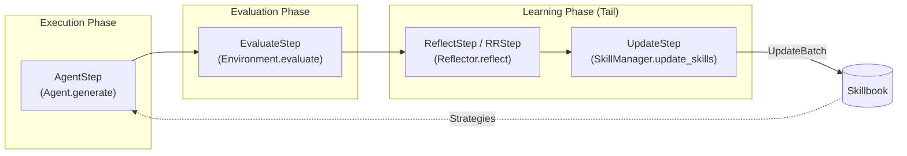
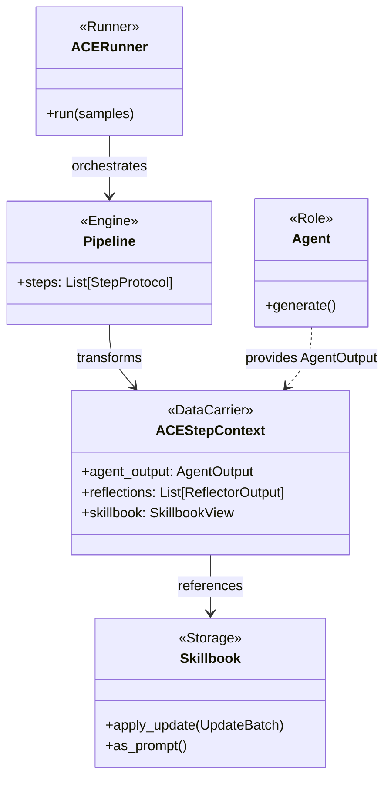

<!-- source: DeepWiki mcp.deepwiki.com · repo kayba-ai/agentic-context-engine · page 2 Core Concepts · fetched 2026-10-26 -->

# Core Concepts

Relevant source files

The following files were used as context for generating this wiki page:

- [CLAUDE.md](CLAUDE.md)
- [README.md](README.md)
- [ace/core/skillbook.py](ace/core/skillbook.py)
- [ace/runners/litellm.py](ace/runners/litellm.py)
- [assets/kayba-banner.png](assets/kayba-banner.png)
- [docs/api/index.md](docs/api/index.md)
- [docs/concepts/skillbook.md](docs/concepts/skillbook.md)
- [docs/concepts/updates.md](docs/concepts/updates.md)
- [docs/design/SKILLBOOK_V2_PLAN.md](docs/design/SKILLBOOK_V2_PLAN.md)
- [docs/guides/composing-pipelines.md](docs/guides/composing-pipelines.md)
- [docs/guides/prompts.md](docs/guides/prompts.md)
- [examples/ace/ace_demo.py](examples/ace/ace_demo.py)
- [tests/test_ace_core.py](tests/test_ace_core.py)

This page covers the fundamental concepts of the Agentic Context Engine (ACE). ACE adds a persistent learning loop to AI agents, enabling them to improve through experience without fine-tuning.

**Scope**: This page focuses on the high-level conceptual model: the learning loop, the Skillbook, the three-role architecture, and adaptation strategies.

---

## The ACE Learning Loop

ACE implements a closed-loop system where agents learn from their own execution traces. This cycle is typically orchestrated by a `Pipeline` [pipeline/pipeline.py:15-104]() consisting of specialized steps.

1.  **Execute**: The `Agent` performs a task, optionally using strategies from the `Skillbook`.
2.  **Evaluate**: A `TaskEnvironment` [ace/core/environments.py:46-59]() assesses the outcome (Micro or Meso feedback).
3.  **Reflect**: The `Reflector` (or `RRStep` [ace/rr/step.py:23-55]()) analyzes the trace to find root causes and insights.
4.  **Update**: The `SkillManager` [ace/implementations.py:141-213]() issues commands to modify the `Skillbook`.

For details, see [The ACE Learning Loop](#2.1).

**Sources**: [README.md:80-99](), [docs/guides/composing-pipelines.md:18-29]()

---

## Skillbook: The Knowledge Repository

The `Skillbook` [ace/core/skillbook.py:270-320]() is the central store for learned strategies. Unlike a vector database, it is a curated collection of "skills" that are injected into the agent's prompt.

### Skill Structure
Each `Skill` [ace/core/skillbook.py:323-380]() follows the **v2 schema**, containing:
*   **Issue**: The problem or pattern identified.
*   **Insight**: The actionable strategy to resolve it.
*   **Keywords**: Structured labels for retrieval and organization.
*   **Metadata**: Effectiveness scores (`helpful_count`, `harmful_count`) and provenance (`occurrences`).

### Sections
Skills are organized into two primary sections [ace/core/skillbook.py:22-23]():
*   `context`: Strategies for the agent to apply during task execution.
*   `harness`: Learnings about the environment or runtime (e.g., rate limits).

For details, see [Skillbook System](#2.2).

**Sources**: [docs/concepts/skillbook.md:1-35](), [ace/core/skillbook.py:323-380]()

---

## Three-Role Architecture

ACE uses a separation of concerns across three specialized roles, typically backed by [PydanticAI](https://ai.pydantic.dev/) agents.

| Role | Key Class | Responsibility |
| :--- | :--- | :--- |
| **Agent** | `Agent` | Executes tasks; cites `skill_ids` it uses. |
| **Reflector** | `Reflector` | Analyzes traces; tags skills as helpful/harmful. |
| **SkillManager** | `SkillManager` | Manages Skillbook evolution via `UpdateOperation`. |

### Recursive Reflector (RR)
The **Recursive Reflector** [ace/rr/step.py:23-55]() is a high-power alternative to the standard Reflector. It uses a `RecursiveAgent` [ace/core/recursive_agent.py:45-102]() to write and execute Python code in a `TraceSandbox` [ace/rr/sandbox.py:24-60]() to programmatically analyze complex execution traces.

For details, see [Three-Role Architecture](#2.3).

**Sources**: [CLAUDE.md:80-87](), [README.md:80-89]()

---

## Adaptation Strategies

ACE supports different modes of learning depending on the availability of data and the deployment scenario.

*   **Online Learning**: The agent learns in real-time from live interactions. This is often done via an `async_boundary` [pipeline/step.py:33-40]() to prevent learning latency from blocking the agent's response.
*   **Offline Learning**: The agent is trained on a batch of `Sample` [ace/core/environments.py:16-24]() objects to build a baseline Skillbook.
*   **Trace Analysis**: The `TraceAnalyser` [ace/runners/trace_analyser.py:21-50]() runner allows learning from pre-recorded execution logs without re-executing the task.

For details, see [Adaptation Strategies](#2.4).

**Sources**: [ace/runners/litellm.py:51-54](), [docs/api/index.md:22-27]()

---

## Insight Levels

ACE learning triggers on two distinct levels of observation:

1.  **Micro (Ground Truth)**: Learning from direct success/failure signals (e.g., "The answer was 4, but the agent said 5").
2.  **Meso (Pattern Observation)**: Learning from the *process* of execution, even without a known correct answer (e.g., "The agent got stuck in a loop when clicking this button").

For details, see [Insight Levels](#2.5).

**Sources**: [ace/core/outputs.py:55-85](), [docs/concepts/skillbook.md:135-152]()

---

## System Mapping: Code to Concepts

This diagram bridges Natural Language concepts to the core classes in the codebase.

**Sources**: [pipeline/pipeline.py:15-104](), [ace/core/context.py:68-105](), [ace/core/skillbook.py:270-320]()

---

