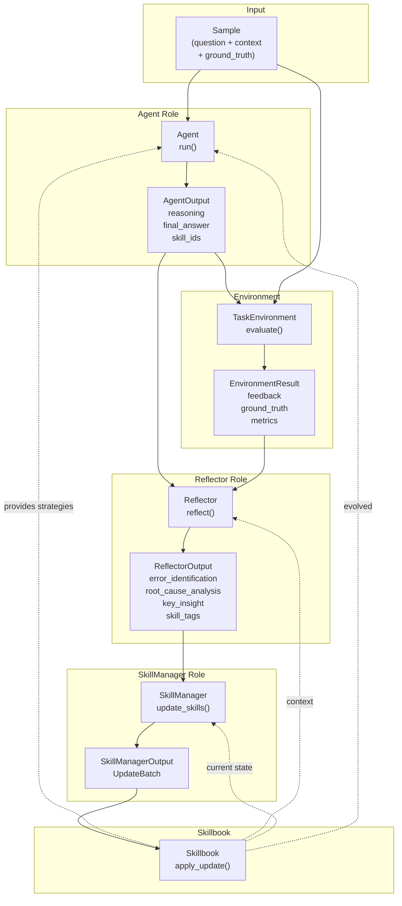
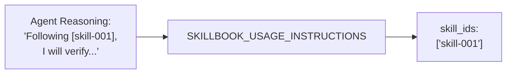
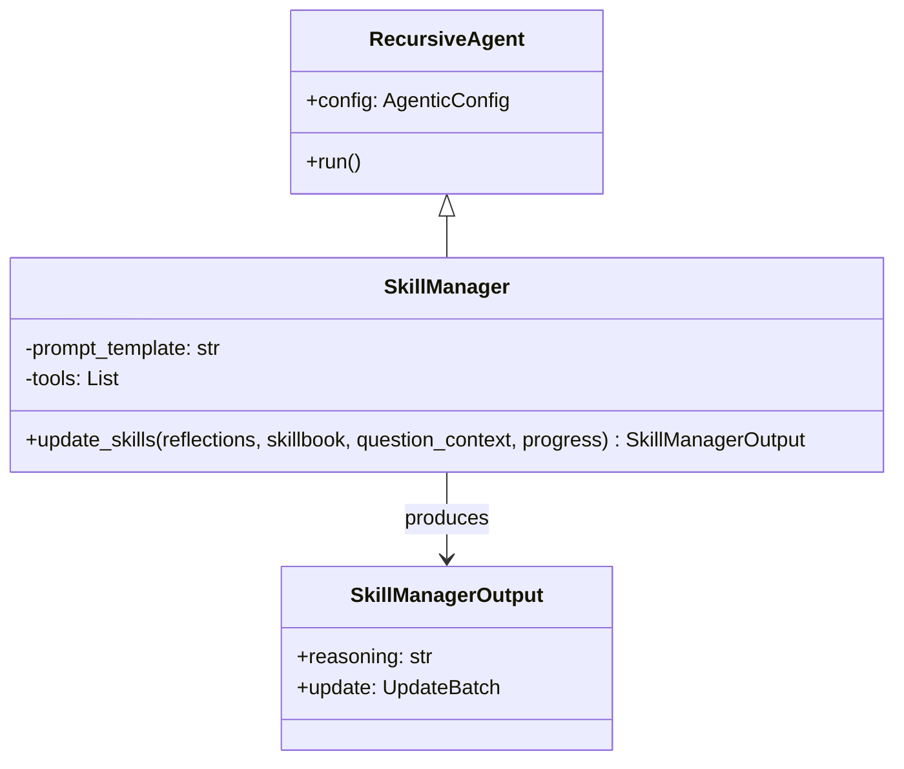
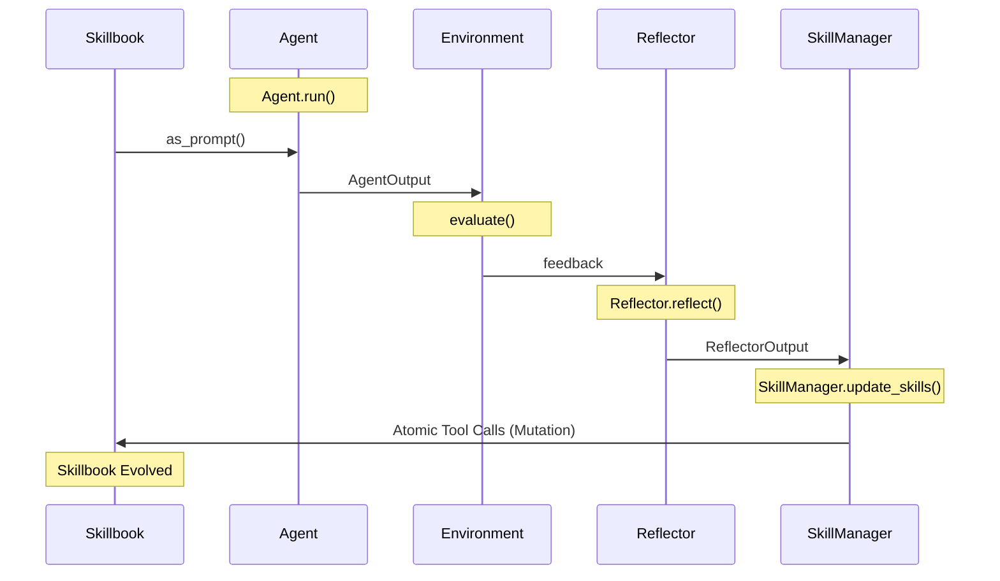

<!-- source: DeepWiki mcp.deepwiki.com · repo kayba-ai/agentic-context-engine · page 2.3 Three-Role Architecture · fetched 2026-10-26 -->

# Three-Role Architecture

Relevant source files

The following files were used as context for generating this wiki page:

- [ace.toml](ace.toml)
- [ace/__init__.py](ace/__init__.py)
- [ace/implementations/prompts.py](ace/implementations/prompts.py)
- [ace/implementations/skill_manager.py](ace/implementations/skill_manager.py)
- [docs/concepts/overview.md](docs/concepts/overview.md)
- [docs/concepts/roles.md](docs/concepts/roles.md)
- [docs/getting-started/quick-start.md](docs/getting-started/quick-start.md)
- [docs/getting-started/setup.md](docs/getting-started/setup.md)
- [tests/test_pipeline_exports.py](tests/test_pipeline_exports.py)

## Purpose and Scope

This page documents the three core roles that power ACE's learning loop: **Agent**, **Reflector**, and **SkillManager**. These roles form the foundation of ACE's self-improvement mechanism, where the Agent executes tasks, the Reflector analyzes outcomes, and the SkillManager updates the skillbook based on learnings.

For information about how these roles are orchestrated in learning loops, see [Adaptation Strategies](#2.4). For the skillbook data structure they operate on, see [Skillbook System](#2.2). For details on the complete learning cycle, see [The ACE Learning Loop](#2.1).

## Role Overview

ACE's architecture separates concerns into three specialized roles, each with a distinct responsibility in the learning process:

**Sources:** [ace/implementations/skill_manager.py:58-93](), [docs/concepts/roles.py:1-11]()

| Role | Input | Output | Responsibility |
|------|-------|--------|----------------|
| **Agent** | Question, Context, Skillbook | Reasoning, Answer, Cited Skills | Execute task using accumulated strategies |
| **Reflector** | Agent Output, Feedback, Skillbook | Error Analysis, Insights, Skill Tags | Diagnose what went right/wrong and why |
| **SkillManager** | Reflection, Skillbook, Progress | Update Operations (Audit Log) | Decide how to evolve the skillbook |

## Agent Role

The Agent executes tasks by applying strategies from the skillbook. It is responsible for producing reasoned answers and citing which skills it applied.

### Core Responsibilities

1. **Strategy Selection** - Scan skillbook for relevant skills [ace/implementations/prompts.py:104-110]()
2. **Problem Decomposition** - Break complex problems into sub-problems [ace/implementations/prompts.py:112-115]()
3. **Strategy Application** - Execute selected strategies with skill ID citations [ace/implementations/prompts.py:117-122]()
4. **Solution Execution** - Show complete reasoning chain and produce final answer [ace/implementations/prompts.py:124-129]()

### Implementation Details

The `Agent` implementation (referenced in `ace/__init__.py`) wraps an LLM and uses the `AGENT_PROMPT` template. The agent prompt instructs the LLM to:

- Review skillbook strategies and cite specific skill IDs inline in reasoning [ace/implementations/prompts.py:167]()
- Show numbered reasoning steps with intermediate calculations [ace/implementations/prompts.py:141-145]()
- Avoid meta-commentary like "I will now..." [ace/implementations/prompts.py:153]()
- Return JSON with `reasoning`, `final_answer`, and `answer_confidence` [ace/implementations/prompts.py:164-176]()

**Sources:** [ace/implementations/prompts.py:68-177](), [ace/__init__.py:84-84]()

### Skill Citation Mechanism

The framework provides instructions for external agents to follow the same citation pattern, ensuring consistency even when the ACE Agent is replaced by an external framework like LangChain or Browser-Use [ace/implementations/prompts.py:31-60]().

**Sources:** [ace/implementations/prompts.py:15-28]()

## Reflector Role

The Reflector analyzes execution traces to understand what went right or wrong. It produces diagnostic insights and classifies skill effectiveness.

### Core Responsibilities

1. **Error Identification** - Pinpoint exact mistakes in reasoning [docs/concepts/roles.md:66-66]()
2. **Root Cause Analysis** - Explain why errors occurred [docs/concepts/roles.md:67-67]()
3. **Learning Extraction** - Extract key insights from the outcome [docs/concepts/roles.md:69-69]()
4. **Skill Tagging** - Classify skills as helpful, harmful, or neutral [docs/concepts/roles.md:70-70]()

### Reflection Modes

The Reflector supports two primary operational modes [docs/concepts/roles.md:72-78]():

| Mode | Description | Implementation |
|------|-------------|----------------|
| `SIMPLE` | Single-pass analysis (default) | Standard LLM prompt-response |
| `RECURSIVE` | Multi-pass with code execution in a REPL loop | `RRStep` / `Recursive Reflector` |

**Sources:** [docs/concepts/roles.md:72-78](), [ace/__init__.py:117-118]()

## SkillManager Role

The SkillManager transforms reflections into actionable skillbook updates. Unlike a staging-based system, the `SkillManager` in ACE v2.1+ often acts as a `RecursiveAgent` that mutates the skillbook directly via tools.

### Core Responsibilities

1. **Direct Mutation** - Apply `add_skill`, `update_skill`, or `remove_skill` directly [ace/implementations/skill_manager.py:3-6]()
2. **Audit Logging** - Record the sequence of operations for transparency [ace/implementations/skill_manager.py:8-13]()
3. **Search & Inspect** - Use `search_skills` and `read_skill` to prevent duplicates [ace/implementations/skill_manager.py:121-124]()
4. **Budget Management** - Manage request and token limits via `RecursiveAgent` base [ace/implementations/skill_manager.py:115-120]()

### SkillManager Interface

**Sources:** [ace/implementations/skill_manager.py:58-93](), [ace/implementations/skill_manager.py:136-169]()

### Implementation Details

The `SkillManager` is initialized with a suite of mutation tools [ace/implementations/skill_manager.py:121-128]():
- `register_sm_search_skills`: Read-only inspection
- `register_add_skill`: Atomic mutation
- `register_update_skill`: Modification of existing skills
- `register_tag_skill`: Metadata updates (helpful/harmful scoring)

When `update_skills` is called, it processes a tuple of reflections and applies changes directly to the provided `Skillbook` instance [ace/implementations/skill_manager.py:147-155]().

**Sources:** [ace/implementations/skill_manager.py:31-39](), [ace/implementations/skill_manager.py:136-188]()

## Role Interaction Flow

The interaction is typically orchestrated by an `ACERunner` or a `Pipeline` [ace/__init__.py:97-103]().

**Sources:** [ace/implementations/skill_manager.py:1-14](), [docs/concepts/overview.md:12-20]()

## Implementation Mapping

Concrete classes and their code locations:

| Role | Class | Implementation Path | Base Class |
|------|-------|---------------------|------------|
| Agent | `Agent` | `ace/implementations/agent.py` | (LLM Wrapper) |
| Reflector | `Reflector` | `ace/implementations/reflector.py` | (LLM Wrapper) |
| Skill Manager | `SkillManager` | [ace/implementations/skill_manager.py:58-93]() | `RecursiveAgent` |
| Recursive Reflector | `RRStep` | `ace/steps/rr_step.py` | `StepProtocol` |

**Sources:** [ace/__init__.py:83-86](), [ace/implementations/skill_manager.py:58-68]()

---

