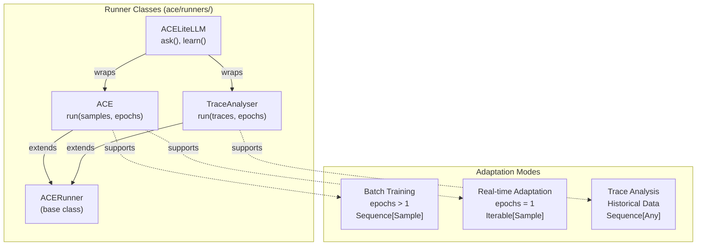
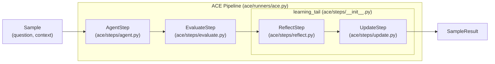
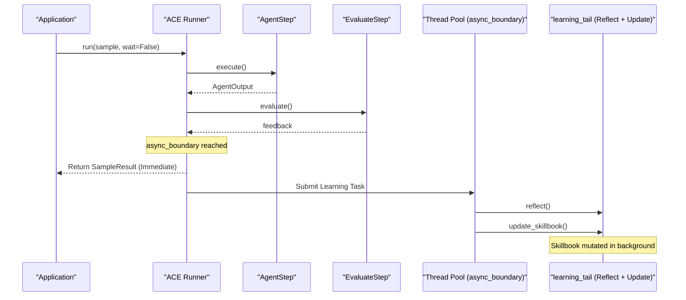
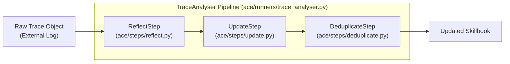

<!-- source: DeepWiki mcp.deepwiki.com · repo kayba-ai/agentic-context-engine · page 2.4 Adaptation Strategies · fetched 2026-10-26 -->

# Adaptation Strategies

Relevant source files

The following files were used as context for generating this wiki page:

- [CLAUDE.md](CLAUDE.md)
- [README.md](README.md)
- [ace/runners/ace.py](ace/runners/ace.py)
- [ace/runners/litellm.py](ace/runners/litellm.py)
- [ace/runners/trace_analyser.py](ace/runners/trace_analyser.py)
- [assets/kayba-banner.png](assets/kayba-banner.png)
- [docs/guides/full-pipeline.md](docs/guides/full-pipeline.md)
- [docs/index.md](docs/index.md)
- [docs/integrations/litellm.md](docs/integrations/litellm.md)
- [docs/integrations/opik.md](docs/integrations/opik.md)
- [docs/pipeline/index.md](docs/pipeline/index.md)
- [examples/ace/ace_demo.py](examples/ace/ace_demo.py)
- [examples/pipeline_composition/compose_custom_pipeline.py](examples/pipeline_composition/compose_custom_pipeline.py)

## Purpose and Scope

This document explains the primary adaptation strategies in the ACE Framework: **Batch Training**, **Real-time Adaptation**, and **Trace Analysis**. Each strategy orchestrates the Execute → Evaluate → Reflect → Update cycle differently based on the data source and operational context.

- **Batch Training**: Multi-epoch training over a fixed dataset using the `ACE` runner.
- **Real-time Adaptation**: Single-pass streaming learning using the `ACE` runner or `ACELiteLLM`.
- **Trace Analysis**: Learning from pre-recorded execution logs without re-execution using the `TraceAnalyser` runner.

These strategies are implemented as high-level orchestrators over the [Pipeline Engine](3.2. Pipeline Engine (pipeline/)).

---

## Overview

Adaptation strategies are implemented through specialized `ACERunner` subclasses in `ace/runners/`. These runners compose individual [Pipeline Steps](3.2.2. Step System) into cohesive learning workflows.

**Diagram: ACE Runner Architecture and Adaptation Modes**

Sources: [ace/runners/base.py:23-24](), [ace/runners/ace.py:27-38](), [ace/runners/trace_analyser.py:26-41](), [ace/runners/litellm.py:3-10]()

---

## Batch Training Mode

Batch training is used to build a robust `Skillbook` from a fixed set of `Sample` objects. By running multiple **epochs**, the agent revisits the same questions, allowing the `Reflector` and `SkillManager` to refine strategies over time.

### Pipeline Composition

The `ACE` runner composes a full loop including execution and evaluation.

**Diagram: Batch Training Pipeline Flow**

### Implementation Details
- **Multi-Epoch Logic**: The `ACERunner._run` method iterates over epochs. If `epochs > 1`, the input must be a `Sequence` to allow repeated passes [ace/runners/ace.py:154-166]().
- **Context Mapping**: `ACE._build_context` maps a `Sample` to an `ACEStepContext`, attaching the current `SkillbookView` [ace/runners/ace.py:179-195]().
- **Checkpointing**: The pipeline can include a `CheckpointStep` to save the `Skillbook` to disk at defined intervals (e.g., every 10 samples) [ace/runners/ace.py:88-89]().

Sources: [ace/runners/ace.py:78-94](), [ace/runners/base.py:155-187](), [docs/guides/full-pipeline.md:125-144]()

---

## Real-time Adaptation

Real-time adaptation allows an agent to learn from interactions as they happen. This is typically a single-pass (`epochs=1`) operation where the learning occurs in the background.

### Async Learning Architecture

To prevent the learning process (Reflection and Skill Management) from blocking the agent's response, ACE uses an **Async Boundary**.

**Diagram: Real-time Async Adaptation Flow**

### Key Features
- **Non-blocking Execution**: By setting `wait=False` in `run()`, the caller receives the agent's answer immediately after evaluation, while reflection continues in background threads [ace/runners/ace.py:149-158]().
- **Eventually Consistent Skillbook**: Subsequent agent calls will automatically pick up the new strategies once the background `UpdateStep` completes.
- **ACELiteLLM Integration**: The `learn_from_feedback` method provides a simplified interface for this mode, wrapping a single interaction into a learning pass [ace/runners/litellm.py:61-68]().

Sources: [ace/runners/ace.py:144-167](), [pipeline/index.md:112-129](), [docs/guides/full-pipeline.md:208-224]()

---

## Trace Analysis

Trace analysis is a "learning-only" strategy. It is used when you have pre-recorded execution logs (traces) from an external system (e.g., LangChain, Browser-use, or production logs) and want to extract strategies without re-running the agent.

### The TraceAnalyser Runner

The `TraceAnalyser` runner omits the `AgentStep` and `EvaluateStep`. It places the raw trace directly into the `ACEStepContext` for the `Reflector` to interpret.

**Diagram: Trace Analysis Pipeline**

### Implementation Details
- **Input Flexibility**: `TraceAnalyser.run` accepts a sequence of `Any` objects. The `_build_context` method preserves the raw trace structure [ace/runners/trace_analyser.py:155-187]().
- **Trace Identity**: It uses `infer_trace_identity` to extract metadata (like source system) from the raw logs to provide provenance for learned insights [ace/runners/trace_analyser.py:175-181]().
- **Offline Refinement**: This mode is ideal for "Expert Iteration" where a human reviews traces and then runs the analyser to codify the successful patterns into the `Skillbook`.

Sources: [ace/runners/trace_analyser.py:26-41](), [ace/runners/trace_analyser.py:78-89](), [ace/runners/trace_analyser.py:169-187]()

---

## Strategy Comparison

| Feature | Batch Training | Real-time Adaptation | Trace Analysis |
| :--- | :--- | :--- | :--- |
| **Runner Class** | `ACE` | `ACE` / `ACELiteLLM` | `TraceAnalyser` |
| **Primary Goal** | Optimization / Convergence | Continuous Improvement | Post-hoc Learning |
| **Agent Execution** | Yes (Re-runs every epoch) | Yes (Live interaction) | No |
| **Input Type** | `Sequence[Sample]` | `Iterable[Sample]` | `Sequence[Any]` (Traces) |
| **Epochs** | Typically > 1 | Typically 1 | 1 or more |
| **Backgrounding** | Usually Synchronous | Asynchronous | Usually Synchronous |

Sources: [ace/runners/ace.py:27-38](), [ace/runners/trace_analyser.py:26-41](), [docs/guides/full-pipeline.md:120-123]()

---

