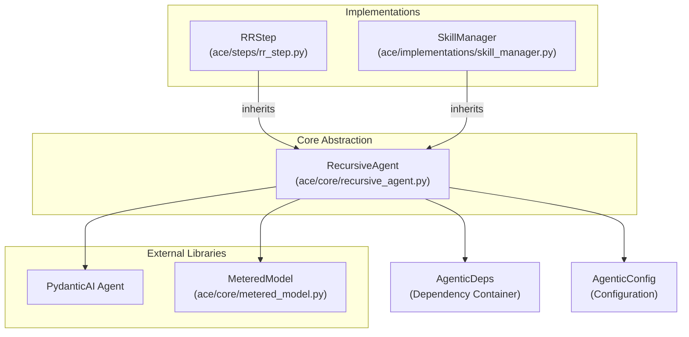
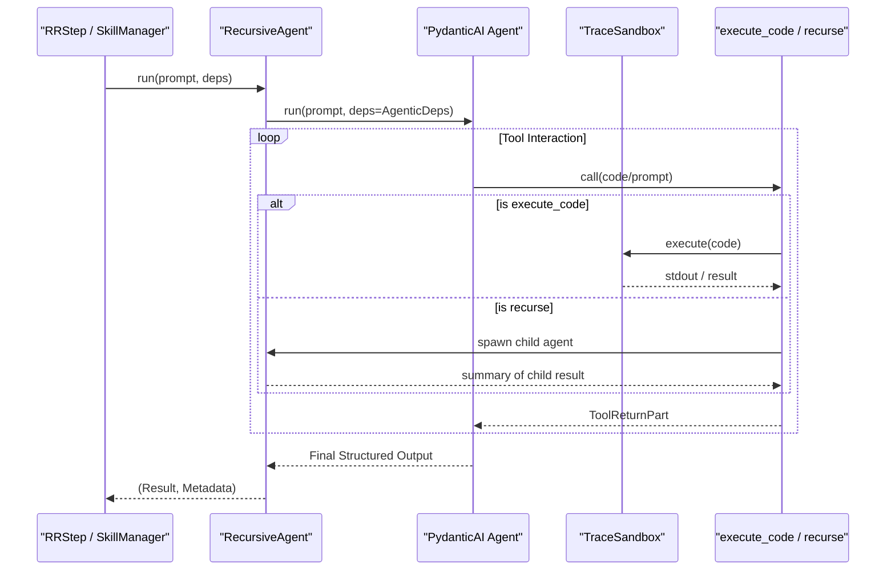

<!-- source: DeepWiki mcp.deepwiki.com · repo kayba-ai/agentic-context-engine · page 3.4 RecursiveAgent Abstraction · fetched 2026-10-26 -->

# RecursiveAgent Abstraction

Relevant source files

The following files were used as context for generating this wiki page:

- [ace/core/recursive_agent.py](ace/core/recursive_agent.py)
- [ace/implementations/prompts.py](ace/implementations/prompts.py)
- [ace/implementations/rr/__init__.py](ace/implementations/rr/__init__.py)
- [ace/implementations/rr/config.py](ace/implementations/rr/config.py)
- [ace/implementations/rr/prompts.py](ace/implementations/rr/prompts.py)
- [ace/implementations/rr/tools.py](ace/implementations/rr/tools.py)
- [ace/implementations/skill_manager.py](ace/implementations/skill_manager.py)
- [ace/providers/pydantic_ai.py](ace/providers/pydantic_ai.py)
- [ace/steps/rr_step.py](ace/steps/rr_step.py)

## Purpose and Scope

The `RecursiveAgent` is a foundational base class in the ACE framework that provides a unified interface for complex, multi-step agentic behaviors. It is specifically designed to handle tasks that require iterative reasoning, tool use, and hierarchical decomposition. Both the **Recursive Reflector (RR)** and the **SkillManager** roles inherit from this abstraction to leverage its built-in capabilities for budget management, two-tier compaction, and depth-based recursion.

By wrapping a `PydanticAI` agent, `RecursiveAgent` provides a robust execution environment where agents can "recurse" into sub-problems, maintain long-running state via a sandboxed Python environment, and automatically summarize their own history when context limits are approached.

**Sources:** [ace/core/recursive_agent.py:1-25](), [ace/implementations/skill_manager.py:58-93](), [ace/steps/rr_step.py:51-69]()

## Architecture and Class Hierarchy

The `RecursiveAgent` acts as a bridge between high-level ACE roles and the underlying `PydanticAI` execution engine. It manages a `PydanticAgent` instance and injects a set of standardized tools and dependency containers.

### Class Relationship Diagram

**Sources:** [ace/core/recursive_agent.py:16-25](), [ace/steps/rr_step.py:51-69](), [ace/implementations/skill_manager.py:58-69]()

## Key Features

### 1. Two-Tier Compaction
To handle long-running analysis traces that exceed LLM context windows, `RecursiveAgent` implements a dual-layer compaction strategy:
*   **Micro-compaction:** Truncates tool outputs (like large trace slices) and replaces them with placeholders (e.g., `[cleared — data still in sandbox variables]`) while keeping the reasoning chain intact.
*   **Full Summarization:** When context usage is still too high, the agent uses a `compaction_summary_prompt` to generate a concise summary of the conversation so far, which then becomes the new starting point for the next turn.

**Sources:** [ace/core/recursive_agent.py:4-5](), [ace/steps/rr_step.py:109-118]()

### 2. Depth-Based Recursion
The `recurse` tool allows an agent to spawn a child `RecursiveAgent` to investigate a specific sub-problem. 
*   **Isolation:** Children have their own context window, preventing the parent's window from bloating.
*   **Inheritance:** Children inherit a copy of the parent's sandbox namespace (variables) and registered helpers.
*   **Budget Gating:** Recursion is limited by `max_depth` to prevent infinite loops and runaway costs.

**Sources:** [ace/core/recursive_agent.py:143-174](), [ace/core/recursive_agent.py:184-203]()

### 3. Budget and Usage Management
`RecursiveAgent` uses `MeteredModel` and `UsageLimits` to strictly control execution:
*   **Request Limits:** `max_requests` prevents infinite tool-calling loops.
*   **Token Limits:** Global token budgets are enforced across parent and child sessions.
*   **Timeouts:** Per-call and per-sandbox execution timeouts are managed via `AgenticConfig`.

**Sources:** [ace/core/recursive_agent.py:6-6](), [ace/core/recursive_agent.py:68-70](), [ace/implementations/rr/config.py:9-20]()

## Implementation Detail: Data Flow

The data flow within a `RecursiveAgent` execution cycle involves the interaction between the `AgenticDeps` container, the `TraceSandbox`, and the `PydanticAI` run context.

### Execution Flow Diagram

**Sources:** [ace/core/recursive_agent.py:82-140](), [ace/core/recursive_agent.py:150-174](), [ace/steps/rr_step.py:167-180]()

## Core Tools and Dependencies

The `RecursiveAgent` provides standard tools that are automatically registered to the underlying `PydanticAI` agent.

### Standard Tools

| Tool | Function | Description |
| :--- | :--- | :--- |
| `execute_code` | `register_execute_code` | Executes Python in a persistent `TraceSandbox`. Supports `register_helper` for cross-session logic. |
| `recurse` | `register_recurse` | Spawns a child session. Inherits sandbox values but has an isolated context window. |

**Sources:** [ace/core/recursive_agent.py:82-106](), [ace/core/recursive_agent.py:143-174]()

### Dependency Container (`AgenticDeps`)
The `AgenticDeps` class is the primary carrier for runtime state:
*   `sandbox`: The `TraceSandbox` instance for code execution.
*   `config`: `AgenticConfig` instance containing limits and timeouts.
*   `iteration`: Counter for tool calls (used for output validation).
*   `run_session_fn`: A callback allowing the agent to spawn recursive instances of itself.

**Sources:** [ace/core/recursive_agent.py:85-87](), [ace/implementations/rr/tools.py:29-45]()

## Usage in SkillManager and RR

The `RecursiveAgent` is specialized by its subclasses through different tools and prompt strategies.

### SkillManager Specialization
The `SkillManager` uses `RecursiveAgent` to mutate the `Skillbook` directly. It replaces the generic analysis tools with atomic mutation tools:
*   `add_skill`, `update_skill`, `remove_skill`, `tag_skill`.
*   It operates with `max_requests=1` by default to simulate a one-shot update or higher for iterative refinement.

**Sources:** [ace/implementations/skill_manager.py:1-14](), [ace/implementations/skill_manager.py:121-134]()

### Recursive Reflector (RR) Specialization
The `RRStep` specializes the `execute_code` tool description to emphasize its role as an "evidence workbench." It also adds:
*   `register_think`: A prose channel to keep narration out of the Python stdout.
*   `register_output_validator`: Ensures the agent actually calls `execute_code` before submitting a final conclusion.

**Sources:** [ace/steps/rr_step.py:128-162](), [ace/implementations/rr/tools.py:52-63](), [ace/implementations/rr/tools.py:97-107]()

## Configuration (`AgenticConfig`)

| Field | Default | Description |
| :--- | :--- | :--- |
| `max_requests` | `10` | Maximum number of LLM turns allowed in a single session. |
| `max_depth` | `2` | Maximum depth of recursion for the `recurse` tool. |
| `timeout` | `30.0` | Timeout in seconds for a single `execute_code` call. |
| `max_output_chars` | `10,000` | Truncation limit for tool output returned to the LLM. |

**Sources:** [ace/core/recursive_agent.py:20](), [ace/implementations/rr/config.py:9-20]()

---

