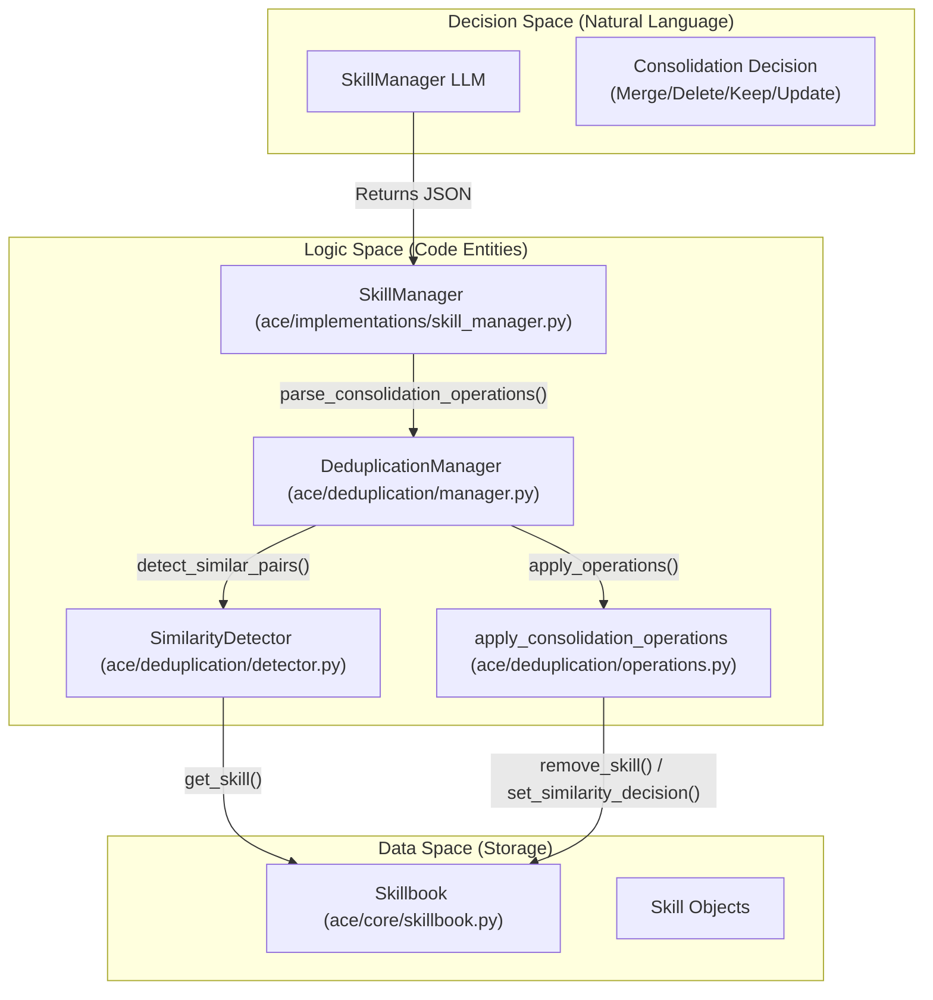
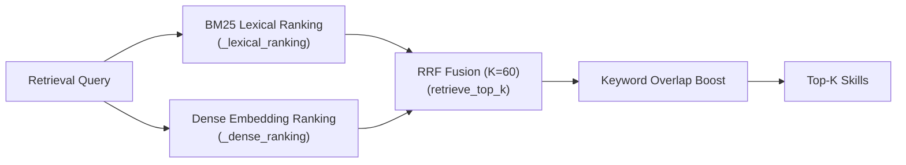
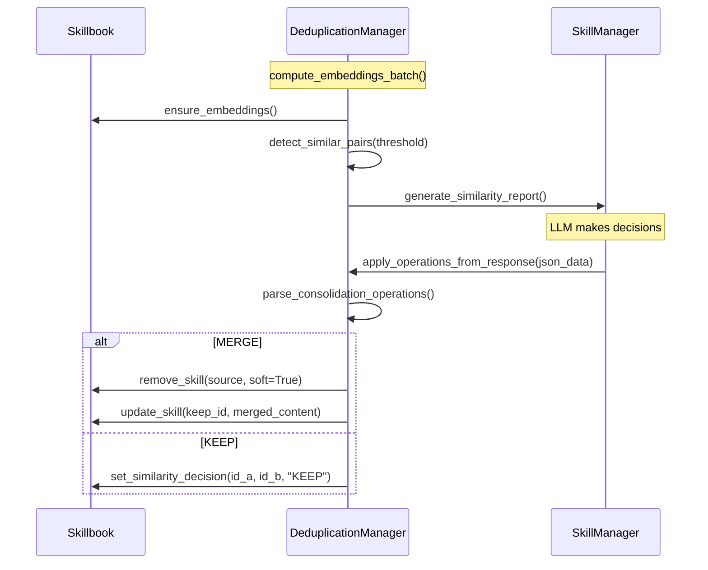

<!-- source: DeepWiki mcp.deepwiki.com · repo kayba-ai/agentic-context-engine · page 3.6 Deduplication System · fetched 2026-10-26 -->

# Deduplication System

<details>
<summary>Relevant source files</summary>

The following files were used as context for generating this wiki page:

- [ace/deduplication/__init__.py](ace/deduplication/__init__.py)
- [ace/deduplication/detector.py](ace/deduplication/detector.py)
- [ace/deduplication/manager.py](ace/deduplication/manager.py)
- [ace/deduplication/operations.py](ace/deduplication/operations.py)
- [ace/deduplication/prompts.py](ace/deduplication/prompts.py)
- [ace/implementations/agent.py](ace/implementations/agent.py)
- [ace/implementations/skill_rendering.py](ace/implementations/skill_rendering.py)
- [ace/integrations/mcp/handlers.py](ace/integrations/mcp/handlers.py)
- [ace/providers/registry.py](ace/providers/registry.py)
- [tests/test_ace_mcp_handlers.py](tests/test_ace_mcp_handlers.py)
- [tests/test_ace_runners.py](tests/test_ace_runners.py)
- [tests/test_openclaw.py](tests/test_openclaw.py)
- [tests/test_pydantic_ai_integration.py](tests/test_pydantic_ai_integration.py)

</details>


## Purpose and Scope

The Deduplication System prevents redundant skills from accumulating in the Skillbook by detecting and consolidating semantically similar strategies. This system uses embedding-based similarity detection and BM25 lexical ranking to identify duplicate or overlapping skills, providing structured consolidation operations that the `SkillManager` applies to maintain a clean, efficient knowledge base.

This page covers the deduplication architecture, similarity detection mechanisms, hybrid retrieval, and consolidation strategies.

**Sources:** [ace/deduplication/manager.py:27-37](), [ace/deduplication/detector.py:28-35](), [ace/implementations/skill_rendering.py:129-138]()

---

## System Overview

The deduplication system coordinates similarity detection and feeds information to the `SkillManager`. It analyzes skills against existing ones to detect semantic overlap that could lead to redundancy.

### Key Capabilities

| Capability | Description |
|------------|-------------|
| **Similarity Detection** | Uses cosine similarity on embeddings to compute semantic similarity between skill pairs [ace/deduplication/detector.py:142-162]() |
| **Hybrid Retrieval** | Combines BM25 lexical ranking with dense embedding fusion (RRF) for relevant skill discovery [ace/implementations/skill_rendering.py:163-182]() |
| **Consolidation Operations** | Supports `MERGE`, `DELETE`, `KEEP`, and `UPDATE` operations [ace/deduplication/operations.py:17-24]() |
| **Provider Flexibility** | Supports LiteLLM and Sentence-Transformers for embedding generation [ace/deduplication/detector.py:40-52]() |

**Sources:** [ace/deduplication/manager.py:27-37](), [ace/deduplication/detector.py:28-52](), [ace/implementations/skill_rendering.py:129-182]()

---

## Architecture and Components

### Component Diagram: Natural Language to Code Entity Space



**Sources:** [ace/deduplication/manager.py:81-144](), [ace/deduplication/detector.py:190-205](), [ace/deduplication/operations.py:78-94]()

### Core Components

#### DeduplicationManager
Coordinates similarity detection and parsing. It generates the `similarity_report` used in `SkillManager` prompts and applies the resulting operations back to the `Skillbook`.
[ace/deduplication/manager.py:27-37]()

#### SimilarityDetector
The engine for computing embeddings and similarities. It supports lazy-loading of local `sentence-transformers` models or remote calls via `litellm`.
[ace/deduplication/detector.py:28-35]()

#### Consolidation Operations
Concrete data structures representing the LLM's decisions:
- **MergeOp**: Combines skills and soft-deletes the redundant ones. [ace/deduplication/operations.py:27-38]()
- **DeleteOp**: Soft-deletes a skill as redundant. [ace/deduplication/operations.py:41-48]()
- **KeepOp**: Stores a `SimilarityDecision` in the skillbook to prevent future reporting of this pair. [ace/deduplication/operations.py:51-58]()
- **UpdateOp**: Modifies content to clarify distinctions. [ace/deduplication/operations.py:61-68]()

**Sources:** [ace/deduplication/manager.py:27-37](), [ace/deduplication/detector.py:28-35](), [ace/deduplication/operations.py:27-68]()

---

## Similarity Detection and Retrieval

### Hybrid Retrieval (RRF Fusion)
ACE uses Reciprocal Rank Fusion (RRF) to combine lexical (BM25) and dense (Embedding) search results when retrieving skills for the agent.



**Sources:** [ace/implementations/skill_rendering.py:129-182](), [ace/implementations/skill_rendering.py:17-21]()

### Embedding Providers
The `SimilarityDetector` supports multiple backends for generating the vectors required for cosine similarity:
- **LiteLLM**: Remote API calls (e.g., OpenAI, Bedrock). [ace/deduplication/detector.py:58-74]()
- **Sentence-Transformers**: Local execution using models like `all-MiniLM-L6-v2`. [ace/deduplication/detector.py:96-120]()

**Sources:** [ace/deduplication/detector.py:40-52](), [ace/deduplication/detector.py:128-136]()

---

## Consolidation Flow

The consolidation process happens during the `SkillManager` update cycle.

### Decision and Application Flow



**Sources:** [ace/deduplication/manager.py:47-75](), [ace/deduplication/manager.py:157-165](), [ace/deduplication/operations.py:96-149]()

### Consolidation Operations Format
The `SkillManager` is prompted to return operations in a specific JSON format. For example, a `MERGE` operation:
```json
{
  "type": "MERGE",
  "source_ids": ["skill-id-1", "skill-id-2"],
  "keep_id": "skill-id-1",
  "merged_content": "Improved combined strategy text",
  "reasoning": "Why merging improves the skillbook"
}
```

**Sources:** [ace/deduplication/prompts.py:68-75](), [ace/deduplication/operations.py:27-38]()

---

## Configuration

The system is configured via `DeduplicationConfig`, which defines thresholds and models.

| Setting | Default | Description |
|---------|---------|-------------|
| `enabled` | `True` | Global toggle for deduplication features. |
| `similarity_threshold` | `0.85` | Minimum cosine similarity to report a pair as "similar". |
| `embedding_provider` | `"sentence-transformers"` | Backend for vector generation. |
| `min_pairs_to_report` | `1` | Minimum number of similar pairs found before generating a report. |

**Sources:** [ace/protocols/deduplication.py](), [ace/deduplication/detector.py:31-32](), [ace/deduplication/manager.py:56-62]()

### Integration with SkillManager
The `SkillManager` uses the `DeduplicationManager` during its update implementation:
1. It calls `get_similarity_report` to augment the prompt. [ace/deduplication/manager.py:47-55]()
2. It calls `apply_operations_from_response` to process the LLM's decisions. [ace/deduplication/manager.py:157-165]()

**Sources:** [ace/deduplication/manager.py:47-165]()

---

