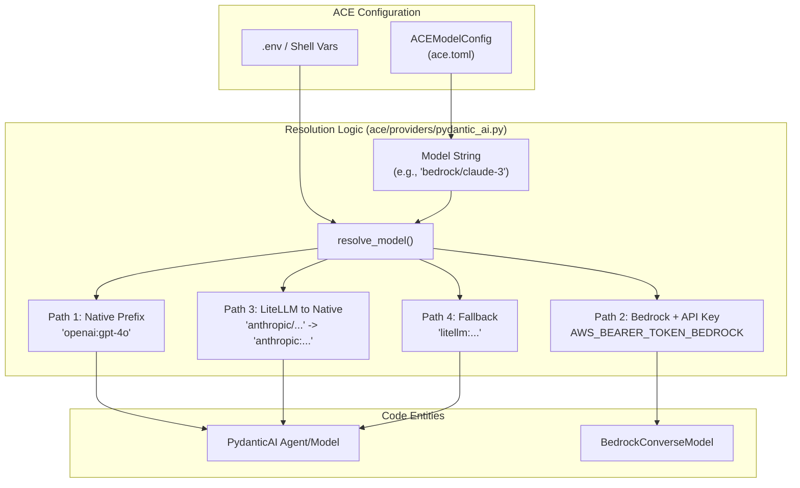
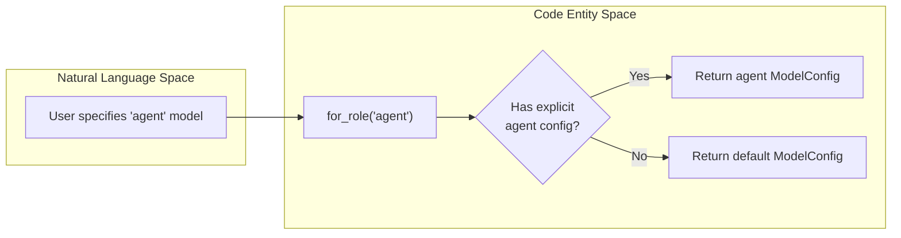

<!-- source: DeepWiki mcp.deepwiki.com · repo kayba-ai/agentic-context-engine · page 4.1 PydanticAI Model Layer · fetched 2026-10-26 -->

# PydanticAI Model Layer

Relevant source files

The following files were used as context for generating this wiki page:

- [ace/providers/config.py](ace/providers/config.py)
- [ace/providers/pydantic_ai.py](ace/providers/pydantic_ai.py)

## Purpose and Scope

The PydanticAI Model Layer serves as the core LLM integration engine for the ACE Framework. It abstracts the complexities of supporting over 100 LLM providers by leveraging PydanticAI's robust model resolution system. This layer is responsible for converting ACE/LiteLLM model identifiers into PydanticAI-compatible strings or provider objects, managing per-role model configurations, and ensuring seamless API interaction across diverse backends including OpenAI, Anthropic, Bedrock, and Google Gemini.

---

## Implementation and Architecture

The model layer centers around `resolve_model`, which handles the mapping between ACE's preferred LiteLLM-style naming conventions and PydanticAI's native provider requirements.

### Model Resolution Data Flow

**Sources:** [ace/providers/pydantic_ai.py:6-18](), [ace/providers/pydantic_ai.py:107-179]()

### Key Functions and Classes

| Entity | Location | Responsibility |
| :--- | :--- | :--- |
| `resolve_model` | [ace/providers/pydantic_ai.py:107-179]() | Primary entry point for converting LiteLLM strings to PydanticAI model identifiers or objects. |
| `ModelConfig` | [ace/providers/config.py:33-56]() | Dataclass holding secrets-free configuration (model, temperature, max_tokens) for a single role. |
| `ACEModelConfig` | [ace/providers/config.py:64-103]() | Orchestrates `ModelConfig` instances for `agent`, `reflector`, and `skill_manager` roles. |
| `_create_bedrock_model` | [ace/providers/pydantic_ai.py:181-195]() | Factory function for creating `BedrockConverseModel` instances when bearer token auth is detected. |

---

## Model Configuration and Parameter Resolution

ACE uses a hierarchical configuration system stored in `ace.toml`. This allows users to define different models and parameters for each role in the learning loop.

### Role-Based Resolution

The `ACEModelConfig.for_role()` method ensures that if a specific model is not defined for a role (e.g., `reflector`), it gracefully falls back to the `default` configuration [ace/providers/config.py:72-78]().

**Sources:** [ace/providers/config.py:72-78](), [ace/providers/config.py:110-127]()

### Resolution Paths

1.  **PydanticAI-native prefix**: If the string already contains a colon and a known provider (e.g., `openai:gpt-4o`), it is passed through unchanged [ace/providers/pydantic_ai.py:151-154]().
2.  **Bedrock with API key**: If `AWS_BEARER_TOKEN_BEDROCK` is set, ACE bypasses standard `boto3` SigV4 auth and constructs a `BedrockConverseModel` using the bearer token [ace/providers/pydantic_ai.py:157-162]().
3.  **LiteLLM to Native Rewrite**: Common LiteLLM prefixes (e.g., `anthropic/`, `vertex_ai/`) are rewritten to PydanticAI native prefixes (e.g., `anthropic:`, `google-vertex:`) to utilize native SDKs instead of the LiteLLM HTTP proxy [ace/providers/pydantic_ai.py:165-175]().
4.  **Generic Fallback**: Any unrecognized string is prefixed with `litellm:` to route through the PydanticAI LiteLLM provider [ace/providers/pydantic_ai.py:178]().

---

## Provider Compatibility and SDK Requirements

While ACE installs `pydantic-ai-slim[litellm]` by default, native provider support requires additional extras to avoid the overhead of the LiteLLM proxy.

| Provider | Prefix Rewrite | Extra Requirement | Env Var |
| :--- | :--- | :--- | :--- |
| **Anthropic** | `anthropic/` -> `anthropic:` | `pydantic-ai-slim[anthropic]` | `ANTHROPIC_API_KEY` |
| **OpenAI** | `openai/` -> `openai:` | `pydantic-ai-slim[openai]` | `OPENAI_API_KEY` |
| **Google Vertex** | `vertex_ai/` -> `google-vertex:` | `pydantic-ai-slim[google]` | `GEMINI_API_KEY` |
| **Azure** | `azure_ai/` -> `azure:` | `pydantic-ai-slim[azure]` | Azure Credentials |

**Sources:** [ace/providers/pydantic_ai.py:20-43](), [ace/providers/pydantic_ai.py:91-104]()

---

## Configuration Persistence

Model settings are persisted in `ace.toml`, while secrets are strictly maintained in `.env` files or system environment variables.

*   **`ace.toml`**: Contains `ModelConfig` data including `model`, `temperature`, and `extra_params` [ace/providers/config.py:23]().
*   **`load_config`**: Scans the current directory for the configuration file [ace/providers/config.py:151-164]().
*   **`find_config`**: Recursively walks up the directory tree to find an `ace.toml` file, supporting monorepo or nested project structures [ace/providers/config.py:167-174]().

**Sources:** [ace/providers/config.py:1-11](), [ace/providers/config.py:143-174]()

---

