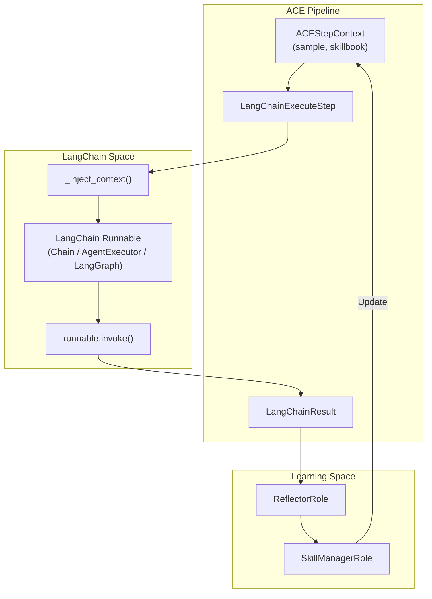
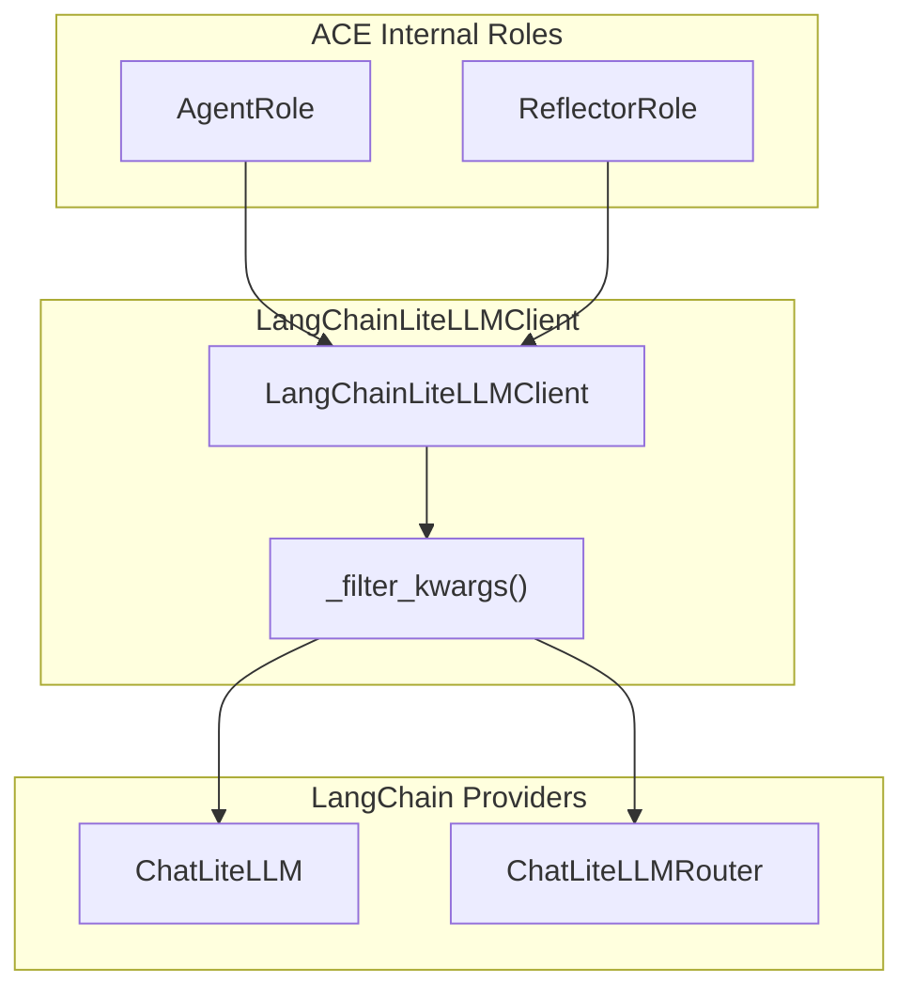

<!-- source: DeepWiki mcp.deepwiki.com · repo kayba-ai/agentic-context-engine · page 4.3 LangChain Client Integration · fetched 2026-10-26 -->

# LangChain Client Integration

<details>
<summary>Relevant source files</summary>

The following files were used as context for generating this wiki page:

- [ace/integrations/browser_use.py](ace/integrations/browser_use.py)
- [ace/integrations/langchain.py](ace/integrations/langchain.py)
- [docs/getting-started/installation.md](docs/getting-started/installation.md)
- [docs/integrations/browser-use.md](docs/integrations/browser-use.md)
- [docs/integrations/claude-code.md](docs/integrations/claude-code.md)
- [docs/integrations/langchain.md](docs/integrations/langchain.md)

</details>


This page documents the `LangChainLiteLLMClient` class and the broader LangChain integration features within the ACE Framework. These components allow ACE to leverage the LangChain ecosystem—including chains, `AgentExecutor`, and LangGraph—while maintaining the framework's core self-learning capabilities.

## Purpose and Scope

The LangChain integration provides two primary capabilities:
1. **`LangChainLiteLLMClient`**: A specialized LLM client that enables ACE roles (Agent, Reflector, SkillManager) to run on top of LangChain's `ChatLiteLLM` and `ChatLiteLLMRouter`.
2. **`LangChainExecuteStep`**: A pipeline integration step that allows ACE to execute existing LangChain `Runnable` objects (chains or agents), inject skillbook strategies into them, and extract execution traces for learning.

This integration is optional and requires the `langchain-core` and `langchain-litellm` packages.

**Sources:** [ace/integrations/langchain.py:1-37](), [docs/integrations/langchain.md:1-11]()

---

## Architecture Overview

The integration bridges ACE's learning loop with LangChain's execution model. It follows the standard ACE integration pattern: **INJECT → EXECUTE → EXTRACT → LEARN**.

### LangChain Integration Data Flow



**Key Components:**
- **`LangChainExecuteStep`**: Orchestrates the execution. It detects the type of Runnable (Simple, Agent, or LangGraph) and handles context injection accordingly [ace/integrations/langchain.py:73-143]().
- **`LangChainResult`**: A data carrier for LangChain-specific execution data, including intermediate steps and message history [ace/integrations/langchain.py:44-66]().

**Sources:** [ace/integrations/langchain.py:39-143](), [docs/integrations/langchain.md:58-65]()

---

## The Execution Step (`LangChainExecuteStep`)

The `LangChainExecuteStep` is responsible for running the LangChain component within an ACE pipeline. It automatically handles different LangChain variants.

### Supported Runnable Variants

| Variant | Detection Logic | Data Extracted |
| :--- | :--- | :--- |
| **Simple Chain** | Default fallback | Final output string |
| **AgentExecutor** | `_is_agent_executor()` | `intermediate_steps` (thoughts/actions) |
| **LangGraph** | `_is_langgraph()` | Full `messages` history |

### Context Injection Logic

ACE injects skillbook strategies into LangChain by modifying the input object before `invoke()` is called. The injection method adapts to the input type:

- **String**: Appends strategies to the end of the string [ace/integrations/langchain.py:157-158]().
- **Message List**: Prepends strategies to the content of the first message [ace/integrations/langchain.py:160-169]().
- **Dict (`input` key)**: Appends to the value of the `input` key [ace/integrations/langchain.py:172-175]().
- **Dict (General)**: Adds a new `skillbook_context` key to the dictionary [ace/integrations/langchain.py:177-180]().

**Sources:** [ace/integrations/langchain.py:149-182](), [docs/integrations/langchain.md:67-80]()

---

## LangChain Client Implementation

The `LangChainLiteLLMClient` allows ACE core roles to use LangChain's routing and load-balancing features.

### Client Architecture



**Key Design Decisions:**
1. **Parameter Filtering**: ACE-specific parameters (like `refinement_round`) are stripped before calling LangChain to prevent validation errors [ace/llm_providers/langchain_client.py:99-102]().
2. **Metadata Mapping**: LangChain's `usage_metadata` and `response_metadata` are mapped back to ACE's `LLMResponse` format, preserving token counts and finish reasons [ace/llm_providers/langchain_client.py:118-142]().

**Sources:** [ace/llm_providers/langchain_client.py:25-146]()

---

## Usage and Configuration

### The LangChain Runner

The `LangChain` runner class (defined in the pipeline engine) provides the highest-level interface for using LangChain with ACE.

```python
from ace import LangChain
from langchain.chains import LLMChain

# 1. Initialize the runner with your existing LangChain runnable
runner = LangChain.from_model(your_chain, ace_model="gpt-4o-mini")

# 2. Run with learning enabled
results = runner.run([
    {"input": "Summarize this document"},
    {"input": "Extract key entities"},
])

# 3. Save the learned strategies
runner.save("chain_expert.json")
```

### Installation
To use these features, install the LangChain extra:
```bash
uv add 'ace-framework[langchain]'
```

**Sources:** [docs/getting-started/installation.md:16](), [docs/integrations/langchain.md:12-24]()

---

## Technical Reference

### LangChainResult Schema
The `LangChainResult` object captures the following fields during execution:
- `task`: The original input string or dict [ace/integrations/langchain.py:58]().
- `output`: The parsed final response [ace/integrations/langchain.py:59]().
- `result_type`: One of `"simple"`, `"agent"`, `"langgraph"`, or `"error"` [ace/integrations/langchain.py:60]().
- `intermediate_steps`: List of `(AgentAction, Observation)` tuples (for `AgentExecutor`) [ace/integrations/langchain.py:63]().
- `messages`: List of message objects (for LangGraph) [ace/integrations/langchain.py:64]().

### Method Reference: `LangChainExecuteStep.__call__`
1. **Extract Task**: Converts the `ctx.sample` into a searchable string [ace/integrations/langchain.py:102]().
2. **Inject**: Calls `_inject_context` to merge skillbook strategies into the input [ace/integrations/langchain.py:105]().
3. **Execute**: Calls `self.runnable.invoke()`. If it's an `AgentExecutor`, it temporarily forces `return_intermediate_steps=True` to capture the trace [ace/integrations/langchain.py:112-119]().
4. **Build Result**: Converts the raw LangChain output into a `LangChainResult` and attaches it to the context [ace/integrations/langchain.py:136-143]().

**Sources:** [ace/integrations/langchain.py:44-66](), [ace/integrations/langchain.py:101-143]()

---

