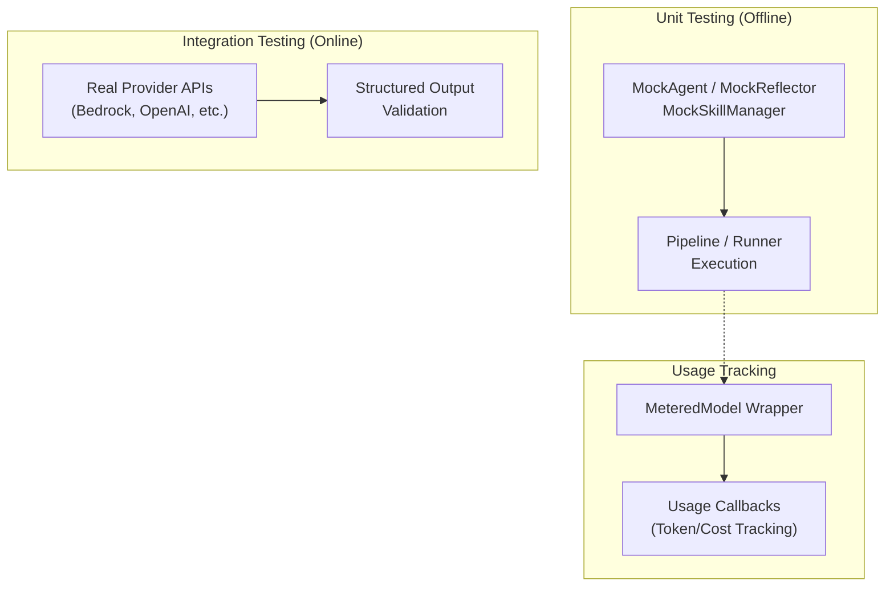
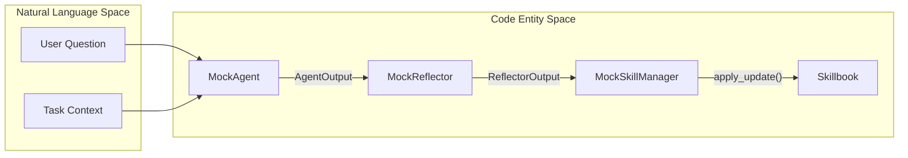
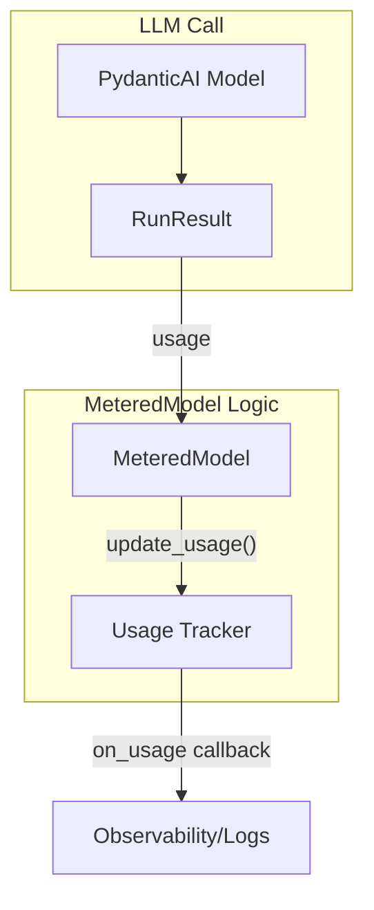

<!-- source: DeepWiki mcp.deepwiki.com · repo kayba-ai/agentic-context-engine · page 4.4 Testing and Mock Clients · fetched 2026-10-26 -->

# Testing and Mock Clients

Relevant source files

The following files were used as context for generating this wiki page:

- [.github/workflows/test.yml](.github/workflows/test.yml)
- [ace/deduplication/prompts.py](ace/deduplication/prompts.py)
- [ace/integrations/mcp/handlers.py](ace/integrations/mcp/handlers.py)
- [tests/conftest.py](tests/conftest.py)
- [tests/test_ace_mcp_handlers.py](tests/test_ace_mcp_handlers.py)
- [tests/test_ace_runners.py](tests/test_ace_runners.py)
- [tests/test_openclaw.py](tests/test_openclaw.py)
- [tests/test_pydantic_ai_integration.py](tests/test_pydantic_ai_integration.py)

## Purpose and Scope

This page documents the testing patterns, mock implementations, and usage tracking strategies used in the ACE Framework. It covers how to test ACE components without making real API calls using mock roles, the `MeteredModel` for tracking token usage and costs, and the integration testing suite that validates real provider interactions.

For information about the actual LLM client implementations, see [PydanticAI Model Layer](4.1). For broader testing infrastructure and test execution, see [Testing](11.3).

## Testing Architecture Overview

The ACE Framework employs a multi-layered testing strategy that transitions from unit tests with zero external dependencies to full integration tests requiring API credentials.

**Sources:** [tests/test_ace_runners.py:26-91](), [tests/test_pydantic_ai_integration.py:36-110]()

## Mock Role Implementations

To test runners and pipelines without LLM dependency, ACE uses minimal mock classes that satisfy the role protocols (`AgentLike`, `ReflectorLike`, `SkillManagerLike`). These mocks simulate structured outputs and state mutations.

### Mock Role Interaction Flow

**Implementation Details:**

*   **MockAgent**: Implements `generate()` to return a static `AgentOutput` with reasoning and a final answer [tests/test_ace_runners.py:26-38]().
*   **MockReflector**: Implements `reflect()` to return a static `ReflectorOutput` containing a key insight and correct approach [tests/test_ace_runners.py:41-58]().
*   **MockSkillManager**: Implements `update_skills()`. Critically, it simulates the real SkillManager by calling `skillbook.add_skill()` directly to mutate the state before returning a `SkillManagerOutput` [tests/test_ace_runners.py:61-91]().

**Sources:** [tests/test_ace_runners.py:26-91]()

## MeteredModel and Usage Tracking

The `MeteredModel` (shared via `RecursiveAgent`) provides a way to track LLM usage across complex recursive operations. It integrates with PydanticAI to capture token counts and calculate costs.

### Data Flow for Usage Tracking

**Key Features:**
*   **Cost Calculation**: Translates token counts into monetary costs based on provider-specific rates.
*   **Recursive Aggregation**: When used in `RecursiveAgent` or `RecursiveReflector`, it aggregates usage across all sub-agent calls [ace/core/recursive_agent.py:34-50]().
*   **Callbacks**: Supports `on_usage` hooks for real-time monitoring of agent spend.

**Sources:** [ace/core/recursive_agent.py:34-50](), [tests/test_pydantic_ai_integration.py:54-59]()

## Integration Testing Suite

Integration tests validate that the framework's roles correctly interact with real LLM providers and produce valid structured data according to Pydantic schemas.

### Test Structure

Integration tests are marked with `@pytest.mark.requires_api` and are typically skipped in standard CI unless specific environment variables (e.g., `OPENAI_API_KEY`) are present [tests/test_pydantic_ai_integration.py:16-21]().

| Role | Test Case | Validation Logic |
| :--- | :--- | :--- |
| **Agent** | `test_basic_question` | Asserts `AgentOutput` reasoning is non-empty and `final_answer` contains expected keywords [tests/test_pydantic_ai_integration.py:39-60](). |
| **Reflector** | `test_wrong_answer_reflection` | Verifies `error_identification` and `root_cause_analysis` are populated [tests/test_pydantic_ai_integration.py:140-163](). |
| **SkillManager** | `test_add_new_skill` | Ensures `UpdateBatch` contains valid operations and reasoning [tests/test_pydantic_ai_integration.py:168-196](). |

### Integration with External Frameworks

Tests also verify the conversion logic for external trace formats, such as OpenClaw session logs.

*   **OpenClawToTraceStep**: Validates the conversion of raw JSONL events into the ACE `trace` dictionary format [tests/test_openclaw.py:164-214]().
*   **End-to-End Pipelines**: Tests the composition of `LoadTracesStep` → `OpenClawToTraceStep` → `learning_tail` to ensure skills are successfully extracted from external logs [tests/test_openclaw.py:221-230]().

**Sources:** [tests/test_pydantic_ai_integration.py:1-196](), [tests/test_openclaw.py:164-230]()

## CI/CD and Test Execution

The framework uses `uv` and `pytest` for test orchestration. The CI pipeline executes tests across multiple OS environments.

### CI Configuration (`.github/workflows/test.yml`)

*   **Python Version**: 3.12 [ .github/workflows/test.yml:16]().
*   **Dependencies**: Installed with `uv sync --extra mcp --extra tracing` [ .github/workflows/test.yml:30]().
*   **Execution**: Runs all tests except those requiring API keys: `uv run pytest -m "not requires_api"` [ .github/workflows/test.yml:34]().
*   **Type Checking**: Runs `mypy` on the `ace/` directory [ .github/workflows/test.yml:44-47]().

**Sources:** [ .github/workflows/test.yml:1-47](), [tests/conftest.py:1-31]()

---

