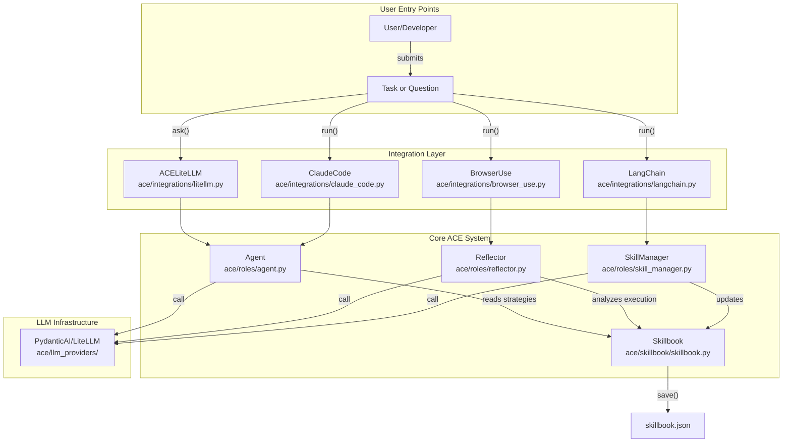
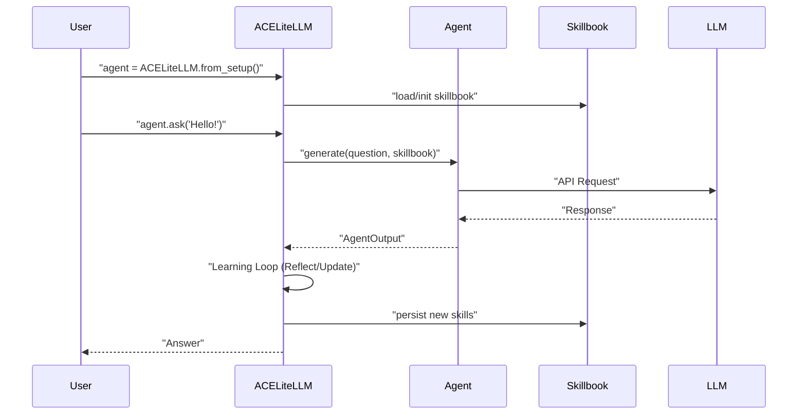
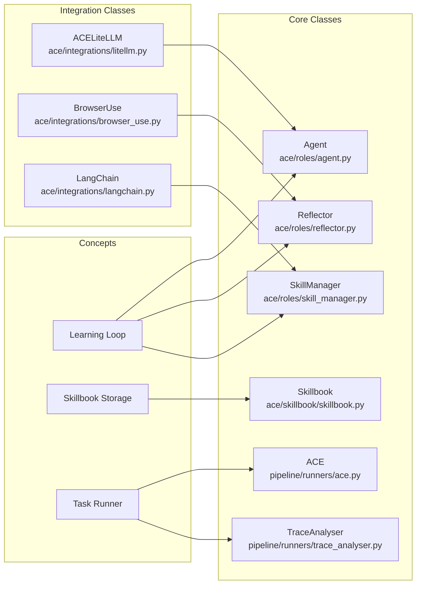

<!-- source: DeepWiki mcp.deepwiki.com · repo kayba-ai/agentic-context-engine · page 5 Getting Started · fetched 2026-10-26 -->

# Getting Started

<details>
<summary>Relevant source files</summary>

The following files were used as context for generating this wiki page:

- [.env.example](.env.example)
- [ace.toml](ace.toml)
- [docs/concepts/overview.md](docs/concepts/overview.md)
- [docs/concepts/roles.md](docs/concepts/roles.md)
- [docs/getting-started/installation.md](docs/getting-started/installation.md)
- [docs/getting-started/quick-start.md](docs/getting-started/quick-start.md)
- [docs/getting-started/setup.md](docs/getting-started/setup.md)
- [docs/integrations/browser-use.md](docs/integrations/browser-use.md)
- [docs/integrations/claude-code.md](docs/integrations/claude-code.md)
- [docs/integrations/langchain.md](docs/integrations/langchain.md)

</details>


This page provides an overview of how to install ACE Framework and run your first self-learning agent. It covers the basic entry points and patterns for getting started quickly.

**Scope:** This page introduces the installation process, core usage patterns, and basic configuration. For detailed installation options see [Installation](#5.1), for configuration details see [Configuration](#5.2), and for complete working examples see [Quick Start Example](#5.3).

---

## Overview

ACE Framework enables AI agents to learn from their own execution feedback by evolving a **skillbook** of strategies [docs/concepts/overview.md:1-5](). It provides multiple entry points depending on your use case, wrapping existing agents with learning capabilities while maintaining their native interfaces.

### Entry Points by Use Case

| Use Case | Integration Class | When to Use |
|----------|------------------|-------------|
| Simple conversational agent | `ACELiteLLM` | Quick prototyping, question-answering [docs/getting-started/quick-start.md:32-42]() |
| Browser automation | `BrowserUse` | Web scraping, form filling, automation tasks [docs/integrations/browser-use.md:1-24]() |
| LangChain workflows | `LangChain` | Existing LangChain chains, agents, or graphs [docs/integrations/langchain.md:1-24]() |
| Autonomous coding | `ClaudeCode` | Code generation, refactoring, testing [docs/integrations/claude-code.md:1-14]() |
| Custom agent integration | `ACE` | Building a new adaptive agent from scratch [docs/concepts/overview.md:58-68]() |

**Sources:** [docs/getting-started/quick-start.md:30-83](), [docs/concepts/overview.md:41-95]()

---

## System Architecture from User Perspective

The following diagram shows how user tasks flow through different entry points to the core ACE learning system:



**Sources:** [docs/concepts/overview.md:8-39](), [docs/concepts/roles.md:5-11](), [docs/getting-started/quick-start.md:30-83]()

---

## Installation Overview

### Basic Installation

The recommended way to install ACE is using `uv` for high-performance dependency management [docs/getting-started/installation.md:5-9]():

```bash
uv add ace-framework
```

### Optional Dependencies

Install additional integrations using extras [docs/getting-started/installation.md:11-23]():

```bash
# Browser automation support
uv add 'ace-framework[browser-use]'

# LangChain integration
uv add 'ace-framework[langchain]'

# Production monitoring and cost tracking
uv add 'ace-framework[observability]'

# All optional features
uv add 'ace-framework[all]'
```

**For complete installation instructions including development setup, see [Installation](#5.1).**

**Sources:** [docs/getting-started/installation.md:1-42]()

---

## First Agent Patterns

### Pattern 1: Simple Conversational Agent

The fastest way to get started is with `ACELiteLLM`, which uses `ace.toml` and `.env` configuration [docs/getting-started/quick-start.md:9-22]():



**Code example:**

```python
from ace import ACELiteLLM

# Create agent using interactive setup config
agent = ACELiteLLM.from_setup()

# Ask questions - learns automatically across them
answer = agent.ask("If all cats are animals, is Felix (a cat) an animal?")
print(f"Learned {len(agent.skillbook.skills())} strategies")

# Save learned knowledge
agent.save("my_agent.json")
```

**Sources:** [docs/getting-started/quick-start.md:9-28](), [docs/getting-started/installation.md:74-88]()

### Pattern 2: Integration Pattern (Existing Agents)

Use this when wrapping an existing agent like `BrowserUse` or `LangChain`. ACE learns from the execution traces without replacing the external framework [docs/concepts/overview.md:70-83]().

```python
from ace import BrowserUse
from langchain_openai import ChatOpenAI

runner = BrowserUse.from_model(
    browser_llm=ChatOpenAI(model="gpt-4o"),
    ace_model="gpt-4o-mini",
)

# INJECT skillbook -> EXECUTE task -> LEARN from trace
results = runner.run("Find the top post on Hacker News")
runner.save("browser_expert.json")
```

**Sources:** [docs/integrations/browser-use.md:11-24](), [docs/concepts/overview.md:85-95]()

---

## Configuration Requirements

### Interactive Setup

The `ace setup` command is the recommended way to configure API keys and model selections [docs/getting-started/setup.md:5-11](). It validates connections and saves configuration to:
- `.env`: API keys (gitignored) [docs/getting-started/setup.md:52-54]()
- `ace.toml`: Model assignments for Agent, Reflector, and SkillManager [docs/getting-started/setup.md:52-55]()

### Manual API Keys

Set environment variables directly if preferred [docs/getting-started/setup.md:68-85]():

```bash
export OPENAI_API_KEY="sk-..."
export ANTHROPIC_API_KEY="sk-ant-..."
```

**For complete configuration options including model discovery and role-specific settings, see [Configuration](#5.2).**

**Sources:** [docs/getting-started/setup.md:1-104](), [.env.example:1-48]()

---

## Code Entity Mapping

The following diagram maps high-level concepts to specific code entities:



**Sources:** [docs/concepts/roles.md:31-35](), [docs/concepts/overview.md:31-35](), [docs/getting-started/quick-start.md:30-83]()

---

## Next Steps

1. **Installation**: Follow the detailed guide to install the framework and its extras [Installation](#5.1).
2. **Configuration**: Use `ace setup` to configure your LLM providers [Configuration](#5.2).
3. **Quick Start**: Build your first self-learning agent using the hands-on examples [Quick Start Example](#5.3).
4. **Concepts**: Understand the underlying [Three-Role Architecture](#2.3) and the [The ACE Learning Loop](#2.1).

**Sources:** [docs/getting-started/installation.md:105-110](), [docs/getting-started/setup.md:222-226]()

---

