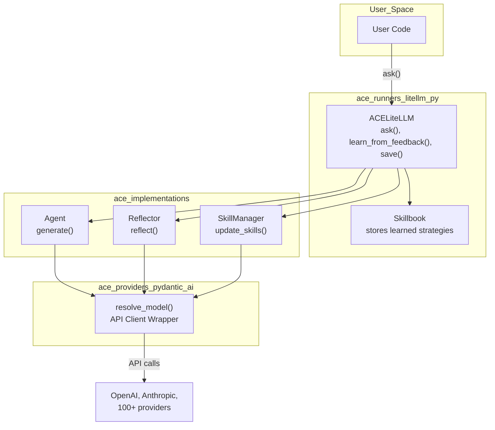
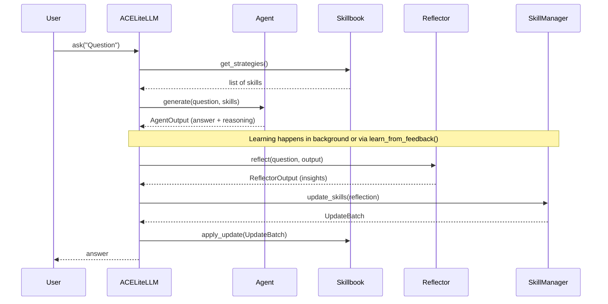

<!-- source: DeepWiki mcp.deepwiki.com · repo kayba-ai/agentic-context-engine · page 5.3 Quick Start Example · fetched 2026-10-26 -->

# Quick Start Example

<details>
<summary>Relevant source files</summary>

The following files were used as context for generating this wiki page:

- [CLAUDE.md](CLAUDE.md)
- [README.md](README.md)
- [ace.toml](ace.toml)
- [ace/runners/litellm.py](ace/runners/litellm.py)
- [assets/kayba-banner.png](assets/kayba-banner.png)
- [docs/concepts/overview.md](docs/concepts/overview.md)
- [docs/concepts/roles.md](docs/concepts/roles.md)
- [docs/getting-started/quick-start.md](docs/getting-started/quick-start.md)
- [docs/getting-started/setup.md](docs/getting-started/setup.md)
- [examples/ace/ace_demo.py](examples/ace/ace_demo.py)

</details>


## Purpose and Scope

This page provides a minimal working example to get ACE Framework running immediately. After completing this example, you will have executed your first self-learning agent and understood the basic interaction pattern using `ACELiteLLM`.

For installation instructions, see [Installation](#5.1). For API key setup and configuration, see [Configuration](#5.2).

---

## Prerequisites

Before running this example, ensure you have:
- Installed ACE Framework (see [Installation](#5.1))
- Set an API key for your LLM provider in your environment (e.g., `OPENAI_API_KEY` or `ANTHROPIC_API_KEY`)

Verify installation:
```bash
python -c "from ace import ACELiteLLM; print('ACE installed')"
```

---

## Minimal Working Example

The simplest way to use ACE is through the `ACELiteLLM` integration, which bundles the core roles into a single conversational interface.

### Basic Usage Pattern

[README.md:54-70]() demonstrates the minimal example:

```python
from ace import ACELiteLLM

# Initialize with a model string
agent = ACELiteLLM(model="gpt-4o-mini")

# First attempt — the agent may hallucinate or fail
answer = agent.ask("Is there a seahorse emoji?")

# Feed a correction — ACE extracts a strategy and updates the Skillbook
agent.learn_from_feedback("There is no seahorse emoji in Unicode.")

# Subsequent calls benefit from the learned strategy
answer = agent.ask("Is there a seahorse emoji?")

# Inspect what the agent has learned
print(agent.get_strategies())
```

**Sources:** [README.md:54-70](), [ace/runners/litellm.py:35-55]()

### Complete Example with Setup Config

If you have run `ace setup` to create an `ace.toml` file, you can load your configuration automatically [docs/getting-started/quick-start.md:7-22]():

```python
from ace import ACELiteLLM

# Load from ace.toml and .env automatically
agent = ACELiteLLM.from_setup()

# Ask related questions — the agent learns patterns across them
answer1 = agent.ask("If all cats are animals, is Felix (a cat) an animal?")
answer2 = agent.ask("If all birds fly, can penguins (birds) fly?")

print(f"Learned {len(agent.skillbook.skills())} strategies")

# Save for reuse
agent.save("my_agent.json")
```

**Sources:** [docs/getting-started/quick-start.md:7-22](), [ace/runners/litellm.py:131-178]()

---

## Code Structure

### ACELiteLLM Component Architecture

The `ACELiteLLM` class acts as a high-level orchestrator for the core ACE roles and the persistent `Skillbook`.



**Diagram: ACELiteLLM Component Structure**

**Sources:** [ace/runners/litellm.py:84-91](), [ace/runners/litellm.py:181-205](), [ace/providers/pydantic_ai.py:27-27](), [docs/concepts/roles.md:5-11]()

---

## Execution Flow

### Interaction and Learning Loop

When `agent.ask()` is called, the system executes a simplified version of the ACE learning loop.



**Diagram: ACELiteLLM Interaction Sequence**

**Sources:** [ace/runners/litellm.py:35-55](), [docs/concepts/overview.md:12-20](), [docs/concepts/roles.md:5-11]()

---

## What Happens Under the Hood

### Agent Generation
When `agent.ask(question)` is called, the `Agent` implementation [ace/implementations/__init__.py]() uses the `Skillbook` to inject relevant strategies into the prompt. The `AgentOutput` includes the final answer and the reasoning used [docs/concepts/roles.md:32-40]().

### Reflection and Analysis
The `Reflector` analyzes the execution. It can operate in `SIMPLE` mode (single-pass) or `RECURSIVE` mode (multi-pass with code execution in a sandbox) to isolate errors and find root causes [docs/concepts/roles.md:72-78]().

### Skill Management
The `SkillManager` receives the `ReflectorOutput` and generates an `UpdateBatch`. This batch contains operations like `ADD`, `UPDATE`, or `REMOVE` to evolve the `Skillbook` [docs/concepts/roles.md:101-106]().

**Sources:** [docs/concepts/roles.md:13-106](), [ace/runners/litellm.py:84-91]()

---

## Key Classes and Methods

| Class | Location | Key Methods | Purpose |
|-------|----------|-------------|---------|
| `ACELiteLLM` | [ace/runners/litellm.py:35]() | `ask()`, `learn()`, `save()` | High-level batteries-included agent |
| `Agent` | [ace/implementations/__init__.py]() | `generate()` | Executes tasks with strategies |
| `Reflector` | [ace/implementations/__init__.py]() | `reflect()` | Analyzes execution traces |
| `SkillManager` | [ace/implementations/__init__.py]() | `update_skills()` | Manages skillbook evolution |
| `Skillbook` | [ace/core/skillbook.py]() | `apply_update()`, `skills()` | Persistent storage for strategies |

**Sources:** [ace/runners/litellm.py:35-125](), [examples/ace/ace_demo.py:58-74]()

---

## Next Steps

After completing this quick start, you can explore more advanced configurations:

1. **Per-Role Models**: Use a strong model for the `Agent` and a cheaper one for `Reflector` (see [Configuration](#5.2)).
2. **Custom Environments**: Implement `TaskEnvironment` to provide automated ground-truth feedback (see [Creating Custom Task Environments](#6.2)).
3. **Recursive Reflection**: Enable the `RECURSIVE` mode for deeper trace analysis (see [Recursive Reflector System](#3.3)).
4. **Framework Integrations**: Wrap existing LangChain or Browser-Use agents (see [Integration Guide](#7)).

**Sources:** [docs/getting-started/setup.md:106-128](), [examples/ace/ace_demo.py:164-187]()

---

