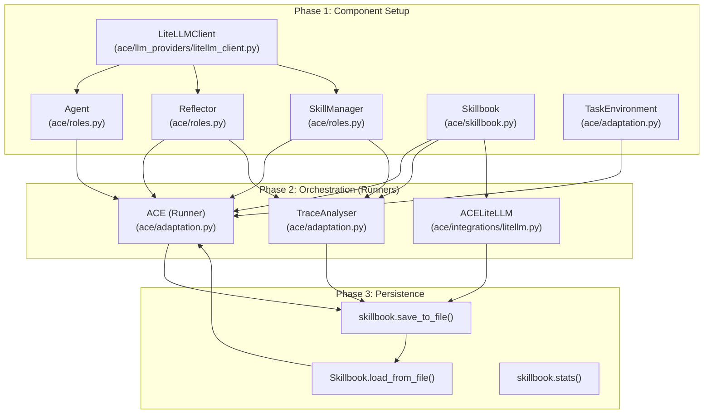
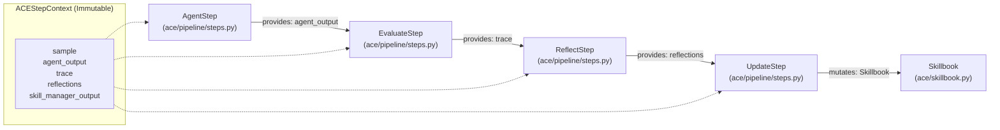

<!-- source: DeepWiki mcp.deepwiki.com · repo kayba-ai/agentic-context-engine · page 6 User Guide · fetched 2026-10-26 -->

# User Guide

<details>
<summary>Relevant source files</summary>

The following files were used as context for generating this wiki page:

- [docs/api/index.md](docs/api/index.md)
- [docs/concepts/skillbook.md](docs/concepts/skillbook.md)
- [docs/concepts/updates.md](docs/concepts/updates.md)
- [docs/design/SKILLBOOK_V2_PLAN.md](docs/design/SKILLBOOK_V2_PLAN.md)
- [docs/guides/composing-pipelines.md](docs/guides/composing-pipelines.md)
- [docs/guides/full-pipeline.md](docs/guides/full-pipeline.md)
- [docs/guides/prompts.md](docs/guides/prompts.md)
- [docs/index.md](docs/index.md)
- [docs/integrations/litellm.md](docs/integrations/litellm.md)
- [docs/integrations/opik.md](docs/integrations/opik.md)
- [docs/pipeline/index.md](docs/pipeline/index.md)
- [examples/pipeline_composition/compose_custom_pipeline.py](examples/pipeline_composition/compose_custom_pipeline.py)

</details>


Practical guides for using ACE in various scenarios and configurations. This guide focuses on hands-on usage patterns for existing ACE components.

**Scope:** This page provides a high-level overview of common workflows. For conceptual background, see [Core Concepts](#2). For installation instructions, see [Installation](#5.1). For detailed API documentation, see [API Reference](#12).

**Sub-topics:**
- [Working with Skillbooks](#6.1) — Creating, saving, loading, and managing skillbooks; understanding skill structure and metadata.
- [Creating Custom Task Environments](#6.2) — Implementing `TaskEnvironment` for custom evaluation logic and feedback generation.
- [Offline Training](#6.3) — Using ACE runner in offline mode for batch training on sample datasets.
- [Online Adaptation](#6.4) — Using ACE runner in online mode for real-time learning from individual tasks.
- [Trace Analysis](#6.5) — Using `TraceAnalyser` runner to learn from pre-recorded execution logs.
- [Prompt Version Management](#6.6) — Selecting prompt versions and using `PromptManager`.

---

## Core Usage Workflow

The typical ACE usage follows a three-phase pattern: component setup, execution with learning (via the pipeline engine), and knowledge persistence.

### Component Relationship Diagram
This diagram bridges the Natural Language Space (Roles) to the Code Entity Space (Classes).


Sources: [ace/roles.py:122-200](), [ace/skillbook.py:204-219](), [ace/adaptation.py:32-45](), [docs/api/index.md:32-48]()

---

## Basic Initialization

### Creating the Three Roles
Each role requires a model identifier (LiteLLM-compatible) and manages a specific part of the learning loop.

```python
from ace import Agent, Reflector, SkillManager

# Roles take a model string directly
agent = Agent("gpt-4o")
reflector = Reflector("gpt-4o-mini") # Use cheaper models for analysis
skill_manager = SkillManager("gpt-4o-mini")
```
Sources: [docs/guides/full-pipeline.md:14-33](), [ace/roles.py:129-131]()

### Initializing a Skillbook
The `Skillbook` is the persistent knowledge store. It uses a v2 schema where skills are categorized into `context` (agent-facing) or `harness` (pipeline-facing) sections.

```python
from ace import Skillbook

skillbook = Skillbook()
# Add a manual skill to bootstrap the agent
skillbook.add_skill(
    section="context",
    issue="Complex math requires decomposition.",
    keywords=["math", "logic"],
    insight="Break the problem into smaller steps."
)
```
Sources: [docs/concepts/skillbook.md:70-90](), [ace/skillbook.py:212-212]()

---

## Adaptation Modes

### Offline Training (Batch)
`ACE.run()` (or `OfflineACE`) is used for batch training over multiple epochs. It iterates through a list of `Sample` objects, evaluating performance via a `TaskEnvironment`.

```python
from ace import ACE, Sample, SimpleEnvironment

runner = ACE.from_roles(
    agent=agent,
    reflector=reflector,
    skill_manager=skill_manager,
    environment=SimpleEnvironment()
)

samples = [Sample(question="2+2?", ground_truth="4")]
results = runner.run(samples, epochs=3)
```
For details, see [Offline Training](#6.3).
Sources: [docs/guides/full-pipeline.md:71-84](), [ace/adaptation.py:52-52]()

### Online Adaptation (Real-time)
Used in production environments where the agent should learn from every interaction. `ACELiteLLM` is the recommended high-level wrapper for this mode.

```python
from ace import ACELiteLLM

agent = ACELiteLLM.from_model("gpt-4o-mini")
answer = agent.ask("How do I solve X?")
# Learning happens in the background via async_boundary
```
For details, see [Online Adaptation](#6.4).
Sources: [docs/integrations/litellm.md:7-17](), [docs/pipeline/index.md:112-129]()

---

## Custom Pipelines and Integrations

ACE is built on a composable pipeline engine. Every runner is a sequence of steps (e.g., `AgentStep`, `EvaluateStep`, `ReflectStep`).

### Pipeline Data Flow Diagram
This diagram shows how data flows between code entities in the `pipeline/` engine.


Sources: [docs/guides/composing-pipelines.md:18-33](), [docs/pipeline/index.md:52-99]()

### Integration Examples
ACE provides ready-made runners for popular frameworks:
- **LangChain:** Wrap chains with `LangChain.from_model(my_chain)`.
- **Browser-Use:** Automate browsers with `BrowserUse.from_model()`.
- **Claude Code:** Enhance coding tasks with `ClaudeCode.from_model()`.

For details on composing custom steps, see [Creating Custom Task Environments](#6.2).
Sources: [docs/api/index.md:59-96](), [docs/guides/composing-pipelines.md:134-154]()

---

## Observability

ACE integrates with **Opik** for tracing and cost tracking. This is enabled via the `OpikStep` or by passing `opik=True` to high-level runners.

```python
ace = ACELiteLLM.from_model("gpt-4o-mini", opik=True, opik_project="my-project")
```
Sources: [docs/integrations/opik.md:1-23](), [docs/integrations/litellm.md:143-156]()

---

