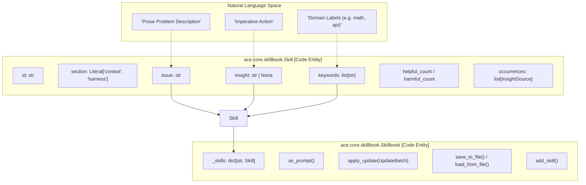
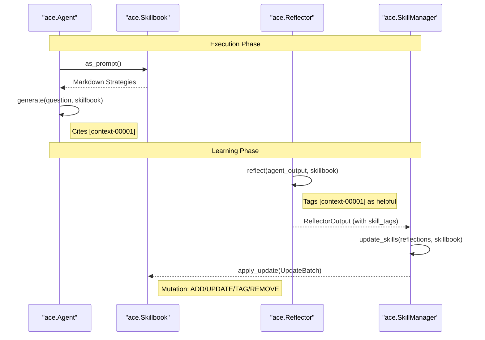

<!-- source: DeepWiki mcp.deepwiki.com · repo kayba-ai/agentic-context-engine · page 6.1 Working with Skillbooks · fetched 2026-10-26 -->

# Working with Skillbooks

<details>
<summary>Relevant source files</summary>

The following files were used as context for generating this wiki page:

- [ace/core/__init__.py](ace/core/__init__.py)
- [ace/core/insight_source.py](ace/core/insight_source.py)
- [ace/core/skillbook.py](ace/core/skillbook.py)
- [docs/api/index.md](docs/api/index.md)
- [docs/concepts/skillbook.md](docs/concepts/skillbook.md)
- [docs/concepts/updates.md](docs/concepts/updates.md)
- [docs/design/SKILLBOOK_V2_PLAN.md](docs/design/SKILLBOOK_V2_PLAN.md)
- [docs/guides/composing-pipelines.md](docs/guides/composing-pipelines.md)
- [docs/guides/prompts.md](docs/guides/prompts.md)
- [tests/test_ace_core.py](tests/test_ace_core.py)

</details>


This page provides practical guidance for creating, managing, and persisting Skillbooks in the ACE Framework. It covers the core operations needed to work with ACE's central knowledge store: creating skillbooks, adding skills, loading/saving to disk, and inspecting contents.

For conceptual understanding of how Skillbooks fit into ACE's architecture, see [Skillbook System](#2.2). For details on how skills are modified through update operations, see [Update Operations](#9.1). For skill metadata and tagging behavior, see [Skill Tagging and Metadata](#9.2).

---

## Skillbook Architecture

The `Skillbook` class serves as ACE's central knowledge repository. As of the v2 schema, it organizes knowledge into two primary sections: `context` (agent-facing instructions) and `harness` (runtime/environment observations).

### Core Components

"Natural Language Space to Code Entity Space"



**Sources:** [ace/core/skillbook.py:15-130](), [docs/design/SKILLBOOK_V2_PLAN.md:18-48](), [docs/concepts/skillbook.md:1-35]()

---

## Creating Skillbooks

### Empty Skillbook

The simplest way to start is with an empty `Skillbook`. By default, it initializes with a `schema_version` of "2".

```python
from ace import Skillbook

# Create empty skillbook
skillbook = Skillbook()

print(f"Skills: {len(skillbook.skills())}")  # 0
stats = skillbook.stats()
print(f"Active Skills: {stats['active_skills']}")
```

### Loading Existing Skillbook

Load previously saved knowledge from a JSON file. If an embeddings sidecar (`.npz`) exists, it is loaded automatically.

```python
from ace import Skillbook

# Load from file
skillbook = Skillbook.load_from_file("strategies.json")

print(f"Loaded {len(skillbook.skills())} skills")
```

**Sources:** [ace/core/skillbook.py:534-555](), [ace/core/skillbook.py:612-632](), [docs/api/index.md:202-221]()

---

## Adding Skills Manually

While skills are typically added via `SkillManager`, manual addition is useful for seeding initial knowledge. In v2, `issue` is always required. `insight` is required for the `context` section.

### Basic Skill Addition

```python
from ace import Skillbook

skillbook = Skillbook()

# Add a context skill
skill = skillbook.add_skill(
    section="context",
    issue="Complex arithmetic is error-prone when done in one step.",
    keywords=["math", "decomposition"],
    insight="Break the problem into smaller steps before computing."
)

print(f"Created skill: {skill.id}") # e.g., context-00001
```

### Skill ID Format

Skills are assigned unique IDs based on their section. The counter increments globally within the skillbook instance.

| Section | ID Format | Example |
|--------------|-----------|---------|
| `context` | `context-XXXXX` | `context-00001` |
| `harness` | `harness-XXXXX` | `harness-00005` |

**Sources:** [ace/core/skillbook.py:346-410](), [tests/test_ace_core.py:28-42](), [docs/concepts/skillbook.md:70-89]()

---

## Retrieving and Inspecting Skills

### Get Specific Skill

```python
# Retrieve by ID
skill = skillbook.get_skill("context-00001")

if skill:
    print(f"Issue: {skill.issue}")
    print(f"Score: +{skill.helpful_count}/-{skill.harmful_count}")
```

### List All Skills

The `.skills()` method returns only active skills by default.

```python
# Get all active skills
active_skills = skillbook.skills()

# Get everything including soft-removed
all_skills = skillbook.skills(include_invalid=True)
```

### Statistics

```python
stats = skillbook.stats()

print(f"Total active: {stats['active_skills']}")
print(f"By section: {stats['by_section']}") # {'context': 1, 'harness': 0}
```

**Sources:** [ace/core/skillbook.py:440-465](), [ace/core/skillbook.py:504-518](), [tests/test_ace_core.py:74-79]()

---

## Saving and Loading

### Save to File

Saving produces two files: the human-readable JSON and a binary `.embeddings.npz` sidecar for fast vector retrieval.

```python
# Save skillbook
skillbook.save_to_file("my_agent.json")
# Creates: my_agent.json AND my_agent.embeddings.npz
```

### Provenance Tracking

Every skill tracks its origin via `occurrences`. When a `SkillManager` updates a skillbook, it attaches an `InsightSource` containing trace IDs and metadata.

```python
skill = skillbook.get_skill("context-00001")
for occurrence in skill.occurrences:
    print(f"Learned from trace: {occurrence.trace_id} (System: {occurrence.source_system})")
```

**Sources:** [ace/core/skillbook.py:586-608](), [ace/core/insight_source.py:108-160](), [docs/concepts/skillbook.md:135-177]()

---

## Prompt Rendering

The `as_prompt()` method converts the skillbook into a Markdown format optimized for LLM consumption. It groups skills by section and includes IDs, keywords, issues, and insights.

### Rendered Format

```markdown
## context
- [context-00001]
  Keywords: math, decomposition
  Issue: Complex arithmetic is error-prone when done in one step.
  Insight: Break the problem into smaller steps before computing.
```

**Sources:** [ace/core/skillbook.py:646-675](), [docs/concepts/skillbook.md:47-66]()

---

## Integration with ACE Roles

"Role Interaction Flow"



### Agent Usage

```python
from ace import Agent, Skillbook

agent = Agent("gpt-4o-mini")
output = agent.generate(
    question="Solve 123 * 456",
    skillbook=skillbook
)
print(f"Citations: {output.skill_ids}")
```

### SkillManager Usage

The `SkillManager` returns an `UpdateBatch` containing `UpdateOperation` objects.

```python
from ace import SkillManager

sm = SkillManager("gpt-4o-mini")
sm_output = sm.update_skills(
    reflections=[reflection],
    skillbook=skillbook,
    source=insight_source # Provenance
)
# Note: SkillManager usually mutates the skillbook via tools, 
# but also returns the batch for tracking.
```

**Sources:** [docs/api/index.md:124-198](), [ace/core/skillbook.py:135-210](), [docs/guides/prompts.md:24-53]()

---

## Deduplication

As skillbooks grow, the `DeduplicationManager` uses embedding similarity to find redundant skills and consolidate them.

```python
from ace import DeduplicationConfig, DeduplicationManager

config = DeduplicationConfig(enabled=True, similarity_threshold=0.85)
manager = DeduplicationManager(config)

# Run deduplication
# manager.deduplicate(skillbook)
```

**Sources:** [docs/concepts/skillbook.md:109-123](), [docs/api/index.md:213-217]()

---

## Best Practices

| Category | Recommendation |
|----------|----------------|
| **Sections** | Use `context` for agent behavior and `harness` for environment issues. |
| **Keywords** | Provide 1-5 stable labels (e.g., `api`, `error-handling`) to aid retrieval. |
| **Persistence** | Always use `save_to_file` to ensure the `.npz` sidecar is updated. |
| **IDs** | Never manually modify skill IDs; let the `Skillbook` generate them. |

**Sources:** [docs/design/SKILLBOOK_V2_PLAN.md:131-140](), [docs/concepts/skillbook.md:68-89]()

---

